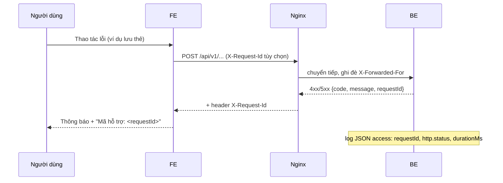

# Báo cáo bàn giao BE → FE — GD4 Kiểm thử & ổn định

| Mục | Giá trị |
|---|---|
| Giai đoạn | GD4 — Kiểm thử & ổn định (30/11 – 06/12/2026, làm sớm 16/11/2026) |
| Ngày bàn giao | 17/11/2026 |
| Trạng thái BE | ✅ B4.1–B4.5 · `mvnw -B test` 544/544 pass (16/11/2026) · thêm B5.1, B5.2b, B5.3 làm sớm |
| FE làm tương ứng | F4.1–F4.4, chuẩn bị F5.1–F5.2 (`roadmap/TienDoDuKien_fronend.md` GĐ4, GĐ5) |
| Báo cáo trước | [SPRINT_3](SPRINT_3_BAO_CAO_BE_BAN_GIAO_CHO_FE.md); hợp đồng chung (lỗi, CSRF, phân trang) xem [SPRINT_1](SPRINT_1_BAO_CAO_BE_BAN_GIAO_CHO_FE.md) |

> **Đọc nhanh:** GD4 **không thêm API**. FE cần: (1) đọc header `X-Request-Id` để hiển thị khi báo lỗi, (2) dùng dữ liệu demo B5.2b cho E2E và kiểm màn hình, (3) build production theo `frontend/Dockerfile` sau Nginx cùng tên miền với `/api`.

---

## 1. BE đã giao gì (đối chiếu 2 roadmap)

| BE bước | Kết quả | FE bước / UI | FE cần làm |
|---|---|---|---|
| B4.1 Phủ TC | ✅ [docs/TRUY_VET_FR_API_TC.md](../docs/TRUY_VET_FR_API_TC.md): FR ↔ API ↔ TC; TC-01…17, 21…24 có test tự động | F4.1 | Dùng bảng truy vết để chọn API cho kịch bản E2E |
| B4.2 Bảo mật | ✅ Swagger tắt ở `prod`, ảnh Docker ghim phiên bản, log không chứa token; `/security-review` không có lỗ hổng mức cao | F4.4 | Kiểm bundle không chứa khóa dịch vụ (FE không cần khóa nào: AI/TTS/thanh toán đều qua BE) |
| B4.3 Hiệu năng TC-20 | ✅ 50 người dùng: p95 ≤ 106 ms, 0 lỗi ([biên bản](../docs/kiem-thu/TC20_BIEN_BAN_HIEU_NANG.md)) | F4.4 | Không cần cache phía FE cho 4 API đo (`/learning/today`, `/decks`, `/library/decks`, `/statistics/overview`) |
| B4.4 Sao lưu TC-19 | ✅ Script sao lưu/khôi phục, thử khôi phục PASS ([biên bản](../docs/kiem-thu/TC19_BIEN_BAN_SAO_LUU_KHOI_PHUC.md)) | — | Không |
| B4.5 Log | ✅ Log JSON ở `prod`, mỗi request `/api` một dòng có `requestId` | F4.3 | Hiện `requestId` trong thông báo lỗi (mục 3) |
| B5.1 Compose prod (sớm) | ✅ `backend/k28/docker-compose.prod.yml`, Nginx, `frontend/Dockerfile` | F5.1 | Kiểm `npm run build` chạy trong Docker; xem mục 2 |
| B5.2b Dữ liệu demo (sớm) | ✅ `scripts/demo/seed_demo.py` | F4.1, F5.2 | Dùng tài khoản mục 7 |
| B5.3 Tài liệu (sớm) | ✅ [docs/api/openapi.json](../docs/api/openapi.json), [huong-dan/](../huong-dan/README.md) | F5.3 | Thêm hướng dẫn sử dụng có ảnh vào `huong-dan/` (phần FE) |

**Chưa có:** B5.4 diễn tập demo (cần FE xong F5.x). Dịch vụ thật OpenAI, Azure Speech, VNPay, Imagen vẫn chạy mô phỏng (`moPhong: true`) đến khi có khóa; client Imagen đã có code (17/11/2026).

## 2. Chạy BE

Dev không đổi, trừ một điểm: `spring-boot:run` **phải** có `-Dspring-boot.run.profiles=dev`. Thiếu profile thì cookie `Secure` (FE ở `http://localhost` không đăng nhập được), Swagger tắt, không có tài khoản mẫu.

Production (F5.1):

| Mục | Giá trị |
|---|---|
| Lệnh | `cd backend/k28 && docker compose --env-file .env.prod -f docker-compose.prod.yml up -d --build` |
| FE | Service `web` build từ `frontend/Dockerfile` (Node 22, `next build`, `next start -p 3000`), biến `NEXT_PUBLIC_API_MOCKING=disabled` cố định trong image |
| Định tuyến | `https://<domain>/api/**` → BE, `https://<domain>/**` → FE, `https://s3.<domain>` → kho tệp (URL ký sẵn upload/tải ảnh, âm thanh) |
| Cookie | `SESSION`, `XSRF-TOKEN` có `Secure`, `SameSite=Lax`, cùng tên miền nên FE gọi `/api` tương đối như dev |

FE kiểm: không gọi thẳng `http://localhost:8080` trong mã; mọi URL tệp lấy từ `url` BE trả về (đã trỏ `s3.<domain>` ở prod).

## 3. Thay đổi hợp đồng chung

Không đổi mã lỗi, cookie hay phân trang. Làm rõ một hợp đồng đã có:

| Header | Chiều | Quy tắc (đã kiểm chứng 17/11/2026) |
|---|---|---|
| `X-Request-Id` | FE → BE (tùy chọn) | 8–64 ký tự `A-Za-z0-9-`; sai định dạng thì BE bỏ qua và tự sinh UUID |
| `X-Request-Id` | BE → FE | Luôn có ở mọi phản hồi; trùng với `requestId` trong body lỗi; CORS đã `expose` |

Phản hồi thật:

```http
HTTP/1.1 401
X-Request-Id: fe-gd4-demo-0001
```
```json
{"code":"UNAUTHENTICATED","message":"Bạn cần đăng nhập để tiếp tục","fieldErrors":[],"requestId":"fe-gd4-demo-0001"}
```

Gửi `X-Request-Id: bad id!` → `200`, header trả `X-Request-Id: ad2ee78c-aff3-41df-b3cf-df306a29f131` (BE tự sinh).

### Bổ sung B3.13 (20/11/2026)

| API | Quyền | Phản hồi |
|---|---|---|
| `GET /api/v1/library/highlights` | Guest | `{tuLuc, denLuc, yeuThichTuan[], yeuThichNhieuNhat[], dongGopTuan[]}`; mục bộ = `{boThe: LibraryDeckResponse, soYeuThich}`; mục người = `{chuSoHuuId, tenTacGia, soBoCongKhai, soYeuThich, soSaoChep}`; mỗi mảng ≤ 5 |
| `GET /api/v1/announcements` | Đăng nhập | `[{id, tieuDe, noiDung, mucDo, lienKet, batDauAt, ketThucAt}]` ≤ 5, `QUAN_TRONG` trước |
| `GET /api/v1/admin/announcements?page&size` | ADMIN | `PageResponse` có thêm `hienThi, version, createdAt, updatedAt` |
| `POST /api/v1/admin/announcements` | ADMIN | 201; body `{tieuDe, noiDung, mucDo, lienKet?, batDauAt, ketThucAt?, hienThi}` |
| `PUT /api/v1/admin/announcements/{id}` | ADMIN | 200; body như POST + `version`; `version` cũ → 409; `ketThucAt <= batDauAt` → 400; `lienKet` ngoài → 400 |
| `DELETE /api/v1/admin/announcements/{id}` | ADMIN | 204; không có → 404 |

FE đã làm: `components/dashboard/DashboardHighlights.js` — `AnnouncementBanner` ("Bảng tin", nút ẩn lưu `localStorage` qua `useSyncExternalStore`) và `CommunitySection` (khối rộng hết trang dưới cột chính, 21/11/2026) gắn vào `/hom-nay`; trang `/quan-tri/thong-bao` và mục menu Quản trị.

## 4. Luồng chính



## 5. API chi tiết (đã kiểm chứng trên BE thật)

GD4 không thêm hoặc đổi API. Danh sách đầy đủ 132 thao tác: [docs/api/openapi.json](../docs/api/openapi.json) (xuất từ `/v3/api-docs` 16/11/2026). API theo màn hình: báo cáo SPRINT_1…3.

## 6. Mã FE mẫu

Hiện mã hỗ trợ trong thông báo lỗi (dùng trong `src/lib/api-client.js`):

```js
export function supportCode(error, response) {
  return error?.requestId || response?.headers?.get('X-Request-Id') || null;
}
```

Kịch bản E2E (F4.1) đăng nhập bằng tài khoản mục 7, giữ cookie qua `storageState`; trước mỗi lượt chạy E2E, chạy lại `seed_demo.py` trên DB sạch để dữ liệu ổn định.

## 7. Dữ liệu mẫu / tài khoản demo

Server profile `dev`, DB mới, rồi:

```bash
cd backend/k28
python scripts/demo/seed_demo.py http://localhost:8080
docker exec -i vocab-mysql-1 sh -c 'mysql -uroot -p"$MYSQL_ROOT_PASSWORD" vocab_learn' < scripts/demo/make_overdue.sql
```

Mật khẩu chung `Vocab@12345`.

| Tài khoản | Gói | Màn hình nên thử |
|---|---|---|
| `admin@vocab.local` | Admin | UI49 kiểm duyệt (báo cáo của An), UI51 dịch vụ (ca ảnh AI lỗi của Chi), UI58/UI59 doanh thu (thêm profile `demo`) |
| `an@vocab.local` | `PRO` | UI12 bảng điều khiển, UI19 phiên học, sổ tay từ khó, cặp dễ nhầm, UI29 xưởng thẻ AI (bản nháp đang chờ lưu) |
| `binh@vocab.local` | `PREMIUM` | Kế hoạch hôm nay với thẻ quá hạn, cứu lịch ôn (TC-10) |
| `chi@vocab.local` | `PRO` | Lịch sử AI có một yêu cầu ảnh lỗi, lịch sử luyện tập |

Kiểm gói hết hạn/402 (UI55, banner `AppShell`): làm theo `backend/k28/scripts/smoke_billing_expiry.py` (tạo User mới, Admin rút hạn rồi chạy kiểm tra hết hạn).

## 8. Checklist FE hoàn thành GD4

- [ ] F4.1 Playwright chạy kịch bản TK §20.2 bước 1–4, 8 với tài khoản mục 7, xanh trên DB sạch
- [ ] F4.2 360px, điều hướng bàn phím, focus thấy được, tương phản, `prefers-reduced-motion` (TC-18)
- [ ] F4.3 Mạng chậm/API lỗi: kết quả ôn đã gửi không mất, nút thử lại rõ, thông báo lỗi có mã hỗ trợ `requestId`
- [ ] F4.4 Lighthouse, kích thước bundle; không có khóa dịch vụ hay URL `localhost:8080` cố định trong bundle
- [ ] F5.1 (chuẩn bị) `docker build frontend` thành công

## 9. Sắp có

| Việc | Khi nào | Ảnh hưởng FE |
|---|---|---|
| B5.4 diễn tập demo 10 bước | Sau F5.1–F5.3 | FE cùng diễn tập |
| OpenAI/Azure/VNPay thật | Khi có khóa | Kết quả bỏ nhãn "Mô phỏng" (`moPhong: false`); hợp đồng API không đổi |
| Ảnh Imagen thật | Khi có `GOOGLE_AI_API_KEY` (code xong 17/11/2026) | `POST /ai/card-images` giữ nguyên hợp đồng; ảnh thật PNG 512×512, `moPhong: false` |

## 10. Lưu ý và kiểm chứng

| Hạng mục | Kiểm chứng | Môi trường |
|---|---|---|
| Toàn bộ test BE | `mvnw -B test` 549/549 pass (gồm client Imagen) | Testcontainers, 17/11/2026 |
| `X-Request-Id` | 2 request thật ở mục 3 | Dev 8081, profile `dev`, 17/11/2026 |
| Log JSON `requestId` | Dòng log thật `"requestId":"b45-json-log-check-03"` | Server tạm bật ECS, 16/11/2026 |
| TC-20, TC-19 | Biên bản ở `docs/kiem-thu/` | Dev, 16/11/2026 |
| `docker-compose.prod.yml` | Chỉ `docker compose config` hợp lệ | **Chưa** dựng trên máy chủ thật; `frontend/Dockerfile` **chưa** build thử |
| Dữ liệu demo | `seed_demo.py` chạy trên DB dev; luồng của An thử lại trên tài khoản chưa luyện: 1 cặp dễ nhầm, sổ tay 21 từ | Dev 8081, 17/11/2026 |

Thay đổi BE ảnh hưởng dev: `R__seed_dev.sql` chuyển từ `db/seed` sang `db/dev` (tài khoản mẫu chỉ nạp ở `dev`/`demo`); DB dev cũ không cần làm gì.

## 11. Liên kết

- Roadmap: [TienDoDuKien_backend.md](../roadmap/TienDoDuKien_backend.md) GĐ4, GĐ5
- Hướng dẫn: [huong-dan/](../huong-dan/README.md)
- Hạn chế đã biết: [04_HAN_CHE_DA_BIET.md](../huong-dan/04_HAN_CHE_DA_BIET.md)
- Gắn khóa dịch vụ thật: [05_KHOA_DICH_VU.md](../huong-dan/05_KHOA_DICH_VU.md)
