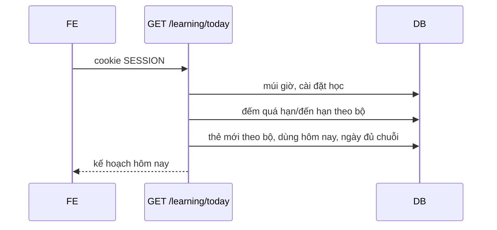

# Báo cáo bàn giao BE → FE — DOT2 Học, luyện tập, thống kê & quản trị

| Mục | Giá trị |
|---|---|
| Giai đoạn | Đợt 2 — Học, luyện tập, thống kê & quản trị (26/10 – 08/11/2026) |
| Ngày cập nhật | 26/10/2026 — B2.3 |
| Trạng thái BE | 🟡 B2.1 xong (không API). B2.2 xong theo test: người dùng chạy `StreakCalculatorTest` và `FR06TodayPlanTest` ngày 19/10 và báo không lỗi (không ghi số lượng); **chưa gọi HTTP thật**; Postman đã có request, chưa chạy. B2.3 xong theo test: `FR06StudySessionTest` 8 test pass khi chạy ngày 26/10 cùng `FR06TodayPlanTest`, `StreakCalculatorTest`, `FR06SrsCalculatorTest` (40 test, BUILD SUCCESS); chưa chạy bộ test đầy đủ, chưa gọi HTTP thật bằng `curl`; Postman đã có request, chưa chạy. B2.4–B2.11 chưa làm |
| FE làm tương ứng | F2.1, F2.2 phần chọn phiên (`roadmap/TienDoDuKien_fronend.md`), UI12 `/hom-nay`, UI18 `/hoc` |
| Báo cáo trước | [Đợt 1](SPRINT_1_BAO_CAO_BE_BAN_GIAO_CHO_FE.md) — hợp đồng chung (lỗi `{code,message,fieldErrors,requestId}`, CSRF, phân trang, ID dạng chuỗi, cookie `SESSION`) xem ở đó |

> **Đọc nhanh:**
> - Báo cáo này có 3 API: `GET /api/v1/learning/today` (mục 5.1), `POST /api/v1/learning/sessions` và `GET /api/v1/learning/sessions/{id}` (mục 5.2, 5.3). Các phần còn lại của Đợt 2 chưa có API: trang gọi BE thật sẽ nhận 404 (MSW chỉ còn mock `GET /public/ping`, không còn handler cho Đợt 2).
> - Hợp đồng ở mục 5 là **contract từ code**, test BE đã chạy (MockMvc) nhưng chưa gọi HTTP thật nên JSON mẫu chưa phải response thật (mục 10).
> - Phần lớn số liệu bằng 0 cho đến khi B2.4 (ghi kết quả ôn) hoàn tất, vì chưa có API nào ghi `tien_do_the` và `su_dung_hoc_ngay`.

---

## 1. BE đã giao gì (đối chiếu 2 roadmap)

| BE bước | Kết quả | FE bước / UI | FE cần làm |
|---|---|---|---|
| B2.1 Bộ tính SRS thuần | ✅ `SrsCalculator` (`SM2-VN-1`), 28 test theo roadmap; không API | — | Không có việc cho FE |
| B2.2 Kế hoạch hôm nay | ✅ `GET /learning/today`, test BE đã chạy (người dùng xác nhận); chưa HTTP thật | F2.1 UI12 `/hom-nay` | Nối theo mục 5.1; ẩn khối cứu lịch ôn |
| B2.3 Tạo phiên học | ✅ `POST /learning/sessions`, `GET /learning/sessions/{id}`; `FR06StudySessionTest` 8 test pass; chưa HTTP thật | F2.2 UI18 `/hoc` (UI19 cần thêm B2.4) | Nối theo mục 5.2, 5.3; chưa có `cheDo`, `duKien` |

**Chưa có** (BE chưa có endpoint, FE gọi sẽ 404): ghi kết quả ôn (B2.4), kết thúc phiên/lịch sử/tạm ngưng/đặt lại (B2.5), cứu lịch ôn và query `phut`, `giuTuMoi` (B2.6), luyện tập (B2.7–B2.8), sổ tay (B2.9), thống kê (B2.10), quản trị (B2.11).

## 2. Chạy BE

Không có dịch vụ, biến môi trường hay dữ liệu mẫu mới. Windows cần `JAVA_TOOL_OPTIONS=-Djdk.net.unixdomain.tmpdir=C:\Users\Public` khi chạy test (Netty/Redis loopback). Chạy API từ `backend/k28/` bằng `.\mvnw.cmd spring-boot:run`; sửa code rồi `.\mvnw.cmd -q -DskipTests compile` để DevTools tự khởi động lại.

## 3. Thay đổi hợp đồng chung

Không thay đổi. Không có mã lỗi mới. Điều kiện: ID trong `boThe[]` dạng chuỗi, tên field trùng tên entity/mockup (tiếng Việt không dấu).

## 4. Luồng chính



Chi tiết: [luồng B2.2](../docs/luong-backend/B2.2-ke-hoach-hom-nay.md).

## 5. API chi tiết

### 5.1 `GET /api/v1/learning/today` — kế hoạch hôm nay

| Quyền | FE bước | UI | Trang |
|---|---|---|---|
| L (đăng nhập) | F2.1 | UI12 | `/hom-nay` |

**Gửi:** không có query hay body ở B2.2 (`phut`, `giuTuMoi` thuộc B2.6).

**Nhận** (contract từ code; số liệu minh họa, **không phải response thật**)

```http
HTTP/1.1 200
Content-Type: application/json
```
```json
{
  "ngay": "2026-10-19",
  "soQuaHan": 2,
  "soDenHan": 1,
  "soTheMoiDaHoc": 0,
  "tuMoiMoiNgay": 10,
  "soMoiConLai": 2,
  "giayMoiLuot": 20,
  "uocTinhPhut": 2,
  "phutMoiNgay": 10,
  "chuoiNgay": 0,
  "homNayDaTinhChuoi": false,
  "luotToiThieuChuoi": 5,
  "daHocHomNay": { "soLuot": 0, "soPhut": 0 },
  "tongSoThe": 5,
  "boThe": [
    { "boTheId": "12", "ten": "Từ vựng văn phòng", "soCanOn": 3, "soMoi": 2 }
  ]
}
```

| Trường | Ý nghĩa |
|---|---|
| `ngay` | Ngày địa phương theo múi giờ của người dùng |
| `soQuaHan` | Lượt (hàng tiến độ) có hạn trước đầu ngày; một thẻ hai chiều có thể tính 2 |
| `soDenHan` | Lượt có hạn trong ngày, kể cả chưa tới giờ; có thể lớn hơn số thẻ vào hàng đợi lúc đó |
| `soTheMoiDaHoc`, `tuMoiMoiNgay`, `soMoiConLai` | Hạn mức từ mới (thẻ vật lý, không nhân đôi hai chiều); `soMoiConLai` không âm |
| `giayMoiLuot`, `uocTinhPhut` | Ước tính cố định 20 giây/lượt; hiển thị là "ước tính" |
| `phutMoiNgay` | Mục tiêu phút từ thiết lập học |
| `chuoiNgay`, `homNayDaTinhChuoi`, `luotToiThieuChuoi` | Ngày liên tiếp có ≥5 lượt hợp lệ; hôm nay chưa đủ thì chuỗi tính từ hôm qua |
| `daHocHomNay` | `soLuot` thật; `soPhut` là ước tính từ số lượt |
| `tongSoThe` | 0 → hiện màn hình chưa có thẻ nào |
| `boThe[]` | Mọi bộ chưa xóa của người dùng (kể cả bộ rỗng), sắp theo tên; `soCanOn` = quá hạn + đến hạn của bộ; `soMoi` không bị cắt theo hạn mức |

Không có `cuuLichOn`; FE coi là `undefined` đến hết B2.6.

**Lỗi**

| HTTP | `code` | Khi nào | FE xử lý |
|---|---|---|---|
| 401 | `UNAUTHENTICATED` | Chưa đăng nhập hoặc phiên hết hạn | Chuyển `/dang-nhap` |

**Tác dụng phụ:** lần gọi đầu có thể tạo hồ sơ học tập mặc định (10 phút, 10 từ mới/ngày) nếu người dùng chưa có.

### 5.2 `POST /api/v1/learning/sessions` — tạo phiên học

| Quyền | FE bước | UI | Trang |
|---|---|---|---|
| L (đăng nhập, cần CSRF) | F2.2 | UI18 | `/hoc` |

**Gửi**

```json
{ "boTheId": "12", "chieuHoc": "EN_VI", "quyThoiGian": 10 }
```

| Field | Quy tắc |
|---|---|
| `boTheId` | Tùy chọn, chuỗi số. Bỏ qua hoặc `null` = tất cả bộ của tôi. Bộ phải của người dùng và chưa xóa |
| `chieuHoc` | Bắt buộc: `EN_VI` hoặc `VI_EN` |
| `quyThoiGian` | Bắt buộc: 5, 10 hoặc 20 (phút). Tối đa `quyThoiGian×60/20` thẻ (15/30/60) |

Không có `cheDo` (thuộc B2.6): nếu FE gửi thì BE bỏ qua.

**Nhận** (201, header `Location: /api/v1/learning/sessions/{id}`; contract từ code, số liệu minh họa)

```json
{
  "id": "7",
  "boTheId": "12",
  "boTheTen": "Từ vựng văn phòng",
  "chieuHoc": "EN_VI",
  "quyThoiGian": 10,
  "batDauAt": "2026-10-26T03:00:00Z",
  "hetGioAt": "2026-10-26T03:10:00Z",
  "ketThucAt": null,
  "trangThai": "DANG_HOC",
  "muiGio": "Asia/Ho_Chi_Minh",
  "hangDoi": [
    {
      "theId": "101",
      "thuTu": 1,
      "trangThai": "CHUA_TRA_LOI",
      "tienDo": { "trangThai": "HOC_LAI", "buocHoc": 0, "ef": 2.5, "khoangOnNgay": 0, "chuoiThanhCong": 0, "soLanQuen": 1, "hanOnAt": "2026-10-26T02:50:00Z", "version": 3 },
      "the": { "id": "101", "boTheId": "12", "tu": "invoice", "tuLoai": "noun", "phienAm": "/ˈɪnvɔɪs/", "nghiaVi": "hóa đơn", "viDuEn": null, "dichVi": null, "anhId": null, "amTuId": "55", "amCauId": null, "version": 0 }
    }
  ]
}
```

| Trường | Ý nghĩa |
|---|---|
| `hetGioAt` | Tính ra `batDauAt + quyThoiGian` phút, không lưu |
| `boTheTen` | Tên bộ; `boTheId` null thì là "Tất cả bộ của tôi" |
| `hangDoi[]` | Bản chụp hàng đợi lúc tạo, theo `thuTu`. Thứ tự ưu tiên: bước học lại đến hạn → ôn đến hạn → thẻ mới trong hạn mức → chiều còn lại của thẻ đã học (không tốn hạn mức) |
| `hangDoi[].trangThai` | `CHUA_TRA_LOI` hoặc `DA_TRA_LOI` |
| `hangDoi[].tienDo` | Tiến độ của chiều đang học. Thẻ chưa có hàng tiến độ: `MOI`, `ef` 2.5, `version` 0, `hanOnAt` null |
| `hangDoi[].tienDo.version` | Dùng làm `expectedVersion` ở B2.4 |
| `hangDoi[].the` | Nội dung thẻ. Media là ID tệp (`anhId`, `amTuId`, `amCauId`), tải qua `/files/{id}`; không có URL. Thẻ bị xóa sau khi tạo phiên: `the = null` |

**Lỗi**

| HTTP | `code` | Khi nào | FE xử lý |
|---|---|---|---|
| 400 | `VALIDATION_FAILED` | `chieuHoc`/`quyThoiGian` thiếu hoặc sai, `boTheId` không phải số; `fieldErrors[].field` là tên field | Hiện lỗi tại field |
| 401 | `UNAUTHENTICATED` | Chưa đăng nhập | Chuyển `/dang-nhap` |
| 404 | `NOT_FOUND` | `boTheId` không tồn tại, đã xóa hoặc của người khác | Báo bộ không còn, tải lại `GET /learning/today` |
| 422 | `BUSINESS_RULE` | Hàng đợi rỗng (không có thẻ đến hạn và hết hạn mức mới hoặc không còn thẻ mới). Không lưu phiên | Hiện thông báo của BE, gợi ý quay lại `/hom-nay` |

**Tác dụng phụ:** tạo `phien_hoc` + `phien_hoc_the`; lần gọi đầu có thể tạo hồ sơ học tập mặc định. Không trừ hạn mức từ mới (B2.4 làm).

### 5.3 `GET /api/v1/learning/sessions/{id}` — xem lại phiên

| Quyền | FE bước | UI | Trang |
|---|---|---|---|
| L (chủ phiên) | F2.2 | UI19 | `/hoc/[sessionId]` |

Response cùng dạng mục 5.2 (200). `hangDoi` đọc từ bản chụp, không tính lại. Phiên không tồn tại hoặc của người khác: 404 `NOT_FOUND`.

## 6. Mã FE mẫu

- Zod schema: các field ở mục 5.1; `boThe[].boTheId` là `z.string()`, `cuuLichOn` là `.optional()`.
- Phiên học: `chieuHoc` là `z.enum(['EN_VI','VI_EN'])`, `hangDoi[].the` là `.nullable()`, `tienDo.hanOnAt` là `z.string().nullable()`, `ketThucAt` nullable.
- Hook: `useQuery({ queryKey: ['learning','today'], queryFn: () => api('/learning/today') })`; làm mới sau khi kết thúc phiên (B2.5).
- Không còn MSW cho Đợt 2: dùng JSON minh họa ở mục 5.1 làm mẫu; `/hom-nay` đọc API thật khi F2.1 được nối.

## 7. Dữ liệu mẫu / tài khoản demo

Chưa có seed cho tiến độ thẻ. Đến B2.4 mới tạo được `tien_do_the` qua API; trước đó người dùng mới luôn thấy `soQuaHan=0`, `soDenHan=0`, `chuoiNgay=0`.

## 8. Checklist FE hoàn thành Đợt 2 (phần B2.2)

- [ ] F2.1 `/hom-nay` đọc `GET /learning/today` thật, không còn MSW
- [ ] Hiển thị hai nhãn "Quá hạn" và "Đến hạn hôm nay" đúng ngữ nghĩa mục 5.1
- [ ] `tongSoThe = 0` hiện trạng thái chưa có thẻ; `soCanOn + soMoiConLai = 0` hiện "không còn thẻ nào hôm nay"
- [ ] Chuỗi ngày dùng `homNayDaTinhChuoi` và `luotToiThieuChuoi`, không hard-code số 5
- [ ] Khối cứu lịch ôn ẩn khi không có `cuuLichOn`
- [ ] F2.2 `/hoc` gửi `POST /learning/sessions` không kèm `cheDo`; 422 hiện thông báo của BE; số lượt gợi ý tính từ `giayMoiLuot` (15/30/60), không ghi cứng 15 giây
- [ ] Trang học bỏ qua `duKien` (chưa có) và đọc media bằng ID tệp

## 9. Sắp có ở Đợt 2 — hợp đồng dự kiến

| BE bước | Dự kiến có | API | FE bước | UI |
|---|---|---|---|---|
| B2.4 | Ghi kết quả ôn | `POST /learning/sessions/{id}/reviews` | F2.3 | UI19 |
| B2.5 | Kết thúc phiên, lịch sử | `POST .../finish`, `GET /learning/history`, `GET /decks/{id}/progress`, `PUT /cards/{id}/progress/suspend`, `POST /cards/{id}/progress/reset` | F2.3 | UI20, UI21 |
| B2.6 | Cứu lịch ôn | Thêm `cuuLichOn` và query `phut`, `giuTuMoi` vào `/learning/today` | F2.4 | UI22 |

Hợp đồng dự kiến theo TK §13 và roadmap; chưa phải đã triển khai.

## 10. Lưu ý / giới hạn / chưa kiểm chứng

| Mục | Chi tiết |
|---|---|
| Kiểm chứng B2.2 | `StreakCalculatorTest` và `FR06TodayPlanTest` đã được người dùng chạy ngày 19/10/2026, báo không lỗi; không có số lượng test hay log đính kèm. Ngày 26/10 chạy lại: `FR06TodayPlanTest` 6 test, `StreakCalculatorTest` 6 test pass |
| Kiểm chứng B2.3 | Ngày 26/10/2026 chạy `mvnw test -Dtest='FR06StudySessionTest,FR06TodayPlanTest,StreakCalculatorTest,FR06SrsCalculatorTest'` (JAVA_TOOL_OPTIONS đặt như mục 2): `FR06StudySessionTest` 8/8 pass (thứ tự hàng đợi, giới hạn theo quỹ thời gian, hạn mức mới, nửa đêm giờ địa phương, chiều còn lại, thẻ/bộ xóa/tạm ngưng/người khác, endpoint 201/404/401/400/422). Tổng 40 test pass. Chưa chạy bộ test đầy đủ, chưa gọi HTTP thật bằng `curl`, request Postman chưa chạy |
| Quyết định nghiệp vụ đề xuất | 20 giây/lượt (hằng); chuỗi theo ngày ≥5 lượt thay vì theo phiên (TK §15.1 chưa chốt); `daHocHomNay.soPhut` ước tính. Có thể đổi khi B2.3/B2.5 và Đợt 3 hoàn tất |
| "Đến hạn hôm nay" ≠ hàng đợi | Gồm cả thẻ hạn muộn hơn giờ hiện tại trong ngày; hàng đợi B2.3 lấy `han_on_at <= now`. FE không dùng `soDenHan` làm số thẻ chắc chắn học được ngay |
| Mockup | Đã rà 19/10: `mockups/dot2/hom-nay.html` đọc đúng tên field, hiển thị đúng và console không lỗi; `demo.js` đã bỏ `muiGio`, `laUocTinh`. Lệch còn lại của demo: 15 giây/lượt (BE 20, trang đọc `giayMoiLuot`), `soPhut` đo thật còn BE ước tính, demo không liệt kê bộ rỗng, demo có `cuuLichOn` (B2.6). `demo.js` đã đổi sang 20 giây/lượt, `hoc.html` đã sửa gợi ý 15/30/60 lượt (26/10) |
| Postman | Thư mục "03 Học tập" của "VocabLearning API" có 4 request, đều có test script, **chưa chạy**: `Kế hoạch hôm nay (B2.2 · FR-06)`, `Tạo phiên học (B2.3 · FR-06)` (lưu `sessionId`), `Xem phiên học (B2.3 · FR-06)`, `Tạo phiên học quỹ thời gian sai → 400 (B2.3 · FR-06)`. Cần đăng nhập trước bằng request thư mục 01 và có ít nhất một thẻ đến hạn hoặc thẻ mới (nếu không sẽ 422). Biến `sessionId` được test script tự tạo khi chạy, chưa khai báo trong hai environment |
| Đổi múi giờ | Ngày cũ trong `su_dung_hoc_ngay` giữ ngày địa phương lúc ghi, không viết lại |
| Chuỗi | Chỉ xét tối đa 1000 ngày gần nhất |
| Hợp đồng B2.3 so với mockup (đối chiếu 19/10, BE đã làm 26/10) | Mockup đã sửa theo BE: `trangThai` dòng hàng đợi `CHUA_TRA_LOI`/`DA_TRA_LOI` (trước là `CHO`/`DA_ON`), `the` trả `anhId`/`amTuId`/`amCauId` (trước là `anhUrl`/`amThanhUrl`; `hoc-phien.html` tạo URL qua `fileUrl()`), 20 giây/lượt, `hoc.html` không gửi `cheDo`. **Còn lệch có chủ đích:** demo còn `cheDo`/`CUU_LICH` (B2.6) và `duKien` (BE chưa có). `tienDo` của demo (`progressView`) đã có cùng các field với BE. Mockup chưa được mở lại trên trình duyệt sau khi sửa (cổng 5173 bị chặn), chỉ kiểm cú pháp `demo.js` và script của `hoc-phien.html` bằng `node` |
| Thẻ học lại trong phiên | Mockup đẩy thẻ lại cuối hàng đợi (`laiTrongPhien`); V8 có unique `(phien_id, the_id, chieu_hoc)`; đã chốt tái dùng dòng cũ (đặt lại `CHUA_TRA_LOI`, `thu_tu` = cuối hàng đợi), không migration, thực hiện ở B2.4 |
| Ngoại lệ module | Truy vấn của `learning` join entity `content` (chỉ đọc); đã ghi vào conventions |

## 11. Báo lỗi cho BE

Gửi đường dẫn API + body + `requestId`; BE tra log theo `requestId`.
