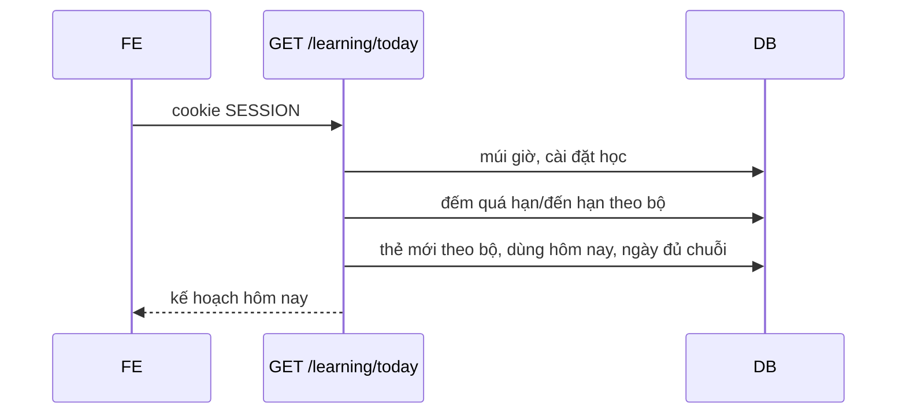
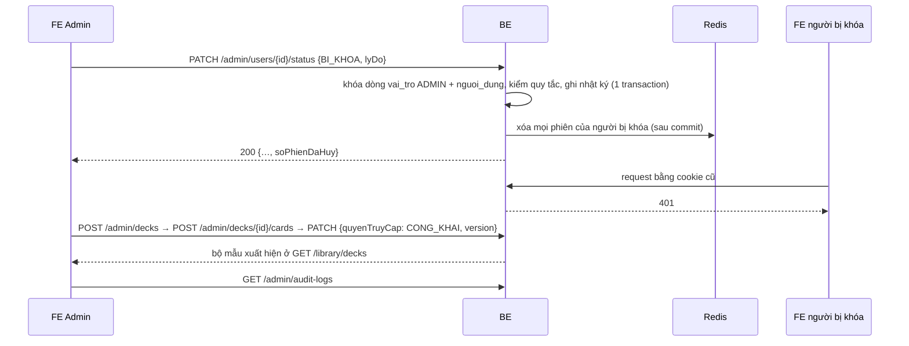

# Báo cáo bàn giao BE → FE — DOT2 Học, luyện tập, thống kê & quản trị

| Mục | Giá trị |
|---|---|
| Giai đoạn | Đợt 2 — Học, luyện tập, thống kê & quản trị (26/10 – 08/11/2026) |
| Ngày cập nhật | 06/11/2026 — thêm `GET /practice/sessions/{id}/questions/{cauHoiId}/audio` cho câu nghe viết (mục 5.8, sửa RS-060), bộ test đầy đủ 404/404 pass; nay 34 route. 04/11/2026 — rà lại `/fe-report`: 33 route Đợt 2 trong controller khớp mục 5, không đổi hợp đồng; bỏ câu cũ "B2.9–B2.11 chưa làm"; vẫn chưa HTTP thật (mục 10). 03/11/2026 — B2.11 quản trị nền (mục 5.12), bộ test đầy đủ 403/403 pass; trước đó cùng ngày B2.10 thống kê nền (mục 5.11), bộ test đầy đủ 394/394 pass; trước đó cùng ngày B2.9 (mục 5.10), B2.8 nộp bài, chấm, lịch sử, luyện lại (mục 5.9), bộ test đầy đủ 382/382 pass; trước đó cùng ngày sửa theo rà soát (RS-002, RS-005, RS-007, RS-008, RS-011, RS-016, RS-017, RS-025, RS-046, RS-050, RS-064, RS-065): bộ test đầy đủ 363/363 pass; trước đó 31/10/2026 — B2.7 (mục 5.8), B2.12 (mục 5.7), B2.6 (mục 5.6); 28/10/2026 — B2.5 (mục 5.5) |
| Trạng thái BE | 🟢 B2.1–B2.12 xong theo test: **bộ test đầy đủ `./mvnw -B test` 404/404 pass ngày 06/11/2026** sau khi thêm API âm thanh câu nghe viết (`FR07PracticeSessionTest` 5). Trước đó: **bộ test đầy đủ `./mvnw -B test` 403/403 pass ngày 03/11/2026 sau B2.11** (thêm `FR13AdminTest` 9). Trước đó: **bộ test đầy đủ `./mvnw -B test` 394/394 pass ngày 03/11/2026 sau B2.10** (thêm `FR11StatisticsTest` 5, `MasteryCalculatorTest` 3). Trước đó: **bộ test đầy đủ `./mvnw -B test` 382/382 pass ngày 03/11/2026 sau B2.8** (thêm `FR07SubmissionTest` 4, `PracticeGraderTest` 11, `AnswerNormalizerTest` 4); lần trước 363/363 (gồm `FR06StudySessionTest` 8, `FR06ReviewTest` 12, `FR06FinishHistoryTest` 4, `FR06ProgressTest` 6, `FR06RescuePlanTest` 5, `FR06DashboardTest` 7, `FR06TodayPlanTest` 6, `FR06QueueQueryTest` 4, `FR06SrsCalculatorTest` 35, `RescuePlanTest` 3, `StreakCalculatorTest` 6, `FR07PracticeSessionTest` 4, `PracticeGeneratorTest` 3). **HTTP thật (07/11/2026):** stack Docker chạy lại, `ping` 200, `/actuator/health` UP; mới gọi `curl` cho 5 ca lỗi thống kê, chưa chạy Postman runner cho cả Đợt 2. Lịch sử từng lần chạy ở mục 10 |
| FE làm tương ứng | F2.1–F2.8 (`roadmap/TienDoDuKien_fronend.md`): UI12 `/hom-nay` (kèm UI22), UI18–UI21 học, UI23–UI26 luyện tập, UI27 `/so-tay`, UI35 `/thong-ke`, UI47 `/quan-tri/tai-khoan`, UI49 `/quan-tri/bo-mau`, UI53 `/quan-tri/nhat-ky` |
| Báo cáo trước | [Đợt 1](SPRINT_1_BAO_CAO_BE_BAN_GIAO_CHO_FE.md) — hợp đồng chung (lỗi `{code,message,fieldErrors,requestId}`, CSRF, phân trang, ID dạng chuỗi, cookie `SESSION`) xem ở đó |

> **Đọc nhanh:**
> - Báo cáo này có **34 API** (33 API đến 03/11 + `GET /practice/sessions/{id}/questions/{cauHoiId}/audio` thêm 06/11, mục 5.8) (tiền tố `/api/v1`): 13 API quản trị (5.12, B2.11); `GET /statistics/overview`, `GET /statistics/skills` (5.11, B2.10); `GET /notebook`, `PUT /notebook/{cardId}`, `DELETE /notebook/{cardId}`, `GET /learning/confusing-pairs` (5.10, B2.9); `POST /practice/sessions/{id}/submissions`, `GET /practice/history`, `POST /practice/mistakes/retry` (5.9, B2.8); `GET /learning/today` (5.1, mở rộng ở 5.6, 5.7); `POST /learning/sessions`, `GET /learning/sessions/{id}` (5.2, 5.3); `POST /learning/sessions/{id}/reviews` (5.4); `POST /learning/sessions/{id}/finish`, `GET /learning/history`, `GET /decks/{id}/progress`, `PUT /cards/{id}/progress/suspend`, `POST /cards/{id}/progress/reset` (5.5); `POST /practice/sessions`, `GET /practice/sessions/{id}` (5.8).
> - B2.9 (03/11) thêm sổ tay và cặp nhầm: `GET /notebook`, `PUT/DELETE /notebook/{cardId}`, `GET /learning/confusing-pairs` (mục 5.10); `nguon = SO_TAY` của `POST /practice/sessions` dùng sổ tay suy ra; migration `V13__so_tay_an_tu.sql`.
> - B2.10 (03/11) thêm `GET /statistics/overview` (tổng quan theo khoảng ngày, `theoNgay` cho khối "Hoạt động 7 ngày" UI12) và `GET /statistics/skills` (mức làm chủ theo kỹ năng) (mục 5.11); không migration.
> - B2.11 (03/11) thêm quản trị nền: tài khoản, vai trò, bộ/thẻ mẫu, nhật ký (mục 5.12); migration `V14__admin.sql`. MSW chỉ còn mock `GET /public/ping`.
> - Hợp đồng ở mục 5 là **contract từ code**, test BE đã chạy (MockMvc) nhưng chưa gọi HTTP thật nên JSON mẫu chưa phải response thật (mục 10).
> - B2.6 (31/10) không thêm route: `GET /learning/today` nhận `phut`, `giuTuMoi` và trả `cuuLichOn`; `POST /learning/sessions` nhận `cheDo`, phiên trả `cheDo` (mục 5.6).
> - B2.7 (31/10) thêm `POST /api/v1/practice/sessions`, `GET /api/v1/practice/sessions/{id}` (mục 5.8).
> - B2.8 (03/11) thêm nộp bài/chấm, lịch sử, luyện lại (mục 5.9); `GET /practice/sessions/{id}` thêm `laLuyenLai`, `baiGocId`, `daNop`, `lanLamId`, `ketQua`; `daHocHomNay.thoiGian` của `/learning/today` cộng thời gian bài luyện đã nộp hôm nay.
> - B2.12 (31/10) không thêm route: `GET /learning/today` thêm `phienDangDo`, `duBaoOn`, `daHocHomNay.thoiGian`; `daHocHomNay.soPhut` đổi sang thời gian thật (mục 5.7).
> - Từ B2.4, `POST .../reviews` là API duy nhất ghi `tien_do_the` và `su_dung_hoc_ngay`; số liệu `/learning/today` chỉ khác 0 sau khi có lượt ôn được ghi.

---

## 1. BE đã giao gì (đối chiếu 2 roadmap)

| BE bước | Kết quả | FE bước / UI | FE cần làm |
|---|---|---|---|
| B2.1 Bộ tính SRS thuần | ✅ `SrsCalculator` (`SM2-VN-2` từ 03/11/2026: Dễ ở lần ôn thứ hai = 8 ngày), không API | — | Nếu FE hiện trước lịch 4 mức thì dùng quy tắc mới; `phienBanThuatToan` của lượt mới là `SM2-VN-2` |
| B2.2 Kế hoạch hôm nay | ✅ `GET /learning/today`, test BE đã chạy (người dùng xác nhận); chưa HTTP thật | F2.1 UI12 `/hom-nay` | Nối theo mục 5.1; khối cứu lịch ôn theo mục 5.6 |
| B2.3 Tạo phiên học | ✅ `POST /learning/sessions`, `GET /learning/sessions/{id}`; `FR06StudySessionTest` 8 test pass; chưa HTTP thật | F2.2 UI18 `/hoc` | Nối theo mục 5.2, 5.3; `cheDo` tùy chọn (mục 5.6); không có `duKien` (chốt 03/11/2026) |
| B2.4 Ghi kết quả ôn | ✅ `POST /learning/sessions/{id}/reviews`; `FR06ReviewTest` 12/12 pass trong bộ đầy đủ 03/11/2026 (thêm ca ghi đồng thời và độ chính xác mili giây); chưa HTTP thật | F2.2 UI19 `/hoc-phien?id=` | Nối theo mục 5.4; không có `duKien`, `khoangHienThi`; 409 không kèm `tienDo` |
| B2.5 Kết thúc phiên, lịch sử, tạm ngưng/đặt lại | ✅ `POST /learning/sessions/{id}/finish`, `GET /learning/history`, `GET /decks/{id}/progress`, `PUT /cards/{id}/progress/suspend`, `POST /cards/{id}/progress/reset`; `FR06FinishHistoryTest` (4), `FR06ProgressTest` (6) pass sau khi sửa `ketThucAt` (28/10); chưa HTTP thật | F2.3 UI20 `/hoc-tong-ket?id=`, UI21 `/bo-the/[id]/tien-do` | Nối theo mục 5.5; chuỗi ngày lấy từ `/learning/today` |
| B2.6 Cứu lịch ôn | ✅ `cuuLichOn` + query `phut`, `giuTuMoi` trong `GET /learning/today`; `cheDo` ở `POST /learning/sessions` và `GET /learning/sessions/{id}`; migration `V10__phien_hoc_che_do.sql`; `FR06RescuePlanTest` (5), `RescuePlanTest` (3) pass (31/10); chưa HTTP thật | F2.4 UI22 khối "Cứu lịch ôn" trên UI12 | Nối theo mục 5.6 |
| B2.12 Bảng điều khiển người học | ✅ `phienDangDo`, `duBaoOn`, `daHocHomNay.thoiGian` trong `GET /learning/today`; `soPhut` theo thời gian thật; `FR06DashboardTest` (7) pass (03/11); chưa HTTP thật | F2.1 mở rộng UI12 | Nối theo mục 5.7; khối "Hoạt động 7 ngày" đọc `GET /statistics/overview` (mục 5.11) |
| B2.7 Tạo bài luyện | ✅ `POST /practice/sessions`, `GET /practice/sessions/{id}`, `GET /practice/sessions/{id}/questions/{cauHoiId}/audio` (thêm 06/11/2026); migration `V11__practice.sql`; `FR07PracticeSessionTest` (5) pass, bộ đầy đủ 404/404 (06/11); chưa HTTP thật | F2.5 UI23, UI24 | Nối theo mục 5.8; câu nghe viết lấy âm qua API `.../audio` |
| B2.8 Nộp bài & chấm | ✅ `POST /practice/sessions/{id}/submissions`, `GET /practice/history`, `POST /practice/mistakes/retry`; `GET /practice/sessions/{id}` có `ketQua`; không migration; `FR07SubmissionTest` (4), `PracticeGraderTest` (11), `AnswerNormalizerTest` (4) pass, bộ đầy đủ 382/382 (03/11); chưa HTTP thật | F2.5 UI24 (nộp), UI25 `/luyen-tap-ket-qua`, UI26 `/luyen-tap-lich-su` | Nối theo mục 5.9; đổi `thoiGianMs` → `thoiGian`; ghép đọc `chiTiet`; `traLoi` có thể `null` |

| B2.9 Sổ tay & cặp nhầm | ✅ `GET /notebook`, `PUT/DELETE /notebook/{cardId}`, `GET /learning/confusing-pairs`; migration `V13__so_tay_an_tu.sql`; `FR08NotebookTest` (4) pass (03/11); chưa HTTP thật | F2.6 UI27 `/so-tay` | Nối theo mục 5.10; sửa tên field cặp nhầm (mục 10a) |
| B2.10 Thống kê nền | ✅ `GET /statistics/overview`, `GET /statistics/skills`; module `stats`; không migration; `FR11StatisticsTest` (5), `MasteryCalculatorTest` (3) pass, bộ đầy đủ 394/394 (03/11); chưa HTTP thật | F2.7 UI35 `/thong-ke`; F2.1 khối "Hoạt động 7 ngày" UI12 | Nối theo mục 5.11; đổi `mucTieuPhutNgay` → `phutMoiNgay` |
| B2.11 Quản trị nền | ✅ `GET /admin/users`, `PATCH /admin/users/{id}/status`, `PUT /admin/users/{id}/roles`, CRUD `/admin/decks`, `GET/POST /admin/decks/{id}/cards`, `PATCH/DELETE /admin/cards/{id}`, `GET /admin/audit-logs`; module `admin`; migration `V14__admin.sql`; `FR13AdminTest` (9) pass, bộ đầy đủ 403/403 (03/11); chưa HTTP thật | F2.8 UI47 `/quan-tri/tai-khoan`, UI49 `/quan-tri/bo-mau`, UI53 `/quan-tri/nhat-ky` | Nối theo mục 5.12; thẻ mẫu dùng `/admin/decks/{id}/cards` (phân trang), không còn `/admin/cards?boTheId` |

**Chưa có** ở Đợt 2: không còn; tab "Tác vụ nền" UI53 chờ B3.11.

## 2. Chạy BE

Theo [backend/README.md](../backend/README.md) (cập nhật 03/11/2026): copy `backend/k28/.env.example` thành `.env`, `docker compose up -d`, rồi `.\mvnw.cmd spring-boot:run -Dspring-boot.run.profiles=dev` (hoặc `docker compose --profile app up -d --build`). Không có profile `dev` thì app dừng khi thiếu bí mật và cookie bật `Secure`. Chạy test không cần `JAVA_TOOL_OPTIONS`: profile Maven `windows-tests` tự thêm. Các ghi chú JAVA_TOOL_OPTIONS như mục 2 ở mục 10 là lịch sử.

## 3. Thay đổi hợp đồng chung

Không có mã lỗi mới.

**B2.11 (03/11/2026):** khi Admin khóa tài khoản hoặc đổi cờ ADMIN, BE xóa mọi phiên của người bị đổi. Request kế tiếp bằng cookie cũ nhận 401 `UNAUTHENTICATED`; FE xử lý như hết phiên (về `/dang-nhap`). Đăng nhập lại khi bị khóa → 403 `ACCOUNT_LOCKED` (đã có từ B1.2). Quyền mới chỉ có sau lần đăng nhập kế tiếp. Điều kiện: ID trong `boThe[]` dạng chuỗi, tên field trùng tên entity/mockup (tiếng Việt không dấu).

**Sửa lỗi 03/11/2026 (lô 3 rà soát; không đổi tên field, không thêm mã lỗi):**
- SRS `SM2-VN-2`: ở `ON_TAP`, chuỗi thành công = 1, mức Dễ cho 8 ngày (trước đây có thể chỉ 3 ngày, ngắn hơn Nhớ 6 ngày).
- Mọi thời điểm trả về (`hanOnAt`, `ketThucAt`, `createdAt`…) có độ chính xác mili giây, nên response review khớp với `GET /learning/sessions/{id}`.
- Hai tab ghi đồng thời trên hai thẻ khác nhau không còn trả 500; cùng một thẻ thì một bên nhận 409 `VERSION_CONFLICT`.
- `phienDangDo.soChuaTraLoi` chỉ đếm thẻ còn trả lời được (bỏ thẻ/bộ đã xóa, thẻ tạm ngưng). Bằng 0 thì hiện "Xem tổng kết".
- Câu `DIEN_CHO_TRONG`: mọi lần xuất hiện của từ đều thành `_____`; chỉ nhận từ gốc và các đuôi `s/es/d/ed/ing/er/est`, nên "art" không còn khớp "article".
- `theIds` mà toàn thẻ tạm ngưng trả 422 với thông điệp "Các thẻ đã chọn đang tạm ngưng, chưa thể luyện."
- Đăng nhập không còn tăng `version` của người dùng, nên `PATCH /me` song song với đăng nhập không bị 409.

## 4. Luồng chính



Chi tiết: [luồng B2.2](../docs/luong-backend/B2.2-ke-hoach-hom-nay.md).

**Quản trị (B2.11): khóa tài khoản và bộ mẫu**



Chi tiết: [luồng B2.11](../docs/luong-backend/B2.11-quan-tri-nen.md).

## 5. API chi tiết

### 5.1 `GET /api/v1/learning/today` — kế hoạch hôm nay

| Quyền | FE bước | UI | Trang |
|---|---|---|---|
| L (đăng nhập) | F2.1 | UI12 | `/hom-nay` |

**Gửi:** query tùy chọn `phut` (1–240) và `giuTuMoi` (`true`/`false`) từ B2.6, xem mục 5.6. Không gửi thì kết quả như B2.2.

**Nhận** (contract từ code; số liệu minh họa, **không phải response thật**)

```http
HTTP/1.1 200
Content-Type: application/json
```
```json
{
  "ngay": "2026-10-19",
  "soQuaHan": 2,
  "soDenHan": 1,
  "soTheMoiDaHoc": 0,
  "tuMoiMoiNgay": 10,
  "soMoiConLai": 2,
  "giayMoiLuot": 20,
  "uocTinhPhut": 2,
  "phutMoiNgay": 10,
  "chuoiNgay": 0,
  "homNayDaTinhChuoi": false,
  "luotToiThieuChuoi": 5,
  "daHocHomNay": { "soLuot": 0, "thoiGian": 0, "soPhut": 0 },
  "tongSoThe": 5,
  "boThe": [
    { "boTheId": "12", "ten": "Từ vựng văn phòng", "soCanOn": 3, "soMoi": 2 }
  ],
  "cuuLichOn": null,
  "phienDangDo": null,
  "duBaoOn": [
    { "ngay": "2026-10-20", "soCanOn": 2 },
    { "ngay": "2026-10-21", "soCanOn": 0 },
    { "ngay": "2026-10-22", "soCanOn": 0 },
    { "ngay": "2026-10-23", "soCanOn": 1 },
    { "ngay": "2026-10-24", "soCanOn": 0 },
    { "ngay": "2026-10-25", "soCanOn": 0 },
    { "ngay": "2026-10-26", "soCanOn": 0 }
  ]
}
```

| Trường | Ý nghĩa |
|---|---|
| `ngay` | Ngày địa phương theo múi giờ của người dùng |
| `soQuaHan` | Lượt (hàng tiến độ) có hạn trước đầu ngày; một thẻ hai chiều có thể tính 2 |
| `soDenHan` | Lượt có hạn trong ngày, kể cả chưa tới giờ; có thể lớn hơn số thẻ vào hàng đợi lúc đó |
| `soTheMoiDaHoc`, `tuMoiMoiNgay`, `soMoiConLai` | Hạn mức từ mới (thẻ vật lý, không nhân đôi hai chiều); `soMoiConLai` không âm |
| `giayMoiLuot`, `uocTinhPhut` | Ước tính cố định 20 giây/lượt; hiển thị là "ước tính" |
| `phutMoiNgay` | Mục tiêu phút từ thiết lập học |
| `chuoiNgay`, `homNayDaTinhChuoi`, `luotToiThieuChuoi` | Ngày liên tiếp có ≥5 lượt hợp lệ; hôm nay chưa đủ thì chuỗi tính từ hôm qua |
| `daHocHomNay` | `soLuot` thật; từ B2.12 `thoiGian` (ms, tổng thời gian trả lời hôm nay) và `soPhut = floor(thoiGian/60000)` (trước B2.12 là ước tính từ số lượt). Xem mục 5.7 |
| `tongSoThe` | 0 → hiện màn hình chưa có thẻ nào |
| `boThe[]` | Mọi bộ chưa xóa của người dùng (kể cả bộ rỗng), sắp theo tên; `soCanOn` = quá hạn + đến hạn của bộ; `soMoi` không bị cắt theo hạn mức |
| `cuuLichOn` | `null` hoặc phương án cứu lịch ôn (B2.6, mục 5.6). Khi có và `tamDungTuMoi = true` thì `soMoiConLai = 0` |
| `phienDangDo`, `duBaoOn` | B2.12, mục 5.7 |

Từ B2.6 `cuuLichOn` luôn có mặt trong JSON, giá trị `null` khi không cần cứu.

**Lỗi**

| HTTP | `code` | Khi nào | FE xử lý |
|---|---|---|---|
| 400 | `VALIDATION_FAILED` | `phut` ngoài 1–240 hoặc không phải số nguyên, `giuTuMoi` khác `true`/`false` (B2.6); `fieldErrors[].field` là tên query | Báo lỗi, gửi lại giá trị hợp lệ |
| 401 | `UNAUTHENTICATED` | Chưa đăng nhập hoặc phiên hết hạn | Chuyển `/dang-nhap` |

**Tác dụng phụ:** lần gọi đầu có thể tạo hồ sơ học tập mặc định (10 phút, 10 từ mới/ngày) nếu người dùng chưa có.

### 5.2 `POST /api/v1/learning/sessions` — tạo phiên học

| Quyền | FE bước | UI | Trang |
|---|---|---|---|
| L (đăng nhập, cần CSRF) | F2.2 | UI18 | `/hoc` |

**Gửi**

```json
{ "boTheId": "12", "chieuHoc": "EN_VI", "quyThoiGian": 10, "cheDo": "THUONG" }
```

| Field | Quy tắc |
|---|---|
| `boTheId` | Tùy chọn, chuỗi số. Bỏ qua hoặc `null` = tất cả bộ của tôi. Bộ phải của người dùng và chưa xóa |
| `chieuHoc` | Bắt buộc: `EN_VI` hoặc `VI_EN` |
| `quyThoiGian` | Bắt buộc: 5, 10 hoặc 20 (phút). Tối đa `quyThoiGian×60/20` thẻ (15/30/60) |
| `cheDo` | Tùy chọn (B2.6): `THUONG` (mặc định) hoặc `CUU_LICH`; giá trị khác → 400 field `cheDo`. Xem mục 5.6 |

**Nhận** (201, header `Location: /api/v1/learning/sessions/{id}`; contract từ code, số liệu minh họa)

```json
{
  "id": "7",
  "boTheId": "12",
  "boTheTen": "Từ vựng văn phòng",
  "chieuHoc": "EN_VI",
  "quyThoiGian": 10,
  "cheDo": "THUONG",
  "batDauAt": "2026-10-26T03:00:00Z",
  "hetGioAt": "2026-10-26T03:10:00Z",
  "ketThucAt": null,
  "trangThai": "DANG_HOC",
  "muiGio": "Asia/Ho_Chi_Minh",
  "hangDoi": [
    {
      "theId": "101",
      "thuTu": 1,
      "trangThai": "CHUA_TRA_LOI",
      "tienDo": { "trangThai": "HOC_LAI", "buocHoc": 0, "ef": 2.5, "khoangOnNgay": 0, "chuoiThanhCong": 0, "soLanQuen": 1, "hanOnAt": "2026-10-26T02:50:00Z", "version": 3 },
      "the": { "id": "101", "boTheId": "12", "tu": "invoice", "tuLoai": "noun", "phienAm": "/ˈɪnvɔɪs/", "nghiaVi": "hóa đơn", "viDuEn": null, "dichVi": null, "anhId": null, "amTuId": "55", "amCauId": null, "version": 0 }
    }
  ]
}
```

| Trường | Ý nghĩa |
|---|---|
| `hetGioAt` | Tính ra `batDauAt + quyThoiGian` phút, không lưu |
| `cheDo` | `THUONG` hoặc `CUU_LICH`, lưu ở `phien_hoc.che_do` (B2.6) |
| `boTheTen` | Tên bộ; `boTheId` null thì là "Tất cả bộ của tôi" |
| `hangDoi[]` | Bản chụp hàng đợi lúc tạo, theo `thuTu`. Thứ tự ưu tiên: bước học lại đến hạn → ôn đến hạn → thẻ mới trong hạn mức → chiều còn lại của thẻ đã học (không tốn hạn mức) |
| `hangDoi[].trangThai` | `CHUA_TRA_LOI` hoặc `DA_TRA_LOI` |
| `hangDoi[].tienDo` | Tiến độ của chiều đang học. Thẻ chưa có hàng tiến độ: `MOI`, `ef` 2.5, `version` 0, `hanOnAt` null |
| `hangDoi[].tienDo.version` | Dùng làm `expectedVersion` ở B2.4 |
| `hangDoi[].the` | Nội dung thẻ. Media là ID tệp (`anhId`, `amTuId`, `amCauId`); không có URL. Lấy URL tải bằng `GET /api/v1/decks/{boTheId}/cards/{theId}/files/{ANH|AM_TU|AM_CAU}` (Đợt 1 mục 5.39a), **không** dùng `/files/{id}`: `/files/{id}` chỉ cho chủ tệp, nên thẻ của bản sao tạo trước 03/11/2026 (tệp còn thuộc tác giả gốc) nhận 404. Thẻ bị xóa sau khi tạo phiên: `the = null` |

**Lỗi**

| HTTP | `code` | Khi nào | FE xử lý |
|---|---|---|---|
| 400 | `VALIDATION_FAILED` | `chieuHoc`/`quyThoiGian` thiếu hoặc sai, `boTheId` không phải số, `cheDo` khác `THUONG`/`CUU_LICH`; `fieldErrors[].field` là tên field | Hiện lỗi tại field |
| 401 | `UNAUTHENTICATED` | Chưa đăng nhập | Chuyển `/dang-nhap` |
| 404 | `NOT_FOUND` | `boTheId` không tồn tại, đã xóa hoặc của người khác | Báo bộ không còn, tải lại `GET /learning/today` |
| 422 | `BUSINESS_RULE` | Hàng đợi rỗng (không có thẻ đến hạn và hết hạn mức mới hoặc không còn thẻ mới; với `CUU_LICH`: không có thẻ đến hạn). Không lưu phiên | Hiện thông báo của BE, gợi ý quay lại `/hom-nay` |

**Tác dụng phụ:** tạo `phien_hoc` + `phien_hoc_the`; lần gọi đầu có thể tạo hồ sơ học tập mặc định. Không trừ hạn mức từ mới (B2.4 làm).

### 5.3 `GET /api/v1/learning/sessions/{id}` — xem lại phiên

| Quyền | FE bước | UI | Trang |
|---|---|---|---|
| L (chủ phiên) | F2.2 | UI19 | `/hoc-phien?id=` |

Response cùng dạng mục 5.2 (200), kể cả `cheDo`. `hangDoi` đọc từ bản chụp, không tính lại. Phiên không tồn tại hoặc của người khác: 404 `NOT_FOUND`.

### 5.4 `POST /api/v1/learning/sessions/{id}/reviews` — ghi kết quả ôn

| Quyền | FE bước | UI | Trang |
|---|---|---|---|
| L (chủ phiên), cần CSRF | F2.2 | UI19 | `/hoc-phien?id=` |

**Gửi**

```json
{
  "clientEventId": "c0f1d3a2-7b1e-4a6c-9d2e-5f8a1b2c3d4e",
  "theId": "101",
  "chieuHoc": "EN_VI",
  "danhGia": "NHO",
  "expectedVersion": 3,
  "thoiGianTraLoiMs": 8200
}
```

| Field | Quy tắc |
|---|---|
| `clientEventId` | Bắt buộc, ≤128, chỉ `A-Za-z0-9._:-`. FE sinh mới cho mỗi lượt và **giữ nguyên khi retry** |
| `theId` | Bắt buộc, chuỗi số; phải là thẻ `CHUA_TRA_LOI` của phiên |
| `chieuHoc` | Bắt buộc, bằng `chieuHoc` của phiên |
| `danhGia` | `QUEN`/`KHO`/`NHO`/`DE` (phím 1–4 chỉ là phím tắt, không phải giá trị gửi) |
| `expectedVersion` | Bắt buộc, `>= 0`; lấy `hangDoi[].tienDo.version` (thẻ chưa có tiến độ là 0) hoặc `tienDo.version` của lượt trước |
| `thoiGianTraLoiMs` | Bắt buộc, `>= 0`; lớn hơn 120000 bị cắt về 120000 |

**Nhận** (201 khi ghi mới, 200 khi gửi lại cùng `clientEventId`; contract từ code, số liệu minh họa)

```json
{
  "clientEventId": "c0f1d3a2-7b1e-4a6c-9d2e-5f8a1b2c3d4e",
  "theId": "101",
  "chieuHoc": "EN_VI",
  "danhGia": "NHO",
  "truoc": { "trangThai": "ON_TAP", "buocHoc": 0, "ef": 2.5, "khoangOnNgay": 6, "chuoiThanhCong": 2, "soLanQuen": 0, "hanOnAt": "2026-10-26T03:00:00Z", "version": 3 },
  "tienDo": { "trangThai": "ON_TAP", "buocHoc": 0, "ef": 2.5, "khoangOnNgay": 15, "chuoiThanhCong": 3, "soLanQuen": 0, "hanOnAt": "2026-11-10T03:05:00Z", "version": 4 },
  "laiTrongPhien": false
}
```

| Trường | Ý nghĩa |
|---|---|
| `truoc`, `tienDo` | Tiến độ trước và sau lượt ôn (cùng cấu trúc `hangDoi[].tienDo`). `tienDo.version` dùng làm `expectedVersion` cho lần chấm sau của thẻ này |
| `laiTrongPhien` | `true` khi thẻ còn bước học/học lại đến hạn trước `hetGioAt`: BE đã đưa thẻ xuống **cuối hàng đợi** (đặt lại `CHUA_TRA_LOI`, `thuTu` lớn nhất + 1). FE tự thêm thẻ vào cuối hàng đợi cục bộ, dùng `tienDo` mới; `false` thì đánh dấu đã trả lời |

**Lỗi**

| HTTP | `code` | Khi nào | FE xử lý |
|---|---|---|---|
| 400 | `VALIDATION_FAILED` | Thiếu/sai field, `chieuHoc` khác phiên | Hiện lỗi |
| 401 | `UNAUTHENTICATED` | Chưa đăng nhập | Chuyển `/dang-nhap` |
| 404 | `NOT_FOUND` | Phiên không tồn tại hoặc của người khác | Về `/hoc` |
| 409 | `VERSION_CONFLICT` | `expectedVersion` lệch (hai tab, hoặc đua giữa hai phiên) | Gọi lại `GET /learning/sessions/{id}`, lấy `tienDo` mới và cho chấm lại. **Body không có** `tienDo`/`duKien` |
| 409 | `CONFLICT` | Phiên đã `KET_THUC`; hoặc `clientEventId` đã dùng cho lượt khác | Phiên đã kết thúc: về `/hoc`. Mã sự kiện trùng: sinh `clientEventId` mới |
| 422 | `BUSINESS_RULE` | Thẻ không thuộc hàng đợi / đã trả lời; thẻ đã xóa hoặc tạm ngưng; hết suất từ mới hôm nay | Bỏ qua thẻ (hiện thông báo của BE), chuyển thẻ tiếp theo |

**Tác dụng phụ:** tạo hoặc cập nhật `tien_do_the` (chiều của phiên), ghi `lich_su_on` (trước/sau, `SM2-VN-2`; lượt cũ `SM2-VN-1`), cộng `su_dung_hoc_ngay.so_luot_hop_le` (và `so_the_moi` nếu là thẻ mới thật, chỉ một lần cho cả hai chiều), cập nhật `phien_hoc_the`. Ngày địa phương tính theo `muiGio` của phiên. Retry cùng `clientEventId` trả 200 với kết quả đã lưu, không cộng lượt.

### 5.5 B2.5 — kết thúc phiên, lịch sử, tiến độ theo bộ, tạm ngưng/đặt lại

Hợp đồng từ code ngày 28/10/2026 (quyết định nghiệp vụ là **đề xuất**, xem roadmap B2.5 và [flow B2.5](../docs/luong-backend/B2.5-ket-thuc-phien-lich-su-tien-do.md)). Chưa có response thật từ HTTP; test B2.5 đã pass, còn 2 test fail ngoài B2.5 (mục 10).

| API | Hợp đồng từ code |
|---|---|
| `POST /learning/sessions/{id}/finish` | 200 cả lần đầu và gọi lại; phiên đã `KET_THUC` trả lại tổng kết cũ, không đổi `ketThucAt`; người khác → 404. Body trả về: `phienId`, `boTheId`, `boTheTen`, `chieuHoc`, `quyThoiGian`, `batDauAt`, `hetGioAt`, `ketThucAt`, `trangThai`, `soLuot`, `soThe`, `soTheMoi`, `soChuaTraLoi`, `thoiGian` (tổng ms), `theoDanhGia{QUEN,KHO,NHO,DE}`, `tuCanLuyen[{theId,tu,tuLoai,nghiaVi,danhGia[]}]`, `lichTiepTheo[{theId,tu,trangThai,hanOnAt}]`. Không có chuỗi ngày (FE gọi `GET /learning/today`), không có `khoangHienThi` |
| `GET /learning/history` | Query `phienId`, `theId`, `boTheId`, `chieuHoc`, `tuNgay`, `denNgay` (YYYY-MM-DD), `page` (0), `size` (20, tối đa 100). `PageResponse` với `items[{id,phienId,theId,boTheId,tu,tuLoai,nghiaVi,chieuHoc,danhGia,thoiGian,truoc,sau,phienBanThuatToan,createdAt}]`, mới nhất trước; `truoc`/`sau` cùng cấu trúc `tienDo` |
| `GET /decks/{id}/progress` | Query `nhom` (`MOI`/`DANG_HOC`/`DEN_HAN`/`QUA_HAN`/`TAM_NGUNG`), `q`, `page`, `size`. Trả `boTheId`, `ten`, `muiGio`, `tongSoThe`, `tongHop{MOI,DANG_HOC,DEN_HAN,QUA_HAN,TAM_NGUNG}` (đếm theo thẻ-chiều), `items[{theId,tu,tuLoai,phienAm,nghiaVi,tamNgung,chieu{EN_VI,VI_EN}}]` (mỗi chiều = `tienDo` + `nhom`), `page`, `size`, `totalElements`, `totalPages`. Nhóm `DANG_HOC` nghĩa là "có lịch, chưa đến hạn" |
| `PUT /cards/{id}/progress/suspend` | Body `{tamNgung}` (`true` để tạm ngưng, `false` để khôi phục), áp cả hai chiều; trả `{theId, tamNgung, chieu{EN_VI,VI_EN}}` |
| `POST /cards/{id}/progress/reset` | Body bắt buộc `{xacNhan: true}` (thiếu → 400, field `xacNhan`); hai chiều về `MOI`, lịch sử giữ nguyên; trả cùng cấu trúc với suspend |

| HTTP | `code` | Khi nào |
|---|---|---|
| 200 | — | Mọi thao tác thành công, kể cả gọi lại (`finish`, suspend, reset lần 2 không tăng `version`) |
| 400 | `VALIDATION_FAILED` | ID không phải số; `chieuHoc`/`nhom` sai; ngày sai định dạng hoặc không tồn tại; `tuNgay > denNgay` (field `denNgay`); `size` ngoài 1–100; thiếu `tamNgung`; `xacNhan` thiếu hoặc `false` |
| 401 | `UNAUTHENTICATED` | Chưa đăng nhập |
| 404 | `NOT_FOUND` | Phiên/bộ/thẻ không tồn tại, của người khác, hoặc bộ/thẻ đã xóa. Lịch sử không 404: ID lạ trả trang rỗng |
| 409 | `VERSION_CONFLICT` | Tranh chấp với lượt ôn đang ghi, hoặc hai request cùng tạo hàng tiến độ |

FE lưu ý: sau `reset`, phiên đang mở có thẻ đó sẽ nhận 409 `VERSION_CONFLICT` khi ghi, nên gọi lại `GET /learning/sessions/{id}`. `tamNgung` của thẻ chỉ `true` khi cả hai chiều `TAM_NGUNG`. Lịch sử gồm lượt của thẻ đã xóa. Ngày lọc lịch sử và nhóm tiến độ theo múi giờ hiện tại của người dùng.

### 5.6 B2.6 — cứu lịch ôn

| Quyền | FE bước | UI | Trang |
|---|---|---|---|
| L (đăng nhập; `POST` cần CSRF) | F2.4 | UI22 | khối "Cứu lịch ôn" trên `/hom-nay` |

Hợp đồng từ code ngày 31/10/2026; quyết định nghiệp vụ là **đề xuất** đã chốt 30/10 (roadmap B2.6, [flow B2.6](../docs/luong-backend/B2.6-cuu-lich-on.md)). Không thêm route.

**`GET /learning/today?phut=15&giuTuMoi=false`**

| Query | Quy tắc |
|---|---|
| `phut` | Tùy chọn, số nguyên 1–240; thiếu hoặc rỗng = `phutMoiNgay` của người dùng. Chỉ đổi cách chia lộ trình, không bật/tắt khối |
| `giuTuMoi` | Tùy chọn, `true`/`false`, mặc định `false` (tạm dừng từ mới) |

`cuuLichOn` khác `null` khi `soQuaHan > phutMoiNgay(cài đặt)×60/20` (ví dụ cài đặt 10 phút → hơn 30 lượt quá hạn). Thẻ đến hạn trong ngày không tính vào ngưỡng.

```json
"cuuLichOn": {
  "soTheCanOn": 120,
  "soQuaHan": 110,
  "phutMoiNgay": 15,
  "luotMoiNgay": 45,
  "soNgay": 3,
  "keHoach": [
    { "ngay": "2026-10-31", "soThe": 45, "phut": 15 },
    { "ngay": "2026-11-01", "soThe": 45, "phut": 15 },
    { "ngay": "2026-11-02", "soThe": 30, "phut": 10 }
  ],
  "tamDungTuMoi": true
}
```

(Contract từ code, số minh họa, **không phải response thật**.)

| Trường | Ý nghĩa |
|---|---|
| `soTheCanOn` | `soQuaHan + soDenHan`, đếm theo thẻ-chiều (một thẻ trễ cả hai chiều tính 2) |
| `phutMoiNgay`, `luotMoiNgay` | Phút dùng để chia (query `phut` hoặc cài đặt) và `phutMoiNgay×60/20`. Có thể khác `phutMoiNgay` ở gốc |
| `soNgay` | `ceil(soTheCanOn / luotMoiNgay)`, số thật, có thể lớn hơn 14 |
| `keHoach[]` | Từ hôm nay, tối đa 14 phần tử; ngày cuối nhận phần dư; `phut` làm tròn lên |
| `tamDungTuMoi` | `!giuTuMoi`. Khi `true`, `soMoiConLai` ở gốc = 0 và `uocTinhPhut` không tính từ mới |

Không có `laUocTinh`, `uuTien`, `giayMoiLuot` trong khối; FE ghi "ước tính" và dùng `giayMoiLuot` ở gốc. Lộ trình tính lại mỗi lần gọi, không lưu, không đổi `han_on_at` (TC-10).

**`POST /learning/sessions` với `cheDo`**

| `cheDo` | Hàng đợi |
|---|---|
| `THUONG` (mặc định) | Như B2.3: bước học/học lại đến hạn → ôn đến hạn theo hạn → thẻ mới trong hạn mức → chiều còn lại. Không đổi khi đang có `cuuLichOn` |
| `CUU_LICH` | Bước học/học lại đến hạn → ôn đến hạn theo `soLanQuen` giảm dần, rồi `hanOnAt` tăng dần. **Không** có thẻ mới và chiều còn lại. Được tạo cả khi `cuuLichOn = null` |

FE ánh xạ: nút "Bắt đầu phiên hôm nay" của UI22 gửi `cheDo: "CUU_LICH"` khi người dùng tạm dừng từ mới (`tamDungTuMoi = true`), `"THUONG"` khi giữ từ mới. `quyThoiGian` vẫn chỉ 5/10/20: chọn giá trị gần `cuuLichOn.phutMoiNgay` nhất. `GET /learning/sessions/{id}` trả `cheDo` để UI19 ghi "học lại sau nghỉ".

| HTTP | `code` | Khi nào |
|---|---|---|
| 400 | `VALIDATION_FAILED` | `phut`, `giuTuMoi`, `cheDo` sai; `fieldErrors[].field` đúng tên |
| 404 | `NOT_FOUND` | `boTheId` hoặc phiên của người khác/đã xóa |
| 422 | `BUSINESS_RULE` | `CUU_LICH` không có thẻ đến hạn; không lưu phiên |

### 5.7 B2.12 — bảng điều khiển UI12

| Quyền | FE bước | UI | Trang |
|---|---|---|---|
| L (đăng nhập) | F2.1 mở rộng | UI12 | `/hom-nay` (bảng điều khiển, TK §9.1) |

Hợp đồng từ code ngày 31/10/2026 ([flow B2.12](../docs/luong-backend/B2.12-bang-dieu-khien.md)). Không thêm route; ba field mới nằm trong `GET /learning/today`, field cũ giữ tên.

```json
"daHocHomNay": { "soLuot": 7, "thoiGian": 149999, "soPhut": 2 },
"phienDangDo": {
  "id": "41",
  "boTheId": "12",
  "boTheTen": "Từ vựng văn phòng",
  "chieuHoc": "EN_VI",
  "quyThoiGian": 10,
  "batDauAt": "2026-10-19T03:00:00Z",
  "hetGioAt": "2026-10-19T03:10:00Z",
  "soDaTraLoi": 1,
  "soChuaTraLoi": 2
},
"duBaoOn": [ { "ngay": "2026-10-20", "soCanOn": 2 }, "… đủ 7 phần tử …" ]
```

(Contract từ code, số minh họa, **không phải response thật**.)

| Trường | Quy tắc |
|---|---|
| `daHocHomNay.thoiGian` | ms, tổng `thoiGianTraLoiMs` đã ghi hôm nay (mỗi lượt tối đa 120000), ngày theo múi giờ hiện tại của người dùng. Từ B2.8 (03/11/2026) cộng `thoiGian` của bài luyện nộp hôm nay (theo `nopAt`, đã cắt ở server) |
| `daHocHomNay.soPhut` | `floor(thoiGian / 60000)`; **đổi nghĩa** so với B2.2 (ước tính từ số lượt) |
| `phienDangDo` | `null` hoặc phiên `DANG_HOC` mới nhất của mình bắt đầu từ đầu ngày hôm nay. Phiên hôm qua chưa kết thúc không hiện. `boTheId = null` → `boTheTen` = "Tất cả bộ của tôi". Không có `cheDo`, `hangDoi` (gọi `GET /learning/sessions/{id}`) |
| `soDaTraLoi`, `soChuaTraLoi` | Số dòng hàng đợi theo trạng thái hiện tại; thẻ học lại trong phiên tính là chưa trả lời |
| `duBaoOn` | Luôn 7 phần tử từ ngày mai, `soCanOn` đếm thẻ-chiều có hạn trong ngày đó; ngày trống = 0; không gồm hôm nay |

FE: `soChuaTraLoi > 0` → "Tiếp tục phiên" mở phiên; bằng 0 → "Kết thúc và xem tổng kết" gọi `POST /learning/sessions/{id}/finish`. Khối "Hoạt động 7 ngày" đọc `GET /statistics/overview?tuNgay=<ngay−6>&denNgay=<ngay>` (mục 5.11).

Lỗi: như mục 5.1 (400 `phut`/`giuTuMoi`, 401).

### 5.8 B2.7 — tạo bài luyện

| Quyền | FE bước | UI | Trang |
|---|---|---|---|
| L (đăng nhập; `POST` cần CSRF) | F2.5 | UI23, UI24 | `/luyen-tap`, `/luyen-tap-lam-bai` |

Hợp đồng từ code ngày 31/10/2026 ([flow B2.7](../docs/luong-backend/B2.7-tao-bai-luyen.md)).

**`POST /api/v1/practice/sessions`**

```json
{ "loaiBai": "TONG_HOP", "soCau": 10, "nguon": "BO_THE", "boTheId": "12" }
```

| Field | Quy tắc |
|---|---|
| `loaiBai` | Bắt buộc: `CHON_NGHIA`, `CHON_TU`, `GHEP_TU`, `DIEN_CHO_TRONG`, `NHAP_TU_THEO_NGHIA`, `NGHE_VIET`, `PHAN_BIET_CAP`, `TONG_HOP` |
| `soCau` | Bắt buộc 5/10/20. `GHEP_TU`: số thẻ, 5 thẻ/câu |
| `nguon` | `BO_THE` (mặc định) hoặc `SO_TAY`; `SO_TAY` không kèm `boTheId` |
| `boTheId` | Tùy chọn, bộ của mình |
| `theIds` | Tùy chọn, tối đa 20 thẻ của mình (nút luyện cặp ở UI27); không kèm `boTheId`/`SO_TAY` |

**201 / `GET /api/v1/practice/sessions/{id}` 200**

```json
{
  "id": "31",
  "loaiBai": "CHON_NGHIA",
  "boTheId": null,
  "boTheTen": "Tất cả bộ của tôi",
  "nguon": "BO_THE",
  "soCau": 5,
  "soCauYeuCau": 5,
  "createdAt": "2026-10-31T02:10:00.123Z",
  "cauHoi": [
    { "id": "201", "thuTu": 1, "loaiCau": "CHON_NGHIA",
      "deBai": { "tu": "receipt", "phienAm": null, "tuLoai": null },
      "phuongAn": [ { "id": "o1", "noiDung": "hóa đơn" }, { "id": "o2", "noiDung": "biên lai" } ] }
  ]
}
```

(Contract từ code, rút gọn, **không phải response thật**.)

| `loaiCau` | `deBai` | `phuongAn` |
|---|---|---|
| `CHON_NGHIA` | `{tu, phienAm, tuLoai}` | 4 nghĩa |
| `CHON_TU` | `{nghiaVi, tuLoai}` | 4 từ |
| `DIEN_CHO_TRONG` | `{cau (có "_____"), goiY, tuLoai}` | `null` |
| `NHAP_TU_THEO_NGHIA` | `{nghiaVi, tuLoai, viDuVi}` | `null` |
| `NGHE_VIET` | `{amTuId, tuLoai}` — lấy URL phát qua `GET .../questions/{cauHoiId}/audio` (bên dưới) | `null` |
| `GHEP_TU` | `{cotTrai[{id, noiDung}], cotPhai[{id, noiDung}]}` | `null` |
| `PHAN_BIET_CAP` | `{cau, goiY}` (một trong hai null) | 2 từ |

- Response **không có đáp án/giải thích**; `GET` trả bản chụp lúc tạo kể cả khi thẻ đã sửa/xóa (TC-11).
- `soCau` = số câu tạo được, có thể nhỏ hơn `soCauYeuCau`.
- Từ B2.8 response có thêm `laLuyenLai`, `baiGocId`, `daNop`, `lanLamId`, `ketQua` (mục 5.9). `daNop = true` → UI24 chuyển sang UI25.

| HTTP | `code` | Khi nào |
|---|---|---|
| 400 | `VALIDATION_FAILED` | Field sai hoặc tổ hợp nguồn sai; `fieldErrors[].field` đúng tên |
| 404 | `NOT_FOUND` | Bộ/thẻ/bài của người khác hoặc đã xóa |
| 422 | `BUSINESS_RULE` | Chưa có thẻ; sổ tay trống; < 4 thẻ cho dạng chọn; < 3 thẻ cho ghép; không thẻ có ví dụ/âm từ; chưa có cặp nhầm (từ B2.8 cặp được ghi khi chọn/ghép nhầm sang thẻ khác) |

**`GET /api/v1/practice/sessions/{id}/questions/{cauHoiId}/audio`** (thêm 06/11/2026, sửa RS-060)

Trả URL tải âm từ của câu `NGHE_VIET`. Không lộ `theId`/`boTheId` nên không tra được đáp án; không dùng `GET /decks/{boTheId}/cards/{theId}/files/AM_TU` cho câu luyện tập vì đề không có hai ID này.

```json
{ "id": "18", "loai": "AM_THANH", "mimeType": "audio/mpeg", "kichThuoc": 10240, "checksum": "…", "hoanTatAt": "2026-11-06T05:48:20.279Z", "downloadUrl": "https://…", "expiresAt": "2026-11-06T05:58:20.279Z" }
```

| HTTP | `code` | `message` | Khi nào |
|---|---|---|---|
| 200 | — | — | Bài của mình, câu thuộc bài, câu `NGHE_VIET` có tệp còn hiệu lực |
| 404 | `NOT_FOUND` | Không tìm thấy bài luyện | Bài của người khác hoặc không tồn tại |
| 404 | `NOT_FOUND` | Không tìm thấy câu hỏi | `cauHoiId` không thuộc bài |
| 404 | `NOT_FOUND` | Câu hỏi không có âm thanh | Câu không phải `NGHE_VIET` |
| 404 | `NOT_FOUND` | (của API tệp) | Tệp đã bị xóa sau khi tạo bài |

FE: gọi khi người học bấm "Nghe"/"Nghe chậm", phát `downloadUrl`; URL hết hạn (`expiresAt`, 10 phút) thì gọi lại. Không dùng giọng đọc trình duyệt cho câu nghe viết.

### 5.9 B2.8 — nộp bài, chấm, lịch sử, luyện lại

| Quyền | FE bước | UI | Trang |
|---|---|---|---|
| L (đăng nhập; `POST` cần CSRF) | F2.5 | UI24 (nộp), UI25, UI26 | `/luyen-tap-lam-bai`, `/luyen-tap-ket-qua`, `/luyen-tap-lich-su` |

Hợp đồng từ code ngày 03/11/2026 ([flow B2.8](../docs/luong-backend/B2.8-nop-bai-cham.md)); quyết định a–q **đề xuất**, chốt 03/11/2026. Không đổi lịch SRS, chưa có điểm thưởng (B3.6).

**`POST /api/v1/practice/sessions/{id}/submissions`** — 201 lần đầu, 200 khi gửi lại cùng `submitKey`.

```json
{ "submitKey": "9f2c4c1e-…", "thoiGian": 184000,
  "traLoi": [
    { "cauHoiId": "201", "luaChonId": "o3" },
    { "cauHoiId": "202", "noiDung": "receit" },
    { "cauHoiId": "203", "cap": [ { "traiId": "t1", "phaiId": "n2" } ] } ] }
```

| Field | Quy tắc |
|---|---|
| `submitKey` | Bắt buộc, ≤ 128, `A-Za-z0-9._:-`. FE sinh một lần cho mỗi bài và **giữ nguyên khi gửi lại** |
| `thoiGian` | Bắt buộc, ms, ≥ 0. Server lưu `min(gửi lên, nộp − tạo bài, số đơn vị × 120000)` (câu ghép tính theo số cặp) |
| `traLoi` | Bắt buộc (có thể rỗng), ≤ 20. Câu không gửi = bỏ trống, tính sai |
| `cauHoiId` | Thuộc bài, không lặp; sai → 400 `traLoi[i].cauHoiId` |
| `luaChonId` / `noiDung` / `cap` | Chỉ field đúng `loaiCau` được đọc. `luaChonId` phải nằm trong `phuongAn`; `noiDung` ≤ 200; `cap` ≤ 5, `traiId`/`phaiId` thuộc đề và không lặp |

**Response** (cũng là `ketQua` của `GET /practice/sessions/{id}` sau khi nộp):

```json
{
  "lanLamId": "88", "baiLuyenId": "31", "loaiBai": "TONG_HOP", "boTheId": "12", "boTheTen": "TOEIC 1",
  "laLuyenLai": false, "soCauDung": 7, "tongSoCau": 10, "diem": 74, "thoiGian": 184000,
  "nopAt": "2026-11-03T02:10:00.123Z",
  "theoKyNang": [ { "kyNang": "NHAN_NGHIA", "dung": 3, "tong": 4 } ],
  "ketQua": [
    { "cauHoiId": "202", "thuTu": 2, "loaiCau": "NGHE_VIET", "theId": "55",
      "deBai": { "amTuId": "18", "tuLoai": "n." }, "phuongAn": null,
      "traLoi": { "noiDung": "receit" },
      "dapAn": { "noiDung": "receipt", "chapNhan": ["receipt"] },
      "dung": false, "diem": 0, "nhomLoi": "CHINH_TA", "chiTiet": null,
      "giaiThich": { "theId": "55", "tu": "receipt", "phienAm": null, "tuLoai": "n.", "nghiaVi": "biên lai", "viDuEn": null, "dichVi": null } }
  ]
}
```

(Contract từ code, rút gọn, **không phải response thật**.)

| `loaiCau` | `traLoi` (null nếu bỏ trống) | `dapAn` | `chiTiet` | `nhomLoi` khi sai |
|---|---|---|---|---|
| `CHON_NGHIA`, `CHON_TU` | `{luaChonId, noiDung}` | `{luaChonId, noiDung}` | `null` | `NGHIA` |
| `PHAN_BIET_CAP` | `{luaChonId, noiDung}` | `{luaChonId, noiDung}` | `null` | `CAP_NHAM` |
| `NHAP_TU_THEO_NGHIA` | `{noiDung}` | `{noiDung, chapNhan}` | `null` | `CHINH_TA` (gần đúng) hoặc `NGHIA` |
| `NGHE_VIET` | `{noiDung}` | `{noiDung, chapNhan}` | `null` | `CHINH_TA` hoặc `NGHE` |
| `DIEN_CHO_TRONG` | `{noiDung}` | `{noiDung, chapNhan}` | `null` | `CHINH_TA` hoặc `NGU_CANH` (gõ dạng gốc cũng `NGU_CANH`) |
| `GHEP_TU` | `{cap[{traiId, phaiId}]}` | `{cap[{traiId, phaiId}]}` | `[{traiId, tu, phaiIdDaChon, nghiaDaChon, phaiId, nghiaDung, dung}]` | `NGHIA` |

- So khớp không phân biệt hoa/thường, gộp khoảng trắng, đổi `’` → `'`; giữ dấu câu và gạch nối. "Gần đúng" = sai tối đa 1/2/3 ký tự (đáp án ≤ 4 / 5–8 / ≥ 9 ký tự).
- `diem` câu 0–100 (ghép chấm từng cặp); `diem` bài = trung bình tỷ lệ đúng × 100, làm tròn. `soCauDung` chỉ đếm câu đúng hết.
- `giaiThich` là bản chụp lúc tạo bài: object `{theId, tu, phienAm, tuLoai, nghiaVi, viDuEn, dichVi}`; **mảng** các object đó với `GHEP_TU`; `{the, theKhac}` với `PHAN_BIET_CAP`. Không còn `giaiThich.cap`, `giaiThich.soSanh` của demo cũ.
- `theoKyNang`: `NHAN_NGHIA` (chọn nghĩa/chọn từ/ghép), `VIET` (nhập từ), `NGHE` (nghe viết), `NGU_CANH` (điền chỗ trống), `CAP_NHAM` (phân biệt cặp); theo thứ tự này, chỉ kỹ năng có trong bài.
- `GET /practice/sessions/{id}` thêm `laLuyenLai`, `baiGocId`, `daNop`, `lanLamId`, `ketQua` (`null` khi chưa nộp). `cauHoi` vẫn không có đáp án.

**`GET /api/v1/practice/history`** — query `loaiBai?`, `tuNgay?`, `denNgay?` (YYYY-MM-DD, múi giờ người dùng), `page` (0), `size` (20, tối đa 100). `PageResponse` `items[{lanLamId, baiLuyenId, loaiBai, boTheTen, soCauDung, tongSoCau, soCauSai, diem, thoiGian, nopAt, laLuyenLai}]`, mới nhất trước. Link sang UI25 bằng `baiLuyenId`.

**`POST /api/v1/practice/mistakes/retry`** `{ "lanLamId": "88" }` → 201 + `Location`, body như `POST /practice/sessions` (bài mới, `laLuyenLai = true`, `baiGocId`, `daNop = false`). Lấy thẻ của câu sai còn dùng được; ghép → `CHON_NGHIA`; kế thừa `nguon`, `boTheId`, `soCauYeuCau`; `soCau` = số câu tạo được. Không có khóa chống trùng: bấm 2 lần tạo 2 bài.

| HTTP | `code` | Khi nào |
|---|---|---|
| 400 | `VALIDATION_FAILED` | `submitKey`/`thoiGian`/`traLoi` sai; `traLoi[i].cauHoiId` lạ hoặc trùng; `traLoi[i].luaChonId`, `traLoi[i].cap[j].traiId/phaiId` không thuộc đề; lịch sử: ngày sai, `tuNgay > denNgay` (`denNgay`), `size` > 100; retry: `lanLamId` sai |
| 401 | `UNAUTHENTICATED` | Chưa đăng nhập |
| 404 | `NOT_FOUND` | Bài/lần làm của người khác hoặc không tồn tại |
| 409 | `CONFLICT` | Bài đã nộp với khóa khác (FE gọi lại `GET /practice/sessions/{id}` để lấy `ketQua`); khóa đã dùng cho bài khác (`fieldErrors[submitKey]`). **Không kèm `lanLamId`** |
| 422 | `BUSINESS_RULE` | Retry: không có câu sai; thẻ của câu sai đã xóa/tạm ngưng hết; không tạo lại được câu |

### 5.10 B2.9 — sổ tay từ khó, cặp dễ nhầm

| Quyền | FE bước | UI | Trang |
|---|---|---|---|
| L (đăng nhập; `PUT`/`DELETE` cần CSRF) | F2.6 | UI27 | `/so-tay` |

Hợp đồng từ code ngày 03/11/2026 ([flow B2.9](../docs/luong-backend/B2.9-so-tay-cap-nham.md)). Sổ tay là kết quả **suy ra**: thẻ có lỗi bài luyện (kể cả câu bỏ trống), hoặc ≥ 3 lần Quên khi đang `ON_TAP` trong 30 ngày (cộng hai chiều), hoặc được đánh dấu. Ghi chú đứng một mình không đưa thẻ vào sổ. Thẻ/bộ đã xóa và thẻ có chiều `TAM_NGUNG` bị ẩn. Đọc sổ tay không đổi lịch SRS.

**`GET /api/v1/notebook?nhomLoi=&page=0&size=20`**

| Query | Quy tắc |
|---|---|
| `nhomLoi` | Tùy chọn: `NGHIA`, `CHINH_TA`, `NGHE`, `NGU_CANH`, `CAP_NHAM`, `QUEN_NHIEU`, `DANH_DAU`; khác → 400 |
| `page`, `size` | `page ≥ 0`; `size` mặc định 20, 1–100 |

```json
{
  "tongHop": { "TAT_CA": 3, "NGHIA": 1, "CHINH_TA": 0, "NGHE": 0, "NGU_CANH": 0, "CAP_NHAM": 1, "QUEN_NHIEU": 1, "DANH_DAU": 1 },
  "items": [{
    "theId": "21", "tu": "receipt", "tuLoai": "noun", "phienAm": "/rɪˈsiːt/", "nghiaVi": "biên lai",
    "boTheId": "2", "boTheTen": "Văn phòng",
    "nhomLoi": [{ "nhomLoi": "NGHIA", "soLan": 3 }],
    "lyDo": ["CAP_DE_NHAM"],
    "bangChung": [{ "nhomLoi": "NGHIA", "nguonSuKien": "BAI_LUYEN", "suKienId": "41", "baiLuyenId": "38", "cauHoiId": "390", "loaiCau": "CHON_NGHIA", "traLoi": "hóa đơn", "dapAn": "biên lai", "createdAt": "2026-11-03T07:30:00.000Z" }],
    "soLanQuen": 0, "ghiChu": null, "danhDauThuCong": false, "lanGanNhatAt": "2026-11-03T07:30:00.000Z"
  }],
  "page": 0, "size": 20, "totalElements": 3, "totalPages": 1
}
```

| Field | Ý nghĩa |
|---|---|
| `tongHop` | Số **thẻ** từng tab trên toàn sổ, không phụ thuộc `nhomLoi`/trang |
| `nhomLoi[].soLan` | Số lượt lỗi theo nhóm (sau mốc bỏ khỏi sổ) |
| `lyDo` | `QUEN_NHIEU`, `SAI_CHINH_TA` (≥ 2 lỗi chính tả trong 5 lượt nhập gần nhất), `CAP_DE_NHAM` (cặp nhầm ≥ 2 lần), `DANH_DAU_THU_CONG` |
| `bangChung` | ≤ 3 lỗi mới nhất. `suKienId` = id lần làm bài (demo cũ gọi `lanLamId`); `traLoi` `null` khi bỏ trống |
| `soLanQuen` | Số lần Quên từ `ON_TAP` trong 30 ngày, cả hai chiều (không phải `tien_do_the.soLanQuen` tích lũy) |
| `ghiChu` | `null` khi chưa có |
| Thứ tự | `lanGanNhatAt` giảm dần (lỗi, lần quên hoặc lúc đánh dấu), rồi `theId` giảm dần |

**`PUT /api/v1/notebook/{cardId}`** body `{ "ghiChu"?: string, "danhDauThuCong"?: boolean }` → 200 một item như trên. Không gửi `version`. Field không gửi hoặc `null` = giữ nguyên; `ghiChu` được trim, `""` xóa ghi chú, tối đa 500 ký tự. Bỏ đánh dấu chỉ làm thẻ rời sổ khi không còn lỗi/lần quên.

**`DELETE /api/v1/notebook/{cardId}`** → 204 (cả khi thẻ chưa có trong sổ). Bỏ đánh dấu, ẩn mọi lỗi/lần quên trước thời điểm gọi, giữ ghi chú. Lỗi hoặc lần quên mới sau đó làm thẻ hiện lại (đúng câu xác nhận trên UI27).

**`GET /api/v1/learning/confusing-pairs`** → mảng tối đa 20, không phân trang:

```json
[{ "id": "5",
   "the1": { "id": "21", "tu": "receipt", "tuLoai": "noun", "phienAm": "/rɪˈsiːt/", "nghiaVi": "biên lai", "viDuEn": "Keep the receipt." },
   "the2": { "id": "22", "tu": "recipe", "tuLoai": "noun", "phienAm": null, "nghiaVi": "công thức", "viDuEn": null },
   "soLanNham": 3, "lanCuoiAt": "2026-11-03T07:30:00.000Z" }]
```

Sắp `soLanNham` giảm dần, rồi `lanCuoiAt` giảm dần. Không có `loaiNham` (BE chỉ ghi một loại: chọn/ghép nhầm sang thẻ khác). Cặp có thẻ đã xóa/tạm ngưng bị bỏ. Nút "Luyện phân biệt" gọi `POST /practice/sessions {loaiBai: PHAN_BIET_CAP, theIds: [the1.id, the2.id], soCau: 5}` (mục 5.8); nút "Luyện sổ tay" gọi `{loaiBai: TONG_HOP, nguon: SO_TAY, soCau: 10}`, sổ trống → 422.

| HTTP | `code` | Khi nào |
|---|---|---|
| 400 | `VALIDATION_FAILED` | `nhomLoi`/`page`/`size` sai; PUT body rỗng; `ghiChu` > 500 (`fieldErrors[ghiChu]`); `cardId` không phải số |
| 401 | `UNAUTHENTICATED` | Chưa đăng nhập |
| 403 | `CSRF_INVALID` | PUT/DELETE thiếu CSRF |
| 404 | `NOT_FOUND` | Thẻ của người khác, đã xóa hoặc thuộc bộ đã xóa |
| 409 | `VERSION_CONFLICT` | Hai PUT/DELETE cùng thẻ chạy đồng thời |

### 5.11 B2.10 — thống kê nền

Contract từ code (MockMvc), chưa gọi HTTP thật. Flow: [B2.10](../docs/luong-backend/B2.10-thong-ke-nen.md). Cả hai endpoint cần đăng nhập, `GET` không cần CSRF.

**`GET /api/v1/statistics/overview?tuNgay&denNgay&boTheId`** — UI35, khối "Hoạt động 7 ngày" UI12.

| Query | Quy tắc |
|---|---|
| `tuNgay`, `denNgay` | `YYYY-MM-DD`; mặc định 7 ngày đến hôm nay (múi giờ hiện tại của người dùng); tối đa 90 ngày tính cả hai đầu; `denNgay` sau hôm nay → 400 |
| `boTheId` | Bộ của chính người dùng, chưa xóa; không thì 404 |

```json
{
  "muiGio": "Asia/Ho_Chi_Minh", "tuNgay": "2026-10-28", "denNgay": "2026-11-03", "boTheId": null,
  "soTuDaHoc": 2, "soLuotOn": 4, "tyLeNho": 75,
  "baiLuyen": {"soBai": 1, "soCauDung": 4, "tongSoCau": 5, "tyLeDung": 80},
  "tongPhut": 14, "phutMoiNgay": 10, "soNgayCoHoc": 2, "soNgayDatMucTieu": 1, "chuoiNgay": 2,
  "theoNgay": [{"ngay": "2026-11-03", "soLuotOn": 3, "soCauLuyen": 5, "thoiGian": 751000, "soPhut": 12}]
}
```

(Ví dụ minh họa dựng từ dữ liệu test, không phải response thật; `theoNgay` thật có đủ mọi ngày trong khoảng.)

- `theoNgay[].thoiGian`/`soPhut` cùng hàm với `daHocHomNay` của `/learning/today`: ngày hôm nay (không lọc bộ) luôn bằng `daHocHomNay.thoiGian`/`soPhut`. `soPhut = floor(thoiGian/60000)`; `tongPhut` = tổng `soPhut` các ngày.
- `soTuDaHoc` đếm thẻ khác nhau (hai chiều = 1 từ). `tyLeNho` = lượt khác Quên / tổng lượt; `tyLeNho`, `baiLuyen.tyLeDung` là `null` khi không có dữ liệu (FE hiện "—").
- `soNgayDatMucTieu` đếm ngày `thoiGian ≥ phutMoiNgay × 60000`. `chuoiNgay` = giá trị `/learning/today`.
- Lọc `boTheId`: bài luyện `SO_TAY`/tất cả bộ không tính. Không lọc thì vẫn tính lượt của thẻ đã xóa.
- `theoNgay[].soLuotOn` đếm lượt ôn theo múi giờ hiện tại; `daHocHomNay.soLuot` đếm theo múi giờ phiên, nên có thể lệch trong ngày vừa đổi múi giờ.

**`GET /api/v1/statistics/skills?boTheId`** — UI35 bảng kỹ năng.

```json
[{"kyNang": "NHAN_NGHIA", "soQuanSat": 6, "soLuotTinh": 6, "duDuLieu": true, "mucLamChu": 54,
  "tyLeDungLanDau": 0, "tyLeDungSauLuyenLai": 100, "soQuanSatToiThieu": 5, "nguon": "BAI_LUYEN"}]
```

- Luôn 5 phần tử: `NHAN_NGHIA, VIET, NGHE, NGU_CANH, CAP_NHAM` (chưa có phát âm). Chỉ từ bài luyện, không dùng lượt ôn SRS.
- `mucLamChu`: 20 lượt gần nhất, trọng số 20…1; `duDuLieu = soLuotTinh ≥ soQuanSatToiThieu`; chưa đủ thì `mucLamChu = null` → FE ghi "Chưa đủ dữ liệu". Tỷ lệ lần đầu/sau luyện lại tính trên mọi lượt, `null` khi không có lượt. Không quy đổi CEFR/TOEIC.

| Status | `code` | Khi nào |
|---|---|---|
| 400 | `VALIDATION_FAILED` | Ngày sai định dạng/không tồn tại, `tuNgay > denNgay`, > 90 ngày, ngày tương lai (`fieldErrors[tuNgay|denNgay]`); `boTheId` không phải số |
| 401 | `UNAUTHENTICATED` | Chưa đăng nhập |
| 404 | `NOT_FOUND` | `boTheId` của người khác hoặc đã xóa |

### 5.12 B2.11 — quản trị nền

Contract từ code (MockMvc), chưa gọi HTTP thật. Flow: [B2.11](../docs/luong-backend/B2.11-quan-tri-nen.md). Mọi endpoint `/api/v1/admin/**` chỉ `ADMIN`: chưa đăng nhập 401, USER 403. Ghi cần CSRF. Lý do `lyDo` 10–500 ký tự (trim).

**`GET /admin/users?q&trangThai&vaiTro&page&size`** — UI47. `q` tìm email/tên (không phân biệt hoa thường, dấu), `trangThai` (`CHUA_XAC_THUC|HOAT_DONG|BI_KHOA|DANG_XOA`), `vaiTro` (`USER|ADMIN`), size mặc định 10, tối đa 100, mới tạo trước. Không trả tài khoản hệ thống của thư viện.

```json
{"items": [{"id": "42", "email": "an@vocab.local", "tenHienThi": "An", "trangThai": "HOAT_DONG", "vaiTro": ["USER"],
  "createdAt": "2026-10-01T02:00:00Z", "dangNhapCuoiAt": "2026-11-03T01:00:00Z", "soBoThe": 3}],
 "page": 0, "size": 10, "totalElements": 1, "totalPages": 1}
```

**`PATCH /admin/users/{id}/status`** body `{trangThai: "HOAT_DONG"|"BI_KHOA", lyDo}` → item như trên + `soPhienDaHuy`. Khóa hủy mọi phiên của người bị khóa (họ bị 401 ngay, đăng nhập lại nhận 403 `ACCOUNT_LOCKED`). Gửi trùng trạng thái → 200, không ghi nhật ký (`BI_KHOA` lặp lại vẫn hủy phiên).

**`PUT /admin/users/{id}/roles`** body `{vaiTro: ["USER"] | ["USER","ADMIN"], lyDo}` → item + `soPhienDaHuy`, `banThanMatQuyen`. Đổi cờ ADMIN hủy mọi phiên của người bị đổi (đăng nhập lại để nhận quyền mới). `banThanMatQuyen = true` (tự bỏ quyền) → phiên hiện tại đã bị đăng xuất: FE xóa trạng thái người dùng và chuyển `/dang-nhap`.

**Bộ mẫu** — UI49.

| API | Body / query | Response |
|---|---|---|
| `GET /admin/decks?q&trangThai&page&size` | `trangThai` `BAN_NHAP|DA_XUAT_BAN|DA_AN`; size mặc định 10; sắp `updatedAt` mới nhất | `PageResponse<SampleDeck>` |
| `GET /admin/decks/{id}` | — | `SampleDeck` |
| `POST /admin/decks` | `{ten, moTa?, chuDeId?, trinhDo, mucTieu}` | 201 `SampleDeck` (luôn `RIENG_TU`, bản nháp) |
| `PATCH /admin/decks/{id}` | `{ten?, moTa?, chuDeId?, boChuDe?, trinhDo?, mucTieu?, quyenTruyCap?, trangThaiKiemDuyet?, lyDo?, version}` | 200 `SampleDeck` |
| `DELETE /admin/decks/{id}` | body `{version, lyDo}` | 204 (xóa mềm) |
| `GET /admin/decks/{id}/cards?page&size` | size mặc định 20, tối đa 100 | `PageResponse<CardResponse>` (như B1.9) |
| `POST /admin/decks/{id}/cards` | `CreateCardRequest` B1.9 | 201 `CardResponse` |
| `PATCH /admin/cards/{id}` | `UpdateCardRequest` B1.9 (có `version`) | 200 `CardResponse` |
| `DELETE /admin/cards/{id}?version=` | — | 204 (xóa mềm) |

```json
{"id": "91", "ten": "Tài chính cơ bản", "moTa": null, "mucTieu": "TOEIC", "chuDeId": "4", "chuDeTen": "Tài chính",
 "trinhDo": "TRUNG_CAP", "quyenTruyCap": "CONG_KHAI", "trangThaiKiemDuyet": "BINH_THUONG", "soThe": 2, "soBanSao": 0,
 "createdAt": "2026-11-03T02:00:00Z", "updatedAt": "2026-11-03T02:05:00Z", "version": 1}
```

- Trạng thái hiển thị: `BAN_NHAP` = `RIENG_TU`+`BINH_THUONG`; `DA_XUAT_BAN` = `CONG_KHAI`+`BINH_THUONG`; `DA_AN` = `trangThaiKiemDuyet = DA_AN`. Xuất bản: `{quyenTruyCap: "CONG_KHAI", version}`; chuyển nháp `{quyenTruyCap: "RIENG_TU", lyDo, version}`; ẩn/hiện `{trangThaiKiemDuyet: "DA_AN"|"BINH_THUONG", lyDo, version}`.
- Ẩn/xóa → bộ biến mất khỏi `/library`; bản sao người học giữ nguyên. Bộ của người học qua các API này → 404.
- Ảnh/âm cho thẻ mẫu: tệp do chính Admin đang thao tác tải lên qua `/files` (B1.6/B1.9).

**`GET /admin/audit-logs?hanhDong&loai&q&tuNgay&denNgay&page&size`** — UI53 tab nhật ký. `loai` `NGUOI_DUNG|BO_THE|THE_TU_VUNG`; `q` tìm tên đối tượng, lý do, tên người làm; ngày `YYYY-MM-DD` theo múi giờ của Admin, tối đa 366 ngày; size mặc định 20, tối đa 100; mới nhất trước.

```json
{"items": [{"id": "7", "nguoiThucHien": {"id": "1", "tenHienThi": "Quản trị viên"}, "hanhDong": "KHOA_TAI_KHOAN",
  "doiTuong": {"loai": "NGUOI_DUNG", "id": "42", "ten": "An"}, "lyDo": "Vi phạm quy định nội dung nhiều lần",
  "truoc": {"trangThai": "HOAT_DONG"}, "sau": {"trangThai": "BI_KHOA"}, "createdAt": "2026-11-03T03:00:00Z"}],
 "page": 0, "size": 20, "totalElements": 1, "totalPages": 1}
```

Mã `hanhDong`: `KHOA_TAI_KHOAN, MO_KHOA_TAI_KHOAN, CAP_QUYEN_QUAN_TRI, THU_QUYEN_QUAN_TRI, TAO_BO_MAU, SUA_BO_MAU, XUAT_BAN_BO_MAU, CHUYEN_VE_NHAP, AN_BO_MAU, HIEN_BO_MAU, XOA_BO_MAU, TAO_THE_MAU, SUA_THE_MAU, XOA_THE_MAU`. `truoc`/`sau` chỉ chứa trường đã đổi (thẻ: cờ `anh/amTu/amCau` thay cho ID tệp); `null` khi tạo/xóa tương ứng.

(JSON minh họa, không phải response thật.)

| Status | `code` | Khi nào |
|---|---|---|
| 400 | `VALIDATION_FAILED` | Thiếu/sai `lyDo`, `trangThai` ngoài `HOAT_DONG/BI_KHOA`, `vaiTro` thiếu USER/trùng/lạ, thiếu `version`, enum query sai, ngày nhật ký sai hoặc > 366 ngày |
| 401 / 403 | `UNAUTHENTICATED` / `FORBIDDEN` | Chưa đăng nhập (hoặc phiên vừa bị hủy) / không phải ADMIN |
| 404 | `NOT_FOUND` | Người dùng không có; bộ không phải bộ mẫu/đã xóa; thẻ không thuộc bộ mẫu |
| 409 | `VERSION_CONFLICT` | `version` bộ/thẻ cũ |
| 422 | `BUSINESS_RULE` | Tự khóa/mở mình; tài khoản `DANG_XOA`/`CHUA_XAC_THUC`; khóa hoặc thu quyền Admin hoạt động cuối cùng; cấp ADMIN cho tài khoản không hoạt động; xuất bản bộ 0 thẻ; xóa thẻ cuối của bộ `CONG_KHAI`; chủ đề không còn |
| 503 | `DEPENDENCY_DOWN` | Redis lỗi khi hủy phiên (trạng thái đã lưu; gửi lại để hủy tiếp) |

## 6. Mã FE mẫu

- Zod schema: các field ở mục 5.1; `boThe[].boTheId` là `z.string()`, `cuuLichOn`, `phienDangDo` là `.nullable()` (object mục 5.6, 5.7); `duBaoOn` là mảng 7 phần tử; `daHocHomNay.thoiGian` là `z.number().int()`.
- Phiên học: `chieuHoc` là `z.enum(['EN_VI','VI_EN'])`, `hangDoi[].the` là `.nullable()`, `tienDo.hanOnAt` là `z.string().nullable()`, `ketThucAt` nullable.
- Hook: `useQuery({ queryKey: ['learning','today'], queryFn: () => api('/learning/today') })`; làm mới sau khi kết thúc phiên (B2.5).
- Không còn MSW cho Đợt 2: dùng JSON minh họa ở mục 5.1 làm mẫu; `/hom-nay` đọc API thật khi F2.1 được nối.
- Quản trị (F2.8), Zod khớp giới hạn BE:

```js
const lyDo = z.string().trim().min(10, 'Nhập lý do từ 10 đến 500 ký tự').max(500, 'Nhập lý do từ 10 đến 500 ký tự');
export const userStatusSchema = z.object({ trangThai: z.enum(['HOAT_DONG', 'BI_KHOA']), lyDo });
export const userRolesSchema = z.object({ vaiTro: z.array(z.enum(['USER', 'ADMIN'])).min(1).max(2).refine((v) => v.includes('USER') && new Set(v).size === v.length), lyDo });
export const sampleDeckSchema = z.object({
  ten: z.string().trim().min(1).max(150), moTa: z.string().max(1000).optional(), chuDeId: z.string().regex(/^[1-9][0-9]{0,18}$/).optional(),
  trinhDo: z.enum(['MOI_BAT_DAU', 'CO_BAN', 'TRUNG_CAP', 'NANG_CAO']), mucTieu: z.enum(['GIAO_TIEP', 'TOEIC'])
});
export const deleteSampleDeckSchema = z.object({ version: z.number().int().min(0), lyDo });
```

```js
export const useAdminUsers = (params) => useQuery({ queryKey: ['admin', 'users', params], queryFn: () => api('/admin/users', { params }) });
export const useChangeUserStatus = () => {
  const qc = useQueryClient();
  return useMutation({
    mutationFn: ({ id, body }) => api(`/admin/users/${id}/status`, { method: 'PATCH', body }),
    onSuccess: () => { qc.invalidateQueries({ queryKey: ['admin', 'users'] }); qc.invalidateQueries({ queryKey: ['admin', 'audit-logs'] }); }
  });
};
```

Sau PATCH/DELETE bộ/thẻ mẫu: invalidate `['admin','decks']`, `['admin','decks',id,'cards']`, `['admin','audit-logs']` và `['library']`. Đổi vai trò trả `banThanMatQuyen = true` → `qc.clear()` rồi chuyển `/dang-nhap`.

## 7. Dữ liệu mẫu / tài khoản demo

Seed dev (`R__seed_dev.sql`, chỉ profile `dev`): `admin@vocab.local` (ADMIN) và `an@vocab.local`, `binh@vocab.local`, `chi@vocab.local` (USER), cùng mật khẩu `Vocab@12345` như báo cáo Đợt 1. Bộ mẫu dev thuộc tài khoản hệ thống `library-editor@vocab.local` (`BI_KHOA`, không đăng nhập được, ẩn khỏi `/admin/users`); V14 tạo tài khoản này ở mọi môi trường.

Chưa có seed cho tiến độ thẻ. Từ B2.4, `tien_do_the` được tạo qua `POST /learning/sessions/{id}/reviews`; người dùng chưa ôn lượt nào vẫn thấy `soQuaHan=0`, `soDenHan=0`, `chuoiNgay=0`.

## 8. Checklist FE hoàn thành Đợt 2 (B2.2–B2.12)

- [ ] F2.1 `/hom-nay` đọc `GET /learning/today` thật, không còn MSW
- [ ] Hiển thị hai nhãn "Quá hạn" và "Đến hạn hôm nay" đúng ngữ nghĩa mục 5.1
- [ ] `tongSoThe = 0` hiện trạng thái chưa có thẻ; `soCanOn + soMoiConLai = 0` hiện "không còn thẻ nào hôm nay"
- [ ] Chuỗi ngày dùng `homNayDaTinhChuoi` và `luotToiThieuChuoi`, không hard-code số 5
- [ ] Khối cứu lịch ôn ẩn khi `cuuLichOn = null`
- [ ] F2.2 `/hoc` gửi `POST /learning/sessions` không kèm `cheDo` (mặc định `THUONG`); 422 hiện thông báo của BE; số lượt gợi ý tính từ `giayMoiLuot` (15/30/60), không ghi cứng 15 giây
- [ ] Trang học không dùng `duKien` (chốt không làm, RS-064) và đọc media qua `GET /decks/{id}/cards/{cardId}/files/{role}`
- [ ] F2.2 UI19 gửi `POST .../reviews` với `clientEventId` mới cho mỗi lượt và giữ nguyên khi retry; `expectedVersion` lấy từ `tienDo.version`
- [ ] 201 và 200 đều xử lý như thành công; `laiTrongPhien = true` thì thêm thẻ vào cuối hàng đợi cục bộ
- [ ] 409 `VERSION_CONFLICT`: gọi lại `GET /learning/sessions/{id}`; 422: bỏ qua thẻ; không dùng `khoangHienThi`, `duKien` (BE không trả)
- [ ] UI20: khi hết hàng đợi hoặc người dùng bấm kết thúc, gọi `POST /learning/sessions/{id}/finish`; gọi lại an toàn; chuỗi ngày lấy từ `GET /learning/today`
- [ ] F2.4 UI22: hiện khối khi `cuuLichOn` khác null; đổi phút thì gọi lại `/learning/today?phut=…`; bỏ chọn "tạm dừng từ mới" thì gửi `giuTuMoi=true`; ghi "ước tính" theo `giayMoiLuot`; `keHoach` tối đa 14 dòng, hiện `soNgay` thật khi lớn hơn
- [ ] F2.4 nút bắt đầu gửi `cheDo` theo `tamDungTuMoi` (`CUU_LICH`/`THUONG`) và `quyThoiGian` 5/10/20 gần nhất; 422 hiện thông báo của BE
- [ ] F2.1 mở rộng: khối "Phiên đang dở" ẩn khi `phienDangDo = null`; `soChuaTraLoi > 0` → "Tiếp tục" mở phiên, bằng 0 → gọi `POST .../finish` rồi mở tổng kết
- [ ] Thanh mục tiêu ngày so `daHocHomNay.thoiGian` với `phutMoiNgay × 60000`; hiển thị `soPhut` (không tự tính từ `soLuot`)
- [ ] Dự báo 7 ngày đọc `duBaoOn`; cột hôm nay = `soQuaHan + soDenHan`; khối "Hoạt động 7 ngày" đọc `theoNgay` của `GET /statistics/overview?tuNgay=<ngay−6>&denNgay=<ngay>`, vạch mục tiêu `phutMoiNgay`
- [ ] F2.7 UI35 `/thong-ke`: `overview` (khoảng 7/30 ngày hoặc tự chọn ≤ 90, lọc bộ), `skills`; `tyLe*` null → "—", `duDuLieu = false` → "Chưa đủ dữ liệu"; đọc `phutMoiNgay` (demo cũ dùng `mucTieuPhutNgay`)
- [ ] F2.5 UI23 gửi `{loaiBai, soCau, nguon, boTheId}`; 422 hiện message của BE; UI24 dựng câu theo `loaiCau`, nghe viết phát tệp `deBai.amTuId`; `daNop = true` thì chuyển sang UI25
- [ ] F2.5 UI24 nộp `{submitKey, thoiGian, traLoi}` (đổi `thoiGianMs` → `thoiGian`); giữ `submitKey` khi gửi lại; 409 `CONFLICT` → mở UI25
- [ ] F2.5 UI25 đọc `ketQua` của `GET /practice/sessions/{id}`: `traLoi` có thể `null`, ghép đọc `chiTiet`, cặp đọc `giaiThich.the`/`giaiThich.theKhac`; nút luyện lại gọi `POST /practice/mistakes/retry {lanLamId}`
- [ ] F2.5 UI26 `GET /practice/history` (mặc định 20/trang; muốn 10 thì gửi `size=10`), hiển thị `thoiGian` (ms)
- [ ] F2.8 UI47 `/quan-tri/tai-khoan`: lọc `q/trangThai/vaiTro`, size 10; khóa/mở/cấp/thu quyền đều có hộp lý do 10–500; hiện `soPhienDaHuy`; `banThanMatQuyen = true` → xóa trạng thái đăng nhập, về `/dang-nhap`; 422 hiện message của BE
- [ ] F2.8 UI49 `/quan-tri/bo-mau`: trạng thái suy từ `quyenTruyCap` + `trangThaiKiemDuyet`; mọi PATCH/DELETE gửi `version`, 409 → tải lại; thẻ mẫu đọc `GET /admin/decks/{id}/cards` (phân trang), tạo `POST /admin/decks/{id}/cards`, xóa `DELETE /admin/cards/{id}?version=`; DELETE bộ gửi body `{version, lyDo}`
- [ ] F2.8 UI53 `/quan-tri/nhat-ky`: lọc `hanhDong`, `loai`, `q`, `tuNgay/denNgay` (≤ 366 ngày); hiển thị `truoc`/`sau` dạng khóa–giá trị; tab "Tác vụ nền" ẩn tới B3.11
- [ ] UI21: `GET /decks/{id}/progress` với `nhom`, `q`, `page`, `size`; nút tạm ngưng gửi `{tamNgung}`; nút đặt lại hỏi xác nhận rồi gửi `{xacNhan: true}`

## 9. Sắp có ở Đợt 3 — hợp đồng dự kiến

Đợt 2 đã đủ B2.1–B2.12. Bảng dưới là **dự kiến** theo `roadmap/TienDoDuKien_backend.md` (Đợt 3) và `roadmap/SPRINT_PLAN.md` (S7–S9), chưa có code; tên field sẽ chốt khi làm từng bước.

| BE bước | Sprint | Dự kiến có | API (dự kiến) | FE bước | UI |
|---|---|---|---|---|---|
| B3.1 | S7 (09/11–15/11) | Tác vụ nền, hạn mức dịch vụ | không có API riêng; hết hạn mức → 429 | — | — |
| B3.2 | S7 | Tạo thẻ bằng AI | `POST /ai/card-drafts` (202 + ID), `GET /ai/requests/{id}`, `POST /ai/card-drafts/{id}/commit` (`Idempotency-Key`) | F3.1 | UI29 `/ai/xuong-the` |
| B3.3 | S7 | Giải thích ngữ cảnh, sửa câu, đề luyện AI | `POST /ai/context-explanations`, `POST /ai/sentence-feedback`, `POST /ai/exercise-drafts`, `GET /ai/history`, `GET /me/service-quota` | F3.2, F3.3 | UI30, UI31 `/ai/viet-cau`, UI32 `/ai/lich-su` |
| B3.5 | S7 | Gợi ý có lý do | `GET /learning/recommendations` → `{reasonCode, message, cardIds, evidence}` | F3.4 | UI28 trên UI12, UI27 |
| B3.4 | S8 (16/11–22/11) | Phát âm | `GET /cards/{id}/audio`, `POST /pronunciation/assessments` (multipart ≤ 15 giây), `GET /pronunciation/assessments/{id}`, `GET /pronunciation/history`, `DELETE /pronunciation/recordings/{id}` | F3.5 | UI33 `/phat-am`, UI34 `/phat-am/lich-su` |
| B3.6 | S8 | Điểm, huy hiệu, thử thách | `GET /rewards/history`, `GET /badges`, `GET /challenges`, CRUD `/admin/badges`, `/admin/challenges` | F3.6 | UI38 `/thanh-tich`, UI54 `/quan-tri/dong-luc` |
| B3.7 | S8 | Thông báo, nhắc học | `GET /notifications`, `PATCH /notifications/{id}`, `POST /admin/announcements` | F3.7 | UI39 `/thong-bao`, UI52 `/quan-tri/thong-bao` |
| B3.8 | S9 (23/11–29/11) | Báo cáo nội dung, kiểm duyệt bộ người học | `POST /reports`, `GET /admin/reports`, `POST /admin/reports/{id}/resolve` | F3.8 | UI45, UI50 `/quan-tri/bao-cao` |
| B3.9 | S9 | Tổng kết tuần | `GET /statistics/weekly-summary` | F3.9 | UI37 `/thong-ke/tuan`, UI36 `/thong-ke/ban-do` |
| B3.10 | S9 | Xóa tài khoản | `POST /me/deletion-requests`, `GET /admin/deletion-requests` | F3.10 | UI44 `/ca-nhan/du-lieu` |
| B3.11 | S9 | Quản trị vận hành | `GET/PUT /admin/service-quotas`, `GET /admin/service-usage`, `GET /admin/statistics`, `GET /admin/jobs` | F3.11 | UI46 `/quan-tri`, UI51 `/quan-tri/dich-vu`, UI53 tab "Tác vụ nền" |

Dự kiến liên quan quản trị: thao tác của B3.8 (ẩn bộ người học), B3.6/B3.7 có thể thêm mã vào `nhat_ky_quan_tri` (CHECK ở V14 sẽ được mở rộng bằng migration mới). Tác vụ dài AI/phát âm trả 202 kèm ID và endpoint trạng thái (TK §13.1).

**B2.12 — bảng điều khiển UI12 (đã code 31/10/2026, hợp đồng ở mục 5.7; đoạn dưới giữ làm bối cảnh):** UI12 `/hom-nay` là bảng điều khiển duy nhất (TK §9.1); không có route hay endpoint `/dashboard` riêng. FE gọi song song `GET /learning/today` và `GET /statistics/overview?tuNgay=<ngay−6>&denNgay=<ngay>`.

| Field mới của `/learning/today` | Dự kiến |
|---|---|
| `phienDangDo` | `null` hoặc `{id, boTheId, boTheTen, chieuHoc, quyThoiGian, batDauAt, hetGioAt, soDaTraLoi, soChuaTraLoi}`: phiên `DANG_HOC` mới nhất bắt đầu trong ngày địa phương hôm nay. `soChuaTraLoi > 0` → nút "Tiếp tục" mở `/hoc-phien?id=`; bằng 0 → "Xem tổng kết" (gọi `POST .../finish`, rồi mở UI20) |
| `duBaoOn` | Luôn 7 phần tử `{ngay, soCanOn}` từ ngày mai; `soCanOn` đếm theo thẻ-chiều như `soQuaHan`/`soDenHan`; ngày trống = 0. Cột "Hôm nay" FE tự lấy `soQuaHan + soDenHan` |
| `daHocHomNay` | Thêm `thoiGian` (ms, tổng thời gian trả lời thật). `soPhut` đổi nghĩa: `floor(thoiGian / 60000)`, không còn là ước tính từ số lượt. Thanh mục tiêu so `thoiGian` với `phutMoiNgay × 60000` |

Khối "Hoạt động 7 ngày" dùng `theoNgay[{ngay, soLuotOn, soPhut}]`; `soPhut` hôm nay phải bằng `daHocHomNay.soPhut`. B2.10 đã có (mục 5.11). Khối chưa có API (gợi ý chờ B3.5) thì ẩn, không hiện số minh họa. Cứu lịch ôn (B2.6) và các field B2.12 đã có API (mục 5.6, 5.7).

## 10. Lưu ý / giới hạn / chưa kiểm chứng

| Mục | Chi tiết |
|---|---|
| Đồng bộ FE ↔ BE (30/10/2026) | FE đã sửa theo hợp đồng mục 5.4–5.5: `/hoc-phien` chọn thẻ `CHUA_TRA_LOI` đến hạn, có màn chờ đếm ngược, hết thẻ hoặc hết giờ thì gọi `POST .../finish` rồi mở `/hoc-tong-ket`; 409 `VERSION_CONFLICT` tải lại phiên, 409 `CONFLICT` mở tổng kết, 422 bỏ qua thẻ. `/hoc-tong-ket` lấy tổng kết từ `POST .../finish` (đọc `thoiGian` ms, `lichTiepTheo[].hanOnAt`), chuỗi ngày từ `/learning/today`. `/bo-the/[id]/tien-do` gửi `{xacNhan:true}`, tự tính khoảng ôn từ `hanOnAt`, đã bỏ chặn trong `FeatureGate` và có nút từ trang chi tiết bộ. Route mock Đợt 2 (luyện tập, sổ tay, cặp dễ nhầm, thống kê) chỉ bật khi `NEXT_PUBLIC_DOT2_MOCK=enabled` (mặc định bật ở `next dev`, tắt ở production); khi tắt, các route này proxy thẳng BE và 6 trang Đợt 2 bị chặn. BE: lỗi CSRF trả `CSRF_INVALID` (403), `api-client` tự gửi lại một lần. Kiểm chứng: `npm test` FE pass, eslint 0 lỗi, test BE `SecurityBaselineTest`, `FR01LoginTest`, `FR01RegisterTest`, `FR04DeckCopyTest`, `IntegrationSetupTest` 46/47 (lỗi 405 `xsrfHelperPassesCsrfFilter` có từ trước). Chưa chạy với HTTP thật trên trình duyệt |
| Kiểm chứng B2.2 | `StreakCalculatorTest` và `FR06TodayPlanTest` đã được người dùng chạy ngày 19/10/2026, báo không lỗi; không có số lượng test hay log đính kèm. Ngày 26/10 chạy lại: `FR06TodayPlanTest` 6 test, `StreakCalculatorTest` 6 test pass |
| Kiểm chứng B2.3 | Ngày 26/10/2026 chạy `mvnw test -Dtest='FR06StudySessionTest,FR06TodayPlanTest,StreakCalculatorTest,FR06SrsCalculatorTest'` (JAVA_TOOL_OPTIONS đặt như mục 2): `FR06StudySessionTest` 8/8 pass (thứ tự hàng đợi, giới hạn theo quỹ thời gian, hạn mức mới, nửa đêm giờ địa phương, chiều còn lại, thẻ/bộ xóa/tạm ngưng/người khác, endpoint 201/404/401/400/422). Tổng 48 test (8 + 6 + 6 + 28; trước đây ghi nhầm 40, sửa 03/11/2026) pass. Chưa chạy bộ test đầy đủ, chưa gọi HTTP thật bằng `curl`, request Postman chưa chạy |
| Quyết định nghiệp vụ đề xuất | 20 giây/lượt (hằng); chuỗi theo ngày ≥5 lượt thay vì theo phiên (TK §15.1 chưa chốt); `daHocHomNay.soPhut` ước tính. Có thể đổi khi B2.3/B2.5 và Đợt 3 hoàn tất |
| "Đến hạn hôm nay" ≠ hàng đợi | Gồm cả thẻ hạn muộn hơn giờ hiện tại trong ngày; hàng đợi B2.3 lấy `han_on_at <= now`. FE không dùng `soDenHan` làm số thẻ chắc chắn học được ngay |
| Mockup | Đã rà 19/10: `mockups/dot2/hom-nay.html` đọc đúng tên field, hiển thị đúng và console không lỗi; `demo.js` đã bỏ `muiGio`, `laUocTinh`. Lệch còn lại của demo: 15 giây/lượt (BE 20, trang đọc `giayMoiLuot`), `soPhut` đo thật còn BE ước tính, demo không liệt kê bộ rỗng, demo có `cuuLichOn` (B2.6). `demo.js` đã đổi sang 20 giây/lượt, `hoc.html` đã sửa gợi ý 15/30/60 lượt (26/10) |
| Postman | **Đối chiếu trực tiếp 07/11/2026:** "03 Học tập" 28 request, "04 Luyện tập" 17, "06 Tương tác & thống kê" 7 (thêm 5 ca lỗi B2.10: ngày tương lai, khoảng ngược, quá 90 ngày → 400; bộ người khác → 404; chưa đăng nhập → 401, đều đã gọi thử bằng `curl` trên Docker và trả đúng), "07 Quản trị" 22 request cho B2.11. Biến `targetUserId`, `sampleDeckId`, `sampleDeckVersion`, `sampleCardId`, `sampleCardVersion` đã khai báo trong cả hai environment. Tài khoản `learner1@test.local`/`admin@test.local` của environment chưa có trong DB Docker; đăng nhập bằng seed `an@vocab.local`/`admin@vocab.local` (`Vocab@12345`). Runner chưa chạy. Ghi chép cũ: thư mục "03 Học tập" có 18 request khi ghi dòng này (26/10); B2.5–B2.12 thêm tiếp, rà soát 03/11/2026 đếm 23 request (chưa đối chiếu lại trực tiếp vì Postman MCP chưa xác thực), đều có test script, **chưa chạy**: `Kế hoạch hôm nay (B2.2 · FR-06)`, `Tạo phiên học (B2.3 · FR-06)` (lưu `sessionId`), `Xem phiên học (B2.3 · FR-06)`, `Tạo phiên học quỹ thời gian sai → 400 (B2.3 · FR-06)`, và 4 request B2.4 (thêm 26/10/2026): `Ghi kết quả ôn (B2.4 · FR-06)`, `Ghi lại cùng sự kiện → 200 replay`, `Ghi kết quả ôn sai phiên bản → 409`, `Ghi kết quả ôn thiếu danhGia → 400`. Request B2.4 dùng pre-request script gọi `GET /learning/sessions/{{sessionId}}` để đặt `reviewCardId`, `reviewVersion`, `reviewDirection`, `reviewEventId` (chưa khai báo trong hai environment, script tự tạo); request replay phải chạy ngay sau request ghi và dùng lại cùng biến. Cần đăng nhập trước bằng request thư mục 01 và có ít nhất một thẻ đến hạn hoặc thẻ mới (nếu không sẽ 422). Biến `sessionId` được test script tự tạo khi chạy, chưa khai báo trong hai environment. **B2.5 (thêm 28/10/2026, chưa chạy):** `Kết thúc phiên học`, `Kết thúc lại → cùng tổng kết` (so `ketThucAt` qua biến `finishKetThucAt`), `Lịch sử ôn`, `Lịch sử ngày không tồn tại → 400`, `Tiến độ theo bộ` (dùng `deckId`, cần bộ còn tồn tại), `Tiến độ nhóm sai → 400`, `Tạm ngưng thẻ`, `Bỏ tạm ngưng thẻ`, `Đặt lại thiếu xác nhận → 400`, `Đặt lại tiến độ thẻ`; request thẻ dùng `reviewCardId` của request B2.4, nên chạy sau B2.4. `/decks/{id}/progress` và `/cards/{id}/progress` được xếp vào "03 Học tập" (đã thêm vào `match` của registry) |
| Đổi múi giờ | Ngày cũ trong `su_dung_hoc_ngay` giữ ngày địa phương lúc ghi, không viết lại |
| Chuỗi | Chỉ xét tối đa 1000 ngày gần nhất |
| Hợp đồng B2.3 so với mockup (đối chiếu 19/10, BE đã làm 26/10) | Mockup đã sửa theo BE: `trangThai` dòng hàng đợi `CHUA_TRA_LOI`/`DA_TRA_LOI` (trước là `CHO`/`DA_ON`), `the` trả `anhId`/`amTuId`/`amCauId` (trước là `anhUrl`/`amThanhUrl`; `hoc-phien.html` tạo URL qua `fileUrl()`), 20 giây/lượt, `hoc.html` không gửi `cheDo`. **Còn lệch có chủ đích:** demo còn `cheDo`/`CUU_LICH` (B2.6) và `duKien` (BE chưa có). `tienDo` của demo (`progressView`) đã có cùng các field với BE. Mockup chưa được mở lại trên trình duyệt sau khi sửa (cổng 5173 bị chặn), chỉ kiểm cú pháp `demo.js` và script của `hoc-phien.html` bằng `node` |
| Thẻ học lại trong phiên | Mockup đẩy thẻ lại cuối hàng đợi (`laiTrongPhien`); V8 có unique `(phien_id, the_id, chieu_hoc)`; đã chốt tái dùng dòng cũ (đặt lại `CHUA_TRA_LOI`, `thu_tu` = cuối hàng đợi), không migration; đã làm ở B2.4 (`PhienHocThe.requeue`, `laiTrongPhien`) |
| Kiểm chứng B2.4 | Người dùng báo đã chạy `FR06ReviewTest` ngày 26/10/2026 (9 test: TC-05 hai chiều, TC-08 replay và hai tab, TC-09 hạn mức khi ghi và múi giờ phiên, thẻ quên xuống cuối hàng đợi, các nhánh 400/401/404/409/422); không đính kèm log hay số lượng pass. Chưa chạy bộ test đầy đủ, chưa gọi HTTP thật bằng `curl`, khi đó chưa có test đa luồng (từ 03/11/2026 đã có 2 test đồng thời, RS-007). Cột JSON `lich_su_on` ghi bằng native SQL (`cast(... as json)`), chưa có bằng chứng riêng ngoài lần chạy test này Bằng chứng có log sau đó: `FR06ReviewTest` pass trong lượt `FR06*Test` 79 test ngày 31/10/2026 và 12/12 trong bộ đầy đủ 363/363 ngày 03/11/2026 |
| Quyết định B2.4 (đề xuất) | Mọi lượt mới ghi thành công tính hợp lệ (kể cả `QUEN`, lặp lại) nên chuỗi ngày ≥5 lượt có thể bị làm đầy; `thoiGianTraLoiMs` cắt ở 120000; vẫn nhận lượt sau `hetGioAt`; phiên kết thúc → 409; ngày theo `phien_hoc.mui_gio`; `duKien` để bước phụ sau. Dòng `CHUA_TRA_LOI` của thẻ xóa/tạm ngưng nằm lại đến `finish` (B2.5) |
| Hợp đồng B2.4 so với mockup (đối chiếu 26/10, BE đã làm) | Tên field body giữ theo TK §13.3 (`theId`, `chieuHoc`, `danhGia`, `expectedVersion`, `thoiGianTraLoiMs`). Phiên đã kết thúc → 409 `CONFLICT`; thẻ ngoài hàng đợi hoặc đã trả lời, thẻ không còn khả dụng, hết hạn mức từ mới → 422; 201 khi ghi mới, 200 khi replay. **Lệch có chủ đích với `demo.js`:** 409 `VERSION_CONFLICT` của BE không kèm `tienDo`/`duKien` (FE gọi lại `GET /sessions/{id}`); response review chưa có `duKien`, `khoangHienThi`; demo dùng trạng thái phiên `DA_KET_THUC` còn BE là `KET_THUC` (đã sửa demo về `KET_THUC` ngày 27/10). `thoiGianTraLoiMs` > 120000 bị cắt về 120000. Tất cả là **đề xuất**. **Mockup chưa sửa và chưa mở lại trên trình duyệt trong lượt B2.4:** `hoc-phien.html` còn đọc `res.khoangHienThi`, `res.duKien`, `err.tienDo`, `err.duKien` (BE chưa có), nên chỉ chạy đúng với `demo.js`; FE thật cần bỏ các phụ thuộc này theo mục 5.4 |
| Kiểm chứng B2.6 (31/10/2026) | `mvnw -q test -Dtest='FR06*Test,RescuePlanTest,StreakCalculatorTest'` (JAVA_TOOL_OPTIONS như mục 2): 79 test, 0 lỗi, exit 0. `FR06RescuePlanTest` 5/5 (chia ngày theo phút cài đặt và query, `giuTuMoi`, ngưỡng chỉ đếm quá hạn và theo cài đặt, thứ tự `CUU_LICH`, không thẻ mới/chiều còn lại, `che_do` lưu DB, phiên `THUONG` giữ B2.3, ảnh chụp `tien_do_the` không đổi, `CUU_LICH` rỗng → 422, 400 `phut`/`giuTuMoi`/`cheDo`, người khác → 404), `RescuePlanTest` 3/3, `FR06TodayPlanTest` 6/6 và `FR06StudySessionTest` 8/8 sau khi sửa chữ ký. Migration V10 áp được và schema validate qua. Chưa chạy lại bộ test đầy đủ (2 fail đã biết ngoài phạm vi vẫn còn), chưa gọi HTTP thật bằng `curl` |
| Quyết định B2.6 (đề xuất, chốt 30/10) | Ngưỡng theo phút cài đặt, không theo query; `phut` 1–240; bỏ `laUocTinh`/`giayMoiLuot`/`uuTien` khỏi `cuuLichOn`; chỉ `CUU_LICH` bỏ thẻ mới; `CUU_LICH` bỏ cả chiều còn lại; cho tạo `CUU_LICH` khi không có `cuuLichOn`; `phut`, `giuTuMoi`, `cheDo` là chuỗi + `@Pattern` để 400 có đúng field. Migration chiếm V10, các migration sau dời một số (roadmap). B2.12 sẽ nối field sau `cuuLichOn` |
| Mockup B2.6 (31/10) | `hom-nay.html`: nút "Bắt đầu phiên hôm nay" gửi `cheDo` theo `tamDungTuMoi` (trước đó không gửi, luôn tạo phiên thường); số lượt và ghi chú ước tính đọc `giayMoiLuot` ở gốc. `demo.js`: `cuuLichOn` bỏ `uuTien`, `laUocTinh`, `giayMoiLuot`; nhận `phut` 1–240 và trả 400 `phut`/`giuTuMoi`; message 400 `cheDo` như BE; phiên `THUONG` không còn bỏ thẻ mới khi đang cứu lịch; `CUU_LICH` bỏ thẻ mới và chiều còn lại. **Kiểm chứng:** mở `hom-nay.html?as=an` (cổng 5173) sau khi đặt An 1 phút/ngày và dời hạn ôn về 10 ngày trước: khối cứu lịch hiện "8 thẻ, 3 ngày", lộ trình 3/3/2, ghi chú 20 giây/lượt; bấm bắt đầu mở `hoc-phien.html` với phiên `CUU_LICH` ("học lại sau nghỉ"); console không lỗi; đã đặt lại dữ liệu demo. Chưa chụp ở 390 px. Lệch còn lại: ô chọn phút của UI22 chỉ 5/10/20 (BE nhận 1–240) |
| Postman B2.6 (31/10) | Sửa `Kế hoạch hôm nay (B2.2 · FR-06)`: thêm query `phut`, `giuTuMoi` (tắt sẵn), test chấp nhận `cuuLichOn` null hoặc đúng cấu trúc (test cũ yêu cầu không có `cuuLichOn` sẽ fail từ B2.6). Thêm vào "03 Học tập": `Kế hoạch cứu lịch theo phút`, `Kế hoạch phút sai → 400`, `Tạo phiên cứu lịch` (201 hoặc 422; lưu `rescueSessionId`), `Xem phiên cứu lịch`, `Tạo phiên chế độ sai → 400`. **Chưa chạy**. Biến `rescueSessionId` do test script tự tạo, chưa khai báo trong hai environment. Registry `synced` không đổi vì đường dẫn đã có |
| Kiểm chứng B2.12 (31/10/2026) | `mvnw -q test -Dtest='FR06*Test,RescuePlanTest,StreakCalculatorTest'` exit 0 (31/10) (JAVA_TOOL_OPTIONS như mục 2), gồm `FR06DashboardTest` 3/3 (phiên đang dở: null khi không có/hôm qua/`KET_THUC`, chọn mới nhất, đếm đã trả lời/còn lại, không lộ phiên người khác; dự báo 7 ngày đúng ranh giới nửa đêm HCM, bỏ thẻ xóa/tạm ngưng/người khác, ngày trống = 0; `thoiGian` tổng ms hôm nay, `soPhut` làm tròn xuống). Không đọc được báo cáo surefire nên không có tổng số test. Chưa chạy bộ đầy đủ, chưa gọi HTTP thật |
| Quyết định B2.12 (đề xuất, 31/10) | Làm trước B2.8/B2.10; `thoiGian` chỉ từ `lich_su_on`, B2.8 cộng bài luyện; điều kiện khớp `/statistics/overview` chuyển sang B2.10; `soPhut` đổi nghĩa (có thể nhỏ hơn số cũ); `phienDangDo` không kèm `cheDo`; gom `duBaoOn` theo ngày bằng Java |
| Mockup/Postman B2.12 (31/10) | `hom-nay.html?as=an` mở lại: đủ field cùng tên DTO, khối "Phiên đang dở" hiện, console không lỗi. Lệch: demo `studyMsOf` cộng thời gian bài luyện (BE chờ B2.8), demo `soLuot` đếm lượt ôn thay vì `so_luot_hop_le` (bằng nhau khi mọi lượt hợp lệ). Postman: sửa test + description của "Kế hoạch hôm nay (B2.2 · B2.12 · FR-06)", chưa chạy |
| Kiểm chứng B2.7 (31/10/2026) | `mvnw test -Dtest='FR07*Test,FR06*Test,RescuePlanTest,StreakCalculatorTest,FR03*Test,FR04*Test'` 220 test, 0 lỗi, BUILD SUCCESS (31/10) (JAVA_TOOL_OPTIONS như mục 2), gồm `FR07PracticeSessionTest` 4/4. Migration V11 áp được, schema validate qua. Chưa chạy bộ đầy đủ, chưa gọi HTTP thật |
| Quyết định B2.7 (đề xuất, chốt 31/10) | V11 tạo đủ 7 bảng; nghe viết cần âm từ (không dùng giọng đọc trình duyệt vì lộ đáp án); cặp nhầm 422 đến B2.8; `createdAt` thay `taoAt`; response chưa có field B2.8. Sửa nền: thời điểm auditing cắt về mili giây (ảnh hưởng mọi `createdAt`/`updatedAt`) |
| Mockup/Postman B2.7 (31/10) | `demo.js`: `createdAt`, `deBai.amTuId` (demo thiếu tệp thì dùng giọng đọc); `luyen-tap-lam-bai.html` phát tệp theo `amTuId`, đã mở trên trình duyệt, console không lỗi. **Lệch còn lại:** demo trả thêm `daNop`, `lanLamId`, `ketQua`, `laLuyenLai` (B2.8) và cho nghe viết với thẻ không có âm (BE bỏ thẻ đó). Postman: 4 request trong "04 Luyện tập", chưa chạy |
| Kiểm chứng B2.8 (03/11/2026) | `mvnw test -Dtest="FR07*Test,FR06*Test,PracticeGraderTest,AnswerNormalizerTest,PracticeGeneratorTest,RescuePlanTest,StreakCalculatorTest"`: 122 test, 1 lỗi ở chính test mới (truy vấn `CAP_NHAM` trả 2 dòng vì câu bỏ trống cũng ghi lỗi); sửa test, chạy lại FR07 + test thuần 26/26 pass. Sau đó bộ đầy đủ `./mvnw -B test` **382/382 pass, BUILD SUCCESS**. `FR07SubmissionTest` 4/4: TC-11 sửa thẻ sau khi tạo vẫn chấm theo bản chụp; nhóm lỗi `CHINH_TA`/`NGHIA`, câu bỏ trống; gửi lại 200, khóa khác 409, khóa dùng cho bài khác 409; `GET` có `ketQua`; thời gian cộng vào `StudyTimeService`; cặp nhầm upsert 1 → 2, `PHAN_BIET_CAP` tạo được; ghép điểm phần 60; luyện lại 2 thẻ, retry khi không còn câu sai/thẻ đã xóa → 422; lịch sử + lọc + 400; 400 từng field, 401, 404. Chưa gọi HTTP thật bằng `curl`, chưa chạy request Postman |
| Quyết định B2.8 (đề xuất, chốt 03/11) | Chi tiết a–q ở [flow B2.8](../docs/luong-backend/B2.8-nop-bai-cham.md). Đáng chú ý cho FE: field `thoiGian` (không phải `thoiGianMs`); 409 không kèm `lanLamId`; lịch sử mặc định 20; bài luyện lại kế thừa `nguon`/`boTheId` (không có `nguon = LUYEN_LAI`); không thêm cột `loai_nham`; B2.8 **không ghi `so_tay_tu_kho`**; từ B2.9 (03/11) sổ tay suy từ `loi_hoc_tap` nên `nguon = SO_TAY` tạo được bài khi có lỗi |
| Mockup + Postman B2.9 (03/11) | `demo.js` (khóa `vl-demo-v7`): sổ tay suy ra như BE (lỗi sau mốc ẩn, Quên từ `ON_TAP` 30 ngày, đánh dấu; ẩn thẻ tạm ngưng ở bất kỳ chiều nào, kể cả nguồn luyện), `bangChung` dùng `suKienId`/`baiLuyenId`/`cauHoiId`/`loaiCau`, PUT không xóa mốc ẩn, DELETE giữ ghi chú; cặp nhầm `soLanNham`/`lanCuoiAt`, bỏ `loaiNham`. `so-tay.html` đọc field mới. Kiểm tra `so-tay.html?as=an` ở 1280/390 px. Postman: 5 request trong "03 Học tập", chưa chạy |
| Quyết định B2.9 (đề xuất, chốt 03/11) | Chi tiết a–l ở [flow B2.9](../docs/luong-backend/B2.9-so-tay-cap-nham.md). Cho FE: PUT không có `version`; DELETE là ẩn theo mốc, không xóa ghi chú; cặp nhầm dùng `soLanNham`/`lanCuoiAt`, không có `loaiNham`; bằng chứng dùng `suKienId`; thẻ tạm ngưng không hiện trong sổ tay. Migration các bước sau dời: admin V14, jobs_ai V15 |
| Mockup B2.8 (03/11) | `demo.js` (đổi khóa lưu `vl-demo-v5` để bỏ dữ liệu cũ): nộp bài nhận `thoiGian`, cắt như BE; `submitKey` ≤ 128 + regex; 409 không kèm `lanLamId`, khóa dùng cho bài khác → 409 `submitKey`; `traLoi` null khi bỏ trống; `dapAn` theo loại câu; `chiTiet` cho ghép; `giaiThich` = bản chụp (mảng với ghép, `{the, theKhac}` với cặp); `diem` câu 0–100; `theoKyNang` theo thứ tự BE; ngưỡng gần đúng theo độ dài + đổi chỗ ký tự; lịch sử mặc định 20, lọc `tuNgay`/`denNgay`, trả `thoiGian`; luyện lại kế thừa `nguon`/`boTheId`/`soCauYeuCau`, trả `baiGocId`. `luyen-tap-lam-bai.html` gửi `thoiGian`; `luyen-tap-ket-qua.html` đọc `chiTiet`, `giaiThich.the/theKhac`, `traLoi` null, `thoiGian`; `luyen-tap-lich-su.html` đọc `thoiGian`. **Kiểm chứng 03/11:** mở `luyen-tap-lich-su.html?as=an` (6 bài, có bài luyện lại), `luyen-tap-ket-qua.html` bài phân biệt cặp và bài ghép tạo mới (chi tiết 5 cặp, nộp lại khóa khác → 409, luyện lại → `CHON_NGHIA`, `baiGocId`), `hom-nay.html?as=an` không `NaN`; console không lỗi. **Lệch còn lại:** demo `cap.loaiNham` và API cặp nhầm/sổ tay thuộc B2.9; demo luyện lại câu cặp đưa cả hai thẻ vào `theIds` (BE tạo một câu cho mỗi thẻ đích) |
| Postman B2.8 (03/11) | Thêm 10 request vào "04 Luyện tập": `Tạo bài để nộp (B2.8 · chuẩn bị)` (lưu `practiceId`, `practiceQuestionId`, `practiceChoiceId`, `practiceSubmitKey`), `Nộp bài luyện (B2.8 · FR-07 · TC-11)` (lưu `lanLamId`), `Nộp lại cùng submitKey → 200`, `Nộp bằng khóa khác → 409`, `Nộp bài khóa sai ký tự → 400`, `Xem bài đã nộp`, `Lịch sử bài luyện`, `Lịch sử size vượt giới hạn → 400`, `Luyện lại câu sai`, `Luyện lại lần làm không tồn tại → 404`. **Chưa chạy.** Biến do test script tự tạo khi chạy, chưa khai báo sẵn trong hai environment (không ghi đè environment vì API thay toàn bộ danh sách, có biến secret). Registry `synced` thêm 3 endpoint |
| Kiểm chứng B2.10 (03/11/2026) | `mvnw -B test -Dtest=FR11StatisticsTest,MasteryCalculatorTest,FR06DashboardTest,FR06TodayPlanTest,FR07SubmissionTest`: lần đầu 25 test, 1 fail (500 "Connection is read-only" vì `SettingsService.learning` tạo hồ sơ học tập mặc định trong transaction chỉ đọc; đổi `overview` sang `@Transactional`), chạy lại `FR11StatisticsTest` 5/5 pass. Bộ đầy đủ `./mvnw -B test`: 394 test, 0 lỗi, BUILD SUCCESS. Chưa gọi HTTP thật, chưa chạy Postman |
| Quyết định B2.10 (đề xuất, chốt 03/11) | Chi tiết a–n ở [flow B2.10](../docs/luong-backend/B2.10-thong-ke-nen.md). Cho FE: `phutMoiNgay` (không phải `mucTieuPhutNgay`); `theoNgay[].thoiGian` (ms); ngày tương lai → 400; kỹ năng chỉ từ bài luyện; lọc theo chủ đề (TK §10 UI35) chưa có |
| Mockup + Postman B2.10 (03/11) | `demo.js`: `overview` trả `phutMoiNgay`, `theoNgay[].thoiGian`, `soNgayDatMucTieu` so ms, `denNgay` tương lai → 400, thông báo lỗi như BE; `thong-ke.html` đọc `phutMoiNgay`. Mở `thong-ke.html?as=an` và `hom-nay.html?as=an` (cổng 5174): không lỗi console, không `undefined`/`NaN`, ngày hôm nay của `overview` khớp `daHocHomNay`. Postman: thêm `Thống kê tổng quan (B2.10 · FR-11)`, `Thống kê kỹ năng (B2.10 · FR-11)` vào "06 Tương tác & thống kê", chưa chạy |
| Ngoại lệ module | Truy vấn của `learning` join entity `content` (chỉ đọc); đã ghi vào conventions |
| Kiểm chứng API âm thanh nghe viết (06/11/2026) | Phương án thêm `theId`/`boTheId` vào `deBai` bị bỏ: `FR07PracticeSessionTest` kiểm response bài luyện không chứa `theId` (lộ đáp án qua `GET /decks/.../cards/{theId}`). Thay bằng `GET /practice/sessions/{id}/questions/{cauHoiId}/audio`: `PracticeService.audio` kiểm chủ bài, câu thuộc bài, `loaiCau = NGHE_VIET`, rồi gọi `FileService.get` (kiểm chủ tệp và trạng thái xóa). Test mới `fr07_listeningAudioIsServedPerQuestionWithoutRevealingCard` (200, người khác 404, câu không phải nghe viết 404, câu bài khác 404, tệp `DA_XOA` 404). `mvnw -B test -Dtest="FR07*Test,FR08*Test,PracticeGeneratorTest,PracticeGraderTest,AnswerNormalizerTest"` 31/31 pass; `./mvnw -B test` 404/404 pass. Mockup: `demo.js` thêm route, `luyen-tap-lam-bai.html` gọi API khi bấm Nghe; đã mở `luyen-tap-lam-bai.html?as=an`, nút Nghe/Nghe chậm gọi đúng API, console không lỗi. Postman: thêm 3 request vào "04 Luyện tập" (`Tạo bài nghe viết (B2.7 · chuẩn bị âm thanh)` lưu `listenPracticeId`/`listenQuestionId`, `Âm thanh câu nghe viết (B2.7 · FR-07)`, `Âm thanh câu không phải nghe viết → 404 (B2.7)`), chưa chạy; cần tài khoản test có thẻ gắn âm từ. Chưa HTTP thật |
| Kiểm chứng B2.11 (03/11/2026) | `mvnw -B test -Dtest=FR13AdminTest`: lần đầu 9 test, 1 fail (500 ở `GET /admin/decks` vì `Map.of().get(null)` khi bộ không có chủ đề; sửa `SampleDeckService.page`). Chạy lại cùng `FR01*`, `FR03*`, `FR04*`: 190 test, 1 fail ở `FR04LibrarySeedTest.tc03_seedCanRunAgainWithoutDuplicateDecksOrCards` (đếm mọi bộ của tài khoản hệ thống = 8, nay bộ mẫu do Admin tạo cũng thuộc tài khoản này; sửa test chỉ đếm bộ "Khởi động —"). Bộ đầy đủ `./mvnw -B test`: **403 test, 0 lỗi, BUILD SUCCESS**. Chưa gọi HTTP thật, chưa chạy Postman |
| Quyết định B2.11 (đề xuất, chốt 03/11) | Chi tiết a–n ở [flow B2.11](../docs/luong-backend/B2.11-quan-tri-nen.md). Cho FE: thẻ mẫu dùng `/admin/decks/{id}/cards` (phân trang) thay cho `/admin/cards?boTheId`; xóa thẻ là xóa mềm, cần `version`; DELETE bộ gửi `{version, lyDo}`; đổi vai trò/khóa hủy phiên người bị đổi; bộ mẫu thuộc tài khoản hệ thống `library-editor@vocab.local` (ẩn khỏi danh sách người dùng); B1.7 (topics/tags) không ghi nhật ký. Nợ: `PasswordService` (B1.3) vẫn hủy phiên trong transaction |
| Mockup B2.11 (03/11) | `demo.js`: thẻ mẫu qua `GET/POST /admin/decks/{id}/cards` trả `CardResponse` đủ field và phân trang, xóa mềm, `version` bắt buộc (bộ và thẻ, 409), DELETE bộ cần `version`; nhật ký trước/sau chỉ trường đổi; khóa `CHUA_XAC_THUC` → 422; roles trả `soPhienDaHuy`; ẩn tài khoản hệ thống; `adminDeckView` thêm `createdAt`. `quan-tri-bo-mau.html` gọi endpoint mới. Mở 3 trang `quan-tri-*.html` (cổng 5174, đăng nhập admin demo): không lỗi console; trên `?id=16` xóa thẻ → 204, xóa thẻ cuối → 422, PATCH thiếu `version` → 400, ẩn thiếu lý do → 400, ẩn có lý do → `DA_AN` và nhật ký `AN_BO_MAU`. Demo không có tệp cho thẻ mẫu |
| Đóng Đợt 2 (`/fe-report DOT2`, 03/11/2026) | Không có BE đang chạy ở `localhost:8080` nên **không chụp response HTTP thật**; mọi JSON ở mục 5 là hợp đồng theo mã nguồn, đã kiểm bằng MockMvc (bộ đầy đủ 403/403), chưa kiểm chứng bằng HTTP. Mục 9 chuyển sang hợp đồng dự kiến Đợt 3; đoạn B2.12 bên dưới mục 9 chỉ là bối cảnh lịch sử |
| Rà lại báo cáo (`/fe-report`, 04/11/2026) | Đối chiếu `@*Mapping` của module `learning`, `practice`, `stats`, `admin`: đúng 33 route như mục 0/5 (13 quản trị + 20 học/luyện/sổ tay/thống kê), không có route thừa hay thiếu; code không đổi từ commit `18f5857`. **Không chụp HTTP thật:** container `vocab-api-1` đang khởi động lại liên tục vì `UnknownHostException: mysql` (các container `vocab-mysql-1`, `vocab-redis-1`, `vocab-s3-1`, `vocab-mailpit-1` đã dừng, mã 255), không khởi động lại stack chỉ để viết báo cáo. Mọi JSON mục 5 vẫn là hợp đồng theo mã nguồn, chưa kiểm chứng bằng HTTP |
| Postman B2.11 (03/11) | Thêm 22 request vào "07 Quản trị" (13 endpoint: luồng chính + ca lỗi 400/409/422), test script lưu `targetUserId`, `sampleDeckId`, `sampleDeckVersion`, `sampleCardId`, `sampleCardVersion` (chưa khai báo sẵn trong environment). Cần đăng nhập Admin dev trước. **Chưa chạy.** Registry `synced` thêm 13 endpoint |
| Đối chiếu trước B2.5 (27/10, chưa code) | Quyết định **đề xuất** ghi ở roadmap B2.5 và mục 9: suspend/reset áp cả thẻ; resume suy trạng thái từ field còn giữ; reset giữ lịch sử, không hoàn suất; finish lặp lại trả cùng tổng kết, không tự đóng phiên quá hạn, giữ dòng `CHUA_TRA_LOI`. Lỗ hổng phát hiện khi đọc code (chưa kiểm chứng): `uk_tien_do_the_nguoi_the_chieu` chưa được map nên hai request cùng tạo hàng tiến độ (hai phiên khác nhau, hoặc suspend và review) trả 500; sẽ map sang 409 `VERSION_CONFLICT` trong B2.5. `daHocHomNay.soPhut` vẫn là ước tính, không thuộc B2.5 |
| Mockup B2.5 (sửa 27/10 trước khi code BE) | `demo.js`: phiên kết thúc là `KET_THUC`; `GET /sessions/{id}` không còn `tongKet`; tổng kết `finish` đổi `thoiGianGiay` → `thoiGian` (ms), thêm `soChuaTraLoi`, bỏ `khoangHienThi` và chuỗi ngày; history có lọc `chieuHoc`, `tuNgay`, `denNgay`, trả `thoiGian`, `truoc`/`sau` đầy đủ, ID bộ lạ trả trang rỗng; progress bỏ `khoangHienThi`, thêm `tongSoThe`; suspend bỏ `truocTamNgung`, khôi phục suy trạng thái như BE; reset bắt buộc `xacNhan`. `hoc-tong-ket.html` lấy tổng kết bằng `POST .../finish` khi phiên đã `KET_THUC` và lấy chuỗi ngày từ `/learning/today`; `bo-the-tien-do.html` gửi `{xacNhan: true}`. **Lệch còn lại của demo:** demo xóa hẳn thẻ nên history không hiện lượt của thẻ đã xóa (BE vẫn hiện); `page()` của demo giới hạn size 50 (BE 100); `hoc-phien.html` vẫn đọc `khoangHienThi`/`duKien` của B2.4. **Kiểm chứng 27/10:** chạy các route demo bằng Node (progress, suspend/resume/reset, history, finish lặp lại, review sau finish → 409) cho đúng hợp đồng trên, và kiểm cú pháp script của hai trang; **chưa mở trên trình duyệt** (cổng 5173 bị chặn, tab `file://` chỉ là ảnh tĩnh không chạy script) |
| Test B2.5 (28/10, code chưa commit) | Lần chạy đầu: 71 test learning, 1 fail ở `FR06FinishHistoryTest.fr06_finishClosesSessionAndRepeatReturnsSameSummary` (lần `finish` đầu trả `ketThucAt` có nano giây, lần gọi lại trả mili giây do cột `DATETIME(3)`). Đã sửa `PhienHoc.finish` cắt về mili giây; chạy lại `-Dtest='FR06*Test,StreakCalculatorTest,FR05CsvTest,IntegrationSetupTest'`: 88 test, 71 test learning pass, chỉ còn 2 fail ngoài B2.5 (dòng dưới). FE nhận `ketThucAt` luôn có độ chính xác mili giây |
| Bộ test đầy đủ (28/10, `./mvnw test`) | 315 test, 3 fail: `FR06FinishHistoryTest.fr06_finishClosesSessionAndRepeatReturnsSameSummary` (cùng lỗi `ketThucAt` ở trên; đã sửa và chạy lại, pass), `IntegrationSetupTest.xsrfHelperPassesCsrfFilter` (mong 404, nhận 405 khi POST `/public/ping`) và `FR05CsvTest.tc04_missingFileMalformedUtf8AndInvalidHeaders` (mong 400, nhận 415 khi phần `mapping` là `text/plain`). Hai lỗi sau thuộc nền tảng/CSV, không chạm code B2.5, chưa xử lý. Chưa gọi HTTP thật bằng `curl` cho 5 API B2.5 |
| Mockup B2.5 so với BE (đối chiếu 28/10 sau khi code) | Tên field `finish`, `history`, `progress`, `suspend`, `reset` trong `demo.js` khớp DTO; không phải sửa thêm. Lệch còn lại như dòng "Mockup B2.5" ở trên. **Chưa mở trên trình duyệt** |

| FE `/hom-nay` hiện tại (đọc 28/10, cập nhật 06/11; BE không sửa FE) | Lỗi điều kiện `tongSoThe` đã được FE sửa (rà soát 06/11/2026). Còn: chưa đọc `cuuLichOn` (UI22), `phienDangDo`, `duBaoOn`, khối 7 ngày; `AppShell.js` có `HOME = '/bo-the'`: logo và "Trở về ứng dụng" về Bộ thẻ, chưa về bảng điều khiển (TK §6.1 bước 6). Câu chuỗi ngày ghi "hoàn thành một phiên có ít nhất 5 lượt" nhưng BE tính theo ngày (≥5 lượt hợp lệ trong ngày, không cần kết thúc phiên). Route Next.js `/api/v1/statistics/*` tự trả số giả khi BE lỗi; không dùng cho bảng điều khiển khi demo |
| Mockup B2.12 (sửa 28/10 trước khi code BE) | `hom-nay.html` thêm khối "Tiếp tục phiên đang dở", "Hoạt động 7 ngày", "Dự báo ôn 7 ngày tới" và sửa câu chuỗi ngày; `demo.js` thêm `phienDangDo`, `duBaoOn`, `daHocHomNay.thoiGian`, `soPhut` làm tròn xuống (cùng hàm với `statistics/overview`), chuỗi ngày tính theo ngày như BE; seed thêm phiên mẫu `phienmau1` đang dở (2/5 thẻ) của tài khoản An để thấy khối "Tiếp tục phiên" (trình duyệt đã có dữ liệu cũ phải bấm "Đặt lại dữ liệu demo"). **Kiểm chứng 28/10:** mở `hom-nay.html?as=an` trên trình duyệt (cổng 5173) ở 1280 px và 390 px: không lỗi console, không cuộn ngang ở 390 px, số phút hôm nay trên khối mục tiêu khớp cột hôm nay của biểu đồ, nút "Tiếp tục phiên" mở `hoc-phien.html` ở thẻ 3/5. Chưa thử nhánh "Kết thúc và xem tổng kết" và chưa xem giao diện sáng. Kiểu biểu đồ nhỏ đang nằm trong `<style>` của trang (giống `thong-ke.html`); FE nên đưa vào CSS dùng chung khi dựng |

### 10a. Việc phía FE cần sửa (rà soát 03/11/2026)

BE không sửa `frontend/`. Các mục dưới đây đã kiểm lại trên mã FE ngày 03/11/2026 và vẫn còn; RS-068…RS-072 thêm theo rà soát 06/11/2026 (`docs/BAO_CAO_RA_SOAT_DOT2.md`, `docs/KE_HOACH_SUA_DOT2.md`).

| Mã | Vị trí FE | Hiện trạng | Việc FE cần làm |
|---|---|---|---|
| RS-060 (Cao) | `frontend/src/app/(app)/luyen-tap-lam-bai/page.js:211` | Đọc `q.deBai?.amThanhUrl`; BE trả `deBai.amTuId` (mục 5.8). Câu `NGHE_VIET` trên BE thật không có âm thanh. Hướng dẫn cũ (dùng `/decks/{boTheId}/cards/{theId}/files/AM_TU`) không làm được vì đề không có `theId`/`boTheId` | Từ 06/11/2026 BE có `GET /api/v1/practice/sessions/{id}/questions/{cauHoiId}/audio` (mục 5.8): bấm "Nghe" thì gọi API này và phát `downloadUrl`; không dùng giọng đọc trình duyệt cho câu nghe viết |
| RS-066 | `frontend/src/app/api/v1/practice/[...slug]/route.js:324-326`, `_mock/backend.js` | Khi có BE, `POST /practice/sessions` đi BE thật nhưng `POST .../submissions` rơi về mock không biết phiên đó → 404 | Đã sửa một phần (rà soát 06/11/2026): có `proxyOrMock` gọi BE trước, nhưng vẫn trả mock khi BE trả 404/405/5xx, và ở dev mock bật mặc định. Tắt mock mặc định, chỉ hiện banner khi dữ liệu thật sự từ mock; sau khi demo trên BE thật thì xóa route mock Đợt 2 |
| RS-068 (Cao) | `frontend/src/components/layout/FeatureGate.js:5-9` | `FUTURE` chặn `/quan-tri/tai-khoan`, `/quan-tri/bo-mau`, `/quan-tri/nhat-ky`; khi `NEXT_PUBLIC_DOT2_MOCK=disabled` chặn cả luyện tập, sổ tay, thống kê | B2.7–B2.11 đã có: bỏ danh sách `FUTURE` và vế chặn theo cờ mock |
| RS-069 (Cao) | `frontend/src/app/(app)/quan-tri/bo-mau/page.js:115-122, 202-206` | Gọi `GET /admin/cards?boTheId=` và `POST /admin/cards` (BE không có) | Dùng `GET /admin/decks/{id}/cards` (đọc `items`), `POST /admin/decks/{id}/cards` (không gửi `boTheId`); sửa vẫn `PATCH /admin/cards/{id}` kèm `version` (mục 5.12) |
| RS-070 | `frontend/src/app/(app)/quan-tri/bo-mau/page.js:271-274` | Xóa thẻ mẫu không gửi `version` | `DELETE /admin/cards/{id}?version={version}`; 409 tải lại danh sách, 422 hiện thông báo BE |
| RS-071 (Cao) | `luyen-tap-lam-bai/page.js:155`, `luyen-tap-ket-qua/page.js:173`, `luyen-tap-lich-su/page.js:100` | Gửi/đọc `thoiGianMs`; BE nhận và trả `thoiGian` (ms). Gửi `thoiGianMs` thì BE trả 400, không nộp được bài | Đổi toàn bộ sang `thoiGian` (mục 5.9) |
| RS-072 | `frontend/src/app/(app)/thong-ke/page.js:98-165` | Đọc `overview.mucTieuPhutNgay`; BE trả `phutMoiNgay` | Đổi sang `phutMoiNgay`; số ngày đạt mục tiêu dùng `soNgayDatMucTieu` của BE (mục 5.11) |
| RS-067 | `frontend/src/app/(app)/so-tay/page.js:307-308` | Đọc `pr.loaiNham`, `pr.soLan`; BE trả `soLanNham`, `lanCuoiAt`, không có `loaiNham` (mục 5.10) | Đổi sang `pr.soLanNham`; bỏ nhãn loại nhầm hoặc hiện cố định "Dễ nhầm"; nếu hiện ngày dùng `pr.lanCuoiAt`. Bằng chứng (nếu hiển thị liên kết lần làm) đọc `suKienId` |
| RS-018 | `frontend/README.md` mục "Trang chờ backend" | Ghi phiên học, `/decks/{id}/progress`, luyện tập là endpoint chưa tồn tại | Sửa README: B2.2–B2.12 đã có (mục 1) |

## 11. Báo lỗi cho BE

Gửi đường dẫn API + body + `requestId`; BE tra log theo `requestId`.
