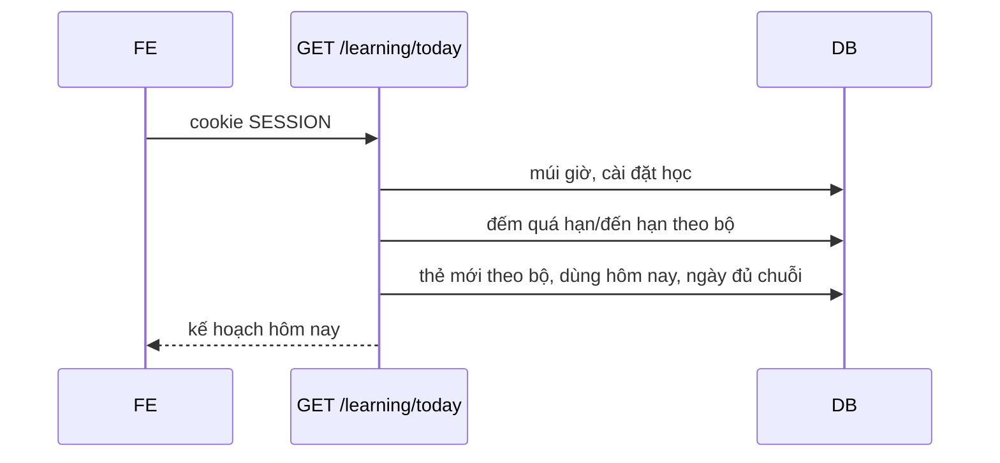

# Báo cáo bàn giao BE → FE — DOT2 Học, luyện tập, thống kê & quản trị

| Mục | Giá trị |
|---|---|
| Giai đoạn | Đợt 2 — Học, luyện tập, thống kê & quản trị (26/10 – 08/11/2026) |
| Ngày cập nhật | 31/10/2026 — code B2.7 tạo bài luyện (mục 5.8), 220 test pass; 31/10/2026 — code B2.12 bảng điều khiển (mục 5.7), test learning exit 0, Postman cập nhật; 31/10/2026 — code B2.6 cứu lịch ôn (mục 5.6), 79 test learning pass, mockup và Postman đã cập nhật; 28/10/2026 — code B2.5 (5 API, mục 5.5), chạy bộ test đầy đủ; thêm kế hoạch bảng điều khiển B2.12 (đề xuất, chưa code) và kết quả chạy test B2.5 đang dở; 27/10/2026 — đối chiếu trước khi code B2.5 (bước đã code gần nhất: B2.4, 26/10) |
| Trạng thái BE | 🟡 B2.1 xong (không API). B2.2 xong theo test: người dùng chạy `StreakCalculatorTest` và `FR06TodayPlanTest` ngày 19/10 và báo không lỗi (không ghi số lượng); **chưa gọi HTTP thật**; Postman đã có request, chưa chạy. B2.3 xong theo test: `FR06StudySessionTest` 8 test pass khi chạy ngày 26/10 cùng `FR06TodayPlanTest`, `StreakCalculatorTest`, `FR06SrsCalculatorTest` (40 test, BUILD SUCCESS); chưa chạy bộ test đầy đủ, chưa gọi HTTP thật bằng `curl`; Postman đã có request, chưa chạy. B2.4 xong theo test: người dùng báo đã chạy `FR06ReviewTest` ngày 26/10 (không đính kèm log hay số lượng test); chưa chạy bộ test đầy đủ, chưa gọi HTTP thật bằng `curl`; Postman đã có 4 request, chưa chạy; chưa có `duKien`. B2.5 xong theo test (28/10): sau khi sửa `ketThucAt`, chạy lại 71 test learning pass (gồm `FR06FinishHistoryTest` 4, `FR06ProgressTest` 6); còn 2 fail ngoài B2.5 (`FR05CsvTest`, `IntegrationSetupTest`); chưa chạy lại bộ đầy đủ, chưa gọi HTTP thật; Postman xem mục 10. B2.6 xong theo test (31/10): `mvnw -q test -Dtest='FR06*Test,RescuePlanTest,StreakCalculatorTest'` 79 test, 0 lỗi (gồm `FR06RescuePlanTest` 5, `RescuePlanTest` 3); chưa chạy lại bộ đầy đủ, chưa gọi HTTP thật; Postman có 5 request mới, chưa chạy. B2.12 xong theo test (31/10): `mvnw -q test -Dtest='FR06*Test,RescuePlanTest,StreakCalculatorTest'` exit 0 (31/10) gồm `FR06DashboardTest` 3 test mới; chưa gọi HTTP thật. B2.7 xong theo test (31/10): `mvnw test -Dtest='FR07*Test,FR06*Test,RescuePlanTest,StreakCalculatorTest,FR03*Test,FR04*Test'` 220 test, 0 lỗi, BUILD SUCCESS (31/10) gồm `FR07PracticeSessionTest` 4; chưa gọi HTTP thật; Postman có 4 request mới, chưa chạy. B2.8–B2.11 chưa làm |
| FE làm tương ứng | F2.1 (kèm mở rộng bảng điều khiển), F2.2 phần chọn phiên, F2.3, F2.4 (`roadmap/TienDoDuKien_fronend.md`), UI12 `/hom-nay` (kèm UI22 khối cứu lịch ôn), UI18 `/hoc` |
| Báo cáo trước | [Đợt 1](SPRINT_1_BAO_CAO_BE_BAN_GIAO_CHO_FE.md) — hợp đồng chung (lỗi `{code,message,fieldErrors,requestId}`, CSRF, phân trang, ID dạng chuỗi, cookie `SESSION`) xem ở đó |

> **Đọc nhanh:**
> - Báo cáo này có 4 API: `GET /api/v1/learning/today` (mục 5.1), `POST /api/v1/learning/sessions` và `GET /api/v1/learning/sessions/{id}` (mục 5.2, 5.3), `POST /api/v1/learning/sessions/{id}/reviews` (mục 5.4). Các phần còn lại của Đợt 2 chưa có API: trang gọi BE thật sẽ nhận 404 (MSW chỉ còn mock `GET /public/ping`, không còn handler cho Đợt 2).
> - Hợp đồng ở mục 5 là **contract từ code**, test BE đã chạy (MockMvc) nhưng chưa gọi HTTP thật nên JSON mẫu chưa phải response thật (mục 10).
> - B2.6 (31/10) không thêm route: `GET /learning/today` nhận `phut`, `giuTuMoi` và trả `cuuLichOn`; `POST /learning/sessions` nhận `cheDo`, phiên trả `cheDo` (mục 5.6).
> - B2.7 (31/10) thêm `POST /api/v1/practice/sessions`, `GET /api/v1/practice/sessions/{id}` (mục 5.8); nộp bài/chấm (B2.8) chưa có.
> - B2.12 (31/10) không thêm route: `GET /learning/today` thêm `phienDangDo`, `duBaoOn`, `daHocHomNay.thoiGian`; `daHocHomNay.soPhut` đổi sang thời gian thật (mục 5.7).
> - Từ B2.4, `POST .../reviews` là API duy nhất ghi `tien_do_the` và `su_dung_hoc_ngay`; số liệu `/learning/today` chỉ khác 0 sau khi có lượt ôn được ghi.

---

## 1. BE đã giao gì (đối chiếu 2 roadmap)

| BE bước | Kết quả | FE bước / UI | FE cần làm |
|---|---|---|---|
| B2.1 Bộ tính SRS thuần | ✅ `SrsCalculator` (`SM2-VN-1`), 28 test theo roadmap; không API | — | Không có việc cho FE |
| B2.2 Kế hoạch hôm nay | ✅ `GET /learning/today`, test BE đã chạy (người dùng xác nhận); chưa HTTP thật | F2.1 UI12 `/hom-nay` | Nối theo mục 5.1; khối cứu lịch ôn theo mục 5.6 |
| B2.3 Tạo phiên học | ✅ `POST /learning/sessions`, `GET /learning/sessions/{id}`; `FR06StudySessionTest` 8 test pass; chưa HTTP thật | F2.2 UI18 `/hoc` | Nối theo mục 5.2, 5.3; `cheDo` tùy chọn (mục 5.6); chưa có `duKien` |
| B2.4 Ghi kết quả ôn | ✅ `POST /learning/sessions/{id}/reviews`; người dùng báo đã chạy `FR06ReviewTest` (9 test trong mã nguồn; không có log hay số lượng pass); chưa HTTP thật | F2.2 UI19 `/hoc/[sessionId]` | Nối theo mục 5.4; chưa có `duKien`, `khoangHienThi`; 409 không kèm `tienDo` |
| B2.5 Kết thúc phiên, lịch sử, tạm ngưng/đặt lại | ✅ `POST /learning/sessions/{id}/finish`, `GET /learning/history`, `GET /decks/{id}/progress`, `PUT /cards/{id}/progress/suspend`, `POST /cards/{id}/progress/reset`; `FR06FinishHistoryTest` (4), `FR06ProgressTest` (6) pass sau khi sửa `ketThucAt` (28/10); chưa HTTP thật | F2.3 UI20 `/hoc/[sessionId]/tong-ket`, UI21 `/bo-the/[id]/tien-do` | Nối theo mục 5.5; chuỗi ngày lấy từ `/learning/today` |
| B2.6 Cứu lịch ôn | ✅ `cuuLichOn` + query `phut`, `giuTuMoi` trong `GET /learning/today`; `cheDo` ở `POST /learning/sessions` và `GET /learning/sessions/{id}`; migration `V10__phien_hoc_che_do.sql`; `FR06RescuePlanTest` (5), `RescuePlanTest` (3) pass (31/10); chưa HTTP thật | F2.4 UI22 khối "Cứu lịch ôn" trên UI12 | Nối theo mục 5.6 |
| B2.12 Bảng điều khiển người học | ✅ `phienDangDo`, `duBaoOn`, `daHocHomNay.thoiGian` trong `GET /learning/today`; `soPhut` theo thời gian thật; `FR06DashboardTest` (3) pass (31/10); chưa HTTP thật | F2.1 mở rộng UI12 | Nối theo mục 5.7; khối "Hoạt động 7 ngày" chờ B2.10 |
| B2.7 Tạo bài luyện | ✅ `POST /practice/sessions`, `GET /practice/sessions/{id}`; migration `V11__practice.sql`; `FR07PracticeSessionTest` (4) pass (31/10); chưa HTTP thật | F2.5 UI23, UI24 | Nối theo mục 5.8; nút nộp chờ B2.8 |

**Chưa có** (BE chưa có endpoint, FE gọi sẽ 404): nộp/chấm, lịch sử, luyện lại bài luyện (B2.8), sổ tay (B2.9), thống kê (B2.10), quản trị (B2.11).

## 2. Chạy BE

Không có dịch vụ, biến môi trường hay dữ liệu mẫu mới. Windows cần `JAVA_TOOL_OPTIONS=-Djdk.net.unixdomain.tmpdir=C:\Users\Public` khi chạy test (Netty/Redis loopback). Chạy API từ `backend/k28/` bằng `.\mvnw.cmd spring-boot:run`; sửa code rồi `.\mvnw.cmd -q -DskipTests compile` để DevTools tự khởi động lại.

## 3. Thay đổi hợp đồng chung

Không thay đổi. Không có mã lỗi mới. Điều kiện: ID trong `boThe[]` dạng chuỗi, tên field trùng tên entity/mockup (tiếng Việt không dấu).

## 4. Luồng chính



Chi tiết: [luồng B2.2](../docs/luong-backend/B2.2-ke-hoach-hom-nay.md).

## 5. API chi tiết

### 5.1 `GET /api/v1/learning/today` — kế hoạch hôm nay

| Quyền | FE bước | UI | Trang |
|---|---|---|---|
| L (đăng nhập) | F2.1 | UI12 | `/hom-nay` |

**Gửi:** query tùy chọn `phut` (1–240) và `giuTuMoi` (`true`/`false`) từ B2.6, xem mục 5.6. Không gửi thì kết quả như B2.2.

**Nhận** (contract từ code; số liệu minh họa, **không phải response thật**)

```http
HTTP/1.1 200
Content-Type: application/json
```
```json
{
  "ngay": "2026-10-19",
  "soQuaHan": 2,
  "soDenHan": 1,
  "soTheMoiDaHoc": 0,
  "tuMoiMoiNgay": 10,
  "soMoiConLai": 2,
  "giayMoiLuot": 20,
  "uocTinhPhut": 2,
  "phutMoiNgay": 10,
  "chuoiNgay": 0,
  "homNayDaTinhChuoi": false,
  "luotToiThieuChuoi": 5,
  "daHocHomNay": { "soLuot": 0, "thoiGian": 0, "soPhut": 0 },
  "tongSoThe": 5,
  "boThe": [
    { "boTheId": "12", "ten": "Từ vựng văn phòng", "soCanOn": 3, "soMoi": 2 }
  ],
  "cuuLichOn": null,
  "phienDangDo": null,
  "duBaoOn": [
    { "ngay": "2026-10-20", "soCanOn": 2 },
    { "ngay": "2026-10-21", "soCanOn": 0 },
    { "ngay": "2026-10-22", "soCanOn": 0 },
    { "ngay": "2026-10-23", "soCanOn": 1 },
    { "ngay": "2026-10-24", "soCanOn": 0 },
    { "ngay": "2026-10-25", "soCanOn": 0 },
    { "ngay": "2026-10-26", "soCanOn": 0 }
  ]
}
```

| Trường | Ý nghĩa |
|---|---|
| `ngay` | Ngày địa phương theo múi giờ của người dùng |
| `soQuaHan` | Lượt (hàng tiến độ) có hạn trước đầu ngày; một thẻ hai chiều có thể tính 2 |
| `soDenHan` | Lượt có hạn trong ngày, kể cả chưa tới giờ; có thể lớn hơn số thẻ vào hàng đợi lúc đó |
| `soTheMoiDaHoc`, `tuMoiMoiNgay`, `soMoiConLai` | Hạn mức từ mới (thẻ vật lý, không nhân đôi hai chiều); `soMoiConLai` không âm |
| `giayMoiLuot`, `uocTinhPhut` | Ước tính cố định 20 giây/lượt; hiển thị là "ước tính" |
| `phutMoiNgay` | Mục tiêu phút từ thiết lập học |
| `chuoiNgay`, `homNayDaTinhChuoi`, `luotToiThieuChuoi` | Ngày liên tiếp có ≥5 lượt hợp lệ; hôm nay chưa đủ thì chuỗi tính từ hôm qua |
| `daHocHomNay` | `soLuot` thật; từ B2.12 `thoiGian` (ms, tổng thời gian trả lời hôm nay) và `soPhut = floor(thoiGian/60000)` (trước B2.12 là ước tính từ số lượt). Xem mục 5.7 |
| `tongSoThe` | 0 → hiện màn hình chưa có thẻ nào |
| `boThe[]` | Mọi bộ chưa xóa của người dùng (kể cả bộ rỗng), sắp theo tên; `soCanOn` = quá hạn + đến hạn của bộ; `soMoi` không bị cắt theo hạn mức |
| `cuuLichOn` | `null` hoặc phương án cứu lịch ôn (B2.6, mục 5.6). Khi có và `tamDungTuMoi = true` thì `soMoiConLai = 0` |
| `phienDangDo`, `duBaoOn` | B2.12, mục 5.7 |

Từ B2.6 `cuuLichOn` luôn có mặt trong JSON, giá trị `null` khi không cần cứu.

**Lỗi**

| HTTP | `code` | Khi nào | FE xử lý |
|---|---|---|---|
| 400 | `VALIDATION_FAILED` | `phut` ngoài 1–240 hoặc không phải số nguyên, `giuTuMoi` khác `true`/`false` (B2.6); `fieldErrors[].field` là tên query | Báo lỗi, gửi lại giá trị hợp lệ |
| 401 | `UNAUTHENTICATED` | Chưa đăng nhập hoặc phiên hết hạn | Chuyển `/dang-nhap` |

**Tác dụng phụ:** lần gọi đầu có thể tạo hồ sơ học tập mặc định (10 phút, 10 từ mới/ngày) nếu người dùng chưa có.

### 5.2 `POST /api/v1/learning/sessions` — tạo phiên học

| Quyền | FE bước | UI | Trang |
|---|---|---|---|
| L (đăng nhập, cần CSRF) | F2.2 | UI18 | `/hoc` |

**Gửi**

```json
{ "boTheId": "12", "chieuHoc": "EN_VI", "quyThoiGian": 10, "cheDo": "THUONG" }
```

| Field | Quy tắc |
|---|---|
| `boTheId` | Tùy chọn, chuỗi số. Bỏ qua hoặc `null` = tất cả bộ của tôi. Bộ phải của người dùng và chưa xóa |
| `chieuHoc` | Bắt buộc: `EN_VI` hoặc `VI_EN` |
| `quyThoiGian` | Bắt buộc: 5, 10 hoặc 20 (phút). Tối đa `quyThoiGian×60/20` thẻ (15/30/60) |
| `cheDo` | Tùy chọn (B2.6): `THUONG` (mặc định) hoặc `CUU_LICH`; giá trị khác → 400 field `cheDo`. Xem mục 5.6 |

**Nhận** (201, header `Location: /api/v1/learning/sessions/{id}`; contract từ code, số liệu minh họa)

```json
{
  "id": "7",
  "boTheId": "12",
  "boTheTen": "Từ vựng văn phòng",
  "chieuHoc": "EN_VI",
  "quyThoiGian": 10,
  "cheDo": "THUONG",
  "batDauAt": "2026-10-26T03:00:00Z",
  "hetGioAt": "2026-10-26T03:10:00Z",
  "ketThucAt": null,
  "trangThai": "DANG_HOC",
  "muiGio": "Asia/Ho_Chi_Minh",
  "hangDoi": [
    {
      "theId": "101",
      "thuTu": 1,
      "trangThai": "CHUA_TRA_LOI",
      "tienDo": { "trangThai": "HOC_LAI", "buocHoc": 0, "ef": 2.5, "khoangOnNgay": 0, "chuoiThanhCong": 0, "soLanQuen": 1, "hanOnAt": "2026-10-26T02:50:00Z", "version": 3 },
      "the": { "id": "101", "boTheId": "12", "tu": "invoice", "tuLoai": "noun", "phienAm": "/ˈɪnvɔɪs/", "nghiaVi": "hóa đơn", "viDuEn": null, "dichVi": null, "anhId": null, "amTuId": "55", "amCauId": null, "version": 0 }
    }
  ]
}
```

| Trường | Ý nghĩa |
|---|---|
| `hetGioAt` | Tính ra `batDauAt + quyThoiGian` phút, không lưu |
| `cheDo` | `THUONG` hoặc `CUU_LICH`, lưu ở `phien_hoc.che_do` (B2.6) |
| `boTheTen` | Tên bộ; `boTheId` null thì là "Tất cả bộ của tôi" |
| `hangDoi[]` | Bản chụp hàng đợi lúc tạo, theo `thuTu`. Thứ tự ưu tiên: bước học lại đến hạn → ôn đến hạn → thẻ mới trong hạn mức → chiều còn lại của thẻ đã học (không tốn hạn mức) |
| `hangDoi[].trangThai` | `CHUA_TRA_LOI` hoặc `DA_TRA_LOI` |
| `hangDoi[].tienDo` | Tiến độ của chiều đang học. Thẻ chưa có hàng tiến độ: `MOI`, `ef` 2.5, `version` 0, `hanOnAt` null |
| `hangDoi[].tienDo.version` | Dùng làm `expectedVersion` ở B2.4 |
| `hangDoi[].the` | Nội dung thẻ. Media là ID tệp (`anhId`, `amTuId`, `amCauId`), tải qua `/files/{id}`; không có URL. Thẻ bị xóa sau khi tạo phiên: `the = null` |

**Lỗi**

| HTTP | `code` | Khi nào | FE xử lý |
|---|---|---|---|
| 400 | `VALIDATION_FAILED` | `chieuHoc`/`quyThoiGian` thiếu hoặc sai, `boTheId` không phải số, `cheDo` khác `THUONG`/`CUU_LICH`; `fieldErrors[].field` là tên field | Hiện lỗi tại field |
| 401 | `UNAUTHENTICATED` | Chưa đăng nhập | Chuyển `/dang-nhap` |
| 404 | `NOT_FOUND` | `boTheId` không tồn tại, đã xóa hoặc của người khác | Báo bộ không còn, tải lại `GET /learning/today` |
| 422 | `BUSINESS_RULE` | Hàng đợi rỗng (không có thẻ đến hạn và hết hạn mức mới hoặc không còn thẻ mới; với `CUU_LICH`: không có thẻ đến hạn). Không lưu phiên | Hiện thông báo của BE, gợi ý quay lại `/hom-nay` |

**Tác dụng phụ:** tạo `phien_hoc` + `phien_hoc_the`; lần gọi đầu có thể tạo hồ sơ học tập mặc định. Không trừ hạn mức từ mới (B2.4 làm).

### 5.3 `GET /api/v1/learning/sessions/{id}` — xem lại phiên

| Quyền | FE bước | UI | Trang |
|---|---|---|---|
| L (chủ phiên) | F2.2 | UI19 | `/hoc/[sessionId]` |

Response cùng dạng mục 5.2 (200), kể cả `cheDo`. `hangDoi` đọc từ bản chụp, không tính lại. Phiên không tồn tại hoặc của người khác: 404 `NOT_FOUND`.

### 5.4 `POST /api/v1/learning/sessions/{id}/reviews` — ghi kết quả ôn

| Quyền | FE bước | UI | Trang |
|---|---|---|---|
| L (chủ phiên), cần CSRF | F2.2 | UI19 | `/hoc/[sessionId]` |

**Gửi**

```json
{
  "clientEventId": "c0f1d3a2-7b1e-4a6c-9d2e-5f8a1b2c3d4e",
  "theId": "101",
  "chieuHoc": "EN_VI",
  "danhGia": "NHO",
  "expectedVersion": 3,
  "thoiGianTraLoiMs": 8200
}
```

| Field | Quy tắc |
|---|---|
| `clientEventId` | Bắt buộc, ≤128, chỉ `A-Za-z0-9._:-`. FE sinh mới cho mỗi lượt và **giữ nguyên khi retry** |
| `theId` | Bắt buộc, chuỗi số; phải là thẻ `CHUA_TRA_LOI` của phiên |
| `chieuHoc` | Bắt buộc, bằng `chieuHoc` của phiên |
| `danhGia` | `QUEN`/`KHO`/`NHO`/`DE` (phím 1–4 chỉ là phím tắt, không phải giá trị gửi) |
| `expectedVersion` | Bắt buộc, `>= 0`; lấy `hangDoi[].tienDo.version` (thẻ chưa có tiến độ là 0) hoặc `tienDo.version` của lượt trước |
| `thoiGianTraLoiMs` | Bắt buộc, `>= 0`; lớn hơn 120000 bị cắt về 120000 |

**Nhận** (201 khi ghi mới, 200 khi gửi lại cùng `clientEventId`; contract từ code, số liệu minh họa)

```json
{
  "clientEventId": "c0f1d3a2-7b1e-4a6c-9d2e-5f8a1b2c3d4e",
  "theId": "101",
  "chieuHoc": "EN_VI",
  "danhGia": "NHO",
  "truoc": { "trangThai": "ON_TAP", "buocHoc": 0, "ef": 2.5, "khoangOnNgay": 6, "chuoiThanhCong": 2, "soLanQuen": 0, "hanOnAt": "2026-10-26T03:00:00Z", "version": 3 },
  "tienDo": { "trangThai": "ON_TAP", "buocHoc": 0, "ef": 2.5, "khoangOnNgay": 15, "chuoiThanhCong": 3, "soLanQuen": 0, "hanOnAt": "2026-11-10T03:05:00Z", "version": 4 },
  "laiTrongPhien": false
}
```

| Trường | Ý nghĩa |
|---|---|
| `truoc`, `tienDo` | Tiến độ trước và sau lượt ôn (cùng cấu trúc `hangDoi[].tienDo`). `tienDo.version` dùng làm `expectedVersion` cho lần chấm sau của thẻ này |
| `laiTrongPhien` | `true` khi thẻ còn bước học/học lại đến hạn trước `hetGioAt`: BE đã đưa thẻ xuống **cuối hàng đợi** (đặt lại `CHUA_TRA_LOI`, `thuTu` lớn nhất + 1). FE tự thêm thẻ vào cuối hàng đợi cục bộ, dùng `tienDo` mới; `false` thì đánh dấu đã trả lời |

**Lỗi**

| HTTP | `code` | Khi nào | FE xử lý |
|---|---|---|---|
| 400 | `VALIDATION_FAILED` | Thiếu/sai field, `chieuHoc` khác phiên | Hiện lỗi |
| 401 | `UNAUTHENTICATED` | Chưa đăng nhập | Chuyển `/dang-nhap` |
| 404 | `NOT_FOUND` | Phiên không tồn tại hoặc của người khác | Về `/hoc` |
| 409 | `VERSION_CONFLICT` | `expectedVersion` lệch (hai tab, hoặc đua giữa hai phiên) | Gọi lại `GET /learning/sessions/{id}`, lấy `tienDo` mới và cho chấm lại. **Body không có** `tienDo`/`duKien` |
| 409 | `CONFLICT` | Phiên đã `KET_THUC`; hoặc `clientEventId` đã dùng cho lượt khác | Phiên đã kết thúc: về `/hoc`. Mã sự kiện trùng: sinh `clientEventId` mới |
| 422 | `BUSINESS_RULE` | Thẻ không thuộc hàng đợi / đã trả lời; thẻ đã xóa hoặc tạm ngưng; hết suất từ mới hôm nay | Bỏ qua thẻ (hiện thông báo của BE), chuyển thẻ tiếp theo |

**Tác dụng phụ:** tạo hoặc cập nhật `tien_do_the` (chiều của phiên), ghi `lich_su_on` (trước/sau, `SM2-VN-1`), cộng `su_dung_hoc_ngay.so_luot_hop_le` (và `so_the_moi` nếu là thẻ mới thật, chỉ một lần cho cả hai chiều), cập nhật `phien_hoc_the`. Ngày địa phương tính theo `muiGio` của phiên. Retry cùng `clientEventId` trả 200 với kết quả đã lưu, không cộng lượt.

### 5.5 B2.5 — kết thúc phiên, lịch sử, tiến độ theo bộ, tạm ngưng/đặt lại

Hợp đồng từ code ngày 28/10/2026 (quyết định nghiệp vụ là **đề xuất**, xem roadmap B2.5 và [flow B2.5](../docs/luong-backend/B2.5-ket-thuc-phien-lich-su-tien-do.md)). Chưa có response thật từ HTTP; test B2.5 đã pass, còn 2 test fail ngoài B2.5 (mục 10).

| API | Hợp đồng từ code |
|---|---|
| `POST /learning/sessions/{id}/finish` | 200 cả lần đầu và gọi lại; phiên đã `KET_THUC` trả lại tổng kết cũ, không đổi `ketThucAt`; người khác → 404. Body trả về: `phienId`, `boTheId`, `boTheTen`, `chieuHoc`, `quyThoiGian`, `batDauAt`, `hetGioAt`, `ketThucAt`, `trangThai`, `soLuot`, `soThe`, `soTheMoi`, `soChuaTraLoi`, `thoiGian` (tổng ms), `theoDanhGia{QUEN,KHO,NHO,DE}`, `tuCanLuyen[{theId,tu,tuLoai,nghiaVi,danhGia[]}]`, `lichTiepTheo[{theId,tu,trangThai,hanOnAt}]`. Không có chuỗi ngày (FE gọi `GET /learning/today`), không có `khoangHienThi` |
| `GET /learning/history` | Query `phienId`, `theId`, `boTheId`, `chieuHoc`, `tuNgay`, `denNgay` (YYYY-MM-DD), `page` (0), `size` (20, tối đa 100). `PageResponse` với `items[{id,phienId,theId,boTheId,tu,tuLoai,nghiaVi,chieuHoc,danhGia,thoiGian,truoc,sau,phienBanThuatToan,createdAt}]`, mới nhất trước; `truoc`/`sau` cùng cấu trúc `tienDo` |
| `GET /decks/{id}/progress` | Query `nhom` (`MOI`/`DANG_HOC`/`DEN_HAN`/`QUA_HAN`/`TAM_NGUNG`), `q`, `page`, `size`. Trả `boTheId`, `ten`, `muiGio`, `tongSoThe`, `tongHop{MOI,DANG_HOC,DEN_HAN,QUA_HAN,TAM_NGUNG}` (đếm theo thẻ-chiều), `items[{theId,tu,tuLoai,phienAm,nghiaVi,tamNgung,chieu{EN_VI,VI_EN}}]` (mỗi chiều = `tienDo` + `nhom`), `page`, `size`, `totalElements`, `totalPages`. Nhóm `DANG_HOC` nghĩa là "có lịch, chưa đến hạn" |
| `PUT /cards/{id}/progress/suspend` | Body `{tamNgung}` (`true` để tạm ngưng, `false` để khôi phục), áp cả hai chiều; trả `{theId, tamNgung, chieu{EN_VI,VI_EN}}` |
| `POST /cards/{id}/progress/reset` | Body bắt buộc `{xacNhan: true}` (thiếu → 400, field `xacNhan`); hai chiều về `MOI`, lịch sử giữ nguyên; trả cùng cấu trúc với suspend |

| HTTP | `code` | Khi nào |
|---|---|---|
| 200 | — | Mọi thao tác thành công, kể cả gọi lại (`finish`, suspend, reset lần 2 không tăng `version`) |
| 400 | `VALIDATION_FAILED` | ID không phải số; `chieuHoc`/`nhom` sai; ngày sai định dạng hoặc không tồn tại; `tuNgay > denNgay` (field `denNgay`); `size` ngoài 1–100; thiếu `tamNgung`; `xacNhan` thiếu hoặc `false` |
| 401 | `UNAUTHENTICATED` | Chưa đăng nhập |
| 404 | `NOT_FOUND` | Phiên/bộ/thẻ không tồn tại, của người khác, hoặc bộ/thẻ đã xóa. Lịch sử không 404: ID lạ trả trang rỗng |
| 409 | `VERSION_CONFLICT` | Tranh chấp với lượt ôn đang ghi, hoặc hai request cùng tạo hàng tiến độ |

FE lưu ý: sau `reset`, phiên đang mở có thẻ đó sẽ nhận 409 `VERSION_CONFLICT` khi ghi, nên gọi lại `GET /learning/sessions/{id}`. `tamNgung` của thẻ chỉ `true` khi cả hai chiều `TAM_NGUNG`. Lịch sử gồm lượt của thẻ đã xóa. Ngày lọc lịch sử và nhóm tiến độ theo múi giờ hiện tại của người dùng.

### 5.6 B2.6 — cứu lịch ôn

| Quyền | FE bước | UI | Trang |
|---|---|---|---|
| L (đăng nhập; `POST` cần CSRF) | F2.4 | UI22 | khối "Cứu lịch ôn" trên `/hom-nay` |

Hợp đồng từ code ngày 31/10/2026; quyết định nghiệp vụ là **đề xuất** đã chốt 30/10 (roadmap B2.6, [flow B2.6](../docs/luong-backend/B2.6-cuu-lich-on.md)). Không thêm route.

**`GET /learning/today?phut=15&giuTuMoi=false`**

| Query | Quy tắc |
|---|---|
| `phut` | Tùy chọn, số nguyên 1–240; thiếu hoặc rỗng = `phutMoiNgay` của người dùng. Chỉ đổi cách chia lộ trình, không bật/tắt khối |
| `giuTuMoi` | Tùy chọn, `true`/`false`, mặc định `false` (tạm dừng từ mới) |

`cuuLichOn` khác `null` khi `soQuaHan > phutMoiNgay(cài đặt)×60/20` (ví dụ cài đặt 10 phút → hơn 30 lượt quá hạn). Thẻ đến hạn trong ngày không tính vào ngưỡng.

```json
"cuuLichOn": {
  "soTheCanOn": 120,
  "soQuaHan": 110,
  "phutMoiNgay": 15,
  "luotMoiNgay": 45,
  "soNgay": 3,
  "keHoach": [
    { "ngay": "2026-10-31", "soThe": 45, "phut": 15 },
    { "ngay": "2026-11-01", "soThe": 45, "phut": 15 },
    { "ngay": "2026-11-02", "soThe": 30, "phut": 10 }
  ],
  "tamDungTuMoi": true
}
```

(Contract từ code, số minh họa, **không phải response thật**.)

| Trường | Ý nghĩa |
|---|---|
| `soTheCanOn` | `soQuaHan + soDenHan`, đếm theo thẻ-chiều (một thẻ trễ cả hai chiều tính 2) |
| `phutMoiNgay`, `luotMoiNgay` | Phút dùng để chia (query `phut` hoặc cài đặt) và `phutMoiNgay×60/20`. Có thể khác `phutMoiNgay` ở gốc |
| `soNgay` | `ceil(soTheCanOn / luotMoiNgay)`, số thật, có thể lớn hơn 14 |
| `keHoach[]` | Từ hôm nay, tối đa 14 phần tử; ngày cuối nhận phần dư; `phut` làm tròn lên |
| `tamDungTuMoi` | `!giuTuMoi`. Khi `true`, `soMoiConLai` ở gốc = 0 và `uocTinhPhut` không tính từ mới |

Không có `laUocTinh`, `uuTien`, `giayMoiLuot` trong khối; FE ghi "ước tính" và dùng `giayMoiLuot` ở gốc. Lộ trình tính lại mỗi lần gọi, không lưu, không đổi `han_on_at` (TC-10).

**`POST /learning/sessions` với `cheDo`**

| `cheDo` | Hàng đợi |
|---|---|
| `THUONG` (mặc định) | Như B2.3: bước học/học lại đến hạn → ôn đến hạn theo hạn → thẻ mới trong hạn mức → chiều còn lại. Không đổi khi đang có `cuuLichOn` |
| `CUU_LICH` | Bước học/học lại đến hạn → ôn đến hạn theo `soLanQuen` giảm dần, rồi `hanOnAt` tăng dần. **Không** có thẻ mới và chiều còn lại. Được tạo cả khi `cuuLichOn = null` |

FE ánh xạ: nút "Bắt đầu phiên hôm nay" của UI22 gửi `cheDo: "CUU_LICH"` khi người dùng tạm dừng từ mới (`tamDungTuMoi = true`), `"THUONG"` khi giữ từ mới. `quyThoiGian` vẫn chỉ 5/10/20: chọn giá trị gần `cuuLichOn.phutMoiNgay` nhất. `GET /learning/sessions/{id}` trả `cheDo` để UI19 ghi "học lại sau nghỉ".

| HTTP | `code` | Khi nào |
|---|---|---|
| 400 | `VALIDATION_FAILED` | `phut`, `giuTuMoi`, `cheDo` sai; `fieldErrors[].field` đúng tên |
| 404 | `NOT_FOUND` | `boTheId` hoặc phiên của người khác/đã xóa |
| 422 | `BUSINESS_RULE` | `CUU_LICH` không có thẻ đến hạn; không lưu phiên |

### 5.7 B2.12 — bảng điều khiển UI12

| Quyền | FE bước | UI | Trang |
|---|---|---|---|
| L (đăng nhập) | F2.1 mở rộng | UI12 | `/hom-nay` (bảng điều khiển, TK §9.1) |

Hợp đồng từ code ngày 31/10/2026 ([flow B2.12](../docs/luong-backend/B2.12-bang-dieu-khien.md)). Không thêm route; ba field mới nằm trong `GET /learning/today`, field cũ giữ tên.

```json
"daHocHomNay": { "soLuot": 7, "thoiGian": 149999, "soPhut": 2 },
"phienDangDo": {
  "id": "41",
  "boTheId": "12",
  "boTheTen": "Từ vựng văn phòng",
  "chieuHoc": "EN_VI",
  "quyThoiGian": 10,
  "batDauAt": "2026-10-19T03:00:00Z",
  "hetGioAt": "2026-10-19T03:10:00Z",
  "soDaTraLoi": 1,
  "soChuaTraLoi": 2
},
"duBaoOn": [ { "ngay": "2026-10-20", "soCanOn": 2 }, "… đủ 7 phần tử …" ]
```

(Contract từ code, số minh họa, **không phải response thật**.)

| Trường | Quy tắc |
|---|---|
| `daHocHomNay.thoiGian` | ms, tổng `thoiGianTraLoiMs` đã ghi hôm nay (mỗi lượt tối đa 120000), ngày theo múi giờ hiện tại của người dùng. Chưa gồm bài luyện (B2.8) |
| `daHocHomNay.soPhut` | `floor(thoiGian / 60000)`; **đổi nghĩa** so với B2.2 (ước tính từ số lượt) |
| `phienDangDo` | `null` hoặc phiên `DANG_HOC` mới nhất của mình bắt đầu từ đầu ngày hôm nay. Phiên hôm qua chưa kết thúc không hiện. `boTheId = null` → `boTheTen` = "Tất cả bộ của tôi". Không có `cheDo`, `hangDoi` (gọi `GET /learning/sessions/{id}`) |
| `soDaTraLoi`, `soChuaTraLoi` | Số dòng hàng đợi theo trạng thái hiện tại; thẻ học lại trong phiên tính là chưa trả lời |
| `duBaoOn` | Luôn 7 phần tử từ ngày mai, `soCanOn` đếm thẻ-chiều có hạn trong ngày đó; ngày trống = 0; không gồm hôm nay |

FE: `soChuaTraLoi > 0` → "Tiếp tục phiên" mở phiên; bằng 0 → "Kết thúc và xem tổng kết" gọi `POST /learning/sessions/{id}/finish`. Khối "Hoạt động 7 ngày" chờ `GET /statistics/overview` (B2.10), ẩn đến khi có.

Lỗi: như mục 5.1 (400 `phut`/`giuTuMoi`, 401).

### 5.8 B2.7 — tạo bài luyện

| Quyền | FE bước | UI | Trang |
|---|---|---|---|
| L (đăng nhập; `POST` cần CSRF) | F2.5 | UI23, UI24 | `/luyen-tap`, `/luyen-tap-lam-bai` |

Hợp đồng từ code ngày 31/10/2026 ([flow B2.7](../docs/luong-backend/B2.7-tao-bai-luyen.md)).

**`POST /api/v1/practice/sessions`**

```json
{ "loaiBai": "TONG_HOP", "soCau": 10, "nguon": "BO_THE", "boTheId": "12" }
```

| Field | Quy tắc |
|---|---|
| `loaiBai` | Bắt buộc: `CHON_NGHIA`, `CHON_TU`, `GHEP_TU`, `DIEN_CHO_TRONG`, `NHAP_TU_THEO_NGHIA`, `NGHE_VIET`, `PHAN_BIET_CAP`, `TONG_HOP` |
| `soCau` | Bắt buộc 5/10/20. `GHEP_TU`: số thẻ, 5 thẻ/câu |
| `nguon` | `BO_THE` (mặc định) hoặc `SO_TAY`; `SO_TAY` không kèm `boTheId` |
| `boTheId` | Tùy chọn, bộ của mình |
| `theIds` | Tùy chọn, tối đa 20 thẻ của mình (nút luyện cặp ở UI27); không kèm `boTheId`/`SO_TAY` |

**201 / `GET /api/v1/practice/sessions/{id}` 200**

```json
{
  "id": "31",
  "loaiBai": "CHON_NGHIA",
  "boTheId": null,
  "boTheTen": "Tất cả bộ của tôi",
  "nguon": "BO_THE",
  "soCau": 5,
  "soCauYeuCau": 5,
  "createdAt": "2026-10-31T02:10:00.123Z",
  "cauHoi": [
    { "id": "201", "thuTu": 1, "loaiCau": "CHON_NGHIA",
      "deBai": { "tu": "receipt", "phienAm": null, "tuLoai": null },
      "phuongAn": [ { "id": "o1", "noiDung": "hóa đơn" }, { "id": "o2", "noiDung": "biên lai" } ] }
  ]
}
```

(Contract từ code, rút gọn, **không phải response thật**.)

| `loaiCau` | `deBai` | `phuongAn` |
|---|---|---|
| `CHON_NGHIA` | `{tu, phienAm, tuLoai}` | 4 nghĩa |
| `CHON_TU` | `{nghiaVi, tuLoai}` | 4 từ |
| `DIEN_CHO_TRONG` | `{cau (có "_____"), goiY, tuLoai}` | `null` |
| `NHAP_TU_THEO_NGHIA` | `{nghiaVi, tuLoai, viDuVi}` | `null` |
| `NGHE_VIET` | `{amTuId, tuLoai}` — phát tệp qua API tệp | `null` |
| `GHEP_TU` | `{cotTrai[{id, noiDung}], cotPhai[{id, noiDung}]}` | `null` |
| `PHAN_BIET_CAP` | `{cau, goiY}` (một trong hai null) | 2 từ |

- Response **không có đáp án/giải thích**; `GET` trả bản chụp lúc tạo kể cả khi thẻ đã sửa/xóa (TC-11).
- `soCau` = số câu tạo được, có thể nhỏ hơn `soCauYeuCau`.
- Chưa có `daNop`, `lanLamId`, `ketQua`, `laLuyenLai` (B2.8). UI24 coi như chưa nộp.

| HTTP | `code` | Khi nào |
|---|---|---|
| 400 | `VALIDATION_FAILED` | Field sai hoặc tổ hợp nguồn sai; `fieldErrors[].field` đúng tên |
| 404 | `NOT_FOUND` | Bộ/thẻ/bài của người khác hoặc đã xóa |
| 422 | `BUSINESS_RULE` | Chưa có thẻ; sổ tay trống; < 4 thẻ cho dạng chọn; < 3 thẻ cho ghép; không thẻ có ví dụ/âm từ; chưa có cặp nhầm (luôn 422 đến B2.8) |

## 6. Mã FE mẫu

- Zod schema: các field ở mục 5.1; `boThe[].boTheId` là `z.string()`, `cuuLichOn`, `phienDangDo` là `.nullable()` (object mục 5.6, 5.7); `duBaoOn` là mảng 7 phần tử; `daHocHomNay.thoiGian` là `z.number().int()`.
- Phiên học: `chieuHoc` là `z.enum(['EN_VI','VI_EN'])`, `hangDoi[].the` là `.nullable()`, `tienDo.hanOnAt` là `z.string().nullable()`, `ketThucAt` nullable.
- Hook: `useQuery({ queryKey: ['learning','today'], queryFn: () => api('/learning/today') })`; làm mới sau khi kết thúc phiên (B2.5).
- Không còn MSW cho Đợt 2: dùng JSON minh họa ở mục 5.1 làm mẫu; `/hom-nay` đọc API thật khi F2.1 được nối.

## 7. Dữ liệu mẫu / tài khoản demo

Chưa có seed cho tiến độ thẻ. Từ B2.4, `tien_do_the` được tạo qua `POST /learning/sessions/{id}/reviews`; người dùng chưa ôn lượt nào vẫn thấy `soQuaHan=0`, `soDenHan=0`, `chuoiNgay=0`.

## 8. Checklist FE hoàn thành Đợt 2 (phần B2.2)

- [ ] F2.1 `/hom-nay` đọc `GET /learning/today` thật, không còn MSW
- [ ] Hiển thị hai nhãn "Quá hạn" và "Đến hạn hôm nay" đúng ngữ nghĩa mục 5.1
- [ ] `tongSoThe = 0` hiện trạng thái chưa có thẻ; `soCanOn + soMoiConLai = 0` hiện "không còn thẻ nào hôm nay"
- [ ] Chuỗi ngày dùng `homNayDaTinhChuoi` và `luotToiThieuChuoi`, không hard-code số 5
- [ ] Khối cứu lịch ôn ẩn khi `cuuLichOn = null`
- [ ] F2.2 `/hoc` gửi `POST /learning/sessions` không kèm `cheDo` (mặc định `THUONG`); 422 hiện thông báo của BE; số lượt gợi ý tính từ `giayMoiLuot` (15/30/60), không ghi cứng 15 giây
- [ ] Trang học bỏ qua `duKien` (chưa có) và đọc media bằng ID tệp
- [ ] F2.2 UI19 gửi `POST .../reviews` với `clientEventId` mới cho mỗi lượt và giữ nguyên khi retry; `expectedVersion` lấy từ `tienDo.version`
- [ ] 201 và 200 đều xử lý như thành công; `laiTrongPhien = true` thì thêm thẻ vào cuối hàng đợi cục bộ
- [ ] 409 `VERSION_CONFLICT`: gọi lại `GET /learning/sessions/{id}`; 422: bỏ qua thẻ; không dùng `khoangHienThi`, `duKien` từ response review (chưa có)
- [ ] UI20: khi hết hàng đợi hoặc người dùng bấm kết thúc, gọi `POST /learning/sessions/{id}/finish`; gọi lại an toàn; chuỗi ngày lấy từ `GET /learning/today`
- [ ] F2.4 UI22: hiện khối khi `cuuLichOn` khác null; đổi phút thì gọi lại `/learning/today?phut=…`; bỏ chọn "tạm dừng từ mới" thì gửi `giuTuMoi=true`; ghi "ước tính" theo `giayMoiLuot`; `keHoach` tối đa 14 dòng, hiện `soNgay` thật khi lớn hơn
- [ ] F2.4 nút bắt đầu gửi `cheDo` theo `tamDungTuMoi` (`CUU_LICH`/`THUONG`) và `quyThoiGian` 5/10/20 gần nhất; 422 hiện thông báo của BE
- [ ] F2.1 mở rộng: khối "Phiên đang dở" ẩn khi `phienDangDo = null`; `soChuaTraLoi > 0` → "Tiếp tục" mở phiên, bằng 0 → gọi `POST .../finish` rồi mở tổng kết
- [ ] Thanh mục tiêu ngày so `daHocHomNay.thoiGian` với `phutMoiNgay × 60000`; hiển thị `soPhut` (không tự tính từ `soLuot`)
- [ ] Dự báo 7 ngày đọc `duBaoOn`; cột hôm nay = `soQuaHan + soDenHan`; khối "Hoạt động 7 ngày" ẩn đến khi có B2.10
- [ ] F2.5 UI23 gửi `{loaiBai, soCau, nguon, boTheId}`; 422 hiện message của BE; UI24 dựng câu theo `loaiCau`, nghe viết phát tệp `deBai.amTuId`; không đọc `daNop`/`ketQua` trước B2.8
- [ ] UI21: `GET /decks/{id}/progress` với `nhom`, `q`, `page`, `size`; nút tạm ngưng gửi `{tamNgung}`; nút đặt lại hỏi xác nhận rồi gửi `{xacNhan: true}`

## 9. Sắp có ở Đợt 2 — hợp đồng dự kiến

| BE bước | Dự kiến có | API | FE bước | UI |
|---|---|---|---|---|
| B2.10 | Hoạt động 7 ngày trên UI12 | `GET /statistics/overview?tuNgay=<ngay−6>&denNgay=<ngay>`, `theoNgay[{ngay, soLuotOn, soPhut}]`, `soPhut` hôm nay = `daHocHomNay.soPhut` | F2.1 (mở rộng), F2.7 | UI12, UI35 |

Hợp đồng dự kiến theo TK §13 và roadmap; chưa phải đã triển khai.

**B2.12 — bảng điều khiển UI12 (đã code 31/10/2026, hợp đồng ở mục 5.7; đoạn dưới giữ làm bối cảnh):** UI12 `/hom-nay` là bảng điều khiển duy nhất (TK §9.1); không có route hay endpoint `/dashboard` riêng. FE gọi song song `GET /learning/today` và `GET /statistics/overview?tuNgay=<ngay−6>&denNgay=<ngay>`.

| Field mới của `/learning/today` | Dự kiến |
|---|---|
| `phienDangDo` | `null` hoặc `{id, boTheId, boTheTen, chieuHoc, quyThoiGian, batDauAt, hetGioAt, soDaTraLoi, soChuaTraLoi}`: phiên `DANG_HOC` mới nhất bắt đầu trong ngày địa phương hôm nay. `soChuaTraLoi > 0` → nút "Tiếp tục" mở `/hoc-phien?id=`; bằng 0 → "Xem tổng kết" (gọi `POST .../finish`, rồi mở UI20) |
| `duBaoOn` | Luôn 7 phần tử `{ngay, soCanOn}` từ ngày mai; `soCanOn` đếm theo thẻ-chiều như `soQuaHan`/`soDenHan`; ngày trống = 0. Cột "Hôm nay" FE tự lấy `soQuaHan + soDenHan` |
| `daHocHomNay` | Thêm `thoiGian` (ms, tổng thời gian trả lời thật). `soPhut` đổi nghĩa: `floor(thoiGian / 60000)`, không còn là ước tính từ số lượt. Thanh mục tiêu so `thoiGian` với `phutMoiNgay × 60000` |

Khối "Hoạt động 7 ngày" dùng `theoNgay[{ngay, soLuotOn, soPhut}]`; `soPhut` hôm nay phải bằng `daHocHomNay.soPhut`. Khối chưa có API (B2.10, B2.12, cứu lịch ôn B2.6, gợi ý B3.5) thì ẩn, không hiện số minh họa.

## 10. Lưu ý / giới hạn / chưa kiểm chứng

| Mục | Chi tiết |
|---|---|
| Đồng bộ FE ↔ BE (30/10/2026) | FE đã sửa theo hợp đồng mục 5.4–5.5: `/hoc-phien` chọn thẻ `CHUA_TRA_LOI` đến hạn, có màn chờ đếm ngược, hết thẻ hoặc hết giờ thì gọi `POST .../finish` rồi mở `/hoc-tong-ket`; 409 `VERSION_CONFLICT` tải lại phiên, 409 `CONFLICT` mở tổng kết, 422 bỏ qua thẻ. `/hoc-tong-ket` lấy tổng kết từ `POST .../finish` (đọc `thoiGian` ms, `lichTiepTheo[].hanOnAt`), chuỗi ngày từ `/learning/today`. `/bo-the/[id]/tien-do` gửi `{xacNhan:true}`, tự tính khoảng ôn từ `hanOnAt`, đã bỏ chặn trong `FeatureGate` và có nút từ trang chi tiết bộ. Route mock Đợt 2 (luyện tập, sổ tay, cặp dễ nhầm, thống kê) chỉ bật khi `NEXT_PUBLIC_DOT2_MOCK=enabled` (mặc định bật ở `next dev`, tắt ở production); khi tắt, các route này proxy thẳng BE và 6 trang Đợt 2 bị chặn. BE: lỗi CSRF trả `CSRF_INVALID` (403), `api-client` tự gửi lại một lần. Kiểm chứng: `npm test` FE pass, eslint 0 lỗi, test BE `SecurityBaselineTest`, `FR01LoginTest`, `FR01RegisterTest`, `FR04DeckCopyTest`, `IntegrationSetupTest` 46/47 (lỗi 405 `xsrfHelperPassesCsrfFilter` có từ trước). Chưa chạy với HTTP thật trên trình duyệt |
| Kiểm chứng B2.2 | `StreakCalculatorTest` và `FR06TodayPlanTest` đã được người dùng chạy ngày 19/10/2026, báo không lỗi; không có số lượng test hay log đính kèm. Ngày 26/10 chạy lại: `FR06TodayPlanTest` 6 test, `StreakCalculatorTest` 6 test pass |
| Kiểm chứng B2.3 | Ngày 26/10/2026 chạy `mvnw test -Dtest='FR06StudySessionTest,FR06TodayPlanTest,StreakCalculatorTest,FR06SrsCalculatorTest'` (JAVA_TOOL_OPTIONS đặt như mục 2): `FR06StudySessionTest` 8/8 pass (thứ tự hàng đợi, giới hạn theo quỹ thời gian, hạn mức mới, nửa đêm giờ địa phương, chiều còn lại, thẻ/bộ xóa/tạm ngưng/người khác, endpoint 201/404/401/400/422). Tổng 40 test pass. Chưa chạy bộ test đầy đủ, chưa gọi HTTP thật bằng `curl`, request Postman chưa chạy |
| Quyết định nghiệp vụ đề xuất | 20 giây/lượt (hằng); chuỗi theo ngày ≥5 lượt thay vì theo phiên (TK §15.1 chưa chốt); `daHocHomNay.soPhut` ước tính. Có thể đổi khi B2.3/B2.5 và Đợt 3 hoàn tất |
| "Đến hạn hôm nay" ≠ hàng đợi | Gồm cả thẻ hạn muộn hơn giờ hiện tại trong ngày; hàng đợi B2.3 lấy `han_on_at <= now`. FE không dùng `soDenHan` làm số thẻ chắc chắn học được ngay |
| Mockup | Đã rà 19/10: `mockups/dot2/hom-nay.html` đọc đúng tên field, hiển thị đúng và console không lỗi; `demo.js` đã bỏ `muiGio`, `laUocTinh`. Lệch còn lại của demo: 15 giây/lượt (BE 20, trang đọc `giayMoiLuot`), `soPhut` đo thật còn BE ước tính, demo không liệt kê bộ rỗng, demo có `cuuLichOn` (B2.6). `demo.js` đã đổi sang 20 giây/lượt, `hoc.html` đã sửa gợi ý 15/30/60 lượt (26/10) |
| Postman | Thư mục "03 Học tập" của "VocabLearning API" có 18 request, đều có test script, **chưa chạy**: `Kế hoạch hôm nay (B2.2 · FR-06)`, `Tạo phiên học (B2.3 · FR-06)` (lưu `sessionId`), `Xem phiên học (B2.3 · FR-06)`, `Tạo phiên học quỹ thời gian sai → 400 (B2.3 · FR-06)`, và 4 request B2.4 (thêm 26/10/2026): `Ghi kết quả ôn (B2.4 · FR-06)`, `Ghi lại cùng sự kiện → 200 replay`, `Ghi kết quả ôn sai phiên bản → 409`, `Ghi kết quả ôn thiếu danhGia → 400`. Request B2.4 dùng pre-request script gọi `GET /learning/sessions/{{sessionId}}` để đặt `reviewCardId`, `reviewVersion`, `reviewDirection`, `reviewEventId` (chưa khai báo trong hai environment, script tự tạo); request replay phải chạy ngay sau request ghi và dùng lại cùng biến. Cần đăng nhập trước bằng request thư mục 01 và có ít nhất một thẻ đến hạn hoặc thẻ mới (nếu không sẽ 422). Biến `sessionId` được test script tự tạo khi chạy, chưa khai báo trong hai environment. **B2.5 (thêm 28/10/2026, chưa chạy):** `Kết thúc phiên học`, `Kết thúc lại → cùng tổng kết` (so `ketThucAt` qua biến `finishKetThucAt`), `Lịch sử ôn`, `Lịch sử ngày không tồn tại → 400`, `Tiến độ theo bộ` (dùng `deckId`, cần bộ còn tồn tại), `Tiến độ nhóm sai → 400`, `Tạm ngưng thẻ`, `Bỏ tạm ngưng thẻ`, `Đặt lại thiếu xác nhận → 400`, `Đặt lại tiến độ thẻ`; request thẻ dùng `reviewCardId` của request B2.4, nên chạy sau B2.4. `/decks/{id}/progress` và `/cards/{id}/progress` được xếp vào "03 Học tập" (đã thêm vào `match` của registry) |
| Đổi múi giờ | Ngày cũ trong `su_dung_hoc_ngay` giữ ngày địa phương lúc ghi, không viết lại |
| Chuỗi | Chỉ xét tối đa 1000 ngày gần nhất |
| Hợp đồng B2.3 so với mockup (đối chiếu 19/10, BE đã làm 26/10) | Mockup đã sửa theo BE: `trangThai` dòng hàng đợi `CHUA_TRA_LOI`/`DA_TRA_LOI` (trước là `CHO`/`DA_ON`), `the` trả `anhId`/`amTuId`/`amCauId` (trước là `anhUrl`/`amThanhUrl`; `hoc-phien.html` tạo URL qua `fileUrl()`), 20 giây/lượt, `hoc.html` không gửi `cheDo`. **Còn lệch có chủ đích:** demo còn `cheDo`/`CUU_LICH` (B2.6) và `duKien` (BE chưa có). `tienDo` của demo (`progressView`) đã có cùng các field với BE. Mockup chưa được mở lại trên trình duyệt sau khi sửa (cổng 5173 bị chặn), chỉ kiểm cú pháp `demo.js` và script của `hoc-phien.html` bằng `node` |
| Thẻ học lại trong phiên | Mockup đẩy thẻ lại cuối hàng đợi (`laiTrongPhien`); V8 có unique `(phien_id, the_id, chieu_hoc)`; đã chốt tái dùng dòng cũ (đặt lại `CHUA_TRA_LOI`, `thu_tu` = cuối hàng đợi), không migration; đã làm ở B2.4 (`PhienHocThe.requeue`, `laiTrongPhien`) |
| Kiểm chứng B2.4 | Người dùng báo đã chạy `FR06ReviewTest` ngày 26/10/2026 (9 test: TC-05 hai chiều, TC-08 replay và hai tab, TC-09 hạn mức khi ghi và múi giờ phiên, thẻ quên xuống cuối hàng đợi, các nhánh 400/401/404/409/422); không đính kèm log hay số lượng pass. Chưa chạy bộ test đầy đủ, chưa gọi HTTP thật bằng `curl`, chưa có test đa luồng thật (an toàn đồng thời dựa vào khóa dòng `phien_hoc` và `@Version`). Cột JSON `lich_su_on` ghi bằng native SQL (`cast(... as json)`), chưa có bằng chứng riêng ngoài lần chạy test này |
| Quyết định B2.4 (đề xuất) | Mọi lượt mới ghi thành công tính hợp lệ (kể cả `QUEN`, lặp lại) nên chuỗi ngày ≥5 lượt có thể bị làm đầy; `thoiGianTraLoiMs` cắt ở 120000; vẫn nhận lượt sau `hetGioAt`; phiên kết thúc → 409; ngày theo `phien_hoc.mui_gio`; `duKien` để bước phụ sau. Dòng `CHUA_TRA_LOI` của thẻ xóa/tạm ngưng nằm lại đến `finish` (B2.5) |
| Hợp đồng B2.4 so với mockup (đối chiếu 26/10, BE đã làm) | Tên field body giữ theo TK §13.3 (`theId`, `chieuHoc`, `danhGia`, `expectedVersion`, `thoiGianTraLoiMs`). Phiên đã kết thúc → 409 `CONFLICT`; thẻ ngoài hàng đợi hoặc đã trả lời, thẻ không còn khả dụng, hết hạn mức từ mới → 422; 201 khi ghi mới, 200 khi replay. **Lệch có chủ đích với `demo.js`:** 409 `VERSION_CONFLICT` của BE không kèm `tienDo`/`duKien` (FE gọi lại `GET /sessions/{id}`); response review chưa có `duKien`, `khoangHienThi`; demo dùng trạng thái phiên `DA_KET_THUC` còn BE là `KET_THUC` (đã sửa demo về `KET_THUC` ngày 27/10). `thoiGianTraLoiMs` > 120000 bị cắt về 120000. Tất cả là **đề xuất**. **Mockup chưa sửa và chưa mở lại trên trình duyệt trong lượt B2.4:** `hoc-phien.html` còn đọc `res.khoangHienThi`, `res.duKien`, `err.tienDo`, `err.duKien` (BE chưa có), nên chỉ chạy đúng với `demo.js`; FE thật cần bỏ các phụ thuộc này theo mục 5.4 |
| Kiểm chứng B2.6 (31/10/2026) | `mvnw -q test -Dtest='FR06*Test,RescuePlanTest,StreakCalculatorTest'` (JAVA_TOOL_OPTIONS như mục 2): 79 test, 0 lỗi, exit 0. `FR06RescuePlanTest` 5/5 (chia ngày theo phút cài đặt và query, `giuTuMoi`, ngưỡng chỉ đếm quá hạn và theo cài đặt, thứ tự `CUU_LICH`, không thẻ mới/chiều còn lại, `che_do` lưu DB, phiên `THUONG` giữ B2.3, ảnh chụp `tien_do_the` không đổi, `CUU_LICH` rỗng → 422, 400 `phut`/`giuTuMoi`/`cheDo`, người khác → 404), `RescuePlanTest` 3/3, `FR06TodayPlanTest` 6/6 và `FR06StudySessionTest` 8/8 sau khi sửa chữ ký. Migration V10 áp được và schema validate qua. Chưa chạy lại bộ test đầy đủ (2 fail đã biết ngoài phạm vi vẫn còn), chưa gọi HTTP thật bằng `curl` |
| Quyết định B2.6 (đề xuất, chốt 30/10) | Ngưỡng theo phút cài đặt, không theo query; `phut` 1–240; bỏ `laUocTinh`/`giayMoiLuot`/`uuTien` khỏi `cuuLichOn`; chỉ `CUU_LICH` bỏ thẻ mới; `CUU_LICH` bỏ cả chiều còn lại; cho tạo `CUU_LICH` khi không có `cuuLichOn`; `phut`, `giuTuMoi`, `cheDo` là chuỗi + `@Pattern` để 400 có đúng field. Migration chiếm V10, các migration sau dời một số (roadmap). B2.12 sẽ nối field sau `cuuLichOn` |
| Mockup B2.6 (31/10) | `hom-nay.html`: nút "Bắt đầu phiên hôm nay" gửi `cheDo` theo `tamDungTuMoi` (trước đó không gửi, luôn tạo phiên thường); số lượt và ghi chú ước tính đọc `giayMoiLuot` ở gốc. `demo.js`: `cuuLichOn` bỏ `uuTien`, `laUocTinh`, `giayMoiLuot`; nhận `phut` 1–240 và trả 400 `phut`/`giuTuMoi`; message 400 `cheDo` như BE; phiên `THUONG` không còn bỏ thẻ mới khi đang cứu lịch; `CUU_LICH` bỏ thẻ mới và chiều còn lại. **Kiểm chứng:** mở `hom-nay.html?as=an` (cổng 5173) sau khi đặt An 1 phút/ngày và dời hạn ôn về 10 ngày trước: khối cứu lịch hiện "8 thẻ, 3 ngày", lộ trình 3/3/2, ghi chú 20 giây/lượt; bấm bắt đầu mở `hoc-phien.html` với phiên `CUU_LICH` ("học lại sau nghỉ"); console không lỗi; đã đặt lại dữ liệu demo. Chưa chụp ở 390 px. Lệch còn lại: ô chọn phút của UI22 chỉ 5/10/20 (BE nhận 1–240) |
| Postman B2.6 (31/10) | Sửa `Kế hoạch hôm nay (B2.2 · FR-06)`: thêm query `phut`, `giuTuMoi` (tắt sẵn), test chấp nhận `cuuLichOn` null hoặc đúng cấu trúc (test cũ yêu cầu không có `cuuLichOn` sẽ fail từ B2.6). Thêm vào "03 Học tập": `Kế hoạch cứu lịch theo phút`, `Kế hoạch phút sai → 400`, `Tạo phiên cứu lịch` (201 hoặc 422; lưu `rescueSessionId`), `Xem phiên cứu lịch`, `Tạo phiên chế độ sai → 400`. **Chưa chạy**. Biến `rescueSessionId` do test script tự tạo, chưa khai báo trong hai environment. Registry `synced` không đổi vì đường dẫn đã có |
| Kiểm chứng B2.12 (31/10/2026) | `mvnw -q test -Dtest='FR06*Test,RescuePlanTest,StreakCalculatorTest'` exit 0 (31/10) (JAVA_TOOL_OPTIONS như mục 2), gồm `FR06DashboardTest` 3/3 (phiên đang dở: null khi không có/hôm qua/`KET_THUC`, chọn mới nhất, đếm đã trả lời/còn lại, không lộ phiên người khác; dự báo 7 ngày đúng ranh giới nửa đêm HCM, bỏ thẻ xóa/tạm ngưng/người khác, ngày trống = 0; `thoiGian` tổng ms hôm nay, `soPhut` làm tròn xuống). Không đọc được báo cáo surefire nên không có tổng số test. Chưa chạy bộ đầy đủ, chưa gọi HTTP thật |
| Quyết định B2.12 (đề xuất, 31/10) | Làm trước B2.8/B2.10; `thoiGian` chỉ từ `lich_su_on`, B2.8 cộng bài luyện; điều kiện khớp `/statistics/overview` chuyển sang B2.10; `soPhut` đổi nghĩa (có thể nhỏ hơn số cũ); `phienDangDo` không kèm `cheDo`; gom `duBaoOn` theo ngày bằng Java |
| Mockup/Postman B2.12 (31/10) | `hom-nay.html?as=an` mở lại: đủ field cùng tên DTO, khối "Phiên đang dở" hiện, console không lỗi. Lệch: demo `studyMsOf` cộng thời gian bài luyện (BE chờ B2.8), demo `soLuot` đếm lượt ôn thay vì `so_luot_hop_le` (bằng nhau khi mọi lượt hợp lệ). Postman: sửa test + description của "Kế hoạch hôm nay (B2.2 · B2.12 · FR-06)", chưa chạy |
| Kiểm chứng B2.7 (31/10/2026) | `mvnw test -Dtest='FR07*Test,FR06*Test,RescuePlanTest,StreakCalculatorTest,FR03*Test,FR04*Test'` 220 test, 0 lỗi, BUILD SUCCESS (31/10) (JAVA_TOOL_OPTIONS như mục 2), gồm `FR07PracticeSessionTest` 4/4. Migration V11 áp được, schema validate qua. Chưa chạy bộ đầy đủ, chưa gọi HTTP thật |
| Quyết định B2.7 (đề xuất, chốt 31/10) | V11 tạo đủ 7 bảng; nghe viết cần âm từ (không dùng giọng đọc trình duyệt vì lộ đáp án); cặp nhầm 422 đến B2.8; `createdAt` thay `taoAt`; response chưa có field B2.8. Sửa nền: thời điểm auditing cắt về mili giây (ảnh hưởng mọi `createdAt`/`updatedAt`) |
| Mockup/Postman B2.7 (31/10) | `demo.js`: `createdAt`, `deBai.amTuId` (demo thiếu tệp thì dùng giọng đọc); `luyen-tap-lam-bai.html` phát tệp theo `amTuId`, đã mở trên trình duyệt, console không lỗi. **Lệch còn lại:** demo trả thêm `daNop`, `lanLamId`, `ketQua`, `laLuyenLai` (B2.8) và cho nghe viết với thẻ không có âm (BE bỏ thẻ đó). Postman: 4 request trong "04 Luyện tập", chưa chạy |
| Ngoại lệ module | Truy vấn của `learning` join entity `content` (chỉ đọc); đã ghi vào conventions |
| Đối chiếu trước B2.5 (27/10, chưa code) | Quyết định **đề xuất** ghi ở roadmap B2.5 và mục 9: suspend/reset áp cả thẻ; resume suy trạng thái từ field còn giữ; reset giữ lịch sử, không hoàn suất; finish lặp lại trả cùng tổng kết, không tự đóng phiên quá hạn, giữ dòng `CHUA_TRA_LOI`. Lỗ hổng phát hiện khi đọc code (chưa kiểm chứng): `uk_tien_do_the_nguoi_the_chieu` chưa được map nên hai request cùng tạo hàng tiến độ (hai phiên khác nhau, hoặc suspend và review) trả 500; sẽ map sang 409 `VERSION_CONFLICT` trong B2.5. `daHocHomNay.soPhut` vẫn là ước tính, không thuộc B2.5 |
| Mockup B2.5 (sửa 27/10 trước khi code BE) | `demo.js`: phiên kết thúc là `KET_THUC`; `GET /sessions/{id}` không còn `tongKet`; tổng kết `finish` đổi `thoiGianGiay` → `thoiGian` (ms), thêm `soChuaTraLoi`, bỏ `khoangHienThi` và chuỗi ngày; history có lọc `chieuHoc`, `tuNgay`, `denNgay`, trả `thoiGian`, `truoc`/`sau` đầy đủ, ID bộ lạ trả trang rỗng; progress bỏ `khoangHienThi`, thêm `tongSoThe`; suspend bỏ `truocTamNgung`, khôi phục suy trạng thái như BE; reset bắt buộc `xacNhan`. `hoc-tong-ket.html` lấy tổng kết bằng `POST .../finish` khi phiên đã `KET_THUC` và lấy chuỗi ngày từ `/learning/today`; `bo-the-tien-do.html` gửi `{xacNhan: true}`. **Lệch còn lại của demo:** demo xóa hẳn thẻ nên history không hiện lượt của thẻ đã xóa (BE vẫn hiện); `page()` của demo giới hạn size 50 (BE 100); `hoc-phien.html` vẫn đọc `khoangHienThi`/`duKien` của B2.4. **Kiểm chứng 27/10:** chạy các route demo bằng Node (progress, suspend/resume/reset, history, finish lặp lại, review sau finish → 409) cho đúng hợp đồng trên, và kiểm cú pháp script của hai trang; **chưa mở trên trình duyệt** (cổng 5173 bị chặn, tab `file://` chỉ là ảnh tĩnh không chạy script) |
| Test B2.5 (28/10, code chưa commit) | Lần chạy đầu: 71 test learning, 1 fail ở `FR06FinishHistoryTest.fr06_finishClosesSessionAndRepeatReturnsSameSummary` (lần `finish` đầu trả `ketThucAt` có nano giây, lần gọi lại trả mili giây do cột `DATETIME(3)`). Đã sửa `PhienHoc.finish` cắt về mili giây; chạy lại `-Dtest='FR06*Test,StreakCalculatorTest,FR05CsvTest,IntegrationSetupTest'`: 88 test, 71 test learning pass, chỉ còn 2 fail ngoài B2.5 (dòng dưới). FE nhận `ketThucAt` luôn có độ chính xác mili giây |
| Bộ test đầy đủ (28/10, `./mvnw test`) | 315 test, 3 fail: `FR06FinishHistoryTest.fr06_finishClosesSessionAndRepeatReturnsSameSummary` (cùng lỗi `ketThucAt` ở trên; đã sửa và chạy lại, pass), `IntegrationSetupTest.xsrfHelperPassesCsrfFilter` (mong 404, nhận 405 khi POST `/public/ping`) và `FR05CsvTest.tc04_missingFileMalformedUtf8AndInvalidHeaders` (mong 400, nhận 415 khi phần `mapping` là `text/plain`). Hai lỗi sau thuộc nền tảng/CSV, không chạm code B2.5, chưa xử lý. Chưa gọi HTTP thật bằng `curl` cho 5 API B2.5 |
| Mockup B2.5 so với BE (đối chiếu 28/10 sau khi code) | Tên field `finish`, `history`, `progress`, `suspend`, `reset` trong `demo.js` khớp DTO; không phải sửa thêm. Lệch còn lại như dòng "Mockup B2.5" ở trên. **Chưa mở trên trình duyệt** |

| FE `/hom-nay` hiện tại (đọc 28/10, BE không sửa FE) | `frontend/src/app/(app)/hom-nay/page.js`: điều kiện khối sẵn sàng `plan?.tongSoThe > 0 \|\| plan` luôn đúng khi có `plan`, nên khi `tongSoThe = 0` hiện cả khối trống lẫn khối kế hoạch. `AppShell.js` có `HOME = '/bo-the'`: logo và "Trở về ứng dụng" về Bộ thẻ, chưa về bảng điều khiển (TK §6.1 bước 6). Câu chuỗi ngày ghi "hoàn thành một phiên có ít nhất 5 lượt" nhưng BE tính theo ngày (≥5 lượt hợp lệ trong ngày, không cần kết thúc phiên). Route Next.js `/api/v1/statistics/*` tự trả số giả khi BE lỗi; không dùng cho bảng điều khiển khi demo |
| Mockup B2.12 (sửa 28/10 trước khi code BE) | `hom-nay.html` thêm khối "Tiếp tục phiên đang dở", "Hoạt động 7 ngày", "Dự báo ôn 7 ngày tới" và sửa câu chuỗi ngày; `demo.js` thêm `phienDangDo`, `duBaoOn`, `daHocHomNay.thoiGian`, `soPhut` làm tròn xuống (cùng hàm với `statistics/overview`), chuỗi ngày tính theo ngày như BE; seed thêm phiên mẫu `phienmau1` đang dở (2/5 thẻ) của tài khoản An để thấy khối "Tiếp tục phiên" (trình duyệt đã có dữ liệu cũ phải bấm "Đặt lại dữ liệu demo"). **Kiểm chứng 28/10:** mở `hom-nay.html?as=an` trên trình duyệt (cổng 5173) ở 1280 px và 390 px: không lỗi console, không cuộn ngang ở 390 px, số phút hôm nay trên khối mục tiêu khớp cột hôm nay của biểu đồ, nút "Tiếp tục phiên" mở `hoc-phien.html` ở thẻ 3/5. Chưa thử nhánh "Kết thúc và xem tổng kết" và chưa xem giao diện sáng. Kiểu biểu đồ nhỏ đang nằm trong `<style>` của trang (giống `thong-ke.html`); FE nên đưa vào CSS dùng chung khi dựng |

## 11. Báo lỗi cho BE

Gửi đường dẫn API + body + `requestId`; BE tra log theo `requestId`.
