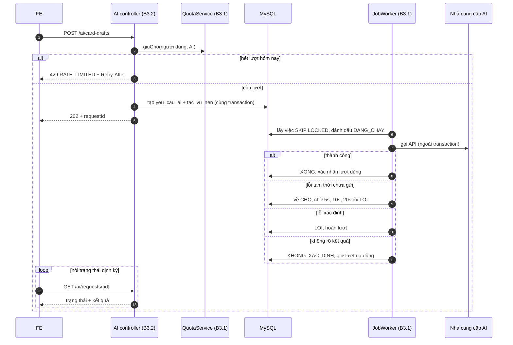

# Báo cáo bàn giao BE → FE — DOT3 AI, phát âm, động lực, vận hành & thanh toán

| Mục | Giá trị |
|---|---|
| Giai đoạn | Đợt 3 — AI, phát âm, động lực, vận hành & thanh toán (09/11 – 29/11/2026, Sprint S7–S9) |
| Ngày cập nhật | 16/11/2026 — **B3.11 code xong** (quản trị vận hành: hạn mức và lượt dùng/lỗi dịch vụ; xem mục 5.15). 16/11/2026 — **B3.9 code xong** (tổng kết tuần `GET /statistics/weekly-summary`; xem mục 5.14). 16/11/2026 — **B3.8 code xong** (báo cáo nội dung và kiểm duyệt: `POST /reports`, `GET /admin/reports`, `POST /admin/reports/{id}/resolve`; xem mục 5.13). 16/11/2026 — **B3.10 code xong** (xóa tài khoản: `POST /me/deletion-requests`, job xóa dữ liệu, ẩn danh bộ công khai; xem mục 5.12). 16/11/2026 — **B3.12c code xong** (Admin: giao dịch, gói người dùng, cấu hình gói, doanh thu, công cụ demo sửa hạn/chạy kiểm tra; 8 API, xem mục 5.11). 16/11/2026 — **B3.12b code xong** (lịch sử giao dịch, biên nhận HTML, nhắc/hết hạn gói, áp quyền lợi 422 `details.quyenLoi`; 2 API mới + `caoCap` ở bộ mẫu, xem mục 5.10). 16/11/2026 — **B3.3 code xong** (giải thích ngữ cảnh, sửa câu, ảnh AI, lịch sử AI, hạn mức hôm nay; 5 API mới + `ketQua` ở `GET /ai/requests/{id}`, xem mục 5.9; Fake, chưa gọi OpenAI/ảnh thật). 16/11/2026 — **B3.12a code xong** (gói dịch vụ, thanh toán Fake/VNPay, 402 `SUBSCRIPTION_REQUIRED`; 6 API, xem mục 5.8; còn 1 lượt VNPay sandbox thật). 15/11/2026 — **B5.2a xong** (thư viện mẫu 8 bộ × 30 = 240 thẻ có IPA, ví dụ, bản dịch; không API mới, xem mục 7). 14/11/2026 — **B3.4b code xong** (đánh giá phát âm: 4 API, Fake + Azure Speech REST; còn 1 lượt gọi Azure thật). 14/11/2026 — **B3.4a code xong** (âm thanh TTS `GET /cards/{id}/audio`, bài `NGHE_VIET` dùng TTS; còn 1 lượt gọi OpenAI TTS thật). 14/11/2026 — **B3.2 code xong** (tạo thẻ bằng AI: 3 API, Fake + OpenAI, `.docx`, lưu vào bộ mới; còn 1 lượt gọi OpenAI thật). 11/11/2026 — B3.1 xong (hạ tầng tác vụ nền và hạn mức, không API); **B3.6 xong** (điểm thưởng, chuỗi ngày + ngày đóng băng, huy hiệu, thử thách tuần; 3 API mới). Các bước còn lại ghi ở mục 1 và mục 9 là **dự kiến** |
| Trạng thái BE | 🟡 Mọi bước Đợt 3 đã có code (16/11/2026); toàn bộ `mvnw test` 544/544 pass. Đã tick: B3.1, B3.5, B3.6, B3.7, B3.8, B3.9, B3.10, B3.11, B5.2a (B3.8–B3.11 xong 16/11/2026: HTTP thật + Postman + mockup). Chưa tick: B3.2, B3.3, B3.4a, B3.4b, B3.12a chờ một lượt gọi nhà cung cấp thật (OpenAI, Azure Speech, VNPay sandbox, ảnh); B3.12b, B3.12c còn công cụ demo/job hết hạn trên server bật `BILLING_DEMO_TOOLS` (mockup UI55–UI59 đã đọc route demo đúng DTO 16/11). Mục 10 ghi từng phần chưa kiểm chứng |
| FE làm tương ứng | F3.1–F3.13 (`roadmap/TienDoDuKien_fronend.md`, mục Đợt 3): UI29 xưởng thẻ AI, UI30–UI32 AI, UI28 gợi ý, UI33–UI34 phát âm, UI38 thành tích, UI39 thông báo, UI45/UI50 báo cáo, UI36–UI37 thống kê, UI44 dữ liệu cá nhân, UI51 vận hành, UI55–UI57 thanh toán, UI58–UI59 quản lý thanh toán |
| Báo cáo trước | [Đợt 2](SPRINT_2_BAO_CAO_BE_BAN_GIAO_CHO_FE.md) — hợp đồng chung (lỗi `{code,message,fieldErrors,requestId}`, CSRF, phân trang, ID dạng chuỗi, cookie `SESSION`) xem ở đó và ở [Đợt 1](SPRINT_1_BAO_CAO_BE_BAN_GIAO_CHO_FE.md) |

> **Đọc nhanh:**
> - **API mới đầu tiên của Đợt 3 (B3.6):** `GET /rewards/history`, `GET /badges`, `GET /challenges` cho UI38 `/thanh-tich`; `GET /learning/today` thêm `daDungNgayNghiTuanNay`, `ngayNghiDaDung` cho thẻ chuỗi ngày trên UI12 (mục 5.2). FE nối F3.6 bằng API thật.
> - **B3.2 (UI29):** `POST /ai/card-drafts` → 202 `{requestId}`, hỏi `GET /ai/requests/{id}` tới `HOAN_TAT`/`LOI`/`KHONG_XAC_DINH`, rồi `POST /ai/card-drafts/{id}/commit` kèm `Idempotency-Key` với `boTheId` **hoặc** `tenBoMoi` (mục 5.5). Chưa có khóa OpenAI nên BE chạy `FakeAiClient`, response có `moPhong: true` → FE gắn nhãn "Mô phỏng".
> - **B3.4b (UI33, UI34):** `POST /pronunciation/assessments` (multipart `theId` + `file` WAV PCM 16 kHz mono ≤ 15 giây) → 201 kết quả có `chiSo` (thiếu là `null`), `ghiAm`, `soSanh`; `GET /pronunciation/assessments/{id}`, `GET /pronunciation/history`, `DELETE /pronunciation/recordings/{id}`; 503 `SPEECH_UNAVAILABLE` hoàn lượt; 429 khi hết lượt `PHAT_AM` (mục 5.7).
> - **B3.4a (UI19, UI24, X-05):** `GET /cards/{id}/audio?loai=TU|CAU` → `FileResponse` + `nguon` (`TAI_LEN`/`TTS`) + `moPhong`; 503 `TTS_UNAVAILABLE` → dùng Web Speech; 429 khi hết lượt `TTS`. Bài `NGHE_VIET` giờ tạo câu cho mọi thẻ: câu không có `deBai.amTuId` có `deBai.amThanhTts = true`, vẫn lấy âm qua `GET /practice/sessions/{id}/questions/{qid}/audio` (mục 5.6).
> - B3.1 chỉ là hạ tầng bên trong BE (hàng đợi tác vụ nền `tac_vu_nen`, hạn mức dịch vụ theo người/ngày). Các trang Đợt 3 khác vẫn dùng MSW/mock cho đến khi từng bước B3.x giao API.
> - Điều FE cần biết từ B3.1: mọi API AI sau này sẽ trả **202 + ID** rồi FE hỏi trạng thái, và hết hạn mức ngày trả **429 `RATE_LIMITED` kèm header `Retry-After`** (mục 3, mục 6). `api-client.js` đã đọc `Retry-After` thành `error.retryAfter`.
> - Hạn mức theo gói (TK §6.9, không có gói miễn phí): `PRO` AI 20, ảnh 10, `TTS` 100, `PHAT_AM` 30 lượt/ngày; `PREMIUM` AI 100, ảnh 30, `TTS` 300, `PHAT_AM` 100 lượt/ngày; "ngày" tính theo giờ Việt Nam (mục 7).
> - **Đã giao 16/11/2026:** B3.3 (mục 5.9), B3.12a–B3.12c (mục 5.8, 5.10, 5.11), B3.10 (5.12), B3.8 (5.13), B3.9 (5.14), B3.11 (5.15). Đợt 3 không còn API dự kiến; Đợt 4 không thêm API cho FE.

---

## 1. BE đã giao gì (đối chiếu 2 roadmap)

| BE bước | Kết quả | FE bước / UI | FE cần làm |
|---|---|---|---|
| B3.1 Tác vụ nền & hạn mức dịch vụ (FR-09, TC-12) | ✅ Không API. `JobService`/`JobWorker` (SKIP LOCKED, retry/backoff, thu hồi lease), `QuotaService` (giữ chỗ nguyên tử, xác nhận, hoàn trả, 429); migration `V15__jobs_ai.sql` (5 bảng, seed hạn mức `PRO`/`PREMIUM`); `FR09JobWorkerTest` (5), `FR09QuotaTest` (5) người dùng báo không lỗi (11/11); chưa HTTP thật | — (nền cho F3.1, F3.2, F3.3) | Chuẩn bị xử lý 429 + `Retry-After` và luồng 202 → hỏi trạng thái (mục 3, 6); chưa nối API |
| B3.2 Adapter AI & tạo thẻ từ đoạn văn (FR-09, TC-12, TC-13, X-01, X-02) | 🟡 3 API; `V18__ai_card_drafts.sql` (`TAI_LIEU`, `mime_type` 100, `yeu_cau_luu_the_ai`); Apache POI; `FakeAiClient` (mặc định) + `OpenAiClient`; 40 test mới pass, toàn bộ 492/492 (14/11); **chưa gọi OpenAI thật**, chưa HTTP thật | F3.1 UI29 `/ai-xuong-the` | Nối 3 API thật (mục 5.5); hỏi trạng thái mỗi 2 giây; giữ cùng `Idempotency-Key` khi bấm lưu lại; nhãn "Mô phỏng" khi `moPhong` |
| B3.4a Âm thanh TTS (FR-10, TC-14) | 🟡 1 API mới + `NGHE_VIET` dùng TTS; `V19__tts_cache.sql` (`am_thanh_tts`, hạn mức `TTS`, tệp hệ thống); `FakeTtsClient` (mặc định) + `OpenAiTtsClient`; `FR10TtsTest` 7 test, toàn bộ suite pass (14/11); **chưa gọi OpenAI TTS thật**, chưa HTTP thật | F3.5 (nghe) UI19, UI24; F3.1 X-05 | Nút loa gọi API thật, fallback Web Speech khi 503/429/lỗi mạng; UI24 hiện nút nghe khi `amTuId` hoặc `amThanhTts` (FE đã sửa `luyen-tap-lam-bai`) |
| B3.3 Các tác vụ AI khác (gọn) | 🟡 Code xong 16/11 (Fake); mockup UI30–UI32 đúng DTO 16/11; chờ OpenAI thật và nhà cung cấp ảnh | F3.2, F3.3 UI30–UI32, UI16, UI29 | Nối API thật (mục 5.9) |
| B3.5 Gợi ý có lý do (FR-08, R-04) | ✅ `GET /learning/recommendations`; 5 mã lý do (`PHAT_AM_THAP` tắt chờ B3.4b); ngưỡng `app.recommendations.*` + `app.notebook.*`; không migration; 21 test mới pass, toàn bộ 452/452 (12/11); chưa HTTP thật | F3.4 UI28 trên UI12, UI27 | Nối API thật (mục 5.4); ẩn khối khi mảng rỗng; thẻ `TIEN_BO` là lời khen, không có nút hành động |
| B3.6 Điểm, chuỗi ngày, huy hiệu, thử thách (gọn, FR-12, TC-15) | ✅ 3 API + mở rộng `/learning/today`; `V16__engagement.sql`; thưởng ghi trong cùng transaction với lượt ôn/nộp bài; `mvnw test` 427/427 pass (11/11); chưa HTTP thật | F3.6 UI38 `/thanh-tich`, thẻ chuỗi UI12 | Nối 3 API thật (mục 5.2); hiện trạng thái ngày nghỉ tuần trên UI12; invalidate sau khi ôn/nộp bài |
| B3.7 Thông báo, nhắc học (gọn, FR-12, TC-15) | ✅ 2 API + `ReminderWorker` 15 phút; `V17__notification.sql`; chống trùng `(user, loại, ngày địa phương)`; `FR12NotificationTest` 4/4 pass (11/11); chưa HTTP thật | F3.7 UI39 chuông + `/thong-bao` | Nối 2 API thật (mục 5.3); số chưa đọc trên chuông; mở `lienKet` rồi `PATCH` đã đọc |
| B3.12a Gói dịch vụ & thanh toán VNPay | 🟡 Code xong 16/11; HTTP thật với cổng Fake pass 16/11 (402, 201, 302, IPN `02`/`97`); mockup UI55, UI57 đúng DTO 16/11; chờ 1 lượt VNPay sandbox thật | F3.12 UI55, UI57 | Nối API thật (mục 5.8); bắt 402 `SUBSCRIPTION_REQUIRED` → `/thanh-toan-goi?lyDo=` |
| B3.4b Đánh giá phát âm (gọn, FR-10, TC-14) | 🟡 4 API mới; `V20__speaking.sql` (`ket_qua_phat_am`, hạn mức `PHAT_AM`); `FakeSpeechClient` (mặc định) + `AzureSpeechClient`; `FR10PronunciationTest` 5 + `AzureSpeechClientTest` 3 pass (14/11); **chưa gọi Azure thật**, chưa HTTP thật | F3.5 UI33, UI34 | Ghi âm Web Audio → WAV 16 kHz mono, chỉ hiện chỉ số khác `null`, nhãn "Mô phỏng" khi `moPhong` (mục 5.7) |
| B3.10 Xóa tài khoản (gọn, FR-14, TC-16) | 🟡 Code xong 16/11 (test pass); HTTP thật trên dev pass 16/11 (tài khoản thử, email Mailpit); Postman đồng bộ 16/11; mockup UI44 đúng DTO 16/11; ✅ xong | F3.10 UI44 | Nối API thật (mục 5.12) |
| B3.8 Báo cáo nội dung, kiểm duyệt (gọn, FR-13) | 🟡 3 API; `V25__moderation.sql`; `FR13ModerationTest` 4/4, toàn bộ 540/540 (16/11); HTTP thật trên dev pass, Postman (16/11); ✅ xong | F3.8 UI45, UI50 | Nối API thật (mục 5.13); bỏ "Yêu cầu sửa", "Từ chối", lịch sử báo cáo của người dùng |
| B3.9 Tổng kết tuần (gọn, FR-11) | 🟡 1 API, không migration; `FR11WeeklySummaryTest` 2/2, toàn bộ 542/542 (16/11); HTTP thật trên dev pass, Postman (16/11); ✅ xong | F3.9 UI37 (UI36 dùng `/statistics/skills`) | Nối API thật (mục 5.14) |
| B3.11 Quản trị vận hành (gọn mạnh, FR-13) | 🟡 3 API; `V26__service_ops.sql`; `FR13ServiceOpsTest` 2/2, toàn bộ 544/544 (16/11); HTTP thật trên dev pass, Postman (16/11); ✅ xong | F3.11 UI51 | Nối API thật (mục 5.15); hạn mức theo từng gói |
| B3.12b Lịch sử giao dịch, hết hạn gói, quyền lợi | 🟡 Code xong 16/11 (test pass); HTTP thật lịch sử + biên nhận pass 16/11; Postman đồng bộ 16/11; mockup UI56 đúng DTO 16/11; chưa chạy job hết hạn trên dev | F3.12 UI56, banner `AppShell`, UI44, UI49 | Nối API thật (mục 5.10); bắt 422 `details.quyenLoi` |
| B3.12c Quản lý thanh toán, doanh thu | 🟡 Code xong 16/11 (test pass); HTTP thật 6/8 API pass 16/11, 2 công cụ demo chưa (server tắt `BILLING_DEMO_TOOLS`); Postman đồng bộ 16/11; mockup UI58–UI59 đúng DTO 16/11 | F3.13 UI58–UI59 | Nối API thật (mục 5.11) |

**Chưa có:** không còn API Đợt 3 chưa code. Phần FE chưa nối API thật vẫn có thể dùng MSW với response ở mục 5. Tab "Tác vụ nền" UI53, UI46, UI52, UI54 đã cắt khỏi Đợt 3 ([KE_HOACH_CAT_DOT3](../docs/KE_HOACH_CAT_DOT3.md)).

## 2. Chạy BE

Giữ nguyên cách chạy ở [Đợt 2 mục 2](SPRINT_2_BAO_CAO_BE_BAN_GIAO_CHO_FE.md) (`backend/README.md`). Phần mới của Đợt 3:

| Mục | Giá trị |
|---|---|
| Migration mới | `V15__jobs_ai.sql` — `tac_vu_nen`, `han_muc_dich_vu`, `su_dung_dich_vu`, `yeu_cau_ai`, `ban_nhap_the_ai`. V15 được sửa ngày 11/11/2026 (bỏ gói `MIEN_PHI`, seed `PRO`/`PREMIUM`) khi **chưa commit**. Máy nào đã chạy bản V15 cũ sẽ báo lỗi checksum Flyway: xóa volume dev (`docker compose down -v`, mất dữ liệu dev) hoặc chạy `flyway repair` |
| Biến cấu hình mới | `JOBS_ENABLED` (mặc định `true`), `JOBS_INTERVAL_MS` (5000), `QUOTA_ZONE` (`Asia/Ho_Chi_Minh`); cấu hình cố định `app.jobs.batch-size: 3`, `max-retry: 3`, `lease: 10m`, `backoff-base: 5s`, `backoff-max: 5m` ở `application.yaml` |
| Test | `application-test.yaml` đặt `app.jobs.enabled=false` để test không chạy job nền; lệnh PowerShell: `.\mvnw.cmd -q test -Dtest='FR09JobWorkerTest,FR09QuotaTest'` |
| Dịch vụ mới | Không (chỉ dùng MySQL có sẵn) |
| B3.6 | Migration `V16__engagement.sql` (`so_diem_thuong`, `huy_hieu`, `nguoi_dung_huy_hieu`, `thu_thach`, `tien_do_thu_thach`; seed 6 huy hiệu, 1 thử thách tuần). Biến `REWARD_DAILY_CAP` (mặc định 100); cố định `app.rewards.diem-moi-luot-on: 1`, `diem-moi-cau-dung: 1`. Test: `.\mvnw.cmd -q test -Dtest='FR12RewardTest,StreakCalculatorTest'` |
| B3.7 | Migration `V17__notification.sql` (`thong_bao`). Biến `REMINDERS_ENABLED` (mặc định `true`), `REMINDERS_INTERVAL_MS` (900000), `REMINDERS_INITIAL_DELAY_MS` (60000); test đặt `app.reminders.enabled=false` |
| B3.2 | Migration `V18__ai_card_drafts.sql` (`TAI_LIEU`, `mime_type` 100, `yeu_cau_luu_the_ai`). Biến `AI_PROVIDER` (`fake` mặc định / `openai`), `OPENAI_API_KEY`, `OPENAI_MODEL` (`gpt-4o-mini`), `OPENAI_BASE_URL`, `AI_FAKE_MODE` |
| B3.4a | Migration `V19__tts_cache.sql` (`am_thanh_tts`, hạn mức `TTS`, `tep_tin.chu_so_huu_id` nullable). Biến `TTS_PROVIDER` (`fake` mặc định / `openai`, dùng chung `OPENAI_API_KEY`), `TTS_MODEL`, `TTS_VOICE`, `TTS_FAKE_MODE` |
| B3.4b | Migration `V20__speaking.sql` (`ket_qua_phat_am`, hạn mức `PHAT_AM`). Biến `SPEECH_PROVIDER` (`fake` mặc định / `azure`), `AZURE_SPEECH_KEY`, `AZURE_SPEECH_REGION` (`southeastasia`), `SPEECH_FAKE_MODE` |
| Tệp mẫu | `backend/k28/.env.example` đã có các biến nhà cung cấp ở trên (sửa 14/11/2026; tên cũ `AI_API_KEY`, `SPEECH_KEY` không được mã đọc) |

## 3. Thay đổi hợp đồng chung

**B3.6 — `GET /learning/today` thêm 2 trường** (cuối response, không đổi trường cũ): `daDungNgayNghiTuanNay` (boolean) và `ngayNghiDaDung` (`YYYY-MM-DD` hoặc `null`). `chuoiNgay` giờ tính có ngày đóng băng (mỗi tuần thứ Hai–Chủ nhật được bỏ qua 1 ngày không đủ 5 lượt; ngày đóng băng không cộng vào số chuỗi), nên có thể lớn hơn trước với cùng dữ liệu. `GET /statistics/overview.chuoiNgay` dùng cùng cách tính. Response của `POST /learning/sessions/{id}/reviews` và `POST /practice/sessions/{id}/submissions` **không đổi**; điểm đọc qua `/rewards/history`.

Mã lỗi mới của Đợt 3: `TTS_UNAVAILABLE` (503, B3.4a, mục 5.6), `SPEECH_UNAVAILABLE` (503, B3.4b, mục 5.7) và `SUBSCRIPTION_REQUIRED` (402, B3.12a, mục 5.8); B3.1 không thêm mã lỗi. **B3.12a — `ErrorResponse` thêm trường `details`** (object, có ở 402 `SUBSCRIPTION_REQUIRED` và, từ B3.12b, ở 422 vượt quyền lợi gói; các lỗi khác không có trường này). **Từ B3.12a mọi API học của User cần gói hiệu lực**: tài khoản mới đăng ký nhận 402 cho tới khi mua gói (tài khoản demo đã có gói, mục 7). Hợp đồng mới cho FE (theo mã nguồn và test MockMvc, chưa kiểm chứng bằng HTTP thật):

| Mục | Chi tiết |
|---|---|
| 429 hết hạn mức ngày | Các API AI (B3.2+) trả 429 với `code = RATE_LIMITED` (mã đã có), `message` tiếng Việt ("Bạn đã dùng hết lượt AI hôm nay, vui lòng thử lại vào ngày mai", hoặc "…tạo ảnh AI…" cho nhóm ảnh), header **`Retry-After`** = số giây đến 00:00 giờ Việt Nam. `fieldErrors` rỗng. FE hiện thời điểm dùng lại từ `Retry-After` và liên kết "Nâng cấp gói" (UI55) khi có B3.12a |
| 429 khác | `RATE_LIMITED` cũng dùng cho giới hạn tốc độ (đăng nhập…) và không phân biệt bằng `code`; chỉ phân biệt bằng ngữ cảnh API và `message` |
| Tác vụ dài | Từ B3.2 các API AI trả 202 + `requestId`; FE hỏi `GET /ai/requests/{id}` định kỳ (xem mục 4). Trạng thái yêu cầu: `CHO`, `DANG_XU_LY`, `HOAN_TAT`, `LOI`, `KHONG_XAC_DINH` (mục 5.5) |
| `KHONG_XAC_DINH` | Nhà cung cấp có thể đã xử lý nhưng BE không biết kết quả (timeout lúc đọc phản hồi, worker chết). BE **không tự thử lại và không hoàn lượt**; FE hiện "Chưa xác định, bạn có thể thử lại" và nói rõ thử lại sẽ dùng thêm một lượt |
| AI lỗi không chặn học | Học SRS, bài luyện cố định, thống kê không phụ thuộc hạn mức hay trạng thái tác vụ nền (TC-12) |

## 4. Luồng chính

Luồng tạo thẻ bằng AI của B3.2 (đã code 14/11/2026) trên hạ tầng B3.1: giữ chỗ hạn mức, hàng đợi, retry/backoff, thu hồi lease. TTS (B3.4a) và đánh giá phát âm (B3.4b) gọi đồng bộ, không qua hàng đợi (mục 5.6, 5.7).



## 5. API chi tiết

### 5.1 B3.1 — không có endpoint

B3.1 không thêm route nào; không có request/response để kiểm chứng. Hành vi FE nhìn thấy gián tiếp qua các API AI của B3.2+ và `GET /me/service-quota` (B3.3, dự kiến). Các quy tắc hạn mức đã code:

| Quy tắc | Chi tiết (theo mã nguồn, test người dùng chạy không lỗi 11/11/2026) |
|---|---|
| Nhóm hạn mức | `AI` (tạo thẻ, giải thích, sửa câu) và `ANH` (ảnh AI, X-04) tách riêng; hết `ANH` không chặn `AI`. Thêm `TTS` (giọng đọc mẫu, B3.4a) và `PHAT_AM` (đánh giá phát âm, B3.4b), mỗi nhóm đếm riêng |
| Còn lại | `giới hạn − đang giữ − đã dùng`; lượt đang xử lý vẫn tính, nên bấm liên tiếp không vượt hạn mức |
| Ngày | Theo giờ `Asia/Ho_Chi_Minh`, đổi ngày lúc 00:00; không theo múi giờ cá nhân của người học |
| Lỗi xác định | Hoàn lượt (`LOI`) |
| Không rõ kết quả | Giữ lượt đã dùng (`KHONG_XAC_DINH`) |
| Retry | Tối đa 3 lần thử lại, chờ 5 giây, 10 giây, 20 giây (trần 5 phút), tức tối đa 4 lần chạy |

**Lỗi** (hợp đồng theo mã nguồn, chưa kiểm chứng; `GlobalExceptionHandler` + `QuotaService`)

| HTTP | `code` | Khi nào | FE xử lý |
|---|---|---|---|
| 429 | `RATE_LIMITED` + `Retry-After` | Hết lượt `AI`, `ANH`, `TTS` hoặc `PHAT_AM` trong ngày | Hiện thời điểm dùng lại (`Retry-After` giây), liên kết UI55 khi có B3.12a; không chặn các chức năng học |

```http
HTTP/1.1 429
Retry-After: 3600
```
```json
{
  "code": "RATE_LIMITED",
  "message": "Bạn đã dùng hết lượt AI hôm nay, vui lòng thử lại vào ngày mai",
  "fieldErrors": [],
  "requestId": "<requestId>"
}
```

Ví dụ trên theo mã nguồn; 429 kèm `Retry-After` đã được `FR09CardDraftTest` và `FR10PronunciationTest` phủ bằng MockMvc, chưa gọi HTTP thật; giá trị `Retry-After` là minh họa.

### 5.2 B3.6 — Điểm thưởng, huy hiệu, thử thách

Cả 3 API: đăng nhập (cookie `SESSION`), chỉ trả dữ liệu của người gọi, `GET` nên không cần CSRF. Hợp đồng theo mã nguồn và `FR12RewardTest` (MockMvc), chưa gọi HTTP thật. Luồng chi tiết: [B3.6](../docs/luong-backend/B3.6-diem-chuoi-huy-hieu.md).

| API | Query | 200 |
|---|---|---|
| `GET /api/v1/rewards/history` | `page` (≥ 0, mặc định 0), `size` (1–100, mặc định 20) | `{tongDiem, diemHomNay, diemToiDaNgay, lichSu: {items[], page, size, totalElements, totalPages}}`; item `{id, loaiSuKien, diemGoc, soDiem, ngayDiaPhuong, createdAt}`, mới nhất trước |
| `GET /api/v1/badges` | — | `[{id, ma, ten, moTa, loaiDieuKien, nguong, daNhan, nhanAt}]`, 6 phần tử theo thứ tự hiển thị |
| `GET /api/v1/challenges` | — | `[{id, ma, ten, moTa, loaiDieuKien, chuKy, mucTieu, giaTri, tuanBatDau, tuanKetThuc, hoanThanhAt}]`, tuần hiện tại theo múi giờ người dùng |

| Enum | Giá trị |
|---|---|
| `loaiSuKien` | `ON_THE` (lượt ôn), `BAI_LUYEN` (bài nộp) |
| `loaiDieuKien` (huy hiệu) | `TONG_LUOT_ON`, `CHUOI_NGAY`, `TONG_BAI_LUYEN`, `TONG_DIEM` |
| `loaiDieuKien` / `chuKy` (thử thách) | `LUOT_ON` / `TUAN` |

Quy tắc FE cần hiển thị đúng:
- 1 điểm cho lượt ôn đầu tiên của mỗi thẻ/chiều trong ngày (các bước học lại cùng ngày không thêm điểm); 1 điểm/câu đúng của bài luyện; bài luyện lại 0 điểm; tối đa `diemToiDaNgay` (100) điểm/ngày. `soDiem < diemGoc` = đã chạm trần, hiện "đã chạm trần ngày".
- Thử thách chỉ đếm lượt ôn được thưởng; `hoanThanhAt` khác `null` = đã hoàn thành. Huy hiệu và thử thách không cộng điểm.
- Ngày đóng băng: `daDungNgayNghiTuanNay = true` → báo "Đã dùng ngày nghỉ tuần này ({ngayNghiDaDung}); nghỉ thêm một ngày trong tuần sẽ đứt chuỗi".

Ví dụ (rút gọn, hợp đồng theo mã nguồn, giá trị minh họa):
```json
{
  "tongDiem": 133, "diemHomNay": 2, "diemToiDaNgay": 100,
  "lichSu": { "items": [ { "id": "41", "loaiSuKien": "ON_THE", "diemGoc": 1, "soDiem": 1, "ngayDiaPhuong": "2026-11-11", "createdAt": "2026-11-11T02:15:03.120Z" } ],
              "page": 0, "size": 20, "totalElements": 1, "totalPages": 1 }
}
```

**Lỗi:** 401 `UNAUTHENTICATED`; 400 `VALIDATION_FAILED` khi `page`/`size` sai (`fieldErrors[].field` = `page`/`size`).

### 5.3 B3.7 — Thông báo và nhắc học

Đăng nhập (cookie `SESSION`); chỉ thông báo của người gọi; `PATCH` cần XSRF như mọi request ghi. Hợp đồng theo mã nguồn và `FR12NotificationTest` (MockMvc), chưa gọi HTTP thật. Luồng: [B3.7](../docs/luong-backend/B3.7-thong-bao-nhac-hoc.md).

| API | Vào | 200 |
|---|---|---|
| `GET /api/v1/notifications` | `chuaDoc` (mặc định `false` = tất cả), `page` (≥ 0), `size` (1–100, mặc định 20) | `{soChuaDoc, thongBao: {items[], page, size, totalElements, totalPages}}`; item `{id, loai, tieuDe, noiDung, lienKet, ngayDiaPhuong, daDocAt, createdAt}`, mới nhất trước |
| `PATCH /api/v1/notifications/{id}` | body `{daDoc: true\|false}` | item đã cập nhật; `daDoc: false` đặt lại chưa đọc |

| Enum `loai` | Ý nghĩa |
|---|---|
| `NHAC_HOC` | Nhắc học hằng ngày (B3.7), `lienKet` = `/hom-nay` |
| `GOI_SAP_HET_HAN`, `GOI_DA_HET_HAN` | B3.12b (16/11/2026): nhắc mỗi ngày từ D−7 đến D sau 08:00, liên kết `/thanh-toan-goi`; hết hạn liên kết `/thanh-toan-goi?lyDo=HET_HAN`. Luôn hiện trong ứng dụng, không phụ thuộc nút tắt nhắc học (mục 5.10) |

Quy tắc FE cần biết:
- Nhắc học do máy chủ gửi mỗi 15 phút theo `gioNhac` + `muiGio` trong cài đặt UI43 (`PUT /me/notification-settings`); mỗi ngày địa phương tối đa 1 lần; `gioNhac` muộn hơn 23:30 được nhắc từ 23:30 để không lỡ ngày (sửa 14/11/2026); không gửi nếu hôm nay đã đủ 5 lượt ôn hợp lệ.
- Tắt "trong ứng dụng" thì thông báo không hiện ở API (email vẫn gửi nếu bật email). Email có link `/ca-nhan/thong-bao` để tắt.
- Chuông: đọc `soChuaDoc` (gọi `GET ?size=1` là đủ); invalidate sau `PATCH`.

**Lỗi:** 401 `UNAUTHENTICATED`; 400 `VALIDATION_FAILED` (`fieldErrors[].field` = `daDoc`/`page`/`size`); 404 `NOT_FOUND` (ID không có hoặc của người khác); 403 `CSRF_INVALID`.

### 5.4 B3.5 — Gợi ý có lý do

`GET /api/v1/learning/recommendations`: đăng nhập (cookie `SESSION`), không tham số, không cần CSRF. Trả **mảng** (không phân trang), chưa có dữ liệu → `[]`. Hợp đồng theo mã nguồn và `FR08RecommendationTest` (MockMvc), chưa gọi HTTP thật. Luồng: [B3.5](../docs/luong-backend/B3.5-goi-y-co-ly-do.md).

Mỗi phần tử `{reasonCode, message, cardIds: string[], evidence}`. `evidence` chỉ có trường khác `null`:

| `reasonCode` | `cardIds` | `evidence` | Hành động FE |
|---|---|---|---|
| `QUEN_NHIEU` | 1 thẻ | `soLanQuen`, `soNgay`, `lanCuoiAt` | Mở thẻ / thêm mẹo nhớ |
| `SAI_CHINH_TA` | 1 thẻ | `soSai`, `soLuot`, `lanCuoiAt` | Tạo bài `NHAP_TU_THEO_NGHIA` |
| `CAP_DE_NHAM` | 2 thẻ | `capId`, `soLanNham`, `lanCuoiAt` | Bài phân biệt cặp |
| `QUA_HAN_NHIEU` | ≤ 20 thẻ | `soQuaHan`, `soDenHan`, `luotMoiNgay`, `phutMoiNgay`, `soNgayKeHoach` | Mở cứu lịch (`cuuLichOn`, phiên `CUU_LICH`) |
| `TIEN_BO` | 1 thẻ | `soLuotCu`, `soSaiCu`, `soNgayCu`, `soLuotMoi`, `soDungMoi`, `soNgayMoi`, `lanCuoiAt` | Chỉ hiển thị lời khen (R-04) |
| `PHAT_AM_THAP` | — | `diem`, `diemToiThieu`, `lanCuoiAt` (dành sẵn) | Chưa trả, chờ B3.4b |

Ví dụ (rút gọn từ kỳ vọng của test, ID minh họa):

```json
[
  {"reasonCode": "QUEN_NHIEU", "message": "Ôn lại ‘receipt’ và thêm mẹo nhớ: bạn quên 3 lần trong 30 ngày qua", "cardIds": ["101"], "evidence": {"soLanQuen": 3, "soNgay": 30, "lanCuoiAt": "2026-11-12T02:00:00Z"}},
  {"reasonCode": "CAP_DE_NHAM", "message": "Phân biệt ‘affect’ và ‘effect’: bạn chọn nhầm 3 lần", "cardIds": ["102", "103"], "evidence": {"capId": "7", "soLanNham": 3, "lanCuoiAt": "2026-11-12T01:00:00Z"}},
  {"reasonCode": "TIEN_BO", "message": "‘reimbursement’: sai 3/5 lượt trước đó, đúng 5/5 lượt trong 7 ngày gần đây", "cardIds": ["104"], "evidence": {"soLuotCu": 5, "soSaiCu": 3, "soNgayCu": 23, "soLuotMoi": 5, "soDungMoi": 5, "soNgayMoi": 7, "lanCuoiAt": "2026-11-10T07:00:00Z"}}
]
```

Quy tắc FE cần biết:
- Thứ tự mảng là thứ tự ưu tiên của BE; hiển thị nguyên thứ tự. Tối đa 2 gợi ý mỗi lý do, 10 gợi ý tổng; một thẻ chỉ xuất hiện ở một lý do (trừ `QUA_HAN_NHIEU`).
- `message` là tiếng Việt, hiển thị trực tiếp; dựng UI riêng (badge, số) từ `evidence`, không tách chuỗi `message`.
- Sau khi ôn, nộp bài, xóa thẻ hoặc `DELETE /notebook/{cardId}`: invalidate `['learning','recommendations']`.

**Lỗi:** 401 `UNAUTHENTICATED`.

### 5.5 B3.2 — Tạo thẻ bằng AI (UI29)

Hợp đồng theo mã nguồn và `FR09CardDraftTest` (MockMvc + Testcontainers, 14/11/2026); HTTP thật trên dev với Fake pass 15/11/2026 (202 → `HOAN_TAT` → commit, gửi lại cùng key trả kết quả cũ); chưa gọi OpenAI thật. Luồng: [B3.2](../docs/luong-backend/B3.2-tao-the-ai.md).

| API | Request | Response |
|---|---|---|
| `POST /api/v1/ai/card-drafts` (CSRF) | `{doanVan?, tepId?, boTheId?}` — đúng một trong `doanVan` (≤ 5.000 ký tự) và `tepId` (tệp `TAI_LIEU` `.docx` ≤ 1 MB đã `complete`); `boTheId` tùy chọn để đánh dấu từ đã có trong bộ | **202** `{requestId, trangThai: "CHO"}`, header `Location` |
| `GET /api/v1/ai/requests/{id}` | — | `{id, loai, trangThai, maLoi, moPhong, nhaCungCap, model, phienBanPrompt, createdAt, banNhap[]}` |
| `POST /api/v1/ai/card-drafts/{id}/commit` (CSRF, `Idempotency-Key`) | `{banNhapIds: string[1..50], boTheId?, tenBoMoi?, sua?}` — đúng một trong `boTheId` và `tenBoMoi` (≤ 150); `sua?: [{banNhapId, tu, tuLoai, nghiaVi, viDuEn, dichVi}]` (tùy chọn, chỉ cho thẻ đang chọn, cùng quy tắc an toàn với parser, tính vào hash idempotency) | `{yeuCauId, boTheId, boMoi, soTheDaLuu, ketQua: [{banNhapId, theId, trung, theTrungIds}]}` |

`banNhap[i]` = `{id, thuTu, tu, tuLoai, nghiaVi, viDuEn, dichVi, trung, theTrungId, trangThaiDuyet: "CHO_DUYET"|"DA_LUU", theDaLuuId}`; rỗng cho tới khi `HOAN_TAT`. `requestId` của body 202 là id yêu cầu AI, **khác** `requestId` trong body lỗi.

```json
{"id":"41","loai":"TAO_THE","trangThai":"HOAN_TAT","maLoi":null,"moPhong":true,"nhaCungCap":"fake","model":"fake-card-draft","phienBanPrompt":"card-draft-v1","createdAt":"2026-11-14T03:00:00Z",
 "banNhap":[{"id":"301","thuTu":1,"tu":"receipt","tuLoai":null,"nghiaVi":"Nghĩa mô phỏng của \"receipt\"","viDuEn":"Please keep the receipt.","dichVi":null,"trung":true,"theTrungId":"88","trangThaiDuyet":"CHO_DUYET","theDaLuuId":null}]}
```
(ví dụ minh họa theo DTO, ID không phải kết quả chạy thật)

| `trangThai` | FE hiển thị | Lượt AI |
|---|---|---|
| `CHO`, `DANG_XU_LY` | "Đang xử lý", nút "Dừng theo dõi" (không hủy phía máy chủ) | đang giữ |
| `HOAN_TAT` | Danh sách thẻ nháp; bỏ chọn sẵn thẻ `trung`; cảnh báo "N thẻ chưa có ví dụ" | đã dùng |
| `LOI` + `maLoi` (`SAI_SCHEMA`, `KHONG_CO_TU`, `NCC_TU_CHOI`, `TEP_QUA_DAI`, `TEP_KHONG_HOP_LE`, `TEP_RONG`, `NCC_TU_CHOI_ND`, `NCC_XAC_THUC`, `NCC_GIOI_HAN`, `NCC_LOI_5XX`, `KET_NOI`, `LUU_TRU`, `NOI_BO`, `MO_PHONG_LOI`, `MO_PHONG_TAM_THOI`; FE xử lý theo `trangThai`, `maLoi` chỉ để hiển thị chi tiết) | Thông báo lỗi, giữ đoạn văn, cho thử lại | **đã hoàn** |
| `KHONG_XAC_DINH` (`TIMEOUT`, `MAT_KET_NOI`, `LEASE_HET_HAN`) | "Chưa xác định", nói rõ thử lại tốn thêm một lượt | đã dùng |

**Lỗi:** 400 `VALIDATION_FAILED` (`fieldErrors[].field` = `doanVan`, `tepId`, `boTheId`, `Idempotency-Key`, `banNhapIds`, `tenBoMoi`, `sua`); 401; 403 CSRF; 404 (yêu cầu, bộ, tệp, thẻ nháp của người khác hoặc không có); 409 (cùng key khác body; thẻ nháp đã lưu bằng key khác); 422 (tệp không phải `TAI_LIEU`/chưa tải xong; commit khi chưa `HOAN_TAT`); 429 `RATE_LIMITED` + `Retry-After`.

Quy tắc FE:
- Tạo **một** `Idempotency-Key` cho mỗi lần bấm "Lưu"; bấm lại sau lỗi mạng dùng **cùng** key (trả lại đúng kết quả cũ, không tạo trùng). Đổi lựa chọn thẻ/bộ → key mới.
- Thẻ nháp không chọn vẫn `CHO_DUYET`, lưu tiếp được bằng key mới. Thẻ trùng vẫn lưu nếu người dùng chọn; BE không ghi đè thẻ cũ.
- Nút "Sửa" (X-06): gửi các thẻ đã sửa trong `sua` cùng lần lưu; thẻ không sửa thì không cần gửi. `tu` 1–100 ký tự, ≤ 6 từ, chỉ chữ/khoảng trắng/`'`/`-`; `nghiaVi` bắt buộc ≤ 500; `tuLoai` ≤ 30; `viDuEn`/`dichVi` ≤ 300; không dùng `< > { }`. Sai → 400 `fieldErrors[].field = sua` (hoặc `sua[i].tu`…). Sửa nội dung = body khác → cần `Idempotency-Key` mới.
- `.txt`/`.csv`: đọc ở trình duyệt rồi gửi `doanVan`. `.docx`: `POST /files/upload-requests {loai:"TAI_LIEU", mimeType:"application/vnd.openxmlformats-officedocument.wordprocessingml.document", kichThuoc, checksum}` → PUT → `POST /files/{fileId}/complete` → `POST /ai/card-drafts {tepId}`.
- Demo lỗi khi BE dùng Fake: thêm `#mo-phong:LOI`, `#mo-phong:TIMEOUT`, `#mo-phong:SAI_SCHEMA`, `#mo-phong:THU_LAI` hoặc `#mo-phong:INJECTION` vào đoạn văn.
- Sau commit: invalidate `['decks']`, `['decks', boTheId]`, `['ai','requests',id]`.

### 5.6 B3.4a — Âm thanh TTS (UI19, UI24, X-05)

Hợp đồng theo mã nguồn và `FR10TtsTest` (MockMvc + Testcontainers, 14/11/2026); HTTP thật trên dev với Fake pass 15/11/2026 (200, tải được `downloadUrl`, lần hai dùng cache); chưa gọi OpenAI thật. Luồng: [B3.4a](../docs/luong-backend/B3.4a-am-thanh-tts.md).

| Method / path | Quyền | Request | Response |
|---|---|---|---|
| `GET /api/v1/cards/{id}/audio` | Đăng nhập (GET, không cần CSRF); chủ thẻ hoặc thẻ thuộc bộ công khai chưa ẩn/xóa | query `loai` = `TU` (mặc định) / `CAU` | 200 `{id, loai, mimeType, kichThuoc, checksum, hoanTatAt, downloadUrl, expiresAt, nguon, moPhong}` |
| `GET /api/v1/practice/sessions/{id}/questions/{qid}/audio` | Chủ bài | – | 200 `FileResponse` (không đổi) |

| Lỗi | Khi nào | FE làm gì |
|---|---|---|
| 400 `VALIDATION_FAILED` | `loai` sai | – |
| 401 | Chưa đăng nhập (thư viện công khai khi khách xem) | Dùng Web Speech |
| 404 `NOT_FOUND` | Thẻ người khác (bộ riêng tư), bộ bị ẩn, thẻ/bộ đã xóa; `CAU` khi thẻ không có `viDuEn` | Ẩn nút loa câu khi `viDuEn` rỗng |
| 422 `BUSINESS_RULE` | Văn bản > 300 ký tự (thực tế không xảy ra vì `tu` ≤ 100, `viDuEn` ≤ 300) | Web Speech |
| 429 `RATE_LIMITED` + `Retry-After` | Hết lượt `TTS` trong ngày (chỉ tính khi chưa có cache) | Web Speech, không chặn học |
| 503 `TTS_UNAVAILABLE` / `DEPENDENCY_DOWN` | Nhà cung cấp hoặc kho tệp lỗi; lượt đã hoàn | Web Speech |

- `nguon = TAI_LEN`: tệp `AM_TU`/`AM_CAU` người dùng tải lên (ưu tiên, không tốn lượt). `nguon = TTS`: giọng đọc sinh tự động, dùng chung cho mọi thẻ cùng nội dung; `moPhong = true` → gắn nhãn "Mô phỏng" (BE đang dùng `FakeTtsClient`, phát âm thanh WAV 0,3 s, không phải giọng đọc thật).
- `downloadUrl` hết hạn ở `expiresAt` (URL ký): cache phía FE theo `expiresAt` như `ListenPrompt` đang làm, gọi lại API khi hết hạn (cache hit không tốn lượt).
- `NGHE_VIET`: thẻ không có `AM_TU` không còn bị loại; `deBai` = `{amThanhTts: true, tuLoai}` thay cho `{amTuId, tuLoai}`. FE đã đổi `hasAudio` trong `frontend/src/app/(app)/luyen-tap-lam-bai/page.js` thành `amTuId || amThanhTts` (build pass 14/11/2026). Route mock `frontend/src/app/api/v1/practice/[...slug]/route.js` chưa sinh `amThanhTts` (chỉ ảnh hưởng chế độ mock).
- X-05 (thẻ nháp đã lưu ở UI29) và UI19: gọi `GET /cards/{theDaLuuId}/audio`; trước khi lưu vẫn dùng Web Speech.
- Demo lỗi khi BE dùng Fake: đưa `#mo-phong:LOI`, `#mo-phong:TIMEOUT`, `#mo-phong:SAI_DINH_DANG` hoặc `#mo-phong:CHAM` (chậm 400 ms) vào `tu`/`viDuEn` của thẻ.
- Mockup: `mockups/shared/demo.js` có route `GET /cards/{id}/audio` (cờ `VLDemo.flags.ttsDown` để demo 503) và `NGHE_VIET` sinh `amThanhTts`.

### 5.7 B3.4b — Đánh giá phát âm (UI33, UI34)

Hợp đồng theo mã nguồn và `FR10PronunciationTest` (MockMvc + Testcontainers, 14/11/2026); HTTP thật trên dev với Fake pass 15/11/2026 (201 `DAY_DU`, lịch sử, xóa bản ghi 204, chỉ số giữ nguyên); chưa gọi Azure Speech thật. Luồng: [B3.4b](../docs/luong-backend/B3.4b-danh-gia-phat-am.md).

| Method / path | Quyền | Request | Response |
|---|---|---|---|
| `POST /api/v1/pronunciation/assessments` | Đăng nhập + CSRF; chủ thẻ hoặc thẻ bộ công khai | `multipart/form-data`: `theId`, `file` (WAV) | 201 `{id, theId, vanBanMau, ngonNgu, nhaCungCap, moPhong, trangThai, chiSo, thoiLuongGhiMs, ghiAm, soSanh, createdAt}` |
| `GET /api/v1/pronunciation/assessments/{id}` | Chủ kết quả | – | 200 như trên |
| `GET /api/v1/pronunciation/history` | Đăng nhập | `theId?`, `page` (0), `size` (20, ≤ 100) | 200 `PageResponse<{id, theId, vanBanMau, nhaCungCap, moPhong, trangThai, tongDiem, doChinhXac, doTroiChay, doDayDu, tepGhiAmId, createdAt}>` |
| `DELETE /api/v1/pronunciation/recordings/{id}` | Chủ bản ghi; `id` = `ghiAm.id` | – | 204, chỉ số giữ nguyên |

| Lỗi | Khi nào | FE làm gì |
|---|---|---|
| 400 `VALIDATION_FAILED` | Thiếu `file`/`theId`; tệp lớn hơn 1 MB (bị chặn ở tầng multipart trước khi vào kiểm tra 512 KB); `theId` của `/history` không phải ID hợp lệ | – |
| 404 `NOT_FOUND` | Thẻ không đọc được; kết quả/bản ghi của người khác hoặc đã xóa | Quay về danh sách |
| 422 `BUSINESS_RULE` (`field: file`) | Không phải WAV PCM 16 kHz/16 bit/mono, ngắn hơn 0,3 giây (`app.speech.min-ms`, sửa 14/11/2026), > 15 giây, > 512 KB; `field: theId` khi từ của thẻ dài hơn 100 ký tự | Báo ghi lại; FE nên tự dừng ghi ở 15 giây |
| 429 `RATE_LIMITED` + `Retry-After` | Hết lượt `PHAT_AM` (PRO 30, PREMIUM 100/ngày) | Hiện giờ dùng lại; vẫn nghe mẫu được |
| 503 `SPEECH_UNAVAILABLE` | Dịch vụ lỗi/timeout; lượt đã hoàn, không lưu gì | Cho thử lại |

- `chiSo = {tongDiem, doChinhXac, doTroiChay, doDayDu, vanBanNhanDien, tu: [{tu, doChinhXac, loi}]}`, điểm 0–100 hoặc `null`; **không hiển thị ô điểm có giá trị `null`**, không tự tính thay. `loi`: `KHONG`/`SAI`/`BO_SOT`/`THUA`/`KHAC`.
- `trangThai`: `DAY_DU`, `THIEU_CHI_SO` (hiện "Dịch vụ không trả đủ chỉ số"), `KHONG_NHAN_DIEN` (hiện "Không nghe rõ, hãy ghi lại"; lượt vẫn bị tính).
- `soSanh = null` ở lần đầu; sau đó là chênh lệch so với lần ngay trước cùng thẻ. `cungThangDo = false` hoặc từng chỉ số `null` → không hiện mức cải thiện.
- Ghi âm: `MediaRecorder` mặc định ra WebM/Opus, BE **không nhận**. Dùng `AudioContext({sampleRate: 16000})` + `ScriptProcessor`/`AudioWorklet` lấy PCM, ghép header WAV 44 byte (16 bit, mono). Tệp 15 giây ≈ 480 KB.
- `ghiAm.downloadUrl` là URL ký hết hạn ở `ghiAm.expiresAt`; gọi lại `GET /assessments/{id}` khi hết hạn.
- Demo khi BE dùng Fake (`moPhong = true`, điểm 60–95 theo nội dung tệp): đưa `#mo-phong:THIEU_CHI_SO`, `#mo-phong:KHONG_NHAN_DIEN`, `#mo-phong:LOI` hoặc `#mo-phong:TIMEOUT` vào `tu` của thẻ.
- Mockup: `mockups/dot3/phat-am.html` đổi bản ghi sang WAV 16 kHz bằng `OfflineAudioContext` rồi gọi route demo; `VLDemo.flags.speechDown` (503), `speechPartial` (`THIEU_CHI_SO`).
- Chưa có: gợi ý `PHAT_AM_THAP` (B3.5 vẫn tắt), ghi sổ tay lỗi phát âm, biểu đồ tiến bộ.

### 5.8 B3.12a — Gói dịch vụ và thanh toán (UI55, UI57)

Hợp đồng theo mã nguồn và `FR15BillingTest` (MockMvc + Testcontainers, 16/11/2026); HTTP thật trên dev với `FakePaymentGateway` pass 16/11/2026; chưa thanh toán VNPay sandbox thật. Luồng: [B3.12a](../docs/luong-backend/B3.12a-goi-va-thanh-toan.md).

| Method / path | Quyền | Request | Response |
|---|---|---|---|
| `GET /api/v1/billing/plans` | Công khai | – | 200 `[{ma, ten, giaThang, giaNam, gioiHanThe, phatAm, boMauCaoCap, hanMucAi, hanMucAnh, hanMucPhatAm}]` (`gioiHanThe: null` = không giới hạn) |
| `GET /api/v1/me/subscription` | Đăng nhập (không cần gói) | – | 200 `{goiMa, tenGoi, trangThai: HIEU_LUC\|HET_HAN\|CHUA_CO_GOI, batDauAt, hetHanAt, soNgayConLai}` |
| `POST /api/v1/billing/checkouts` | Đăng nhập + CSRF | `{goiMa: PRO\|PREMIUM, chuKy: THANG\|NAM}` | 201 `{maDon, paymentUrl, soTien, hanThanhToanAt, moPhong}` |
| `GET /api/v1/billing/transactions/{maDon}` | Chủ đơn | – | 200 `{maDon, goiMa, tenGoi, chuKy, soTien, cong: VNPAY\|MO_PHONG, trangThai: CHO_THANH_TOAN\|THANH_CONG\|THAT_BAI\|HET_HAN, maPhanHoi, taoAt, hoanTatAt}` |
| `GET /api/v1/billing/vnpay/return` | Cổng gọi qua trình duyệt | `vnp_*` | 302 tới `/thanh-toan-ket-qua?maDon=…` (lỗi chữ ký: `?loi=SAI_CHU_KY`) |
| `GET /api/v1/billing/vnpay/ipn` | VNPay gọi máy chủ | `vnp_*` | 200 `{RspCode, Message}` — FE không gọi |

Luồng FE: UI55 gọi `POST /billing/checkouts` → `window.location.assign(paymentUrl)` (không tự mở trong iframe). Bản mô phỏng (`moPhong: true`) chuyển thẳng về `/thanh-toan-ket-qua?maDon=` sau khoảng một giây; gắn nhãn "Thanh toán mô phỏng" ở UI55/UI57. UI57 đọc `GET /billing/transactions/{maDon}`: `THANH_CONG` → gọi lại `GET /me/subscription`, mở menu học, nút về UI12; `CHO_THANH_TOAN` → hỏi lại mỗi 2 giây tối đa ~1 phút (IPN có thể đến sau); `THAT_BAI`/`HET_HAN` → nút "Thử lại" về UI55. Số tiền luôn hiển thị theo response, không tự tính ở FE.

| Lỗi | Khi nào | FE làm gì |
|---|---|---|
| 402 `SUBSCRIPTION_REQUIRED` | Mọi API học khi chưa có gói/hết hạn. `details = {lyDo: CHUA_CO_GOI\|HET_HAN, goiGanNhat, hetHanAt}` | Bắt chung ở `apiClient` → chuyển `/thanh-toan-goi?lyDo={lyDo}`; khóa menu học, còn Gói & thanh toán, Thông báo, Cá nhân. Không xóa dữ liệu nào ở FE |
| 422 `BUSINESS_RULE`, `fieldErrors[goiMa]` | Gói không bán, hoặc đang dùng gói khác còn hạn (không đổi gói giữa kỳ) | Hiện `message`; ở UI55 chỉ cho chọn gói đang dùng khi còn hạn (gia hạn cộng dồn) |
| 409 `CONFLICT` | Có đơn gói khác đang chờ thanh toán chưa quá 15 phút | Hiện `message`, gợi ý chờ hoặc hoàn tất đơn cũ |
| 404 | Đơn không tồn tại hoặc của người khác | UI57 hiện "Không tìm thấy đơn" và nút về UI55 |

Được phép khi chưa có gói: `/auth/**`, `/public/**`, `/library/**`, `/me`, `/me/**` (hồ sơ, cài đặt, `/me/subscription`), `/billing/**`, `/notifications/**`, `/files/**`, `GET /decks/{id}/export`. Admin không bị chặn.

### 5.9 B3.3 — Giải thích ngữ cảnh, sửa câu, ảnh AI, hạn mức (UI30–UI32, UI16, UI29)

Hợp đồng theo mã nguồn và `FR09AiTaskTest` (MockMvc + Testcontainers, 16/11/2026); HTTP thật trên dev pass 16/11/2026; chạy với `FakeAiClient`/`FakeImageClient` (`moPhong: true`); chưa gọi OpenAI hay nhà cung cấp ảnh thật. Luồng: [B3.3](../docs/luong-backend/B3.3-tac-vu-ai-khac.md).

| Method / path | Request | Response |
|---|---|---|
| `POST /api/v1/ai/context-explanations` | `{tu ≤ 100, nguCanh? ≤ 1000}` | 202 `{requestId, trangThai}` + `Location` |
| `POST /api/v1/ai/sentence-feedback` | `{tu ≤ 100, cau ≤ 500}` | 202 |
| `POST /api/v1/ai/card-images` | `{tu ≤ 100, nghia? ≤ 300}` | 202 (hạn mức nhóm `ANH`) |
| `GET /api/v1/ai/requests/{id}` | – | như B3.2, **thêm `ketQua`** (`null` khi chưa `HOAN_TAT`) |
| `GET /api/v1/ai/history` | `loai?` (`TAO_THE\|NGU_CANH\|SUA_CAU\|ANH_THE`), `page` (0), `size` (20, ≤ 100) | 200 `PageResponse<{id, loai, trangThai, maLoi, inputRef, moPhong, nhaCungCap, createdAt}>` |
| `GET /api/v1/me/service-quota` | – | 200 `{goiMa, ngay, datLaiAt, hanMuc: [{loai: AI\|ANH\|TTS\|PHAT_AM, gioiHan, soDung, soGiu, conLai}]}` |

`ketQua` theo `loai`:
- `NGU_CANH`: `{tu, tuLoai, phienAm, nghiaVi, giaiThich, viDuEn, dichVi, meoNho, doanLienQuan}`. Tên trường trùng thẻ → R-02/X-03 điền thẳng vào form (`tuLoai`, `phienAm`, `nghiaVi`, `viDuEn`, `dichVi`); người học sửa rồi mới lưu. `phienAm`, `tuLoai`, `meoNho`, `doanLienQuan` có thể `null`. Ghi chú "Gợi ý AI, chưa kiểm chứng như từ điển".
- `SUA_CAU`: `{cauGoc, cauSua, dungTuMucTieu, loi: [{loai, doanGoc, doanSua, giaiThich}], nhanXet, cachDungTu}`. `loai` = `NGU_PHAP`/`CHINH_TA`/`TU_VUNG` hiển thị là **lỗi**, `PHONG_CACH` hiển thị là **gợi ý** (TK §14.1); không ghi "cách viết đúng duy nhất".
- `ANH_THE`: `{tepId}` → `GET /api/v1/files/{tepId}` lấy URL ký; gửi `anhId = tepId` khi tạo/sửa thẻ (UI16) hoặc sau khi lưu thẻ nháp.
- `TAO_THE`: `{soThe, soBoQua, soTrung}`.

Trạng thái và lỗi giống B3.2: `LOI` (đã hoàn lượt, `maLoi` ví dụ `SAI_SCHEMA`, `MO_PHONG_LOI`, `ANH_KHONG_HOP_LE`), `KHONG_XAC_DINH` (đã tính lượt). 400 không tốn lượt; 429 + `Retry-After`; 402 nếu chưa có gói. AI lỗi không chặn lưu thẻ bằng tay. Sau khi tạo yêu cầu: invalidate `['ai','history']`, `['me','service-quota']`.

### 5.10 B3.12b — Lịch sử giao dịch, biên nhận, hết hạn gói, quyền lợi (UI56, banner, UI44, UI49)

Hợp đồng theo mã nguồn và `FR15BillingTest`, `FR15EntitlementTest`, `FR15SubscriptionExpiryTest` (MockMvc + Testcontainers, 16/11/2026); HTTP thật trên dev 16/11/2026: lịch sử 200, `size=500` 400 `fieldErrors.size`, biên nhận 200 `text/html; charset=UTF-8` + `Content-Disposition: inline; filename="bien-nhan-<maDon>.html"` + CSP `default-src 'none'; style-src 'unsafe-inline'`, biên nhận của người khác 404 "Không tìm thấy đơn thanh toán". Chưa chạy job hết hạn trên dev. Luồng: [B3.12b](../docs/luong-backend/B3.12b-lich-su-het-han-quyen-loi.md).

| Method / path | Request | Response | FE |
|---|---|---|---|
| `GET /api/v1/billing/transactions` | `trangThai?`, `page` (0), `size` (20, ≤ 100) | 200 `PageResponse` (`items`, `page`, `size`, `totalElements`, `totalPages`) của `{maDon, goiMa, tenGoi, chuKy, soTien, cong, trangThai, maPhanHoi, taoAt, hoanTatAt}`, mới nhất trước | UI56 bảng giao dịch; đơn chờ quá 15 phút đã hiện `HET_HAN` |
| `GET /api/v1/billing/transactions/{maDon}/receipt` | – | 200 `text/html` in được; 404 không phải của mình; 422 chưa `THANH_CONG` | Nút "Xem biên nhận" chỉ ở đơn `THANH_CONG`. Cần cookie phiên: `fetch` (credentials) → `Blob` → `URL.createObjectURL` mở tab mới, hoặc iframe `srcdoc`; trang không chạy script |
| `POST /api/v1/admin/decks`, `PATCH /api/v1/admin/decks/{id}` | thêm `caoCap?: boolean` | `caoCap` trong `SampleDeckResponse` | UI49 công tắc "Bộ cao cấp (Premium)" |
| `GET /api/v1/library/decks`, `GET /api/v1/library/decks/{id}` | – | `caoCap` trong `LibraryDeckResponse` | UI12/UI13 nhãn "Premium"; nút sao chép vẫn bấm được, BE trả 422 nếu gói không đủ |

Lỗi 422 quyền lợi (`code = BUSINESS_RULE`, `details` luôn có `quyenLoi`, `goiCanNangCap` có thể `null`):

| `details.quyenLoi` | Khi nào | Trường thêm | FE |
|---|---|---|---|
| `GIOI_HAN_THE` | Tạo thẻ, commit CSV, sao chép bộ, lưu thẻ AI vượt `gioiHanThe` của gói (Pro 5.000) | `gioiHanThe`, `soTheHienCo` | Hiện `message`, liên kết UI55 nếu có `goiCanNangCap` (không đổi gói giữa kỳ: mua sau khi gói hiện tại hết hạn) |
| `PHAT_AM` | Gói không có cờ `phat_am` (hiện cả Pro và Premium đều có) | – | Ẩn/khóa nút ghi âm theo `GET /billing/plans` |
| `BO_MAU_CAO_CAP` | Sao chép bộ mẫu `caoCap` khi gói không có `boMauCaoCap` (Pro) | – | Hiện `message` + liên kết UI55 |

Banner `AppShell`: dùng `GET /me/subscription.soNgayConLai` (vàng ≤ 7, đỏ ≤ 1); thông báo `GOI_SAP_HET_HAN`/`GOI_DA_HET_HAN` đến qua `GET /notifications` (mục 5.3).

### 5.11 B3.12c — Quản lý thanh toán và doanh thu (UI58, UI59, chỉ Admin)

Hợp đồng theo mã nguồn và `FR15AdminBillingTest` (MockMvc + Testcontainers, 16/11/2026); HTTP thật trên dev 16/11/2026: `payments` (lọc `email`, khoảng ngày ngược 400 `fieldErrors.rangeValid`), `payments/{maDon}` kèm `duLieuCong`, `subscriptions`, `plans` (giá < 1.000 → 400, `version` cũ 409), `revenue` (thiếu `ky` 400, khoảng năm ngược 400 `fieldErrors.yearRangeValid`) đều đúng; learner 403. `PATCH .../expiry` và `expiry-check` trả 404 "Công cụ demo đang tắt" vì server đang chạy không bật `BILLING_DEMO_TOOLS` — nhánh tắt đã kiểm, nhánh bật chưa. FE: 404 này → ẩn khối công cụ demo. Luồng và bảng API đầy đủ: [B3.12c](../docs/luong-backend/B3.12c-quan-ly-thanh-toan-doanh-thu.md). User gọi → 403.

| Method / path | FE dùng ở | Ghi chú |
|---|---|---|
| `GET /api/v1/admin/payments?trangThai&goiMa&tuNgay&denNgay&email&page&size` | UI59 tab Giao dịch | Ngày `yyyy-MM-dd` giờ VN, lọc theo thời điểm tạo đơn |
| `GET /api/v1/admin/payments/{maDon}` | UI59 chi tiết | `{giaoDich, duLieuCong}`; `duLieuCong` có thể `null` (đơn chưa có kết quả cổng) |
| `GET /api/v1/admin/subscriptions?trangThai&goiMa&email&sapHetHan&page&size` | UI59 tab Gói người dùng | `sapHetHan=7` cho bộ lọc "Sắp hết hạn"; có `version` để sửa hạn |
| `GET /api/v1/admin/plans`, `PUT /api/v1/admin/plans/{ma}` | UI59 tab Cấu hình gói | PUT gửi đủ trường + `version`; 409 → tải lại; `gioiHanThe: null` = không giới hạn |
| `GET /api/v1/admin/revenue?ky=THANG&nam=2026` (`QUY`; `NAM&tuNam&denNam`) | UI58 | Tiền là số nguyên VND; `soVoiKyTruocPhanTram`, `tyLeThanhCong` là phần trăm 1 chữ số, có thể `null` (hiện "—") |
| `PATCH /api/v1/admin/subscriptions/{id}/expiry {hetHanAt, lyDo, version}` | UI59 công cụ demo | Chỉ khi `BILLING_DEMO_TOOLS=true` (dev mặc định bật), tắt → 404: FE ẩn khối công cụ khi nhận 404 |
| `POST /api/v1/admin/subscriptions/expiry-check {lyDo}` | UI59 nút "Chạy kiểm tra hết hạn" | Trả `{soNhacSapHetHan, soChuyenHetHan, soDonHetHan}` |

Dữ liệu doanh thu demo: chạy BE với `SPRING_PROFILES_ACTIVE=dev,demo` để nạp 160 đơn `DEMO-…` (01/2025–09/2026).

### 5.12 B3.10 — Xóa tài khoản (UI44)

Hợp đồng theo mã nguồn và `FR14AccountDeletionTest` (16/11/2026); HTTP thật trên dev 16/11/2026 với tài khoản thử: 400 `xacNhan` "Email xác nhận không khớp với email của tài khoản", 400 `matKhau` "Mật khẩu không đúng", 202 `{"id":"1","phamVi":"TAI_KHOAN","trangThai":"CHO_XU_LY","yeuCauAt":"2026-11-16T14:45:57.906Z"}`, ngay sau đó `/me` 401, đăng nhập 403 `ACCOUNT_LOCKED`; Mailpit nhận "Tài khoản VocabLearning đã được xóa". Luồng và chính sách đầy đủ: [B3.10](../docs/luong-backend/B3.10-xoa-tai-khoan.md).

| Method / path | Request | Response | FE |
|---|---|---|---|
| `POST /api/v1/me/deletion-requests` | `{xacNhan: <email tài khoản>, matKhau?}` (`matKhau` bắt buộc nếu tài khoản có mật khẩu) | 202 `{id, phamVi, trangThai: CHO_XU_LY, yeuCauAt}`; cookie phiên bị xóa | Bước 1: hiện chính sách (bộ công khai giữ với tên "Người dùng đã xóa", dữ liệu học và tệp riêng bị xóa, gói kết thúc không hoàn tiền, giao dịch giữ để đối soát). Bước 2: nhập email + mật khẩu. 202 → xóa cache người dùng, chuyển trang thông báo "Đã nhận yêu cầu, email xác nhận sẽ gửi khi hoàn tất" (không gọi API cần đăng nhập nữa) |

Lỗi: 400 `fieldErrors[].field = xacNhan` (email không khớp) hoặc `matKhau` (sai mật khẩu); 422 quản trị viên cuối cùng. Sau đó đăng nhập trả 403 `ACCOUNT_LOCKED`. Không phụ thuộc gói.

### 5.13 B3.8 — Báo cáo nội dung và kiểm duyệt (UI45, UI50)

Hợp đồng theo mã nguồn và `FR13ModerationTest` (16/11/2026); HTTP thật trên dev 16/11/2026: 201, 409 gửi trùng, 400 mô tả ngắn, 403 người dùng thường gọi API quản trị, `GIU` 200 rồi xử lý lại 409. Luồng: [B3.8](../docs/luong-backend/B3.8-bao-cao-kiem-duyet.md).

| Method / path | Request | Response | FE |
|---|---|---|---|
| `POST /api/v1/reports` | `{loaiDoiTuong: BO_THE\|THE_TU_VUNG\|YEU_CAU_AI, doiTuongId, lyDo: SAI_NOI_DUNG\|KHONG_PHU_HOP\|KHAC, moTa}` (`moTa` 10–500 ký tự) | 201 `{id, loaiDoiTuong, doiTuongId, lyDo, moTa, trangThai: CHO_XU_LY, createdAt}` | UI45: nút "Báo cáo" chỉ hiện trên bộ/thẻ thư viện **của người khác** và đầu ra AI `HOAN_TAT` của mình. Không cần gói (không có 402) |
| `GET /api/v1/admin/reports` | `?trangThai=CHO_XU_LY\|DA_GIU\|DA_AN&loaiDoiTuong=&page=0&size=20` | `PageResponse` (`items`) của `{id, loaiDoiTuong, doiTuongId, lyDo, moTa, noiDung, trangThai, nguoiBaoCao{id,tenHienThi}, nguoiXuLy\|null, lyDoXuLy, xuLyAt, createdAt}` | UI50: lọc "Chờ xử lý" = `trangThai=CHO_XU_LY` (cũ trước), "Đã xử lý" = gọi `DA_GIU` và `DA_AN`, "Tất cả" = không gửi `trangThai`. `noiDung` là bản chụp lúc báo cáo: bộ `{ten, moTa, boMau, chuSoHuuId}`, thẻ `{ten, tu, tuLoai, nghiaVi, phienAm, viDuEn, dichVi, boTheId, chuSoHuuId}`, AI `{ten, loai, inputRef, nhaCungCap, model, phienBanPrompt, ketQua, banNhap}`; hiện `noiDung.ten` làm tiêu đề, render văn bản thuần |
| `POST /api/v1/admin/reports/{id}/resolve` | `{quyetDinh: GIU\|AN, lyDo}` (`lyDo` 10–500) | 200 cùng dạng một phần tử ở trên | Quyết định chỉ có "Giữ nội dung" và "Ẩn nội dung"; mọi báo cáo đang chờ của cùng nội dung được xử lý cùng lúc → tải lại danh sách |

Lỗi `POST /reports`: 400 `fieldErrors` (`moTa`, `lyDo`, `loaiDoiTuong`, `doiTuongId`); 404 nội dung không xem được (riêng tư, đã ẩn, đã xóa, yêu cầu AI của người khác); 409 `CONFLICT` "đã báo cáo, đang chờ xử lý"; 422 nội dung của chính mình hoặc yêu cầu AI chưa hoàn tất; 429 + `Retry-After` khi quá 20 báo cáo/giờ. Lỗi resolve: 400 `lyDo`/`quyetDinh`, 404, 409 báo cáo đã xử lý; người không phải Admin 403.

Response thật trên dev (16/11/2026), `POST /reports` 201:

```json
{"id":"3","loaiDoiTuong":"THE_TU_VUNG","doiTuongId":"2128","lyDo":"SAI_NOI_DUNG","moTa":"Nghia tieng Viet cua the nay bi sai","trangThai":"CHO_XU_LY","createdAt":"2026-11-16T12:40:59.509Z"}
```

`POST /admin/reports/3/resolve` `{"quyetDinh":"GIU","lyDo":"..."}` 200 (phần tử của `GET /admin/reports` cùng dạng, `nguoiXuLy = null` khi chờ):

```json
{"id":"3","loaiDoiTuong":"THE_TU_VUNG","doiTuongId":"2128","lyDo":"SAI_NOI_DUNG","moTa":"Nghia tieng Viet cua the nay bi sai","noiDung":{"tu":"stakeholder","ten":"stakeholder (TOEIC nâng cao — Hợp đồng, rủi ro và chiến lược)","dichVi":"Chúng tôi đã gặp từng bên liên quan trước khi ra mắt.","tuLoai":"noun","viDuEn":"We met every stakeholder before the launch.","boTheId":"30","nghiaVi":"bên liên quan","phienAm":"/ˈsteɪkˌhoʊldər/","chuSoHuuId":"43"},"trangThai":"DA_GIU","nguoiBaoCao":{"id":"2","tenHienThi":"Nguyễn Văn An"},"nguoiXuLy":{"id":"1","tenHienThi":"Quản trị viên"},"lyDoXuLy":"Noi dung dung, giu lai sau khi kiem tra","xuLyAt":"2026-11-16T12:40:59.548Z","createdAt":"2026-11-16T12:40:59.509Z"}
```

Lỗi thật: gửi lại → 409 `{"code":"CONFLICT","message":"Bạn đã báo cáo nội dung này và báo cáo đang chờ xử lý"}`; mô tả ngắn → 400 `fieldErrors: [{"field":"moTa","message":"Mô tả từ 10 đến 500 ký tự"}]`; xử lý lại → 409 "Báo cáo đã được xử lý"; `an@` gọi `/admin/reports` → 403 `FORBIDDEN`.

Sau khi ẩn: bộ biến mất khỏi thư viện (chi tiết 404), chủ bộ thấy `trangThaiKiemDuyet = DA_AN`; thẻ ẩn không còn trong chi tiết thư viện và `soThe`, chủ vẫn thấy; `GET /ai/requests/{id}` có thêm `anKiemDuyet` (ẩn → `ketQua = null`, `banNhap = []`, lưu thẻ nháp 422), `GET /ai/history` cũng có `anKiemDuyet`. Người dùng **không** có API xem báo cáo đã gửi và không nhận thông báo kết quả (cắt) — bỏ khối "Báo cáo đã gửi của bạn" ở UI45, sau khi gửi chỉ hiện "Đã tiếp nhận báo cáo".

### 5.14 B3.9 — Tổng kết tuần (UI37)

Hợp đồng theo mã nguồn và `FR11WeeklySummaryTest` (16/11/2026); HTTP thật trên dev 16/11/2026: tuần này và tuần trước 200, tuần tương lai và ngày không tồn tại 400. Luồng: [B3.9](../docs/luong-backend/B3.9-tong-ket-tuan.md).

| Method / path | Request | Response | FE |
|---|---|---|---|
| `GET /api/v1/statistics/weekly-summary` | `?ngay=YYYY-MM-DD` (ngày bất kỳ trong tuần; bỏ trống = tuần hiện tại) | `{muiGio, tuNgay, denNgay, tuanHienTai, soTuDaHoc, soTuMoi, soLuotOn, tyLeNho, soCauLuyen, tongPhut, soNgayCoHoc, kyNang[], tuKho[], tuDaVuotQua[], mucTieuTuanSau, tomTat}` | Bộ chọn tuần gửi `ngay = tuNgay` của tuần (tuần này: bỏ trống; tuần trước: `tuNgay − 7`). Hiện "Từ mới đã học" = `soTuMoi`, "Lượt ôn hợp lệ" = `soLuotOn`, "Ngày học hợp lệ" = `soNgayCoHoc`; nhãn múi giờ từ `muiGio` |

- `kyNang[]`: `{kyNang, soQuanSat, tyLeDung, soQuanSatTuanTruoc, tyLeDungTuanTruoc, duDuLieu, tienBo}` cho 5 kỹ năng. Mục "Một bước tiến rõ ràng" chỉ nêu kỹ năng `tienBo = true`; `duDuLieu = false` → "Chưa đủ dữ liệu để so sánh". `tyLeDung` có thể `null`.
- `tuKho[]` (≤ 3): `{theId, tu, boTheId, tenBo, soLanSai, soLuot}` → "Sai/quên `soLanSai`/`soLuot` lượt trong tuần".
- `tuDaVuotQua[]`: cùng dạng phần tử `GET /learning/recommendations` (`reasonCode = TIEN_BO`, `message`, `cardIds`, `evidence`); dùng lại component thẻ gợi ý, không có nút hành động.
- `mucTieuTuanSau`: `{soNgayHoc, phutMoiNgay, theIds, vanBan}`; hiện `vanBan` và liên kết tới thiết lập học, không tự đổi cài đặt.
- `tomTat`: câu tóm tắt dựng từ mẫu, render văn bản thuần. Không có nhãn AI vì không gọi AI.

Response thật trên dev (16/11/2026), `?ngay=2026-11-09` 200 (`kyNang` rút gọn còn 2/5 phần tử):

```json
{"muiGio":"Asia/Ho_Chi_Minh","tuNgay":"2026-11-09","denNgay":"2026-11-15","tuanHienTai":false,"soTuDaHoc":5,"soTuMoi":0,"soLuotOn":5,"tyLeNho":100,"soCauLuyen":0,"tongPhut":0,"soNgayCoHoc":1,"kyNang":[{"kyNang":"NHAN_NGHIA","soQuanSat":0,"tyLeDung":null,"soQuanSatTuanTruoc":13,"tyLeDungTuanTruoc":15,"duDuLieu":false,"tienBo":false},{"kyNang":"NGHE","soQuanSat":0,"tyLeDung":null,"soQuanSatTuanTruoc":2,"tyLeDungTuanTruoc":0,"duDuLieu":false,"tienBo":false}],"tuKho":[],"tuDaVuotQua":[],"mucTieuTuanSau":{"soNgayHoc":3,"phutMoiNgay":10,"theIds":[],"vanBan":"Học 3 ngày, mỗi ngày 10 phút."},"tomTat":"Tuần 09/11–15/11: bạn ôn 5 từ (0 từ mới) qua 5 lượt, làm 0 câu luyện, học 1/7 ngày."}
```

Lỗi: 400 `fieldErrors[].field = ngay` (sai định dạng, ngày không tồn tại "Ngày không tồn tại", tuần tương lai "Không chọn tuần trong tương lai" — cả hai đã gọi thật), 401, 402 khi chưa có gói.

### 5.15 B3.11 — Hạn mức và lượt dùng dịch vụ (UI51, chỉ Admin)

Hợp đồng theo mã nguồn và `FR13ServiceOpsTest` (16/11/2026); HTTP thật trên dev 16/11/2026: đọc/sửa hạn mức 200, `version` cũ 409, lý do ngắn 400, `service-usage` 200, người dùng thường 403. Luồng: [B3.11](../docs/luong-backend/B3.11-quan-tri-van-hanh.md).

| Method / path | Request | Response | FE |
|---|---|---|---|
| `GET /api/v1/admin/service-quotas` | — | `[{id, goiMa, loai, soLuotNgay, version}]` | Bảng hạn mức theo **gói** (`PRO`, `PREMIUM`) × loại `AI`, `ANH`, `TTS`, `PHAT_AM` |
| `PUT /api/v1/admin/service-quotas` | `{hanMuc: [{goiMa, loai, soLuotNgay, version}], lyDo}` (`soLuotNgay` 0–10000, `lyDo` 10–500, tối đa 20 mục) | 200 danh sách mới | Gửi các ô đã sửa kèm `version` vừa đọc; 409 → tải lại; thay đổi áp ngay cho lượt kế tiếp |
| `GET /api/v1/admin/service-usage` | `?tuNgay=&denNgay=` (mặc định 7 ngày gần nhất, tối đa 90) | `{muiGio, tuNgay, denNgay, dichVu: [{loai, soLuotDung, soDangGiu, soNguoiDung, soLoi, soKhongXacDinh}]}` | Bảng "Sử dụng dịch vụ": cột Lượt = `soLuotDung`, Lỗi = `soLoi`; `soLoi = null` (TTS, phát âm) → "Không ghi nhận". Bỏ cột "Thời gian TB" và "Chi phí" (đã cắt) |

Response thật trên dev (16/11/2026): `GET /admin/service-quotas` 200 (rút gọn còn 2/8 phần tử; sắp theo `goiMa`, `loai`):

```json
[{"id":"3","goiMa":"PREMIUM","loai":"AI","soLuotNgay":100,"version":0},{"id":"1","goiMa":"PRO","loai":"AI","soLuotNgay":20,"version":2}]
```

`GET /admin/service-usage` 200:

```json
{"muiGio":"Asia/Ho_Chi_Minh","tuNgay":"2026-11-10","denNgay":"2026-11-16","dichVu":[{"loai":"AI","soLuotDung":5,"soDangGiu":0,"soNguoiDung":1,"soLoi":0,"soKhongXacDinh":0},{"loai":"ANH","soLuotDung":1,"soDangGiu":0,"soNguoiDung":1,"soLoi":0,"soKhongXacDinh":0},{"loai":"TTS","soLuotDung":1,"soDangGiu":0,"soNguoiDung":1,"soLoi":null,"soKhongXacDinh":null},{"loai":"PHAT_AM","soLuotDung":1,"soDangGiu":0,"soNguoiDung":1,"soLoi":null,"soKhongXacDinh":null}]}
```

Lỗi thật: `version` cũ → 409 `{"code":"VERSION_CONFLICT","message":"Hạn mức AI của gói PRO đã được người khác sửa, vui lòng tải lại"}`; lý do ngắn → 400 `fieldErrors: [{"field":"lyDo","message":"Nhập lý do từ 10 đến 500 ký tự"}]`; `an@` → 403.

Lỗi: 400 `fieldErrors` (`hanMuc`, `lyDo`, `tuNgay`, `denNgay`; mục trùng gói+loại), 404 gói/loại không có, 409 `VERSION_CONFLICT`, 403 không phải Admin. Mọi lần sửa ghi nhật ký `SUA_HAN_MUC` (xem ở `/admin/audit-logs?loai=HAN_MUC_DICH_VU`).

## 6. Mã FE mẫu

Giữ nhất quán với `src/lib/api-client.js` (đã đọc `Retry-After` thành `error.retryAfter`).

```js
export function quotaMessage(error) {
  if (error?.status !== 429 || error?.data?.code !== 'RATE_LIMITED') return null;
  const hours = error.retryAfter ? Math.ceil(error.retryAfter / 3600) : null;
  return hours ? `${error.data.message} (dùng lại sau khoảng ${hours} giờ)` : error.data.message;
}
```

```js
export function useAiRequest(requestId) {
  return useQuery({
    queryKey: ['ai', 'requests', requestId],
    queryFn: () => api.get(`/ai/requests/${requestId}`),
    enabled: Boolean(requestId),
    refetchInterval: (query) =>
      ['HOAN_TAT', 'LOI', 'KHONG_XAC_DINH'].includes(query.state.data?.trangThai) ? false : 2000,
  });
}
```

```js
import { http, HttpResponse } from 'msw';

export const aiQuotaExhausted = http.post('/api/v1/ai/card-drafts', () =>
  HttpResponse.json(
    { code: 'RATE_LIMITED', message: 'Bạn đã dùng hết lượt AI hôm nay, vui lòng thử lại vào ngày mai', fieldErrors: [], requestId: 'mock' },
    { status: 429, headers: { 'Retry-After': '3600' } },
  ),
);
```

```js
export const useRewardHistory = (page = 0) =>
  useQuery({ queryKey: ['rewards', 'history', page], queryFn: () => api.get(`/rewards/history?page=${page}&size=20`) });
export const useBadges = () => useQuery({ queryKey: ['badges'], queryFn: () => api.get('/badges') });
export const useChallenges = () => useQuery({ queryKey: ['challenges'], queryFn: () => api.get('/challenges') });
```

Sau khi ghi lượt ôn hoặc nộp bài thành công: invalidate `['rewards']`, `['badges']`, `['challenges']`, `['learning','today']` (B3.6).

`useAiRequest` dùng được với API thật của B3.2 (mục 5.5). Mã lỗi 429 và `Retry-After` theo mã nguồn hiện tại. Sau mutation AI thành công: invalidate `['ai','history']` và `['me','service-quota']` (khi B3.3 có).

## 7. Dữ liệu mẫu / tài khoản demo

- Tài khoản demo giữ nguyên như Đợt 2: `admin@vocab.local` (ADMIN), `an@vocab.local`, `binh@vocab.local`, `chi@vocab.local` (USER), mật khẩu `Vocab@12345` (seed dev).
- **Gói (B3.12a):** seed dev cấp gói 1 năm từ lúc chạy seed: `an`, `chi` → `PRO`, `binh` → `PREMIUM`; Admin không cần gói. Muốn xem 402/UI55 khi chưa có gói: đăng ký tài khoản mới (xác thực qua Mailpit `localhost:8025`). Thanh toán dev mặc định `PAYMENT_PROVIDER=fake` (`PAYMENT_FAKE_RESULT=THAT_BAI` để thử thất bại); VNPay sandbox cần `PAYMENT_PROVIDER=vnpay`, `VNPAY_TMN_CODE`, `VNPAY_HASH_SECRET` trong `.env` của máy.
- Hạn mức seed bởi `V15__jobs_ai.sql` (theo TK §6.9, mọi môi trường): `PRO` AI 20 / ảnh 10; `PREMIUM` AI 100 / ảnh 30 mỗi ngày. `V19` thêm `TTS` 100 / 300, `V20` thêm `PHAT_AM` 30 / 100 (PRO / PREMIUM). Từ B3.12a (16/11/2026) hạn mức theo gói đang hiệu lực. Quản trị đổi mức qua `PUT /admin/service-quotas` (B3.11, mục 5.15).
- **Thư viện mẫu (B5.2a, R-01, 15/11/2026):** `R__library_starter.sql` (seed dev) có 8 bộ mẫu `nguon=MAU`, mỗi bộ 30 thẻ, đủ 2 mục tiêu × 4 trình độ: "Giao tiếp mới bắt đầu — Chào hỏi và sinh hoạt hằng ngày", "Giao tiếp cơ bản — Hẹn gặp, hỏi đường và mua sắm", "Giao tiếp trung cấp — Trao đổi ý kiến và giải quyết vấn đề", "Giao tiếp nâng cao — Thuyết phục và diễn đạt tinh tế", "TOEIC mới bắt đầu — Văn phòng và đi lại", "TOEIC cơ bản — Mua bán, giao hàng và đặt chỗ", "TOEIC trung cấp — Tài chính, nhân sự và quy trình", "TOEIC nâng cao — Hợp đồng, rủi ro và chiến lược". Tên cũ "Khởi động — …" được đổi tại chỗ khi app dev khởi động lại (Flyway chạy lại seed). Mọi thẻ có `phienAm` (IPA giọng Mỹ, dạng `/…/`), `tuLoai`, `viDuEn` chứa đúng từ, `dichVi`; không thẻ nào có `AM_TU`, nên bài `NGHE_VIET` luôn trả `deBai.amThanhTts: true` và FE lấy âm qua `GET /practice/sessions/{id}/questions/{qid}/audio` (TTS B3.4a). Không đổi API; FE không cần sửa gì ngoài chuỗi tìm kiếm cũ "Khởi động —" nếu có (FE hiện không dùng).
- Dev mặc định `AI_PROVIDER=fake` (mọi tài khoản demo tạo thẻ AI được, nhãn "Mô phỏng"), độ trễ 1 giây. Bật OpenAI: đặt `AI_PROVIDER=openai` và `OPENAI_API_KEY` trong `.env` của máy (không ghi khóa thật vào `.env.example`). Tương tự `TTS_PROVIDER=openai` cho giọng đọc và `SPEECH_PROVIDER=azure` + `AZURE_SPEECH_KEY` cho phát âm; mặc định cả hai là `fake`.

## 8. Checklist FE hoàn thành Đợt 3

Trạng thái BE đến 16/11/2026: mọi F-step Đợt 3 đã có API (mục 5.2–5.15); các mục dưới là tiêu chí FE theo `roadmap/TienDoDuKien_fronend.md`.

- [ ] F3.1 UI29 `/ai-xuong-the`: 202 → hỏi trạng thái định kỳ (dừng ở `HOAN_TAT`/`LOI`/`KHONG_XAC_DINH`); "Lưu N thẻ đã chọn" với `Idempotency-Key`; chọn bộ có sẵn hoặc nhập tên bộ mới; AI lỗi vẫn lưu tay được
- [ ] 429 `RATE_LIMITED` hiện thời điểm dùng lại từ `Retry-After` (mục 6); hết hạn mức ảnh hiện nút "Nâng cấp gói" sang UI55 (sau B3.12a); không chặn học
- [ ] `KHONG_XAC_DINH` hiện "Chưa xác định" và nói rõ thử lại tốn thêm một lượt; `LOI` cho thử lại
- [ ] F3.2 UI30, UI31, UI16: không render HTML từ AI; AI lỗi/429 không chặn lưu thẻ tay
- [ ] F3.3 UI32 lịch sử AI dạng danh sách; hạn mức còn lại đọc `GET /me/service-quota` (B3.3)
- [ ] F3.4 UI28 gợi ý đọc `GET /learning/recommendations` (mục 5.4): hiển thị mã lý do, `message`, số liệu từ `evidence`; ẩn khối khi `[]`; `TIEN_BO` không có nút hành động
- [ ] F3.5 phần nghe (B3.4a): nút loa UI19/UI24/thư viện gọi `GET /cards/{id}/audio`, nhãn "Mô phỏng" khi `moPhong`, 503/429/401/lỗi mạng chuyển Web Speech; UI24 hiện nút nghe khi `amTuId` hoặc `amThanhTts`
- [ ] F3.5 UI33, UI34 phát âm (B3.4b, mục 5.7): xin quyền micro khi bấm ghi, nghe lại trước khi gửi, gửi WAV PCM 16 kHz mono ≤ 15 giây; chỉ hiện chỉ số khác `null`, so sánh chỉ khi `soSanh.cungThangDo`; kết quả `moPhong` có nhãn "Mô phỏng"; 503/429 không chặn nghe mẫu; xóa bản ghi bằng `ghiAm.id`
- [ ] F3.6 UI38 đọc `/rewards/history` (phân trang), `/badges`, `/challenges`; hiện "đã chạm trần ngày" khi `soDiem < diemGoc`; UI12 hiện ngày nghỉ tuần từ `daDungNgayNghiTuanNay`/`ngayNghiDaDung`; không tự tính điểm ở FE
- [ ] F3.7 thông báo đọc API thật
- [ ] F3.8 UI45: nút "Báo cáo" chỉ trên nội dung thư viện của người khác và đầu ra AI `HOAN_TAT` của mình; 409/422 hiện đúng thông điệp; không có khối "Báo cáo đã gửi". UI50: lọc theo `trangThai`, xử lý chỉ "Giữ"/"Ẩn" kèm lý do 10–500, 409 → tải lại
- [ ] F3.9 UI37: bộ chọn tuần gửi `ngay`, không cho chọn tuần tương lai; kỹ năng `duDuLieu = false` hiện "Chưa đủ dữ liệu"; `tuDaVuotQua` dùng lại thẻ gợi ý
- [ ] F3.10 UI44: hai bước chính sách → email + mật khẩu; 202 xóa cache và rời khu vực đăng nhập
- [ ] F3.11 UI51: hạn mức theo gói × loại, gửi `version`, 409 → tải lại; lỗi `null` hiện "Không ghi nhận"
- [ ] F3.12 UI55, UI56, UI57 nối `billing`, bắt 402 `SUBSCRIPTION_REQUIRED` chuyển `/thanh-toan-goi`
- [ ] F3.13 UI58, UI59 quản lý thanh toán Admin

## 9. Sắp có ở Đợt 4 — hợp đồng dự kiến

Theo `roadmap/TienDoDuKien_backend.md` (Đợt 3), `roadmap/SPRINT_PLAN.md` (S7–S9) và [KE_HOACH_CAT_DOT3](../docs/KE_HOACH_CAT_DOT3.md); đến 16/11/2026 mọi dòng đều "đã giao" (hợp đồng thật ở mục 5); bảng giữ lại để đối chiếu sprint. Sau Đợt 3 là Đợt 4 (B4.1–B4.5: kiểm thử nghiệm thu TC-01…TC-24, bảo mật, hiệu năng, sao lưu, giám sát), không có API mới cho FE.

| BE bước | Sprint | Dự kiến có | API (dự kiến) | FE bước | UI |
|---|---|---|---|---|---|
| B3.2 | S7 (09/11–15/11) | Tạo thẻ bằng AI; nhập tệp, lưu vào bộ mới (X-01, X-02) — **đã giao 14/11, xem mục 5.5** (chờ 1 lượt OpenAI thật) | `POST /ai/card-drafts` (202 + ID; đoạn văn hoặc `tepId`), `GET /ai/requests/{id}`, `POST /ai/card-drafts/{id}/commit` (`boTheId` hoặc `tenBoMoi`, `Idempotency-Key`) | F3.1 | UI29 `/ai-xuong-the` |
| B3.4a | S7 | Âm thanh TTS — **đã giao 14/11, xem mục 5.6** (chờ 1 lượt OpenAI TTS thật) | `GET /cards/{id}/audio?loai=TU\|CAU` | F3.5 (nghe) | UI19, UI24 |
| B3.3 (gọn) | S8 (16/11–22/11) | Giải thích ngữ cảnh, sửa câu, tự điền thẻ (R-02, X-03), ảnh AI (X-04) — **đã giao 16/11, xem mục 5.9**; `POST /ai/exercise-drafts` **Hoãn** | `POST /ai/context-explanations`, `POST /ai/sentence-feedback`, `POST /ai/card-images` (202), `GET /ai/history`, `GET /me/service-quota` | F3.2, F3.3 | UI30, UI31, UI32, UI16, UI29 |
| B3.5 | S8 | Gợi ý có lý do (+ `TIEN_BO`) — **đã giao 12/11, xem mục 5.4** | `GET /learning/recommendations` → `[{reasonCode, message, cardIds, evidence}]` | F3.4 | UI28, UI27 |
| B3.7 (gọn) | S8 | Thông báo, nhắc học — **đã giao 11/11, xem mục 5.3** | `GET /notifications`, `PATCH /notifications/{id}` | F3.7 | UI39 |
| B3.12a | S8 | Gói dịch vụ, VNPay sandbox (FR-15) — **đã giao 16/11, xem mục 5.8** (chờ 1 lượt VNPay sandbox thật) | `GET /billing/plans`, `GET /me/subscription`, `POST /billing/checkouts`, `GET /billing/vnpay/ipn`, `GET /billing/vnpay/return`, `GET /billing/transactions/{maDon}` | F3.12 | UI55, UI57 |
| B3.4b (gọn) | S9 (23/11–29/11) | Đánh giá phát âm — **đã giao 14/11, xem mục 5.7** (chờ 1 lượt Azure Speech thật) | `POST /pronunciation/assessments` (multipart ≤ 15 giây), `GET /pronunciation/assessments/{id}`, `GET /pronunciation/history`, `DELETE /pronunciation/recordings/{id}` | F3.5 | UI33, UI34 |
| B3.8 (gọn) | S9 | Báo cáo nội dung, kiểm duyệt — **đã giao 16/11, xem mục 5.13** | `POST /reports`, `GET /admin/reports`, `POST /admin/reports/{id}/resolve` | F3.8 | UI45, UI50 |
| B3.9 (gọn) | S9 | Tổng kết tuần, bản đồ làm chủ dạng bảng — **đã giao 16/11, xem mục 5.14** | `GET /statistics/weekly-summary` | F3.9 | UI37, UI36 |
| B3.10 (gọn) | S9 | Xóa tài khoản — **đã giao 16/11, xem mục 5.12** | `POST /me/deletion-requests` | F3.10 | UI44 |
| B3.11 (gọn mạnh) | S9 | Hạn mức và lượt dùng/lỗi dịch vụ — **đã giao 16/11, xem mục 5.15** | `GET/PUT /admin/service-quotas`, `GET /admin/service-usage` | F3.11 | UI51 |
| B3.12b | S9 | Lịch sử giao dịch, biên nhận, hết hạn gói, áp quyền lợi (TC-22, TC-23) — **đã giao 16/11, xem mục 5.10** | `GET /billing/transactions`, `GET /billing/transactions/{maDon}/receipt`, `GET /me/subscription` (`soNgayConLai`) | F3.12 | UI56, banner `AppShell`, UI44 |
| B3.12c | S9 | Quản lý thanh toán, doanh thu, công cụ demo sửa hạn (TC-23, TC-24) — **đã giao 16/11, xem mục 5.11** | `GET /admin/payments`, `GET /admin/payments/{maDon}`, `GET /admin/subscriptions`, `GET/PUT /admin/plans`, `GET /admin/revenue`, `PATCH /admin/subscriptions/{id}/expiry`, `POST /admin/subscriptions/expiry-check` | F3.13 | UI58, UI59 |

Mockup Đợt 3: xem `mockups/dot3/` (README và `ui.js`); đã đối chiếu với DTO cho UI38 `thanh-tich` (B3.6) và UI28 `goi-y` + khối trên `hom-nay`, `so-tay` (B3.5), UI39 `thong-bao` (B3.7), UI29 `ai-xuong-the` (B3.2), UI33 `phat-am` và UI34 `phat-am-lich-su` (B3.4b), UI45 `bao-cao-noi-dung` và UI50 `quan-tri-bao-cao` (B3.8), UI37 `tong-ket-tuan` (B3.9), UI51 `quan-tri-dich-vu` (B3.11), UI44 `ca-nhan-du-lieu` (B3.10), UI30 `ai-giai-thich`, UI31 `ai-viet-cau`, UI32 `ai-lich-su` (B3.3), UI55 `thanh-toan-goi` + UI57 `thanh-toan-ket-qua` (B3.12a), UI56 `thanh-toan-lich-su` (B3.12b), UI58 `quan-ly-thong-ke` + UI59 `quan-ly-thanh-toan` (B3.12c) — 16/11/2026; các màn khác chưa vì BE chưa có API. Việc tạo hay sửa mockup cần yêu cầu riêng.

## 10. Lưu ý / giới hạn / chưa kiểm chứng

| Mục | Chi tiết |
|---|---|
| Kiểm chứng B3.1 | **11/11/2026:** người dùng báo compile, khởi động app và `.\mvnw.cmd -q test -Dtest='FR09JobWorkerTest,FR09QuotaTest'` không lỗi sau khi đổi sang gói `PRO`/`PREMIUM`; không có tổng số test hay log đính kèm. Chưa chạy bộ test đầy đủ (`mvnw verify`). Không có HTTP thật vì B3.1 không có endpoint; không có mục Postman hay mockup cho bước này |
| Test đã viết | `FR09JobWorkerTest`: hai worker không lấy trùng 20 job; retry/backoff 5s·10s·20s rồi `LOI` sau 4 lần chạy; `LOI`, `KHONG_XAC_DINH`, lỗi lạ, loại chưa đăng ký không retry; lease hết hạn → `KHONG_XAC_DINH`; `enqueue` ngoài transaction bị từ chối. `FR09QuotaTest`: 10 request đồng thời với giới hạn 5 chỉ được 5; 429 kèm `Retry-After` và sang ngày mới theo giờ Việt Nam; hạn mức ảnh tách khỏi AI; hoàn trả và xác nhận; job `LOI` hoàn lượt, `KHONG_XAC_DINH` giữ lượt |
| Quyết định nghiệp vụ (11/11/2026) | `han_muc_dich_vu(goi_ma, loai)` là nguồn hạn mức duy nhất, `goi_dich_vu` không có cột `han_muc_*` (TK §12.2 đã sửa); "ngày" hạn mức theo `app.quota.zone`; worker chết hoặc quá lease 10 phút → `KHONG_XAC_DINH`, không hoàn lượt (đánh đổi: worker chết trước khi gọi API thì người dùng mất một lượt); không có gói miễn phí |
| Chưa chốt | hạn mức cho bài luyện AI (hoãn cùng `exercise-drafts`). Đã chốt sau 11/11: nhà cung cấp OpenAI (13/11/2026, chưa có khóa nên chạy `FakeAiClient` có nhãn), hạn mức `TTS` (B3.4a) và `PHAT_AM` (B3.4b) |
| Điểm nối tạm | Đã gỡ 16/11/2026: `EntitlementGoiResolver` (B3.12a) thay `ProGoiResolver`, hạn mức theo gói thật; hồ sơ test tắt guard (`app.billing.enforce=false`) và khi tắt hạn mức coi như `PRO` |
| Đã nối ở B3.2 | `CardDraftJobHandler` (loại `AI_TAO_THE`) là `JobHandler` đầu tiên; `yeu_cau_ai`/`ban_nhap_the_ai` đã có entity `YeuCauAi`/`BanNhapTheAi` |
| Rủi ro đã biết | Test 10 request đồng thời có thể lộ deadlock khi tạo dòng đếm lần đầu (chưa thấy xảy ra); `app.jobs.lease` (10 phút) phải lớn hơn `batch-size × timeout API` khi chọn timeout ở B3.2 |
| Môi trường dev | Máy đã áp bản V15 cũ phải reset DB dev hoặc `flyway repair` (mục 2) |
| Tài liệu đã đồng bộ | `roadmap/TienDoDuKien_backend.md` (B3.1 và B3.6 `[x]`, dòng thứ tự migration, B3.12a), TK §12.2, §13 (UI12), §14.2, §15.1, [luồng B3.1](../docs/luong-backend/B3.1-tac-vu-nen-va-han-muc.md), [luồng B3.6](../docs/luong-backend/B3.6-diem-chuoi-huy-hieu.md), ghi chú B3.6 trong luồng B2.4 và B2.8 |
| Kiểm chứng B3.6 | **11/11/2026:** `.\mvnw.cmd test` toàn bộ 427 test, 0 lỗi, BUILD SUCCESS (Testcontainers MySQL 8.4/Redis); trong đó `FR12RewardTest` 6 (gửi lặp + bước học lại chỉ thưởng 1 lần, trần 100 ghi `so_diem = 0`, nộp bài lặp và luyện lại không cộng, huy hiệu `BUOC_DAU`/`CHUOI_3` + thử thách sau 5 lượt, ngày đóng băng đọc từ DB, 401/400), `StreakCalculatorTest` 13 (nghỉ 1 ngày, 2 ngày liền, 2 ngày rời cùng tuần, CN + T2, đổi múi giờ, qua tuần). Chưa gọi HTTP thật trên dev; Postman đã thêm 4 request nhưng chưa chạy test script |
| Quyết định B3.6 (11/11/2026) | Trần 100/ngày cấu hình được; dùng `su_dung_hoc_ngay.diem` (có từ V8) làm bộ đếm ngày có khóa dòng; `su_kien_id` VARCHAR(64) = `tienDoId:ngày` để mỗi thẻ/chiều chỉ thưởng 1 lần/ngày; ghi thưởng cùng transaction (không gọi mạng, rollback cùng lượt ôn); huy hiệu/thử thách không cộng điểm; nghỉ CN + T2 liền nhau vẫn giữ chuỗi (mỗi tuần một ngày nghỉ, TK §15.1 đã ghi rõ); sửa lỗi B2.2 mất một ngày chuỗi khi đổi múi giờ sang phía tây |
| Đổi hành vi cũ | `chuoiNgay` của `/learning/today` và `/statistics/overview` có thể tăng so với trước vì có ngày đóng băng; `FR06TodayPlanTest` đã sửa kỳ vọng (3 → 4, 2 → 3) |
| Giới hạn B3.6 | "Qua nửa đêm" dựa trên cách gán ngày theo múi giờ phiên của B2.2 (TC-09), chưa có test tích hợp đồng hồ cố định cho lượt ôn 23:59/00:01. Bài luyện không cộng vào chuỗi ngày (chuỗi chỉ đếm lượt ôn, theo TK). Mockup `quan-tri-dong-luc` (UI54) giữ nguyên vì đã Cắt. Mockup `demo.js` tính huy hiệu `CHUOI_NGAY` theo chuỗi hiện tại, còn BE giữ huy hiệu đã nhận vĩnh viễn |
| Mockup / Postman B3.6 | `mockups/shared/demo.js` thêm 3 route đúng DTO + ngày đóng băng trong `/learning/today`; `mockups/dot3/ui.js` trang `thanh-tich` đọc 3 route (kiểm tra preview `?as=an`, console không lỗi). Postman "06 Tương tác & thống kê": 3 request + 1 ca 400 |
| Kiểm chứng B3.5 | **12/11/2026:** `.\mvnw.cmd -q test -Dtest=ProgressPolicyTest,RecommendationServiceTest,RecommendationRulesTest,FR08RecommendationTest,FR08NotebookTest` → 8 + 5 + 5 + 3 + 4 test, 0 lỗi; toàn bộ `.mvnw.cmd -B test` 452/452 pass, BUILD SUCCESS (Testcontainers MySQL 8.4/Redis). `FR08RecommendationTest`: rỗng → `[]`, 401; ba lý do với dữ liệu thật, bỏ thẻ đã xóa và thẻ chỉ có 4 lượt mới, user khác → `[]` (TC-02); `QUA_HAN_NHIEU` khớp `cuuLichOn` và không đổi `han_on_at` (TC-10). Chưa gọi HTTP thật |
| Quyết định B3.5 (12/11/2026, đề xuất) | TK §8.3 `QUA_HAN_NHIEU` sửa thành "vượt số lượt mỗi ngày theo cài đặt" để trùng điều kiện `cuuLichOn`; giữ tên `reasonCode`/`cardIds`/`evidence` theo hợp đồng đã ghi; mỗi thẻ một gợi ý; loại trùng theo thứ tự ưu tiên; ngưỡng `TIEN_BO` ở `app.recommendations.tien-bo.*`; ba mã đầu dùng chung `app.notebook.*` với sổ tay; `ProgressPolicy` để B3.9 dùng lại |
| Giới hạn B3.5 | `SAI_CHINH_TA` chỉ có unit test (SQL `spellingStats` chép điều kiện từ `spellingCardIds` của B2.9, chưa có test tích hợp riêng); `PHAT_AM_THAP` chưa có rule; Mockup UI28 đã đối chiếu DTO (13/11/2026): route demo `GET /learning/recommendations` trong `mockups/shared/demo.js` (cùng quy tắc BE, khóa lưu trữ `vl-demo-v8`, thêm mẫu `TIEN_BO` cho thẻ "How's it going?"), trang `dot3/goi-y.html` đọc route này, khối "Gợi ý cho bạn" trên `dot2/hom-nay.html` và `dot2/so-tay.html`; preview `?as=an`, `?as=binh` ở 1280 và 390 px không lỗi console, không cuộn ngang. Postman "03 Học tập": thêm request "Gợi ý có lý do (B3.5 · FR-08)" kèm test script (13/11/2026), chưa chạy |
| Kiểm chứng B3.2 | **14/11/2026:** `.\mvnw.cmd test -Dtest='CardDraftParserTest,FakeAiClientTest,FR09CardDraftTest'` → 14 + 8 + 18 test, 0 lỗi; toàn bộ `mvnw -B test` 492/492 pass (lần chạy sau khi thêm `sua`), BUILD SUCCESS (Testcontainers MySQL 8.4/Redis/RustFS). `FR09CardDraftTest`: 202 → `CHO` → worker → `HOAN_TAT` + metadata + lượt `DA_DUNG`; injection chỉ ra thẻ nháp hợp lệ, không đổi bộ/thẻ (TC-12); sai schema → `LOI` hoàn lượt; timeout → `KHONG_XAC_DINH` giữ lượt; `THU_LAI` 4 lần → `LOI` hoàn lượt; 429 + `Retry-After`; 400/401/403; 404 dữ liệu người khác; chọn 3/8, gửi 2 lần → đúng 3 thẻ, cùng key khác body 409, key khác lưu lại thẻ đã lưu 409 (TC-13); bộ mới `RIENG_TU`; đánh dấu trùng; `.docx` qua `tepId`, quá 5.000 ký tự → `TEP_QUA_DAI`; `FileVerifier` nhận `.docx`, từ chối ZIP khác. **Chưa:** 1 lượt gọi OpenAI thật (chưa có khóa), HTTP thật trên dev, tải `.docx` qua URL ký thật |
| Quyết định B3.2 (13/11/2026) | Nhà cung cấp **OpenAI** (`gpt-4o-mini`, đổi bằng `OPENAI_MODEL`), Structured Outputs strict + BE kiểm lại; sai schema/0 mục hợp lệ → `LOI` hoàn lượt; `V18` thêm `TAI_LIEU`, nới `mime_type` lên 100, bảng `yeu_cau_luu_the_ai`; Apache POI `poi-ooxml` 5.4.1 đọc `.docx`; `boTheId` tùy chọn ở `card-drafts` để đánh dấu trùng (TK §13 đã sửa); chọn client bằng `app.ai.provider` thay vì `@Profile` để dev bật được OpenAI thật; trần tải lên 1 MB của `TAI_LIEU` nằm trong enum `LoaiTep` như các loại tệp khác, `app.ai.card-draft.max-tep-bytes` là ngưỡng riêng của AI |
| Bổ sung B3.2 (14/11/2026) | Commit nhận `sua` (X-06 "Sửa" trước khi lưu): nội dung sửa ghi vào thẻ mới và `noi_dung_json` của nháp; kiểm bằng `CardDraftParser.kiemTraSua`. `CardDraftParserTest` 14, `FR09CardDraftTest` 18 (thêm `tc13_commitSavesEditedDraftContent`, `tc13_invalidEditsAreRejected`) pass. Mockup UI29 có nút "Sửa trước khi lưu" gửi `sua` (preview: sửa nghĩa/từ loại rồi lưu vào bộ mới, console sạch) |
| Giới hạn B3.2 | Bộ mới luôn `trinhDo = CO_BAN`; Fake chỉ tách từ ≥ 4 chữ cái, nghĩa là chuỗi mô phỏng. Mockup UI29 (`dot3/ai-xuong-the.html`, `ui.js`) đọc 3 route demo đúng DTO trong `shared/demo.js` (cùng quy tắc 202/hỏi trạng thái/`Idempotency-Key`/409/422/429); preview `?as=an` 1280 và 390 px: tạo 8 thẻ nháp, đánh dấu trùng, lưu 3/8 vào bộ mới, `SAI_SCHEMA`, `TIMEOUT`, console không lỗi, không cuộn ngang. Postman chưa đồng bộ (connector Postman của plugin chưa xác thực) |
| Kiểm chứng B3.4a | **14/11/2026:** `./mvnw -q test -Dtest='FR10TtsTest,FR07PracticeSessionTest'` không lỗi (race 2 luồng thật sự chạm `uk_am_thanh_tts_khoa` trong log); `./mvnw -q verify` toàn bộ exit 0. Log có `LettuceConnectionFactory has been STOPPED` từ tác vụ dọn phiên của context test cũ, không làm test lỗi. FE `npm run build` exit 0. Mockup kiểm bằng `VLDemo.handle` trên preview (200 TTS, 404 thẻ riêng tư người khác, 400 `loai` sai, 503 khi `ttsDown`, `NGHE_VIET` có `amThanhTts`) |
| Quyết định B3.4a (14/11/2026) | OpenAI `gpt-4o-mini-tts`, giọng `alloy` cố định, chung `OPENAI_API_KEY` (bật bằng `TTS_PROVIDER=openai`); hạn mức `TTS` PRO 100 / PREMIUM 300 lượt/ngày, chỉ tính cache miss (người dùng chọn thêm "Miễn phí 30" nhưng TK không có gói miễn phí nên không seed); mọi lỗi nhà cung cấp kể cả timeout → 503 + hoàn lượt; tệp TTS là tệp hệ thống `chu_so_huu_id = NULL` |
| Giới hạn B3.4a | Hai request đồng thời cùng nội dung có thể cùng gọi nhà cung cấp (chỉ một bản ghi được giữ, bên thua hoàn lượt và xóa object); tệp TTS không bao giờ bị dọn khi không còn thẻ nào dùng; chưa có endpoint Admin xem cache |
| Kiểm chứng B3.4b | **14/11/2026:** `./mvnw -q test -Dtest='FR10PronunciationTest,AzureSpeechClientTest'` không lỗi (5 + 3 test); toàn bộ `mvnw verify` 507/507 pass (trước khi đổi `coGhiAm` → `tepGhiAmId`; sau đổi chạy lại `FR10PronunciationTest` + `AzureSpeechClientTest` pass); mockup UI33/UI34 gọi route demo (`VLDemo.handle` trả đúng khóa DTO, 201/400/422/503/204/404) và render đúng trên preview; lần chạy đầu phát hiện và sửa lỗi MIME `codecs=audio/pcm` không hợp lệ với Spring (đổi sang `codecs="audio/pcm"`) |
| Quyết định B3.4b (14/11/2026) | Azure Speech REST short audio + Fake mặc định (`SPEECH_PROVIDER=azure`); hạn mức `PHAT_AM` PRO 30 / PREMIUM 100; chỉ WAV PCM 16 kHz/16 bit/mono ≤ 15 giây; lỗi dịch vụ → 503 + hoàn lượt, không lưu |
| Giới hạn B3.4b | Chưa gọi Azure thật nên header `Content-Type` có `codecs` trong ngoặc kép chưa được Azure xác nhận; cờ gói `phat_am` kiểm từ B3.12b; bản ghi không tự xóa theo thời hạn |
| Kiểm chứng B3.11 | **16/11/2026:** `./mvnw test -Dtest='FR13ServiceOpsTest,FR09QuotaTest,FR13AdminTest'` 16/16 pass, toàn bộ `mvnw test` 544/544 BUILD SUCCESS (Testcontainers): sửa hạn mức nguyên tử, 409 version, nhật ký trước/sau, áp ngay ở `/me/service-quota`, 400/404; lượt dùng và lỗi AI/ảnh theo khoảng ngày, TTS `soLoi = null`. Mockup UI51 đã đọc route demo đúng DTO (16/11). HTTP thật trên dev pass (16/11). Postman đã đồng bộ (16/11) |
| Kiểm chứng B3.9 | **16/11/2026:** `./mvnw test -Dtest='FR11WeeklySummaryTest,RecommendationRulesTest,FR08RecommendationTest,FR11StatisticsTest'` 15/15 pass, toàn bộ `mvnw test` 542/542 BUILD SUCCESS (Testcontainers). `FR11WeeklySummaryTest`: số tổng, từ mới, kỹ năng `VIET` 40 % → 83 %, từ khó, từ đã vượt qua có lượt sau cuối tuần bị loại, mục tiêu, cô lập người dùng, 400/401. Sửa kèm cận trên `progressStats` (B3.5). Mockup UI37 đã đọc route demo đúng DTO (16/11). HTTP thật trên dev pass (16/11). Postman đã đồng bộ (16/11) |
| Kiểm chứng B3.8 | **16/11/2026:** `./mvnw -q test -Dtest=FR13ModerationTest` 4/4 pass, toàn bộ `mvnw test` 540/540 BUILD SUCCESS (Testcontainers): 422 bộ của mình, 404 bộ riêng tư, 409 gửi trùng, 403 learner, ẩn bộ xử lý cả 2 báo cáo + nhật ký `AN_NOI_DUNG`, ẩn thẻ còn 2/3 thẻ ở thư viện, ẩn AI `ketQua = null`, 400/401. Mockup UI45/UI50 đã đọc route demo đúng DTO (16/11). HTTP thật trên dev pass (16/11). Postman đã đồng bộ (16/11) |
| Chưa kiểm chứng | **HTTP thật trên dev:** đã gọi B3.8, B3.9, B3.11 (16/11/2026; không thử `AN` trên dev để giữ thư viện mẫu, nhánh này có ở `FR13ModerationTest`); đã gọi B3.10, B3.12a (cổng Fake), B3.12b (trừ job hết hạn), B3.12c (trừ 2 công cụ demo vì server tắt `BILLING_DEMO_TOOLS`); chưa gọi B3.2–B3.7. **Nhà cung cấp thật:** OpenAI (B3.2, B3.3, B3.4a), Azure Speech (B3.4b), VNPay sandbox (B3.12a), ảnh AI (B3.3). **Postman:** đã đồng bộ B3.2–B3.12 (16/11/2026, 41 request mới cho B3.3, B3.8–B3.12; chưa chạy cả collection bằng Postman Runner, body ví dụ đã gọi thật bằng script). Mockup UI55–UI59 đã đối chiếu DTO (16/11/2026) |
| Môi trường khi gọi HTTP (16/11/2026) | Server ở cổng 8080 trả cookie `XSRF-TOKEN` có `Secure`, khác mô tả profile `dev` (cookie không `Secure`); trình duyệt vẫn nhận trên `http://localhost`, nhưng công cụ như curl/Python phải bỏ cờ `Secure` mới gửi lại được. Kiểm lại `COOKIE_SECURE`/profile của tiến trình đang chạy |

## 11. Báo lỗi cho BE

Gửi đường dẫn API + body + `requestId`; BE tra: `docker compose logs api | grep <requestId>`.
