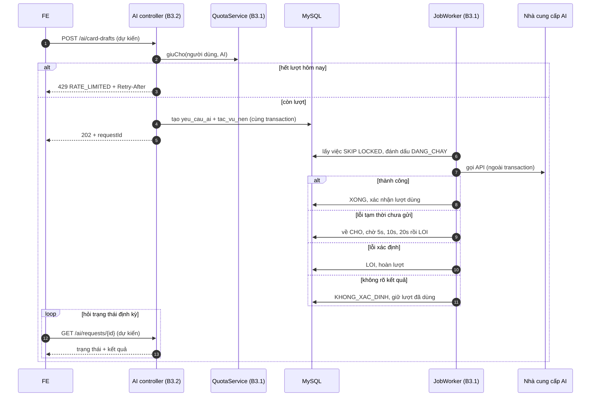

# Báo cáo bàn giao BE → FE — DOT3 AI, phát âm, động lực, vận hành & thanh toán

| Mục | Giá trị |
|---|---|
| Giai đoạn | Đợt 3 — AI, phát âm, động lực, vận hành & thanh toán (09/11 – 29/11/2026, Sprint S7–S9) |
| Ngày cập nhật | 11/11/2026 — B3.1 xong (hạ tầng tác vụ nền và hạn mức, không API); **B3.6 xong** (điểm thưởng, chuỗi ngày + ngày đóng băng, huy hiệu, thử thách tuần; 3 API mới). Các bước còn lại ghi ở mục 1 và mục 9 là **dự kiến** |
| Trạng thái BE | 🟡 Đang làm: B3.1 xong theo test người dùng chạy; **B3.6 xong**, toàn bộ `mvnw test` 427/427 pass ngày 11/11/2026 (gồm `FR12RewardTest` 6, `StreakCalculatorTest` 13). Chưa gọi HTTP thật trên môi trường dev. Các bước B3.x khác chưa bắt đầu |
| FE làm tương ứng | F3.1–F3.13 (`roadmap/TienDoDuKien_fronend.md`, mục Đợt 3): UI29 xưởng thẻ AI, UI30–UI32 AI, UI28 gợi ý, UI33–UI34 phát âm, UI38 thành tích, UI39 thông báo, UI45/UI50 báo cáo, UI36–UI37 thống kê, UI44 dữ liệu cá nhân, UI51 vận hành, UI55–UI57 thanh toán, UI58–UI59 quản lý thanh toán |
| Báo cáo trước | [Đợt 2](SPRINT_2_BAO_CAO_BE_BAN_GIAO_CHO_FE.md) — hợp đồng chung (lỗi `{code,message,fieldErrors,requestId}`, CSRF, phân trang, ID dạng chuỗi, cookie `SESSION`) xem ở đó và ở [Đợt 1](SPRINT_1_BAO_CAO_BE_BAN_GIAO_CHO_FE.md) |

> **Đọc nhanh:**
> - **API mới đầu tiên của Đợt 3 (B3.6):** `GET /rewards/history`, `GET /badges`, `GET /challenges` cho UI38 `/thanh-tich`; `GET /learning/today` thêm `daDungNgayNghiTuanNay`, `ngayNghiDaDung` cho thẻ chuỗi ngày trên UI12 (mục 5.2). FE nối F3.6 bằng API thật.
> - B3.1 chỉ là hạ tầng bên trong BE (hàng đợi tác vụ nền `tac_vu_nen`, hạn mức dịch vụ theo người/ngày). Các trang Đợt 3 khác vẫn dùng MSW/mock cho đến khi từng bước B3.x giao API.
> - Điều FE cần biết từ B3.1: mọi API AI sau này sẽ trả **202 + ID** rồi FE hỏi trạng thái, và hết hạn mức ngày trả **429 `RATE_LIMITED` kèm header `Retry-After`** (mục 3, mục 6). `api-client.js` đã đọc `Retry-After` thành `error.retryAfter`.
> - Hạn mức theo gói (TK §6.9, không có gói miễn phí): `PRO` AI 20 và ảnh 10 lượt/ngày; `PREMIUM` AI 100 và ảnh 30 lượt/ngày; "ngày" tính theo giờ Việt Nam (mục 7).
> - Bắt đầu với B3.2 (S7, tạo thẻ bằng AI, UI29) khi BE giao; xem hợp đồng dự kiến ở mục 9.

---

## 1. BE đã giao gì (đối chiếu 2 roadmap)

| BE bước | Kết quả | FE bước / UI | FE cần làm |
|---|---|---|---|
| B3.1 Tác vụ nền & hạn mức dịch vụ (FR-09, TC-12) | ✅ Không API. `JobService`/`JobWorker` (SKIP LOCKED, retry/backoff, thu hồi lease), `QuotaService` (giữ chỗ nguyên tử, xác nhận, hoàn trả, 429); migration `V15__jobs_ai.sql` (5 bảng, seed hạn mức `PRO`/`PREMIUM`); `FR09JobWorkerTest` (5), `FR09QuotaTest` (5) người dùng báo không lỗi (11/11); chưa HTTP thật | — (nền cho F3.1, F3.2, F3.3) | Chuẩn bị xử lý 429 + `Retry-After` và luồng 202 → hỏi trạng thái (mục 3, 6); chưa nối API |
| B3.2 Adapter AI & tạo thẻ từ đoạn văn | ⏳ Chưa làm (S7) | F3.1 UI29 `/ai/xuong-the` | Làm trước với MSW theo hợp đồng dự kiến mục 9 |
| B3.4a Âm thanh TTS | ⏳ Chưa làm (S7) | F3.5 (nghe) UI19, UI24 | MSW |
| B3.3 Các tác vụ AI khác (gọn) | ⏳ Chưa làm (S8) | F3.2, F3.3 UI30–UI32, UI16 | MSW |
| B3.5 Gợi ý có lý do | ⏳ Chưa làm (S8) | F3.4 UI28 | MSW |
| B3.6 Điểm, chuỗi ngày, huy hiệu, thử thách (gọn, FR-12, TC-15) | ✅ 3 API + mở rộng `/learning/today`; `V16__engagement.sql`; thưởng ghi trong cùng transaction với lượt ôn/nộp bài; `mvnw test` 427/427 pass (11/11); chưa HTTP thật | F3.6 UI38 `/thanh-tich`, thẻ chuỗi UI12 | Nối 3 API thật (mục 5.2); hiện trạng thái ngày nghỉ tuần trên UI12; invalidate sau khi ôn/nộp bài |
| B3.7 Thông báo, nhắc học (gọn) | ⏳ Chưa làm (S8) | F3.7 UI39 | MSW |
| B3.12a Gói dịch vụ & thanh toán VNPay | ⏳ Chưa làm (S8) | F3.12 UI55, UI57 | MSW; bắt 402 `SUBSCRIPTION_REQUIRED` khi bước này giao |
| B3.4b Đánh giá phát âm (gọn) | ⏳ Chưa làm (S9) | F3.5 UI33, UI34 | MSW |
| B3.8–B3.11 | ⏳ Chưa làm (S9) | F3.8–F3.11 | MSW |
| B3.12b, B3.12c | ⏳ Chưa làm (S9) | F3.12 UI56, F3.13 UI58–UI59 | MSW |

**Chưa có** (dùng MSW): các API Đợt 3 còn lại ở mục 9, vì chưa có code; mỗi bước sẽ được bàn giao bằng cách cập nhật báo cáo này. Tab "Tác vụ nền" UI53, UI46, UI52, UI54 đã cắt khỏi Đợt 3 ([KE_HOACH_CAT_DOT3](../docs/KE_HOACH_CAT_DOT3.md)).

## 2. Chạy BE

Giữ nguyên cách chạy ở [Đợt 2 mục 2](SPRINT_2_BAO_CAO_BE_BAN_GIAO_CHO_FE.md) (`backend/README.md`). Phần mới của B3.1:

| Mục | Giá trị |
|---|---|
| Migration mới | `V15__jobs_ai.sql` — `tac_vu_nen`, `han_muc_dich_vu`, `su_dung_dich_vu`, `yeu_cau_ai`, `ban_nhap_the_ai`. V15 được sửa ngày 11/11/2026 (bỏ gói `MIEN_PHI`, seed `PRO`/`PREMIUM`) khi **chưa commit**. Máy nào đã chạy bản V15 cũ sẽ báo lỗi checksum Flyway: xóa volume dev (`docker compose down -v`, mất dữ liệu dev) hoặc chạy `flyway repair` |
| Biến cấu hình mới | `JOBS_ENABLED` (mặc định `true`), `JOBS_INTERVAL_MS` (5000), `QUOTA_ZONE` (`Asia/Ho_Chi_Minh`); cấu hình cố định `app.jobs.batch-size: 3`, `max-retry: 3`, `lease: 10m`, `backoff-base: 5s`, `backoff-max: 5m` ở `application.yaml` |
| Test | `application-test.yaml` đặt `app.jobs.enabled=false` để test không chạy job nền; lệnh PowerShell: `.\mvnw.cmd -q test -Dtest='FR09JobWorkerTest,FR09QuotaTest'` |
| Dịch vụ mới | Không (chỉ dùng MySQL có sẵn) |
| B3.6 | Migration `V16__engagement.sql` (`so_diem_thuong`, `huy_hieu`, `nguoi_dung_huy_hieu`, `thu_thach`, `tien_do_thu_thach`; seed 6 huy hiệu, 1 thử thách tuần). Biến `REWARD_DAILY_CAP` (mặc định 100); cố định `app.rewards.diem-moi-luot-on: 1`, `diem-moi-cau-dung: 1`. Test: `.\mvnw.cmd -q test -Dtest='FR12RewardTest,StreakCalculatorTest'` |

## 3. Thay đổi hợp đồng chung

**B3.6 — `GET /learning/today` thêm 2 trường** (cuối response, không đổi trường cũ): `daDungNgayNghiTuanNay` (boolean) và `ngayNghiDaDung` (`YYYY-MM-DD` hoặc `null`). `chuoiNgay` giờ tính có ngày đóng băng (mỗi tuần thứ Hai–Chủ nhật được bỏ qua 1 ngày không đủ 5 lượt; ngày đóng băng không cộng vào số chuỗi), nên có thể lớn hơn trước với cùng dữ liệu. `GET /statistics/overview.chuoiNgay` dùng cùng cách tính. Response của `POST /learning/sessions/{id}/reviews` và `POST /practice/sessions/{id}/submissions` **không đổi**; điểm đọc qua `/rewards/history`.

Không có mã lỗi mới ở B3.1. Hợp đồng mới cho FE (theo mã nguồn, chưa kiểm chứng bằng HTTP):

| Mục | Chi tiết |
|---|---|
| 429 hết hạn mức ngày | Các API AI (B3.2+) trả 429 với `code = RATE_LIMITED` (mã đã có), `message` tiếng Việt ("Bạn đã dùng hết lượt AI hôm nay, vui lòng thử lại vào ngày mai", hoặc "…tạo ảnh AI…" cho nhóm ảnh), header **`Retry-After`** = số giây đến 00:00 giờ Việt Nam. `fieldErrors` rỗng. FE hiện thời điểm dùng lại từ `Retry-After` và liên kết "Nâng cấp gói" (UI55) khi có B3.12a |
| 429 khác | `RATE_LIMITED` cũng dùng cho giới hạn tốc độ (đăng nhập…) và không phân biệt bằng `code`; chỉ phân biệt bằng ngữ cảnh API và `message` |
| Tác vụ dài | Từ B3.2 các API AI trả 202 + `requestId`; FE hỏi `GET /ai/requests/{id}` định kỳ (xem mục 4). Trạng thái yêu cầu: `CHO`, `DANG_XU_LY`, `HOAN_TAT`, `LOI`, `KHONG_XAC_DINH` (dự kiến, B3.2) |
| `KHONG_XAC_DINH` | Nhà cung cấp có thể đã xử lý nhưng BE không biết kết quả (timeout lúc đọc phản hồi, worker chết). BE **không tự thử lại và không hoàn lượt**; FE hiện "Chưa xác định, bạn có thể thử lại" và nói rõ thử lại sẽ dùng thêm một lượt |
| AI lỗi không chặn học | Học SRS, bài luyện cố định, thống kê không phụ thuộc hạn mức hay trạng thái tác vụ nền (TC-12) |

## 4. Luồng chính

Luồng dưới là **dự kiến cho B3.2** (cùng hạ tầng B3.1 đã có). Phần B3.1 đã code: giữ chỗ hạn mức, hàng đợi, retry/backoff, thu hồi lease.



## 5. API chi tiết

### 5.1 B3.1 — không có endpoint

B3.1 không thêm route nào; không có request/response để kiểm chứng. Hành vi FE nhìn thấy gián tiếp qua các API AI của B3.2+ và `GET /me/service-quota` (B3.3, dự kiến). Các quy tắc hạn mức đã code:

| Quy tắc | Chi tiết (theo mã nguồn, test người dùng chạy không lỗi 11/11/2026) |
|---|---|
| Nhóm hạn mức | `AI` (tạo thẻ, giải thích, sửa câu) và `ANH` (ảnh AI, X-04) tách riêng; hết `ANH` không chặn `AI` |
| Còn lại | `giới hạn − đang giữ − đã dùng`; lượt đang xử lý vẫn tính, nên bấm liên tiếp không vượt hạn mức |
| Ngày | Theo giờ `Asia/Ho_Chi_Minh`, đổi ngày lúc 00:00; không theo múi giờ cá nhân của người học |
| Lỗi xác định | Hoàn lượt (`LOI`) |
| Không rõ kết quả | Giữ lượt đã dùng (`KHONG_XAC_DINH`) |
| Retry | Tối đa 3 lần thử lại, chờ 5 giây, 10 giây, 20 giây (trần 5 phút), tức tối đa 4 lần chạy |

**Lỗi** (hợp đồng theo mã nguồn, chưa kiểm chứng; `GlobalExceptionHandler` + `QuotaService`)

| HTTP | `code` | Khi nào | FE xử lý |
|---|---|---|---|
| 429 | `RATE_LIMITED` + `Retry-After` | Hết lượt `AI` hoặc `ANH` trong ngày | Hiện thời điểm dùng lại (`Retry-After` giây), liên kết UI55 khi có B3.12a; không chặn các chức năng học |

```http
HTTP/1.1 429
Retry-After: 3600
```
```json
{
  "code": "RATE_LIMITED",
  "message": "Bạn đã dùng hết lượt AI hôm nay, vui lòng thử lại vào ngày mai",
  "fieldErrors": [],
  "requestId": "<requestId>"
}
```

Ví dụ trên là **hợp đồng theo mã nguồn, chưa kiểm chứng** (BE chưa có API nào gọi `QuotaService` qua HTTP); `Retry-After` là ví dụ minh họa.

### 5.2 B3.6 — Điểm thưởng, huy hiệu, thử thách

Cả 3 API: đăng nhập (cookie `SESSION`), chỉ trả dữ liệu của người gọi, `GET` nên không cần CSRF. Hợp đồng theo mã nguồn và `FR12RewardTest` (MockMvc), chưa gọi HTTP thật. Luồng chi tiết: [B3.6](../docs/luong-backend/B3.6-diem-chuoi-huy-hieu.md).

| API | Query | 200 |
|---|---|---|
| `GET /api/v1/rewards/history` | `page` (≥ 0, mặc định 0), `size` (1–100, mặc định 20) | `{tongDiem, diemHomNay, diemToiDaNgay, lichSu: {items[], page, size, totalElements, totalPages}}`; item `{id, loaiSuKien, diemGoc, soDiem, ngayDiaPhuong, createdAt}`, mới nhất trước |
| `GET /api/v1/badges` | — | `[{id, ma, ten, moTa, loaiDieuKien, nguong, daNhan, nhanAt}]`, 6 phần tử theo thứ tự hiển thị |
| `GET /api/v1/challenges` | — | `[{id, ma, ten, moTa, loaiDieuKien, chuKy, mucTieu, giaTri, tuanBatDau, tuanKetThuc, hoanThanhAt}]`, tuần hiện tại theo múi giờ người dùng |

| Enum | Giá trị |
|---|---|
| `loaiSuKien` | `ON_THE` (lượt ôn), `BAI_LUYEN` (bài nộp) |
| `loaiDieuKien` (huy hiệu) | `TONG_LUOT_ON`, `CHUOI_NGAY`, `TONG_BAI_LUYEN`, `TONG_DIEM` |
| `loaiDieuKien` / `chuKy` (thử thách) | `LUOT_ON` / `TUAN` |

Quy tắc FE cần hiển thị đúng:
- 1 điểm cho lượt ôn đầu tiên của mỗi thẻ/chiều trong ngày (các bước học lại cùng ngày không thêm điểm); 1 điểm/câu đúng của bài luyện; bài luyện lại 0 điểm; tối đa `diemToiDaNgay` (100) điểm/ngày. `soDiem < diemGoc` = đã chạm trần, hiện "đã chạm trần ngày".
- Thử thách chỉ đếm lượt ôn được thưởng; `hoanThanhAt` khác `null` = đã hoàn thành. Huy hiệu và thử thách không cộng điểm.
- Ngày đóng băng: `daDungNgayNghiTuanNay = true` → báo "Đã dùng ngày nghỉ tuần này ({ngayNghiDaDung}); nghỉ thêm một ngày trong tuần sẽ đứt chuỗi".

Ví dụ (rút gọn, hợp đồng theo mã nguồn, giá trị minh họa):
```json
{
  "tongDiem": 133, "diemHomNay": 2, "diemToiDaNgay": 100,
  "lichSu": { "items": [ { "id": "41", "loaiSuKien": "ON_THE", "diemGoc": 1, "soDiem": 1, "ngayDiaPhuong": "2026-11-11", "createdAt": "2026-11-11T02:15:03.120Z" } ],
              "page": 0, "size": 20, "totalElements": 1, "totalPages": 1 }
}
```

**Lỗi:** 401 `UNAUTHENTICATED`; 400 `VALIDATION_FAILED` khi `page`/`size` sai (`fieldErrors[].field` = `page`/`size`).

## 6. Mã FE mẫu

Giữ nhất quán với `src/lib/api-client.js` (đã đọc `Retry-After` thành `error.retryAfter`).

```js
export function quotaMessage(error) {
  if (error?.status !== 429 || error?.data?.code !== 'RATE_LIMITED') return null;
  const hours = error.retryAfter ? Math.ceil(error.retryAfter / 3600) : null;
  return hours ? `${error.data.message} (dùng lại sau khoảng ${hours} giờ)` : error.data.message;
}
```

```js
export function useAiRequest(requestId) {
  return useQuery({
    queryKey: ['ai', 'requests', requestId],
    queryFn: () => api.get(`/ai/requests/${requestId}`),
    enabled: Boolean(requestId),
    refetchInterval: (query) =>
      ['HOAN_TAT', 'LOI', 'KHONG_XAC_DINH'].includes(query.state.data?.trangThai) ? false : 2000,
  });
}
```

```js
import { http, HttpResponse } from 'msw';

export const aiQuotaExhausted = http.post('/api/v1/ai/card-drafts', () =>
  HttpResponse.json(
    { code: 'RATE_LIMITED', message: 'Bạn đã dùng hết lượt AI hôm nay, vui lòng thử lại vào ngày mai', fieldErrors: [], requestId: 'mock' },
    { status: 429, headers: { 'Retry-After': '3600' } },
  ),
);
```

```js
export const useRewardHistory = (page = 0) =>
  useQuery({ queryKey: ['rewards', 'history', page], queryFn: () => api.get(`/rewards/history?page=${page}&size=20`) });
export const useBadges = () => useQuery({ queryKey: ['badges'], queryFn: () => api.get('/badges') });
export const useChallenges = () => useQuery({ queryKey: ['challenges'], queryFn: () => api.get('/challenges') });
```

Sau khi ghi lượt ôn hoặc nộp bài thành công: invalidate `['rewards']`, `['badges']`, `['challenges']`, `['learning','today']` (B3.6).

`useAiRequest` và handler `card-drafts` là **dự kiến** (B3.2 chưa có); tên field `trangThai` chốt khi làm B3.2. Mã lỗi 429 và `Retry-After` theo mã nguồn hiện tại. Sau mutation AI thành công: invalidate `['ai','history']` và `['me','service-quota']` (khi B3.3 có).

## 7. Dữ liệu mẫu / tài khoản demo

- Tài khoản demo giữ nguyên như Đợt 2: `admin@vocab.local` (ADMIN), `an@vocab.local`, `binh@vocab.local`, `chi@vocab.local` (USER), mật khẩu `Vocab@12345` (seed dev).
- Hạn mức seed bởi `V15__jobs_ai.sql` (theo TK §6.9, mọi môi trường): `PRO` AI 20 / ảnh 10; `PREMIUM` AI 100 / ảnh 30 mỗi ngày. Chưa có B3.12a nên mọi người dùng được coi là `PRO`. Quản trị đổi mức qua `PUT /admin/service-quotas` (B3.11, chưa có).
- Chưa có dữ liệu `yeu_cau_ai` hay tác vụ nền để FE xem; các bảng này rỗng đến khi B3.2.

## 8. Checklist FE hoàn thành Đợt 3

Trạng thái BE đến 11/11/2026: chỉ B3.1; các mục dưới là tiêu chí FE theo `roadmap/TienDoDuKien_fronend.md`, chưa làm được khi API chưa có (dùng MSW).

- [ ] F3.1 UI29 `/ai/xuong-the`: 202 → hỏi trạng thái định kỳ (dừng ở `HOAN_TAT`/`LOI`/`KHONG_XAC_DINH`); "Lưu N thẻ đã chọn" với `Idempotency-Key`; chọn bộ có sẵn hoặc nhập tên bộ mới; AI lỗi vẫn lưu tay được
- [ ] 429 `RATE_LIMITED` hiện thời điểm dùng lại từ `Retry-After` (mục 6); hết hạn mức ảnh hiện nút "Nâng cấp gói" sang UI55 (sau B3.12a); không chặn học
- [ ] `KHONG_XAC_DINH` hiện "Chưa xác định" và nói rõ thử lại tốn thêm một lượt; `LOI` cho thử lại
- [ ] F3.2 UI30, UI31, UI16: không render HTML từ AI; AI lỗi/429 không chặn lưu thẻ tay
- [ ] F3.3 UI32 lịch sử AI dạng danh sách; hạn mức còn lại đọc `GET /me/service-quota` (B3.3)
- [ ] F3.4 UI28 gợi ý hiển thị mã lý do và minh chứng
- [ ] F3.5 UI33, UI34 phát âm: xin quyền micro khi bấm ghi, chỉ hiện chỉ số có thật, kết quả Fake có nhãn "Mô phỏng"
- [ ] F3.6 UI38 đọc `/rewards/history` (phân trang), `/badges`, `/challenges`; hiện "đã chạm trần ngày" khi `soDiem < diemGoc`; UI12 hiện ngày nghỉ tuần từ `daDungNgayNghiTuanNay`/`ngayNghiDaDung`; không tự tính điểm ở FE
- [ ] F3.7 thông báo đọc API thật
- [ ] F3.8–F3.11 báo cáo, thống kê tuần, xóa dữ liệu, vận hành đọc API thật
- [ ] F3.12 UI55, UI56, UI57 nối `billing`, bắt 402 `SUBSCRIPTION_REQUIRED` chuyển `/thanh-toan-goi`
- [ ] F3.13 UI58, UI59 quản lý thanh toán Admin

## 9. Sắp có (phần còn lại của Đợt 3) — hợp đồng dự kiến

Theo `roadmap/TienDoDuKien_backend.md` (Đợt 3), `roadmap/SPRINT_PLAN.md` (S7–S9) và [KE_HOACH_CAT_DOT3](../docs/KE_HOACH_CAT_DOT3.md); **chưa có code**, tên field chốt khi làm từng bước. Sau Đợt 3 là Đợt 4 (B4.1–B4.5: kiểm thử nghiệm thu TC-01…TC-24, bảo mật, hiệu năng, sao lưu, giám sát), không có API mới cho FE.

| BE bước | Sprint | Dự kiến có | API (dự kiến) | FE bước | UI |
|---|---|---|---|---|---|
| B3.2 | S7 (09/11–15/11) | Tạo thẻ bằng AI; nhập tệp, lưu vào bộ mới (X-01, X-02); dùng hạ tầng B3.1 | `POST /ai/card-drafts` (202 + ID; đoạn văn hoặc `tepId`), `GET /ai/requests/{id}`, `POST /ai/card-drafts/{id}/commit` (`boTheId` hoặc `tenBoMoi`, `Idempotency-Key`) | F3.1 | UI29 `/ai/xuong-the` |
| B3.4a | S7 | Âm thanh TTS | `GET /cards/{id}/audio` | F3.5 (nghe) | UI19, UI24 |
| B3.3 (gọn) | S8 (16/11–22/11) | Giải thích ngữ cảnh, sửa câu, tự điền thẻ (R-02, X-03), ảnh AI (X-04); `POST /ai/exercise-drafts` **Hoãn** | `POST /ai/context-explanations`, `POST /ai/sentence-feedback`, `POST /ai/card-images` (202), `GET /ai/history`, `GET /me/service-quota` | F3.2, F3.3 | UI30, UI31, UI32, UI16, UI29 |
| B3.5 | S8 | Gợi ý có lý do (+ `TIEN_BO`) | `GET /learning/recommendations` → `{reasonCode, message, cardIds, evidence}` | F3.4 | UI28, UI27 |
| B3.7 (gọn) | S8 | Thông báo, nhắc học | `GET /notifications`, `PATCH /notifications/{id}` | F3.7 | UI39 |
| B3.12a | S8 | Gói dịch vụ, VNPay sandbox (FR-15); `EntitlementService` thay `ProGoiResolver`; `SubscriptionGuard` 402 | `GET /billing/plans`, `GET /me/subscription`, `POST /billing/checkouts`, `GET /billing/vnpay/ipn`, `GET /billing/vnpay/return`, `GET /billing/transactions/{maDon}` | F3.12 | UI55, UI57 |
| B3.4b (gọn) | S9 (23/11–29/11) | Đánh giá phát âm | `POST /pronunciation/assessments` (multipart ≤ 15 giây), `GET /pronunciation/assessments/{id}`, `GET /pronunciation/history`, `DELETE /pronunciation/recordings/{id}` | F3.5 | UI33, UI34 |
| B3.8 (gọn) | S9 | Báo cáo nội dung, kiểm duyệt | `POST /reports`, `GET /admin/reports`, `POST /admin/reports/{id}/resolve` | F3.8 | UI45, UI50 |
| B3.9 (gọn) | S9 | Tổng kết tuần, bản đồ làm chủ dạng bảng | `GET /statistics/weekly-summary` | F3.9 | UI37, UI36 |
| B3.10 (gọn) | S9 | Xóa tài khoản | `POST /me/deletion-requests` | F3.10 | UI44 |
| B3.11 (gọn mạnh) | S9 | Hạn mức và lượt dùng/lỗi dịch vụ | `GET/PUT /admin/service-quotas`, `GET /admin/service-usage` | F3.11 | UI51 |
| B3.12b | S9 | Lịch sử giao dịch, biên nhận, hết hạn gói, áp quyền lợi (TC-22, TC-23) | `GET /billing/transactions`, `GET /billing/transactions/{maDon}/receipt`, `GET /me/subscription` (`soNgayConLai`) | F3.12 | UI56, banner `AppShell`, UI44 |
| B3.12c | S9 | Quản lý thanh toán, doanh thu, công cụ demo sửa hạn (TC-23, TC-24) | `GET /admin/payments`, `GET /admin/payments/{maDon}`, `GET /admin/subscriptions`, `GET/PUT /admin/plans`, `GET /admin/revenue`, `PATCH /admin/subscriptions/{id}/expiry`, `POST /admin/subscriptions/expiry-check` | F3.13 | UI58, UI59 |

Mockup Đợt 3: xem `mockups/dot3/` (README và `ui.js`); mới đối chiếu với DTO cho UI38 `thanh-tich` (B3.6), các màn khác chưa vì BE chưa có API. Việc tạo hay sửa mockup cần yêu cầu riêng.

## 10. Lưu ý / giới hạn / chưa kiểm chứng

| Mục | Chi tiết |
|---|---|
| Kiểm chứng B3.1 | **11/11/2026:** người dùng báo compile, khởi động app và `.\mvnw.cmd -q test -Dtest='FR09JobWorkerTest,FR09QuotaTest'` không lỗi sau khi đổi sang gói `PRO`/`PREMIUM`; không có tổng số test hay log đính kèm. Chưa chạy bộ test đầy đủ (`mvnw verify`). Không có HTTP thật vì B3.1 không có endpoint; không có mục Postman hay mockup cho bước này |
| Test đã viết | `FR09JobWorkerTest`: hai worker không lấy trùng 20 job; retry/backoff 5s·10s·20s rồi `LOI` sau 4 lần chạy; `LOI`, `KHONG_XAC_DINH`, lỗi lạ, loại chưa đăng ký không retry; lease hết hạn → `KHONG_XAC_DINH`; `enqueue` ngoài transaction bị từ chối. `FR09QuotaTest`: 10 request đồng thời với giới hạn 5 chỉ được 5; 429 kèm `Retry-After` và sang ngày mới theo giờ Việt Nam; hạn mức ảnh tách khỏi AI; hoàn trả và xác nhận; job `LOI` hoàn lượt, `KHONG_XAC_DINH` giữ lượt |
| Quyết định nghiệp vụ (11/11/2026) | `han_muc_dich_vu(goi_ma, loai)` là nguồn hạn mức duy nhất, `goi_dich_vu` không có cột `han_muc_*` (TK §12.2 đã sửa); "ngày" hạn mức theo `app.quota.zone`; worker chết hoặc quá lease 10 phút → `KHONG_XAC_DINH`, không hoàn lượt (đánh đổi: worker chết trước khi gọi API thì người dùng mất một lượt); không có gói miễn phí |
| Chưa chốt | Đầu ra nhà cung cấp sai schema có hoàn lượt hay không (quyết định ở `khiKetThuc` của B3.2); hạn mức riêng cho phát âm và bài luyện AI (thêm giá trị `loai` bằng migration của bước cần); mốc 12/11/2026 chốt nhà cung cấp AI (chưa có khóa thì dùng `FakeAiClient` có nhãn) |
| Điểm nối tạm | `ProGoiResolver` luôn trả `PRO`; B3.12a thay bằng bản đọc `EntitlementService`. Trước đó chưa có `SubscriptionGuard` nên chưa có 402 |
| Việc chờ làm | `JobWorker` chỉ chạy được khi có `JobHandler` đăng ký (B3.2+); `yeu_cau_ai`/`ban_nhap_the_ai` mới có bảng, chưa có entity |
| Rủi ro đã biết | Test 10 request đồng thời có thể lộ deadlock khi tạo dòng đếm lần đầu (chưa thấy xảy ra); `app.jobs.lease` (10 phút) phải lớn hơn `batch-size × timeout API` khi chọn timeout ở B3.2 |
| Môi trường dev | Máy đã áp bản V15 cũ phải reset DB dev hoặc `flyway repair` (mục 2) |
| Tài liệu đã đồng bộ | `roadmap/TienDoDuKien_backend.md` (B3.1 và B3.6 `[x]`, dòng thứ tự migration, B3.12a), TK §12.2, §13 (UI12), §14.2, §15.1, [luồng B3.1](../docs/luong-backend/B3.1-tac-vu-nen-va-han-muc.md), [luồng B3.6](../docs/luong-backend/B3.6-diem-chuoi-huy-hieu.md), ghi chú B3.6 trong luồng B2.4 và B2.8 |
| Kiểm chứng B3.6 | **11/11/2026:** `.\mvnw.cmd test` toàn bộ 427 test, 0 lỗi, BUILD SUCCESS (Testcontainers MySQL 8.4/Redis); trong đó `FR12RewardTest` 6 (gửi lặp + bước học lại chỉ thưởng 1 lần, trần 100 ghi `so_diem = 0`, nộp bài lặp và luyện lại không cộng, huy hiệu `BUOC_DAU`/`CHUOI_3` + thử thách sau 5 lượt, ngày đóng băng đọc từ DB, 401/400), `StreakCalculatorTest` 13 (nghỉ 1 ngày, 2 ngày liền, 2 ngày rời cùng tuần, CN + T2, đổi múi giờ, qua tuần). Chưa gọi HTTP thật trên dev; Postman đã thêm 4 request nhưng chưa chạy test script |
| Quyết định B3.6 (11/11/2026) | Trần 100/ngày cấu hình được; dùng `su_dung_hoc_ngay.diem` (có từ V8) làm bộ đếm ngày có khóa dòng; `su_kien_id` VARCHAR(64) = `tienDoId:ngày` để mỗi thẻ/chiều chỉ thưởng 1 lần/ngày; ghi thưởng cùng transaction (không gọi mạng, rollback cùng lượt ôn); huy hiệu/thử thách không cộng điểm; nghỉ CN + T2 liền nhau vẫn giữ chuỗi (mỗi tuần một ngày nghỉ, TK §15.1 đã ghi rõ); sửa lỗi B2.2 mất một ngày chuỗi khi đổi múi giờ sang phía tây |
| Đổi hành vi cũ | `chuoiNgay` của `/learning/today` và `/statistics/overview` có thể tăng so với trước vì có ngày đóng băng; `FR06TodayPlanTest` đã sửa kỳ vọng (3 → 4, 2 → 3) |
| Giới hạn B3.6 | "Qua nửa đêm" dựa trên cách gán ngày theo múi giờ phiên của B2.2 (TC-09), chưa có test tích hợp đồng hồ cố định cho lượt ôn 23:59/00:01. Bài luyện không cộng vào chuỗi ngày (chuỗi chỉ đếm lượt ôn, theo TK). Mockup `quan-tri-dong-luc` (UI54) giữ nguyên vì đã Cắt. Mockup `demo.js` tính huy hiệu `CHUOI_NGAY` theo chuỗi hiện tại, còn BE giữ huy hiệu đã nhận vĩnh viễn |
| Mockup / Postman B3.6 | `mockups/shared/demo.js` thêm 3 route đúng DTO + ngày đóng băng trong `/learning/today`; `mockups/dot3/ui.js` trang `thanh-tich` đọc 3 route (kiểm tra preview `?as=an`, console không lỗi). Postman "06 Tương tác & thống kê": 3 request + 1 ca 400 |
| Chưa kiểm chứng | Các API Đợt 3 còn lại ở mục 9 (chưa có code); HTTP thật cho mọi bước B3.x |

## 11. Báo lỗi cho BE

Gửi đường dẫn API + body + `requestId`; BE tra: `docker compose logs api | grep <requestId>`.
