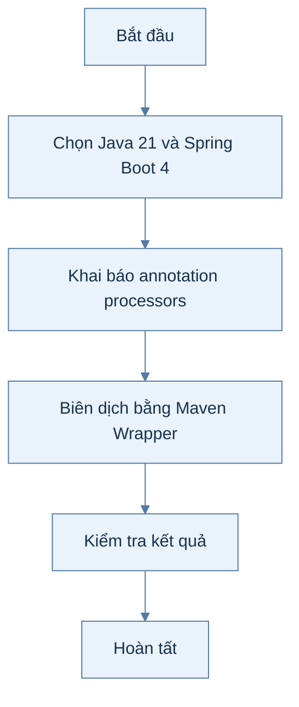
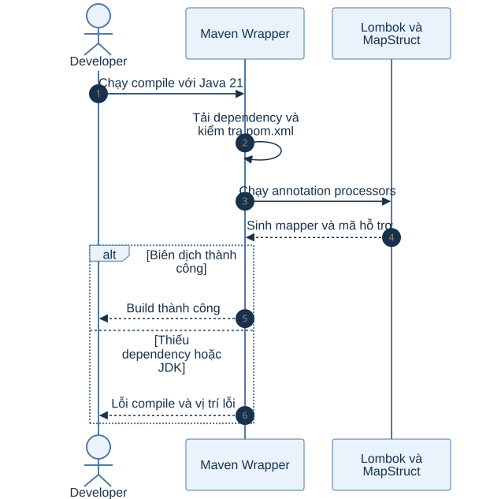
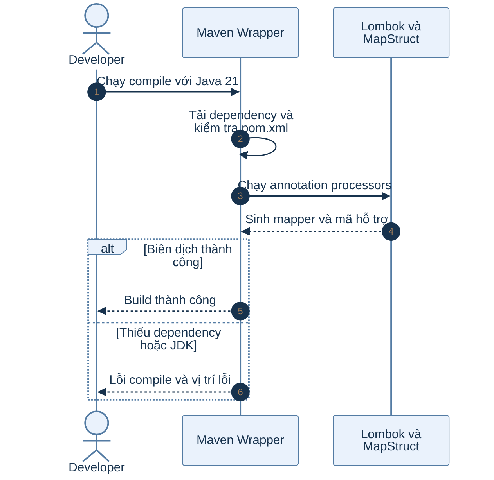

# B0.1 — Khởi tạo backend

> Phạm vi: backend hiện có theo roadmap và mã nguồn. Sơ đồ hoạt động mô tả các bước; sơ đồ tuần tự mô tả thành phần tham gia.

## Sơ đồ hoạt động

Xem mã Mermaid của sơ đồ

## Sơ đồ tuần tự

Xem mã Mermaid của sơ đồ

## Giải thích từng bước

| Bước | Việc diễn ra | Ý nghĩa và dữ liệu |
|---|---|---|
| 1 | Chọn Java 21 và Spring Boot 4 | Thiết lập pom.xml, Maven Wrapper và các dependency web, validation, JPA, security, Redis, Flyway, mail, S3. |
| 2 | Khai báo annotation processors | Cấu hình Lombok, MapStruct và lombok-mapstruct-binding để lớp mapper được sinh khi biên dịch. |
| 3 | Biên dịch bằng Maven Wrapper | Maven tải dependency, chạy annotation processor và tạo mã nguồn sinh tự động. |
| 4 | Kiểm tra kết quả | Lệnh compile thành công chứng minh cấu hình nền có thể xây dựng ứng dụng. |

## Nhánh lỗi và cách kiểm tra

Nếu thiếu JDK 21 hoặc processor binding, quá trình compile thất bại trước khi chạy API. Sửa pom.xml hoặc môi trường Java rồi biên dịch lại.

## Vị trí mã nguồn liên quan

`backend/k28/pom.xml`, `backend/k28/mvnw`. Các đường dẫn Java ở trên nằm dưới `backend/k28/src/main/java/com/do_an_tot_nghiep/k28/`.
