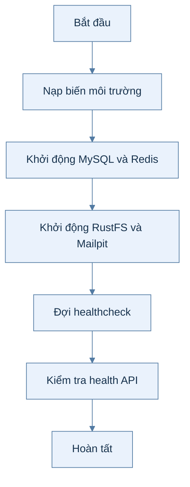
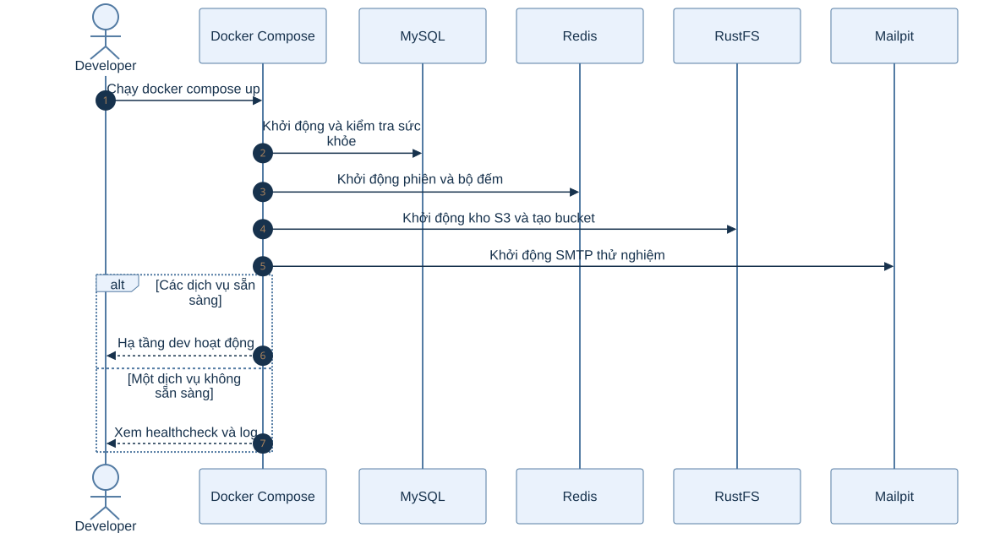
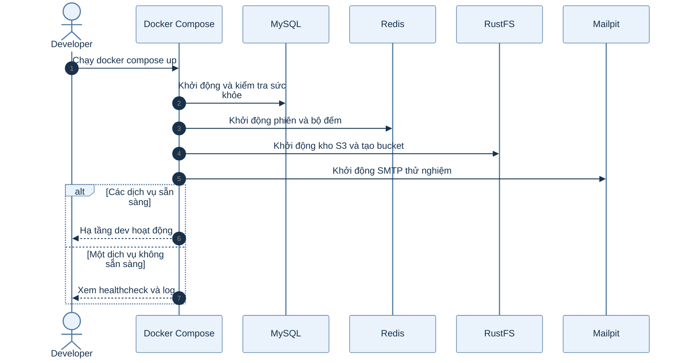

# B0.2 — Môi trường Docker Compose

> Phạm vi: backend hiện có theo roadmap và mã nguồn. Sơ đồ hoạt động mô tả các bước; sơ đồ tuần tự mô tả thành phần tham gia.

## Sơ đồ hoạt động

Xem mã Mermaid của sơ đồ

## Sơ đồ tuần tự

Xem mã Mermaid của sơ đồ

## Giải thích từng bước

| Bước | Việc diễn ra | Ý nghĩa và dữ liệu |
|---|---|---|
| 1 | Nạp biến môi trường | Compose đọc giá trị DB, Redis, S3 và SMTP từ .env; .env.example chỉ là mẫu phát triển. |
| 2 | Khởi động MySQL và Redis | MySQL giữ dữ liệu bền vững; Redis giữ phiên và bộ đếm giới hạn tần suất. |
| 3 | Khởi động RustFS và Mailpit | RustFS cung cấp S3 nội bộ, Mailpit thu thư thử nghiệm qua SMTP. |
| 4 | Đợi healthcheck | Các service phải sẵn sàng trước khi backend kết nối; profile app mới chạy thêm container API. |
| 5 | Kiểm tra health API | Khi backend chạy, actuator health phản ánh trạng thái ứng dụng và kết nối cần thiết. |

## Nhánh lỗi và cách kiểm tra

Sai host giữa chạy trực tiếp (localhost) và chạy trong Compose (tên service, truyền bằng biến môi trường) thường làm kết nối thất bại. Kiểm tra cổng host 3307 và tên service nội bộ khi chạy trong container.

## Vị trí mã nguồn liên quan

`backend/k28/docker-compose.yml`, `backend/k28/Dockerfile`. Các đường dẫn Java ở trên nằm dưới `backend/k28/src/main/java/com/do_an_tot_nghiep/k28/`.
