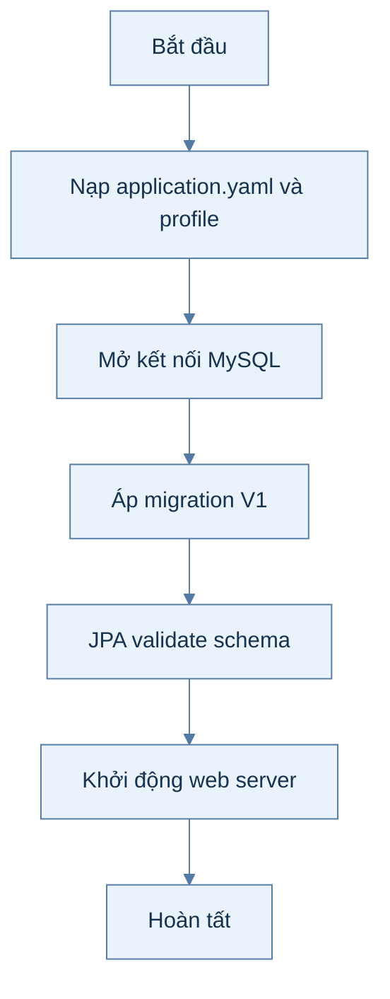
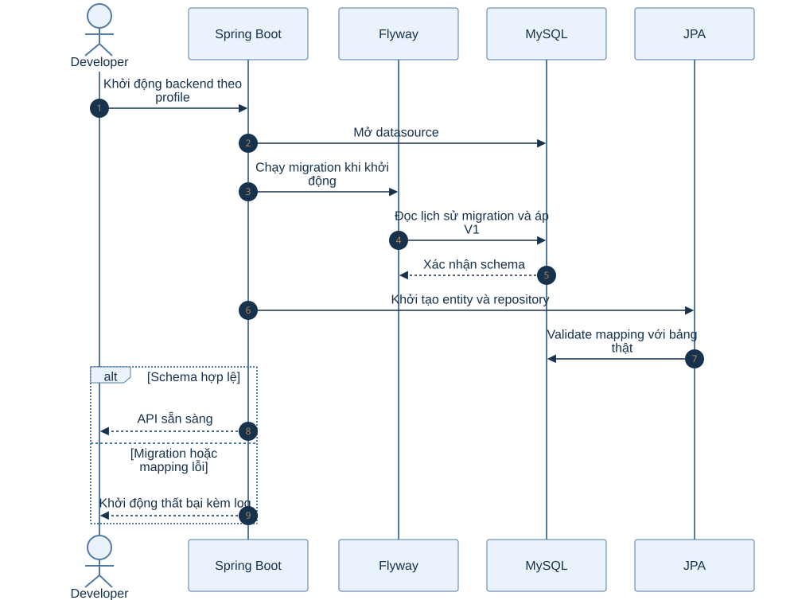
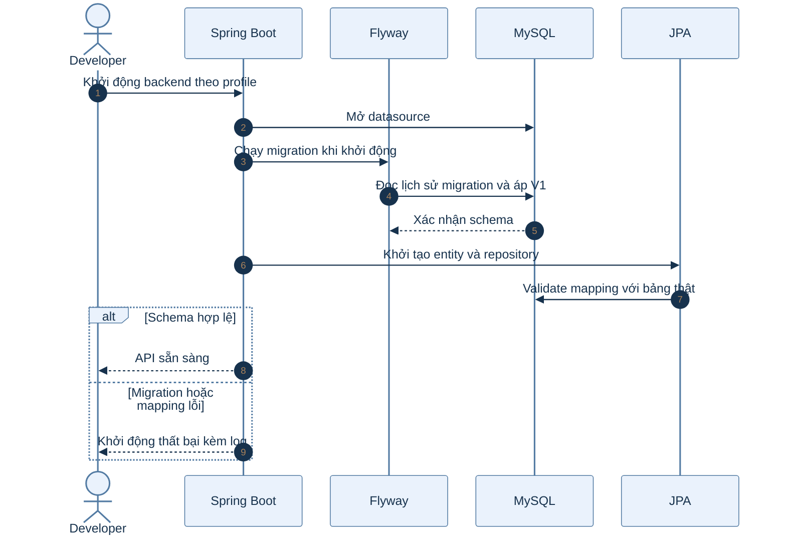

# B0.3 — Cấu hình ứng dụng và Flyway

> Phạm vi: backend hiện có theo roadmap và mã nguồn. Sơ đồ hoạt động mô tả các bước; sơ đồ tuần tự mô tả thành phần tham gia.

## Sơ đồ hoạt động

Xem mã Mermaid của sơ đồ

## Sơ đồ tuần tự

Xem mã Mermaid của sơ đồ

## Giải thích từng bước

| Bước | Việc diễn ra | Ý nghĩa và dữ liệu |
|---|---|---|
| 1 | Nạp application.yaml và profile | Ứng dụng nhận URL MySQL, Redis, SMTP, S3 cùng các cấu hình JPA, session và múi giờ. |
| 2 | Mở kết nối MySQL | Datasource kết nối trước khi repository và service phục vụ yêu cầu. |
| 3 | Áp migration V1 | Flyway tạo bảng tài khoản, vai trò, danh tính OAuth, token và thiết lập; ghi lịch sử migration. |
| 4 | JPA validate schema | Hibernate so khớp entity với lược đồ; không tự sửa bảng vì ddl-auto là validate. |
| 5 | Khởi động web server | Chỉ sau khi cấu hình và migration hợp lệ, API mới sẵn sàng nhận request. |

## Nhánh lỗi và cách kiểm tra

Nếu migration lỗi hoặc entity lệch schema, ứng dụng không khởi động. Sửa migration hoặc mapping tương ứng, không sửa tay bảng production.

## Vị trí mã nguồn liên quan

`backend/k28/src/main/resources/application.yaml`, `backend/k28/src/main/resources/db/migration/V1__account.sql`. Các đường dẫn Java ở trên nằm dưới `backend/k28/src/main/java/com/do_an_tot_nghiep/k28/`.
