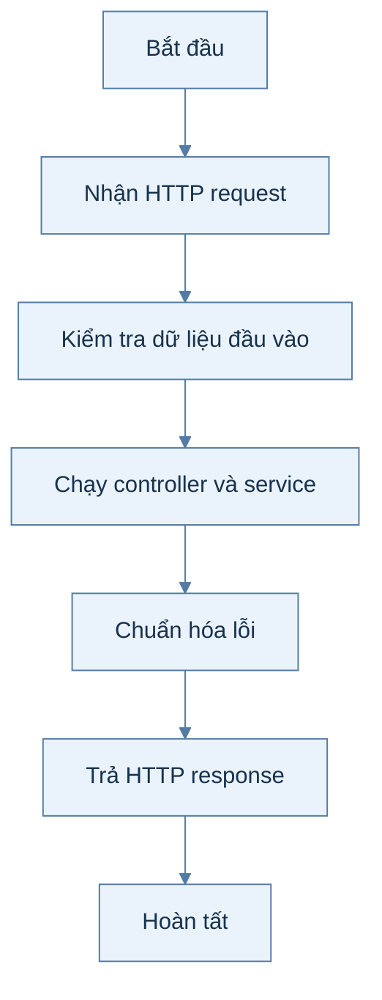
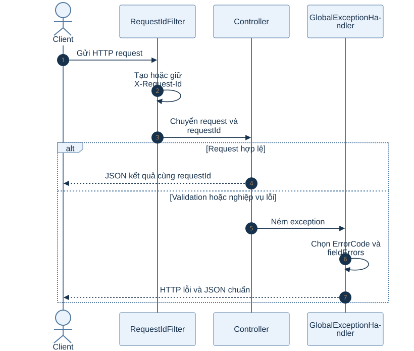
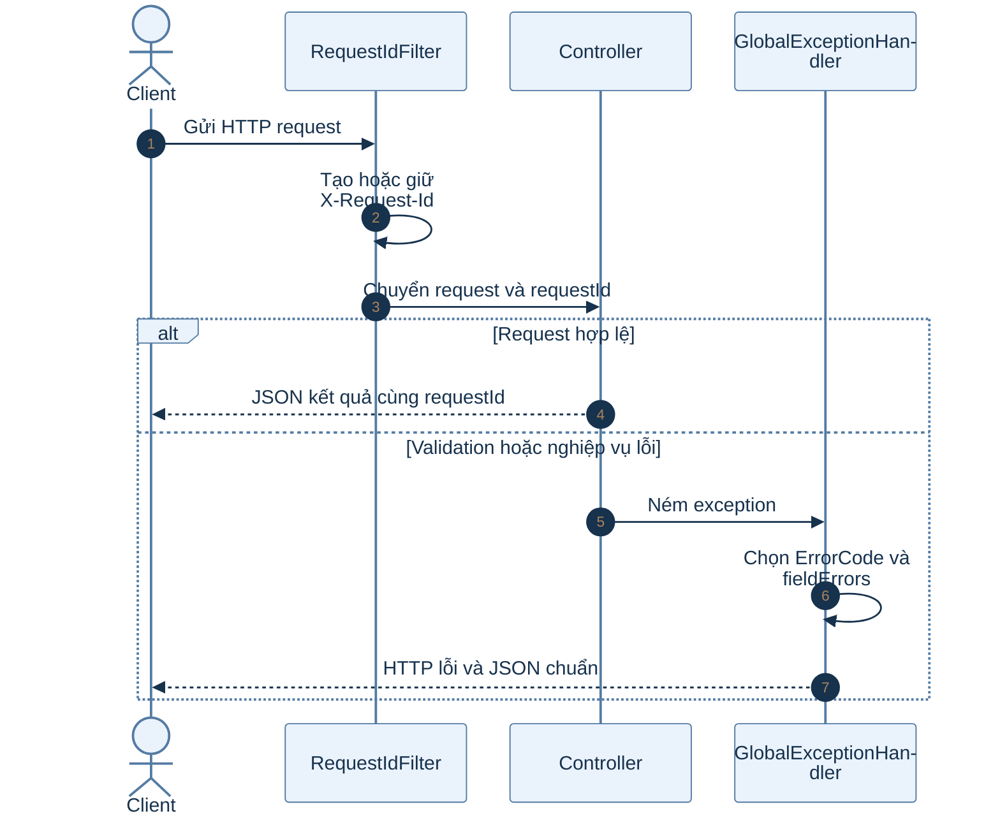

# B0.4 — Xử lý lỗi và tiện ích web

> Hợp đồng hiện hành: lỗi code/message/fieldErrors[]/requestId; phân trang items/page/size/totalElements/totalPages. Log xuất MDC requestId từ05/10.

> Phạm vi: backend hiện có theo roadmap và mã nguồn. Sơ đồ hoạt động mô tả các bước; sơ đồ tuần tự mô tả thành phần tham gia.

## Sơ đồ hoạt động

Xem mã Mermaid của sơ đồ

## Sơ đồ tuần tự

Xem mã Mermaid của sơ đồ

## Giải thích từng bước

| Bước | Việc diễn ra | Ý nghĩa và dữ liệu |
|---|---|---|
| 1 | Nhận HTTP request | RequestIdFilter lấy hoặc tạo X-Request-Id rồi gắn vào MDC để truy vết log. |
| 2 | Kiểm tra dữ liệu đầu vào | Validation phát hiện trường thiếu hoặc sai giới hạn trước khi đi sâu vào nghiệp vụ. |
| 3 | Chạy controller và service | Lỗi nghiệp vụ được biểu diễn bằng ApiException với ErrorCode xác định. |
| 4 | Chuẩn hóa lỗi | GlobalExceptionHandler đổi exception thành code, message, fieldErrors và requestId. |
| 5 | Trả HTTP response | Mã trạng thái tương ứng với lỗi, còn response không chứa stack trace nội bộ. |

## Nhánh lỗi và cách kiểm tra

Lỗi validation trả 400; không có đăng nhập trả 401; quyền không đủ trả 403; xung đột dữ liệu trả 409. Đối chiếu code với HTTP status trước khi sửa FE.

## Vị trí mã nguồn liên quan

`common/web/RequestIdFilter.java`, `common/exception/GlobalExceptionHandler.java`, `common/exception/ErrorCode.java`. Các đường dẫn Java ở trên nằm dưới `backend/k28/src/main/java/com/do_an_tot_nghiep/k28/`.
