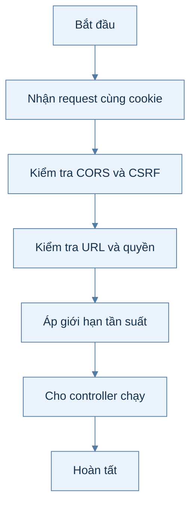
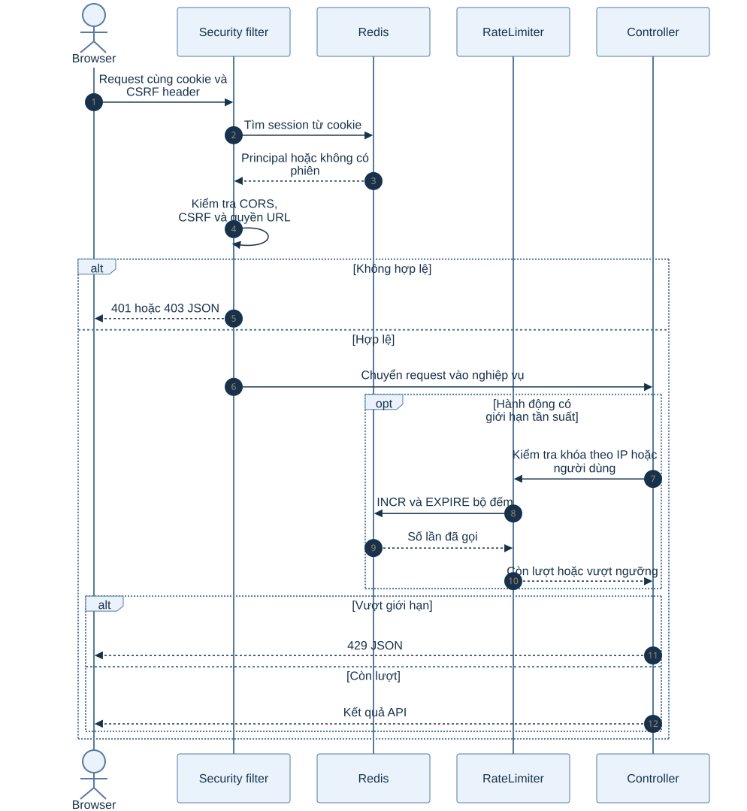
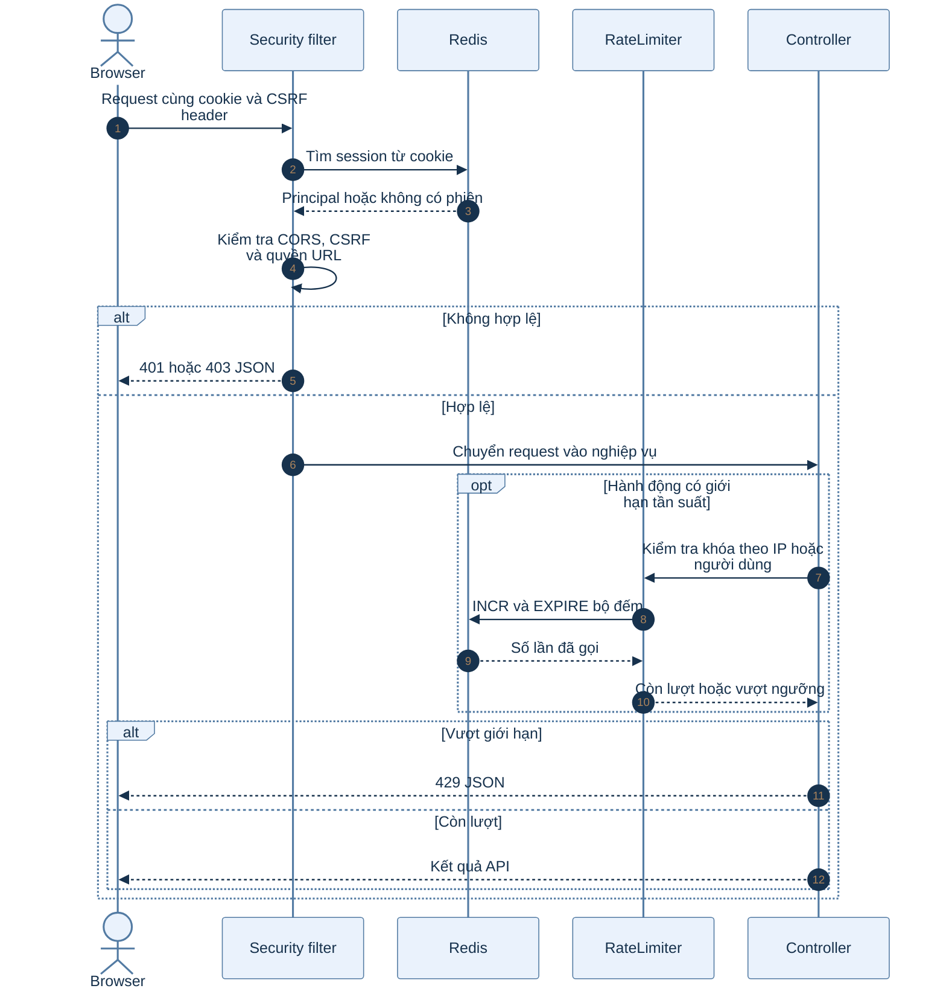

# B0.5 — Bảo mật nền

> Phạm vi: backend hiện có theo roadmap và mã nguồn. Sơ đồ hoạt động mô tả các bước; sơ đồ tuần tự mô tả thành phần tham gia.

## Sơ đồ hoạt động

Xem mã Mermaid của sơ đồ

## Sơ đồ tuần tự

Xem mã Mermaid của sơ đồ

## Giải thích từng bước

| Bước | Việc diễn ra | Ý nghĩa và dữ liệu |
|---|---|---|
| 1 | Nhận request cùng cookie | Security filter đọc phiên Spring Session từ Redis để khôi phục người đăng nhập. |
| 2 | Kiểm tra CORS và CSRF | Origin phải phù hợp cấu hình; phương thức thay đổi dữ liệu phải có X-XSRF-TOKEN hợp lệ. |
| 3 | Kiểm tra URL và quyền | Đường public được phép; admin cần vai trò ADMIN; đường còn lại cần đăng nhập. |
| 4 | Áp giới hạn tần suất | RateLimiter dùng Redis INCR và EXPIRE với khóa theo IP hoặc người dùng và hành động. |
| 5 | Cho controller chạy | Request hợp lệ vào nghiệp vụ, còn trường hợp vi phạm trả 401, 403 hoặc 429. |

## Nhánh lỗi và cách kiểm tra

FE cần gửi cookie và header CSRF khi gọi POST, PUT, PATCH, DELETE. Cookie sai hoặc hết hạn dẫn tới 401; thiếu CSRF dẫn tới 403.

## Vị trí mã nguồn liên quan

`common/security/SecurityConfig.java`, `common/security/RateLimiter.java`, `common/security/CsrfController.java`. Các đường dẫn Java ở trên nằm dưới `backend/k28/src/main/java/com/do_an_tot_nghiep/k28/`.
