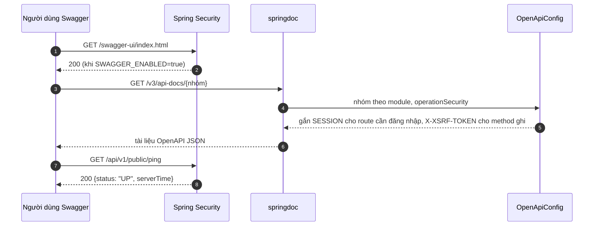

# B0.6 — OpenAPI và quy ước API

> Viết bổ sung 03/11/2026 (RS-020) từ mã nguồn hiện tại; bước đã xong từ GĐ0. Chưa sinh ảnh SVG, xem [README](README.md#cách-xem).

## Sơ đồ tuần tự

## Giải thích từng bước

1. **Bật/tắt:** `springdoc.api-docs.enabled` và `springdoc.swagger-ui.enabled` theo `SWAGGER_ENABLED`. Từ 03/11/2026 mặc định **tắt** ở cấu hình gốc, bật ở profile `dev` và `test` (RS-013).
2. **Nhóm:** `OpenApiConfig` tạo nhóm `all` (`/api/v1/**`) và nhóm theo module: `account`, `content`, `learning`, `practice`, `ai-speaking`, `engagement`, `admin`. Swagger UI mở nhóm `all` trước.
3. **Bảo mật trong tài liệu:** `operationSecurity` gắn scheme cookie `SESSION` cho mọi route trừ `/api/v1/auth/**`, `/api/v1/public/**`, `/api/v1/library/**`; gắn header `X-XSRF-TOKEN` cho mọi method ghi (khác GET/HEAD/OPTIONS/TRACE).
4. **Ping:** `GET /api/v1/public/ping` (`PingController`) không cần đăng nhập, trả `{status: "UP", serverTime}` theo `Clock` chung.

## Quy ước API (áp dụng mọi bước sau)

| Quy ước | Nội dung |
|---|---|
| Tiền tố | `/api/v1`, đường dẫn tiếng Anh (TK §13.2) |
| Tên field JSON | Trùng tên field entity, camelCase tiếng Việt không dấu; ngoại lệ đã chấp nhận ghi ở `be-code/references/conventions.md` |
| ID | Trả dạng chuỗi |
| Lỗi | `{code, message, fieldErrors, requestId}`, xem [B0.4](B0.4-loi-va-web-chung.md) |
| Phân trang | `{items, page, size, totalElements, totalPages}` |

## Nhánh lỗi và cách kiểm tra

- Swagger tắt (`SWAGGER_ENABLED=false`) → `/swagger-ui/index.html` và `/v3/api-docs/**` không còn được phục vụ.
- Kiểm tra: `ApiDocsTest` (4 test: ping công khai, tài liệu `all` có ping và scheme, bảo mật từng route khớp request thật, Swagger UI mở được), pass trong bộ đầy đủ 363/363 ngày 03/11/2026.

## Vị trí mã nguồn liên quan

- `backend/k28/src/main/java/com/do_an_tot_nghiep/k28/common/config/OpenApiConfig.java`
- `backend/k28/src/main/java/com/do_an_tot_nghiep/k28/common/web/PingController.java`
- `backend/k28/src/test/java/com/do_an_tot_nghiep/k28/common/web/ApiDocsTest.java`
