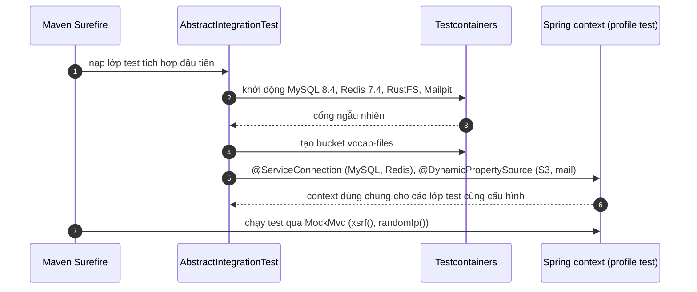

# B0.7 — Nền kiểm thử

> Viết bổ sung 03/11/2026 (RS-020) từ mã nguồn hiện tại; bước đã xong từ GĐ0. Chưa sinh ảnh SVG, xem [README](README.md#cách-xem).

## Sơ đồ tuần tự

## Giải thích từng bước

1. **Một bộ container cho cả lần chạy:** container khởi động trong khối `static` của `AbstractIntegrationTest`, dùng chung cho mọi lớp test con. Image ghim phiên bản giống Compose: `mysql:8.4`, `redis:7.4-alpine`, `rustfs/rustfs:1.0.3`, `axllent/mailpit:v1.32.0` (ghim 03/11/2026).
2. **Kết nối:** MySQL và Redis qua `@ServiceConnection`; S3 và mail qua `@DynamicPropertySource`. Profile `test` (`src/test/resources/application-test.yaml`) cấp giá trị giả cho các biến bắt buộc (DB user/password, Google) vì cấu hình gốc không còn mặc định (RS-013).
3. **Tiện ích:** `xsrf()` gắn cookie và header CSRF khớp nhau; `randomIp()` đổi IP để không đụng hạn mức đăng nhập; `toJson()` dùng `JsonMapper` của app.
4. **Đặt tên:** lớp `FRxx…Test`, phương thức theo mã yêu cầu (`fr02_…`); tiền tố `tcNN_` chỉ còn ở test cũ.

## Chạy

- `./mvnw -B test` trong `backend/k28`, Docker phải đang chạy.
- Windows: profile Maven `windows-tests` tự thêm `-Djdk.net.unixdomain.tmpdir=%PUBLIC%`; surefire nạp Mockito bằng `-javaagent` (RS-003, RS-004, RS-040). Không cần `JAVA_TOOL_OPTIONS`.

## Nhánh lỗi và cách kiểm tra

| Triệu chứng | Nguyên nhân | Cách xử lý |
|---|---|---|
| `Could not find a valid Docker environment` | Docker chưa chạy | Bật Docker Desktop |
| `Unable to establish loopback connection` | Chạy Windows không qua profile `windows-tests` | Chạy bằng `./mvnw` của dự án |
| `Missing required setting …` | Thiếu giá trị trong profile `test` | Bổ sung vào `application-test.yaml` |

Kiểm chứng gần nhất: `./mvnw -B test` 363/363 pass ngày 03/11/2026 (`IntegrationSetupTest` 4 test kiểm tra chính nền này).

## Vị trí mã nguồn liên quan

- `backend/k28/src/test/java/com/do_an_tot_nghiep/k28/support/AbstractIntegrationTest.java`
- `backend/k28/src/test/java/com/do_an_tot_nghiep/k28/support/IntegrationSetupTest.java`
- `backend/k28/src/test/resources/application-test.yaml`
- `backend/k28/pom.xml` (profile `windows-tests`, cấu hình surefire)
