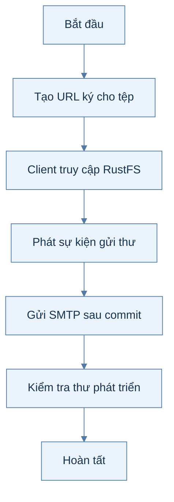
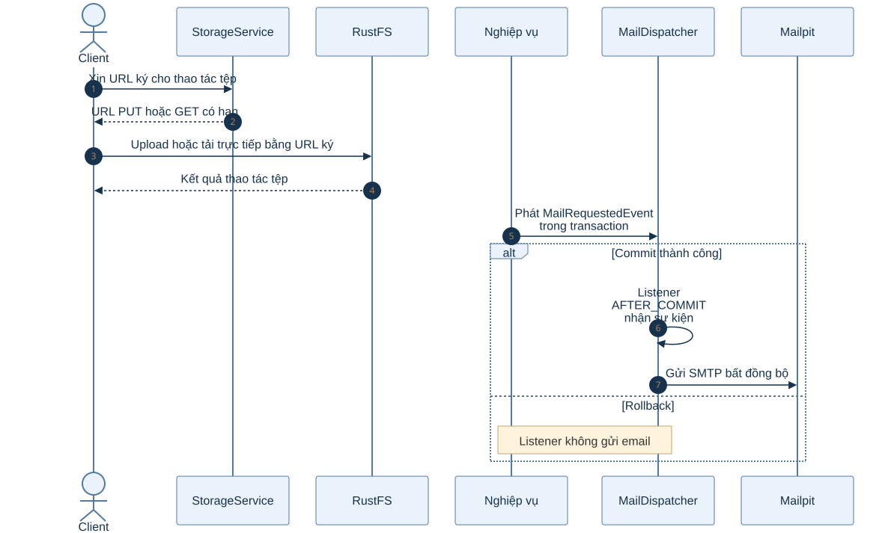
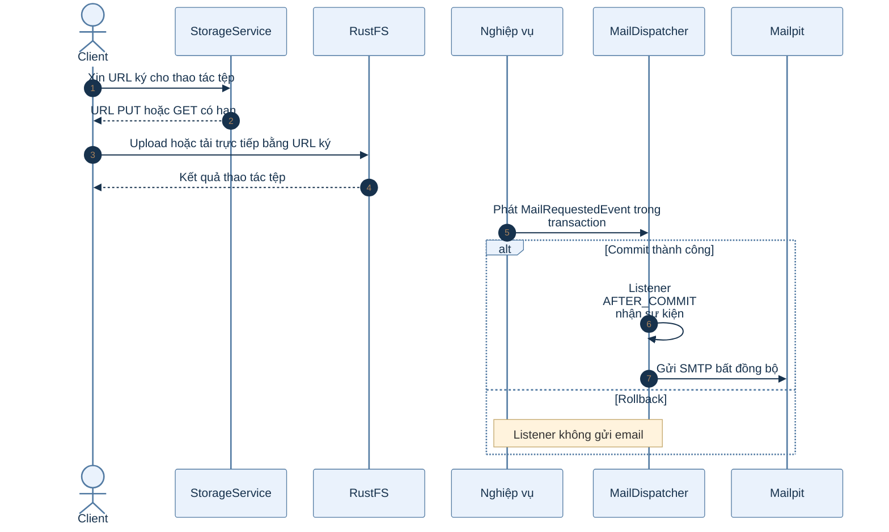

# B0.8 — Kho tệp và email

> Phạm vi: backend hiện có theo roadmap và mã nguồn. Sơ đồ hoạt động mô tả các bước; sơ đồ tuần tự mô tả thành phần tham gia.

## Sơ đồ hoạt động

Xem mã Mermaid của sơ đồ

## Sơ đồ tuần tự

Xem mã Mermaid của sơ đồ

## Giải thích từng bước

| Bước | Việc diễn ra | Ý nghĩa và dữ liệu |
|---|---|---|
| 1 | Tạo URL ký cho tệp | StorageService ký URL PUT hoặc GET có thời hạn ngắn; bucket ở chế độ riêng tư. |
| 2 | Client truy cập RustFS | Client dùng URL đã ký để upload hoặc download trực tiếp, không truyền dữ liệu tệp qua API. |
| 3 | Phát sự kiện gửi thư | Nghiệp vụ hoàn tất transaction rồi phát MailRequestedEvent chứa nội dung thư. |
| 4 | Gửi SMTP sau commit | MailDispatcher nhận sự kiện AFTER_COMMIT (đặt `fallbackExecution=true`: phát ngoài transaction thì gửi ngay) và xử lý bất đồng bộ qua MailService. |
| 5 | Kiểm tra thư phát triển | Mailpit nhận thư để developer xem; rollback DB không được phát thư. |

## Nhánh lỗi và cách kiểm tra

Nếu email lỗi sau khi transaction đã commit, dữ liệu nghiệp vụ vẫn tồn tại; cần xem log tác vụ gửi thư. URL ký hết hạn phải được cấp lại.

## Vị trí mã nguồn liên quan

`common/storage/StorageService.java`, `common/mail/MailService.java`, `common/mail/MailDispatcher.java`. Các đường dẫn Java ở trên nằm dưới `backend/k28/src/main/java/com/do_an_tot_nghiep/k28/`.
