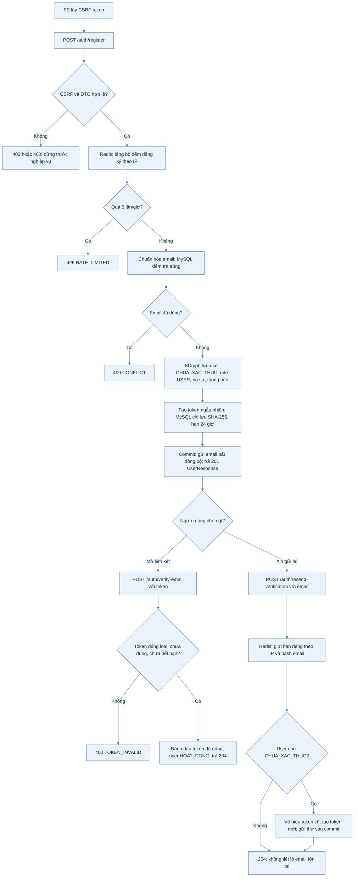
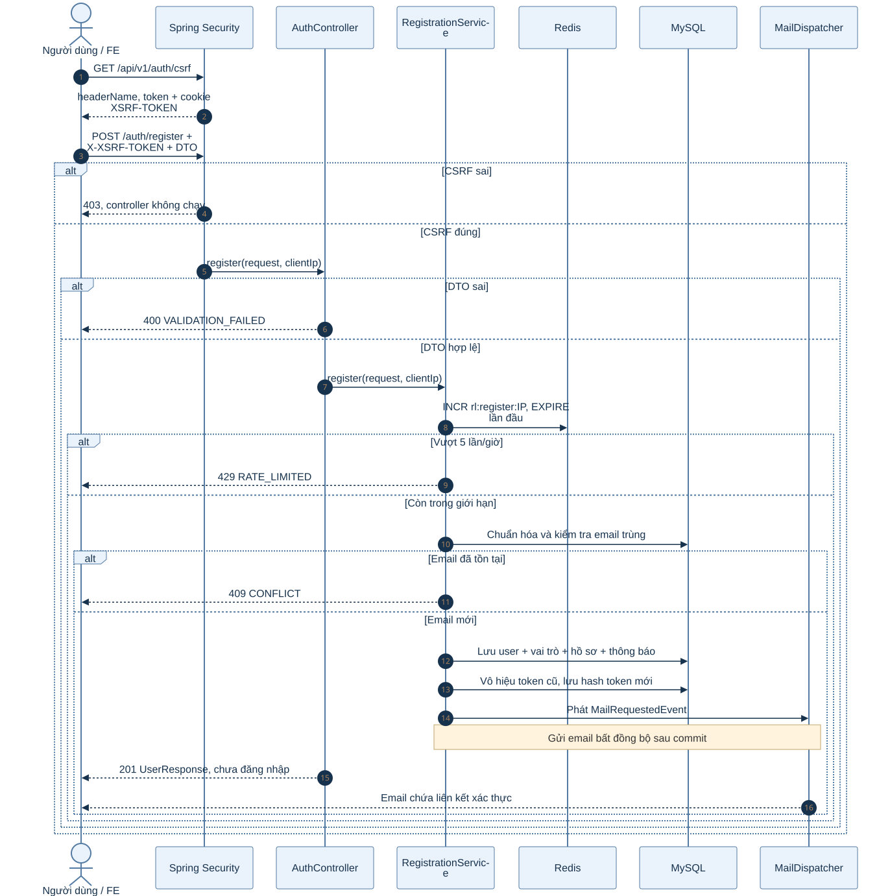
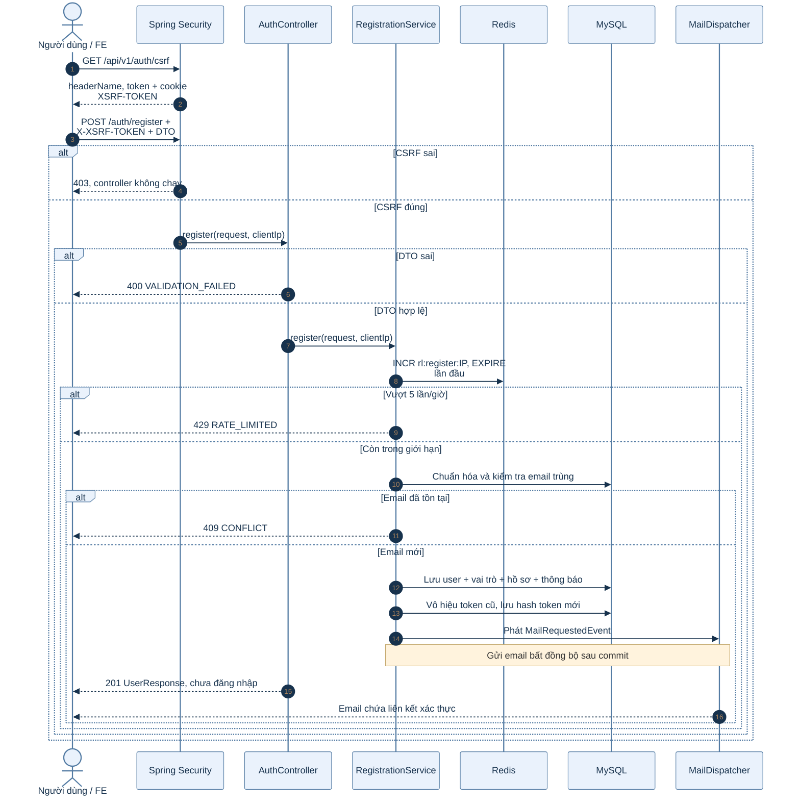
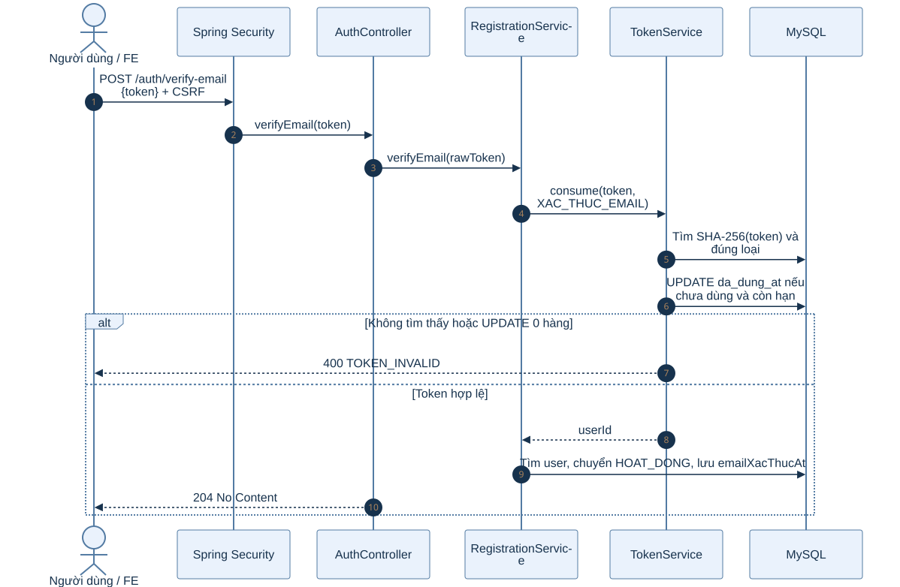
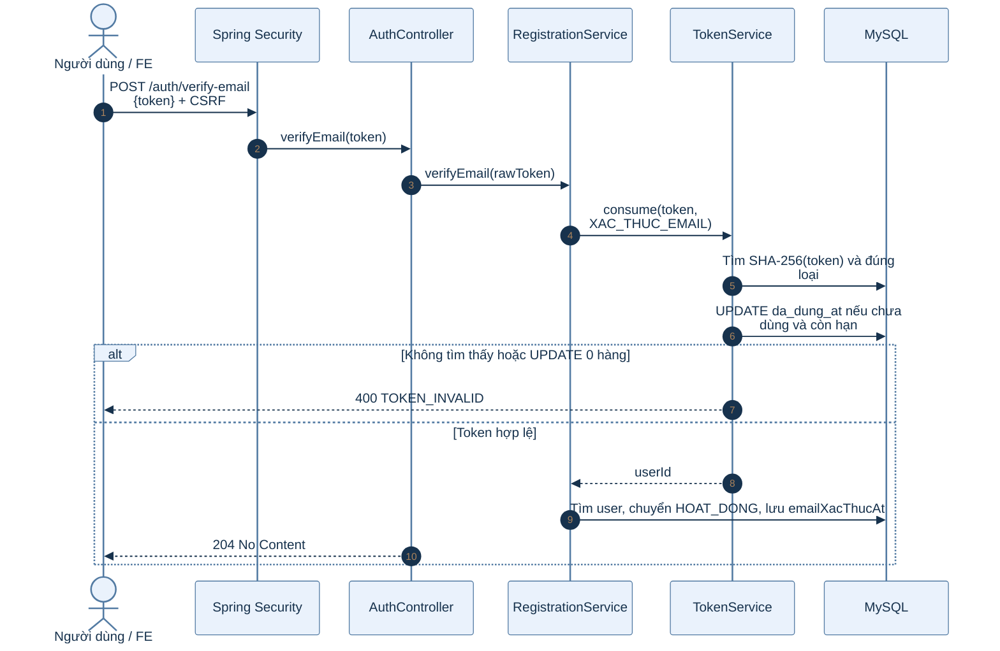
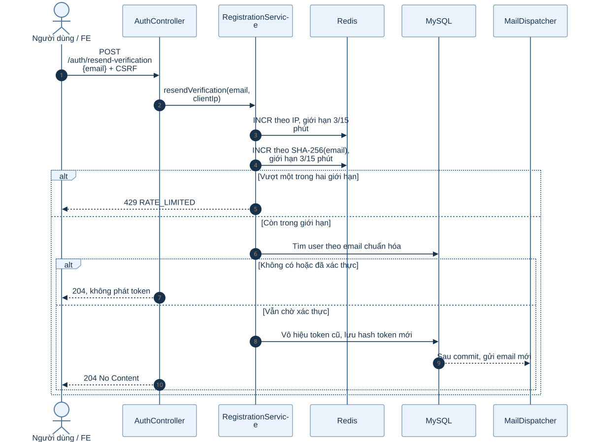
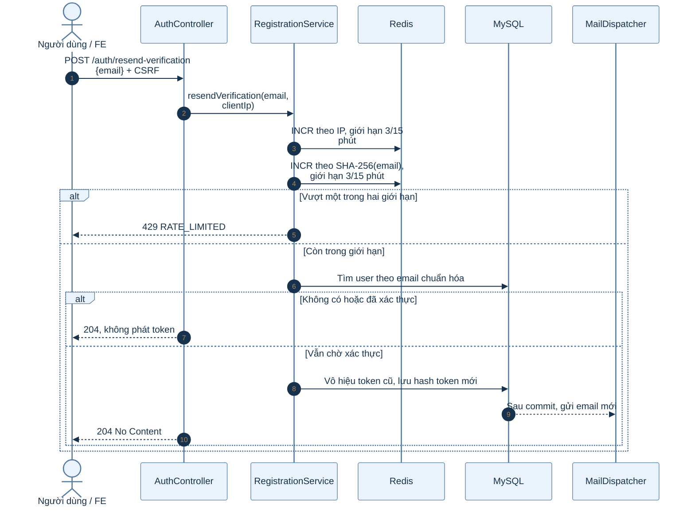

# B1.1 — Đăng ký và xác thực email

Phạm vi: `POST /api/v1/auth/register`, `POST /api/v1/auth/verify-email`, `POST /api/v1/auth/resend-verification`. Sơ đồ mô tả mã backend hiện tại, không chỉ kế hoạch trong roadmap.

## 1. Sơ đồ hoạt động

Ba API là ba request độc lập. Đăng ký chỉ tạo tài khoản chờ xác thực; mở email không tự đăng nhập.

Xem mã Mermaid của sơ đồ

## 2. Sơ đồ tuần tự: đăng ký

Xem mã Mermaid của sơ đồ

### Giải thích từng bước đăng ký

1. **Lấy CSRF:** `GET /api/v1/auth/csrf` cấp giá trị để gửi trong header `X-XSRF-TOKEN`. `permitAll` ở `/auth/**` chỉ bỏ yêu cầu đăng nhập, không bỏ CSRF cho `POST`.
2. **Kiểm tra DTO:** `RegisterRequest` yêu cầu `tenHienThi`, `email`, `password` và `acceptTerms=true`; `muiGio` có thể bỏ trống. Mật khẩu phải dài 8–72 ký tự, có chữ cái và chữ số. Dữ liệu sai nhận `400 VALIDATION_FAILED` trước khi vào service.
3. **Chặn thao tác dồn dập:** `RateLimiter.REGISTER` tăng khóa Redis theo IP. Lần đầu đặt TTL 1 giờ; lần thứ sáu trong cửa sổ nhận `429`. Việc tăng đếm xảy ra trước bước kiểm tra email trùng.
4. **Kiểm tra và tạo user:** Service chuẩn hóa email; kiểm tra tồn tại trong MySQL. Nó cũng bắt lỗi unique constraint lúc `saveAndFlush`, nên hai yêu cầu đồng thời dùng cùng email vẫn dẫn tới `409` cho một yêu cầu. Múi giờ mặc định là `Asia/Ho_Chi_Minh`; múi giờ cung cấp phải là ID IANA hợp lệ.
5. **Lưu dữ liệu nghiệp vụ:** Mật khẩu được BCrypt; user bắt đầu ở `CHUA_XAC_THUC`, có vai trò `USER`, hồ sơ học tập và cài đặt thông báo mặc định. Các ghi MySQL nằm trong giao dịch của `RegistrationService.register`.
6. **Phát token:** `TokenService.issue` tạo 32 byte ngẫu nhiên, lưu SHA-256 của token cùng loại `XAC_THUC_EMAIL`, hạn 24 giờ và thời điểm tạo. Token gốc chỉ đi vào liên kết email; Redis không giữ token này.
7. **Gửi thư sau commit:** `MailService` phát sự kiện, `MailDispatcher` nhận bất đồng bộ sau commit. Response `201 UserResponse` không bảo đảm email đã tới hộp thư. Nếu SMTP lỗi, dispatcher ghi log; tài khoản đã commit không bị tự xóa.

## 3. Sơ đồ tuần tự: xác thực email

Xem mã Mermaid của sơ đồ

### Giải thích từng bước xác thực

1. Người dùng mở URL trong email. FE lấy `token` trong query string rồi gửi `POST /auth/verify-email` với body `{ "token": "..." }` và CSRF token.
2. Backend không tìm token gốc trong Redis. `TokenService.consume` băm giá trị nhận được bằng SHA-256, tìm đúng loại `XAC_THUC_EMAIL` trong MySQL.
3. Câu `UPDATE` của repository chỉ thành công nếu `da_dung_at IS NULL` và `het_han_at > now`. Hai request cùng dùng một token không thể cùng cập nhật thành công; request sau nhận `TOKEN_INVALID`.
4. Khi đã đánh dấu token dùng, service tìm user và gọi `verifyEmail(now)`. User `CHUA_XAC_THUC` chuyển `HOAT_DONG` và có `email_xac_thuc_at`. Response là `204`, không có body và không tạo session; người dùng đăng nhập ở B1.2.
5. Token sai, sai loại, hết hạn hoặc đã dùng nhận `400 TOKEN_INVALID`. FE nên đưa người dùng đến chức năng gửi lại thư, không thử lặp vô hạn cùng token.

## 4. Sơ đồ tuần tự: gửi lại thư

Xem mã Mermaid của sơ đồ

**Phân tích:** Hai giới hạn là hai khóa Redis riêng. Với email không tồn tại hoặc user đã xác thực, response vẫn là `204` để không tiết lộ trạng thái tài khoản. Nếu đủ điều kiện, token cũ cùng loại bị đánh dấu đã dùng trước khi phát token mới, nên link cũ mất hiệu lực. FE chỉ nên thông báo “nếu email đủ điều kiện, thư sẽ được gửi”.

## 5. Vai trò dữ liệu và các nhánh lỗi

| Nơi lưu | Vai trò trong B1.1 |
| --- | --- |
| MySQL | Người dùng, vai trò, hồ sơ, cài đặt thông báo; hash token xác thực, hạn dùng và dấu đã dùng. |
| Redis | Bộ đếm giới hạn đăng ký/gửi lại theo cửa sổ thời gian. Không lưu token xác thực email. |
| Email | Chuyển liên kết chứa token gốc đến người dùng. |

| Tình huống | Kết quả BE | Ý nghĩa |
| --- | --- | --- |
| Thiếu CSRF | `403 FORBIDDEN` | Request bị Security chặn trước controller. |
| DTO đăng ký sai | `400 VALIDATION_FAILED` | Không tạo user. |
| Email đã có | `409 CONFLICT` | Không cấp thêm tài khoản. |
| Vượt giới hạn Redis | `429 RATE_LIMITED` | Không tiếp tục nghiệp vụ. |
| Token sai/hết hạn/đã dùng | `400 TOKEN_INVALID` | Không xác thực user. |
| Gửi lại với email không đủ điều kiện | `204` | Không tiết lộ tài khoản có tồn tại hay không. |

**Mã nguồn chính:** `account/controller/AuthController.java`, `account/service/RegistrationService.java`, `account/service/TokenService.java`, `common/mail/MailDispatcher.java`, `common/security/RateLimiter.java` dưới `backend/k28/src/main/java/com/do_an_tot_nghiep/k28/`.
