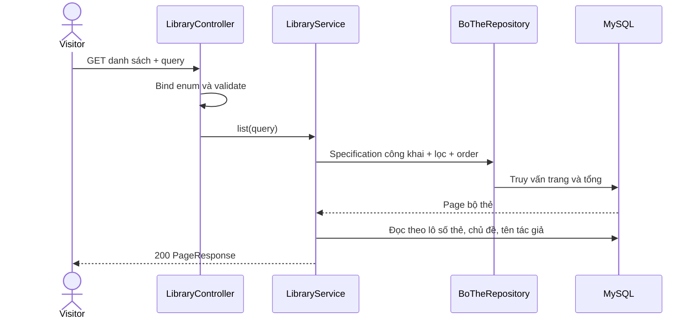
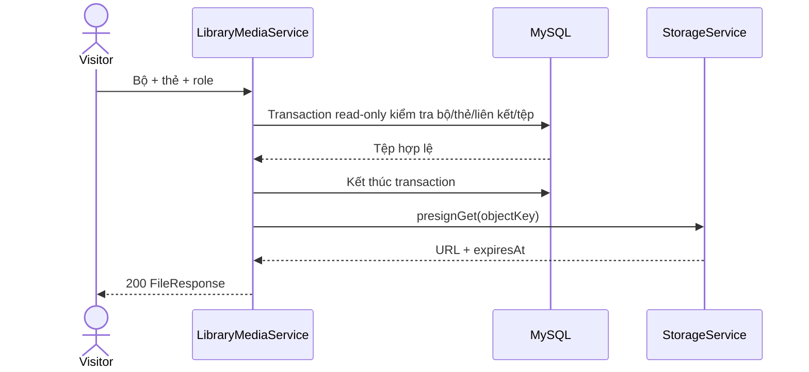

# B1.10 — Thư viện công khai

Ngày đối chiếu: 08/10/2026. Phạm vi: FR-04, danh sách/chi tiết công khai, media và bộ khởi động. Sao chép bộ thuộc B1.11; quản trị/kiểm duyệt nội dung thuộc bước riêng.

## 1. Hợp đồng và quyết định

| API | Quyền | Kết quả |
|---|---|---|
| `GET /api/v1/library/decks` | Guest | `PageResponse<LibraryDeckResponse>` |
| `GET /api/v1/library/decks/{id}` | Guest | `{boThe, the}`; `the` là PageResponse |
| `GET /api/v1/library/decks/{id}/cards/{cardId}/files/{role}` | Guest | FileResponse và URL ký có hạn |

Phương án A được chốt trong session: bộ hiển thị khi `quyen_truy_cap=CONG_KHAI AND trang_thai_kiem_duyet=BINH_THUONG AND xoa_at IS NULL`. `BINH_THUONG` nghĩa là chưa bị ẩn, không phải bằng chứng đã duyệt trước. Schema không có trạng thái chờ duyệt/đã duyệt. Cụm “công khai + đã duyệt” ở roadmap cũ đã được thay bằng điều kiện thực tế này.

`bo_mau=true` trả `nguon=MAU`, nhãn “Bộ mẫu”; false trả `CHIA_SE`, nhãn “Người học chia sẻ”. Không suy nguồn từ vai trò tác giả hoặc `bo_nguon_id`. Không suy mục tiêu bộ từ hồ sơ tác giả. API CRUD cá nhân không nhận quyền đánh dấu bộ mẫu.

## 2. Schema và bộ khởi động

- Giữ migration V1–V5; không sửa migration đã áp dụng. V5 bổ sung `bo_the.muc_tieu` nullable và `bo_mau` mặc định false.
- Seed dev mới `R__library_starter.sql`: 8 bộ/24 thẻ, đủ hai mục tiêu × bốn trình độ. Tác giả riêng không có mật khẩu và bị khóa; không cấp ADMIN.
- Seed nằm trong `db/seed`, chỉ được Flyway nạp qua cấu hình dev hiện tại. Đây là nội dung tự biên soạn cho kiểm thử/demo, không phải bộ giáo trình đã nghiệm thu để dùng production.
- Chạy lại seed không tạo trùng bộ/thẻ, không khôi phục nội dung đã xóa mềm, không ghi đè nội dung đã chỉnh sửa.
- Sau khi lưu learning settings, FE dùng mục tiêu/trình độ từ response đã lưu để gọi thư viện với `nguon=MAU`. Không tìm thấy bộ phù hợp trả danh sách rỗng; không sửa thiết lập người học hoặc tự sao chép bộ.

## 3. Danh sách

| Query | Giới hạn/mặc định |
|---|---|
| `q` | Tối đa 150 ký tự; strip/NFC; tìm trong tên hoặc mô tả bộ |
| `chuDeId` | ID nguyên dương dạng chuỗi trong giới hạn Long |
| `trinhDo` | `MOI_BAT_DAU`, `CO_BAN`, `TRUNG_CAP`, `NANG_CAO` |
| `mucTieu` | `GIAO_TIEP`, `TOEIC` |
| `nguon` | `MAU`, `CHIA_SE` |
| `sort` | `updated` mặc định, `name`, `size` |
| `page` | Không âm; mặc định 0 |
| `size` | 1–100; mặc định 20 |

Các bộ lọc kết hợp AND. `%`, `_`, `!` được escape khi tìm LIKE; không tìm theo nội dung thẻ. Bộ có mục tiêu null không khớp bộ lọc mục tiêu cụ thể. Offset `page*size` không vượt Integer.MAX_VALUE.

Thứ tự: `updated` = updatedAt DESC/id DESC; `name` = ten ASC/id ASC theo collation DB; `size` = số thẻ chưa xóa DESC/id DESC. Specification không thêm order cho count query. Trang vượt cuối trả items rỗng và giữ tổng kết quả.

Metadata bộ trả `id`, `ten`, `moTa`, `chuDeId`, `tenChuDe`, `trinhDo`, `mucTieu`, `nguon`, `chuSoHuuId`, `tenTacGia`, `soThe`, `createdAt`, `updatedAt`. ID là chuỗi; thời gian Instant/UTC. Không trả email, mật khẩu hoặc tiến độ học.

## 4. Chi tiết và phân trang thẻ

`GET /library/decks/{id}?page=0&size=20` kiểm tra ID dương, tìm bộ với cùng Specification công khai, rồi đọc thẻ `xoa_at IS NULL`, ID DESC. Bộ riêng tư/bị ẩn/đã xóa/không tồn tại đều trả 404, kể cả chủ sở hữu hoặc ADMIN truy cập qua thư viện.

Response gồm `boThe` và `the`. `boThe.soThe` bằng tổng thẻ chưa xóa. Bộ chưa có thẻ vẫn trả 200 với soThe=0 và trang thẻ rỗng.

Thẻ trả `id`, `boTheId`, `tu`, `tuLoai`, `nghiaVi`, `phienAm`, `viDuEn`, `dichVi`, `doKho`, `nguon`, `nhanIds`, `anhId`, `amTuId`, `amCauId`. Không trả version/cảnh báo trùng từ. Nhãn và liên kết tệp đọc theo lô cho trang đang lấy; thiếu nhãn trả [], thiếu tệp trả null. ID liên kết không bảo đảm tệp vẫn tải được: API media kiểm tra lại trạng thái tại thời điểm yêu cầu.

## 5. Media

Role nhận `ANH`, `AM_TU`, `AM_CAU`. Kiểm tra theo thứ tự:

1. Bộ còn công khai, bình thường và chưa xóa.
2. Thẻ chưa xóa và thuộc đúng bộ.
3. Thẻ có liên kết tệp đúng role.
4. Tệp đã hoàn tất, còn hiệu lực, chưa xóa và đúng loại ảnh/âm thanh.
5. Kết thúc transaction read-only trước khi ký URL bằng StorageService.

FileResponse: `id`, `loai`, `mimeType`, `kichThuoc`, `checksum`, `hoanTatAt`, `downloadUrl`, `expiresAt`. URL không lưu lâu dài. URL đã cấp có thể dùng đến thời hạn dù bộ đổi quyền sau đó. GET mới kiểm tra lại điều kiện công khai. Endpoint `/api/v1/files/{id}` vẫn yêu cầu đăng nhập và ownership.

## 6. Lỗi, transaction và tác dụng phụ

| HTTP/code | Trường hợp |
|---|---|
| 400 `VALIDATION_FAILED` | ID/query/enum/role hoặc phân trang không hợp lệ |
| 404 `NOT_FOUND` | Bộ không đủ điều kiện; thẻ sai bộ/đã xóa; liên kết hoặc tệp không hợp lệ |
| 401 `UNAUTHENTICATED` | Guest gọi API tệp cá nhân, không phải API media thư viện |

Dùng lỗi chung `{code,message,fieldErrors,requestId}`. Các API thư viện chỉ đọc; không tăng version, không tạo yêu thích/bản sao/lịch học. Không cần CSRF cho GET. Không bổ sung quyền quản trị hoặc vượt ownership của API CRUD.

## 7. Giao diện và kiểm chứng

FE giữ giao diện hiện có, mở FeatureGate cho thư viện, gửi đúng tên query và đọc đúng DTO. Bộ lọc/sắp xếp/phân trang lưu trên URL; đổi bộ lọc về trang đầu. Có loading, empty, lỗi kèm requestId, thử lại, chi tiết và sao chép liên kết. Media tải theo yêu cầu và lấy URL mới khi thử lại. Không hiển thị thao tác sao chép bộ khi B1.11 chưa triển khai.

| Kiểm chứng ngày 08/10/2026 | Kết quả |
|---|---|
| Compile BE | Thành công |
| Một lượt Maven FR04LibraryTest/Media/Onboarding/Seed | 19 + 11 + 2 + 9 = 41 lượt, không lỗi/bỏ qua |
| FE unit tests | 9/9 |
| Build FE | Thành công, có route `/thu-vien/[id]` |
| Newman trực tiếp BE cổng 8081 | 28 request, 79 assertion đạt |
| Newman qua Next.js cổng 3000 | 28 request, 79 assertion đạt, lượt riêng |
| HTTP media fixture @test.local | 6 kiểm tra đạt; 3 download có checksum khớp |
| Browser FE thật | 18 kiểm tra đạt; desktop1440, mobile360/390, dữ liệu dài, media, 404/retry, URL/paging và onboarding. Sau sửa bố cục hàng đã build/lint lại đạt |

Bằng chứng: [JUnit và tổng hợp](../../report/evidence/B1.10-verification-20261008.json), [Newman BE](../../report/evidence/B1.10-newman-20261008.json), [Newman Next.js](../../report/evidence/B1.10-newman-next-20261008.json), [HTTP media](../../report/evidence/B1.10-http-media-20261008.json), [UI](../../report/evidence/B1.10-ui-20261008.json).

Đây là kiểm chứng phạm vi B1.10, không phải toàn bộ test suite hoặc nghiệm thu toàn bộ FE. Không cộng các lượt Maven/Newman/HTTP thành một tổng suite. Không chạy lại HTTP6 B1.8 và không thay trạng thái B1.8. Không sửa migration đã áp dụng, không commit/push trong lượt này.

## 8. Bàn giao

- [Báo cáo hiện tại, mục 5.40–5.42 và mục 10](<../../ban-giao-cho fe/SPRINT_1_BAO_CAO_BE_BAN_GIAO_CHO_FE.md>)
- [Roadmap BE](../../roadmap/TienDoDuKien_backend.md)
- [Postman và cách chuẩn bị fixture](../../postman/README.md)

Nội dung bộ mẫu production cần quy trình biên soạn/đánh giá riêng. Seed dev hiện tại không thay chức năng quản trị bộ mẫu. B1.11 (sao chép bộ) và B1.12 (CSV) đã triển khai sau B1.10.
