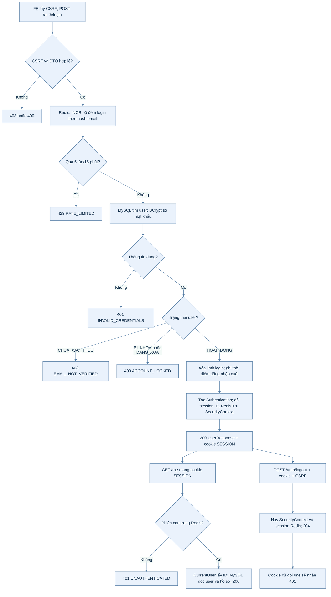
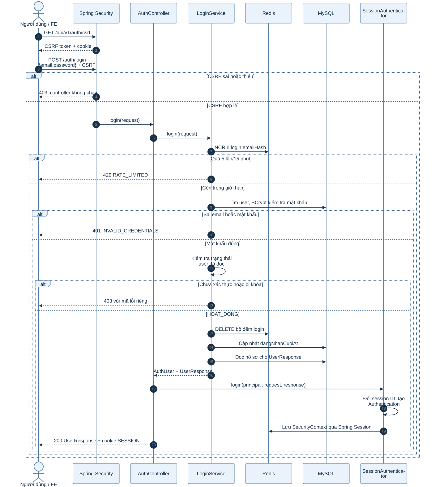
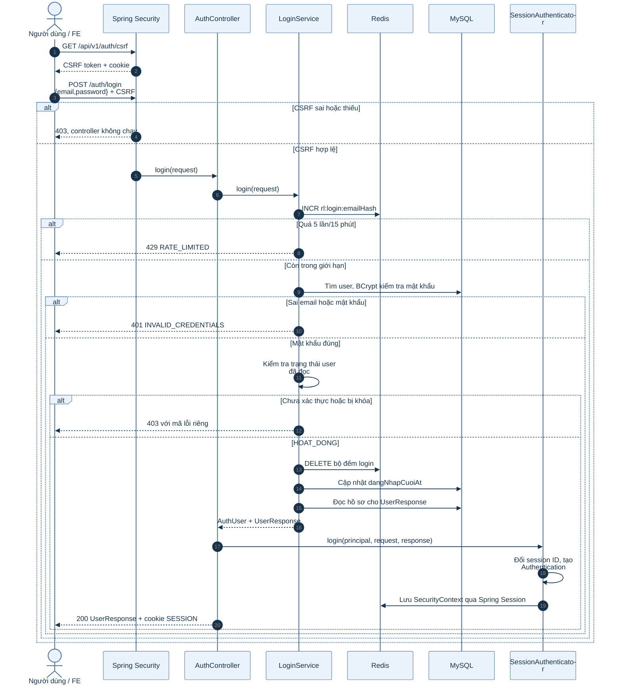
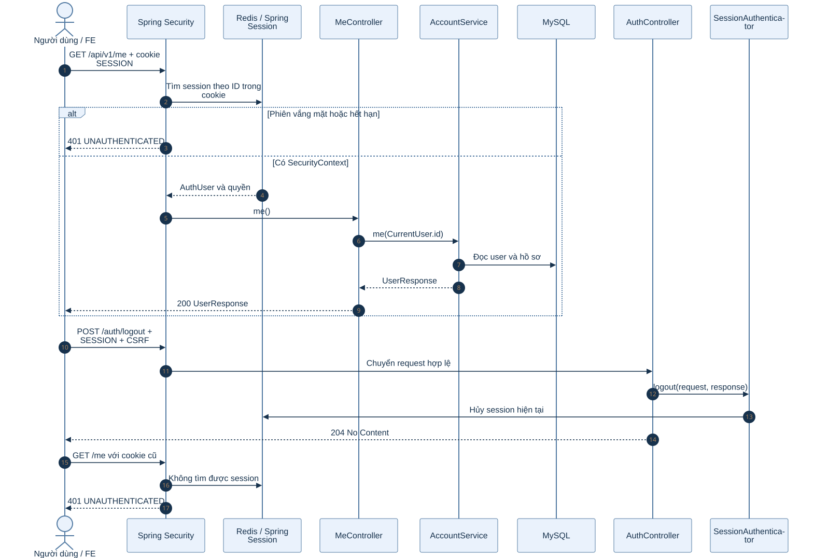
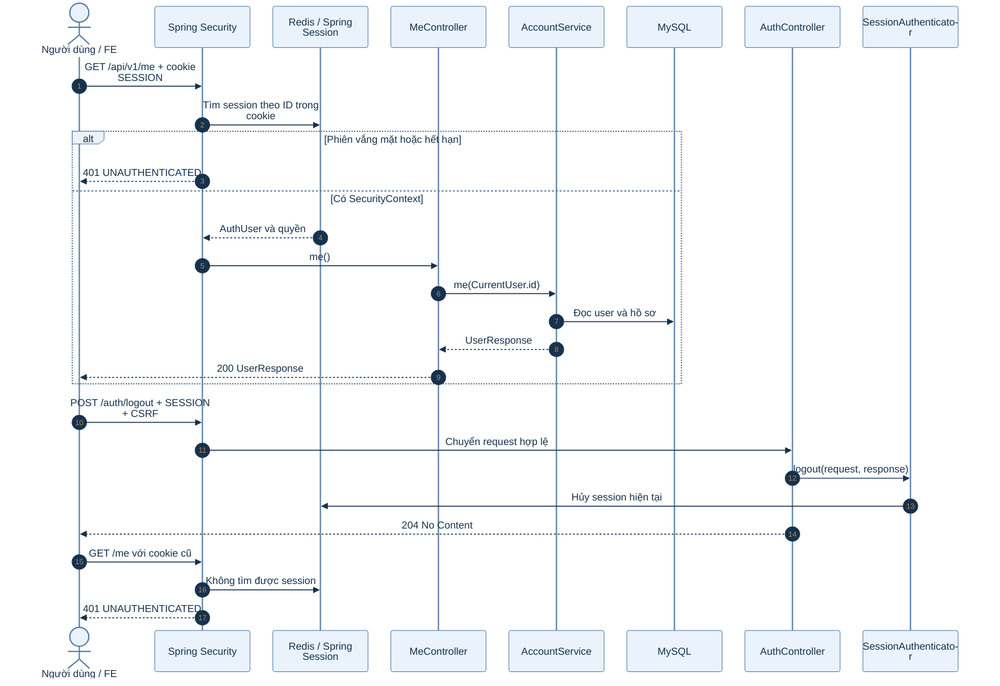

# B1.2 — Đăng nhập, đăng xuất và thông tin phiên

Phạm vi: `GET /api/v1/auth/csrf`, `POST /api/v1/auth/login`, `GET /api/v1/me`, `POST /api/v1/auth/logout`.

## 1. Sơ đồ hoạt động

Sơ đồ tách ba thời điểm: tạo phiên lúc đăng nhập, dùng phiên để đọc `/me`, và hủy phiên lúc đăng xuất.

Xem mã Mermaid của sơ đồ

## 2. Sơ đồ tuần tự: đăng nhập và tạo phiên

Xem mã Mermaid của sơ đồ

### Giải thích từng bước đăng nhập

1. **CSRF trước POST:** `GET /auth/csrf` trả tên header và token. FE phải gửi token trong `X-XSRF-TOKEN`, đồng thời gửi cookie với request. URL `/auth/login` công khai về xác thực nhưng không được miễn CSRF.
2. **DTO và chuẩn hóa email:** `LoginRequest` yêu cầu email và mật khẩu. `LoginService` chuẩn hóa email rồi tạo khóa `rl:login:email:<SHA-256(email)>`; email thô không được dùng làm khóa Redis.
3. **Đếm mọi lần thử:** Redis tăng bộ đếm trước khi kiểm tra mật khẩu. Chính sách là 5 lần/15 phút. Lần thứ sáu trong cửa sổ trả `429 RATE_LIMITED`, kể cả nếu mật khẩu lần này đúng. Đăng nhập thành công xóa khóa để lần tiếp theo bắt đầu lại.
4. **So mật khẩu:** MySQL trả user nếu có. Nếu không có user hoặc không có mật khẩu, service vẫn so BCrypt với một hash giả; đây là biện pháp giảm khác biệt thời gian xử lý. Sai email/mật khẩu cùng trả `401 INVALID_CREDENTIALS`.
5. **Xét trạng thái sau mật khẩu:** `CHUA_XAC_THUC` trả `403 EMAIL_NOT_VERIFIED`; `BI_KHOA` hoặc `DANG_XOA` trả `403 ACCOUNT_LOCKED`. Chỉ `HOAT_DONG` qua được.
6. **Tạo principal:** Service ghi `dang_nhap_cuoi_at`, trả `AuthUser` gồm user ID, email và vai trò cùng `UserResponse`. `SessionAuthenticator` tạo `Authentication`, đổi session ID chống session fixation và lưu `SecurityContext`.
7. **Lưu phiên:** Spring Session đặt dữ liệu phiên trong Redis. Cookie `SESSION` gửi về trình duyệt chỉ mang ID tham chiếu; nó `HttpOnly`, `SameSite=Lax`, và `Secure` khi `app.cookie-secure=true`. Cấu hình timeout hiện là 7 ngày.

## 3. Sơ đồ tuần tự: dùng phiên và đăng xuất

Xem mã Mermaid của sơ đồ

### Giải thích từng bước sử dụng và hủy phiên

1. Trình duyệt gửi cookie `SESSION` ở `GET /me`. Spring Session tìm phiên trong Redis; Spring Security khôi phục `SecurityContext`. Nếu Redis không còn phiên hoặc phiên hết hạn, request dừng ở `401`.
2. `CurrentUser` đọc ID từ `AuthUser` trong security context. `AccountService.me` đọc lại user và hồ sơ ở MySQL rồi tạo `UserResponse`; Redis không phải kho hồ sơ.
3. Đăng xuất là `POST /auth/logout`, vẫn cần CSRF token. `SessionAuthenticator.logout` dùng `SecurityContextLogoutHandler`, hủy context và session hiện tại. Spring Session xóa phiên Redis; API trả `204`.
4. Điều hướng FE sang trang login mà không gọi API logout chỉ thay đổi màn hình, không thu hồi phiên phía BE. Kiểm chứng đúng là dùng cookie cũ gọi `/me` và nhận `401`.

## 4. Phân tích trạng thái, lỗi và nơi lưu

| Thành phần | Chứa gì? |
| --- | --- |
| Cookie `XSRF-TOKEN` và header `X-XSRF-TOKEN` | Chứng minh request ghi xuất phát từ trang đã lấy CSRF token; không phải phiên đăng nhập. |
| Cookie `SESSION` | ID tham chiếu đến phiên; không chứa toàn bộ hồ sơ hay mật khẩu. |
| Redis | Phiên Spring Session/SecurityContext và bộ đếm giới hạn đăng nhập. |
| MySQL | Tài khoản, hash BCrypt, vai trò, hồ sơ và lần đăng nhập cuối. |

| Tình huống | HTTP và mã lỗi | Điểm dừng |
| --- | --- | --- |
| Thiếu CSRF ở login/logout | `403 FORBIDDEN` | Security, trước controller. |
| Sai email hoặc mật khẩu | `401 INVALID_CREDENTIALS` | `LoginService`. |
| Chưa xác thực email | `403 EMAIL_NOT_VERIFIED` | `LoginService`, sau khi mật khẩu đúng. |
| Bị khóa hoặc đang xóa | `403 ACCOUNT_LOCKED` | `LoginService`. |
| Vượt giới hạn login | `429 RATE_LIMITED` | Trước truy vấn mật khẩu. |
| Không có phiên hợp lệ khi gọi `/me` | `401 UNAUTHENTICATED` | Spring Security. |

**Mã nguồn chính:** `account/controller/AuthController.java`, `account/controller/MeController.java`, `account/service/LoginService.java`, `common/security/SessionAuthenticator.java`, `common/security/SecurityConfig.java`, `common/security/CsrfController.java` dưới `backend/k28/src/main/java/com/do_an_tot_nghiep/k28/`.
