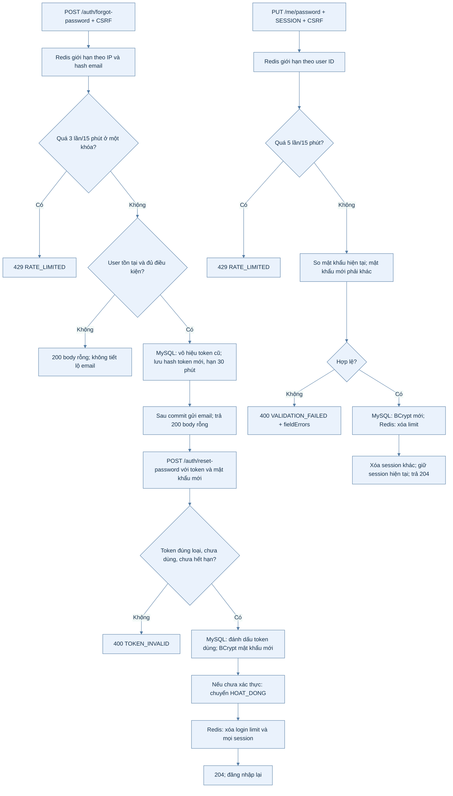
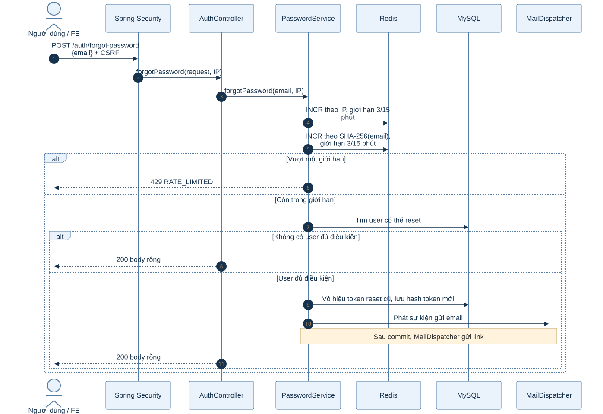
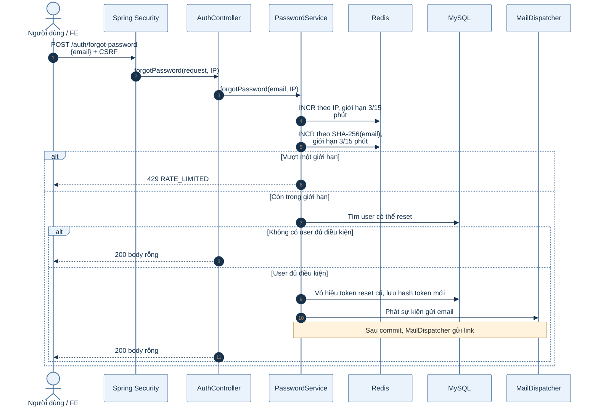
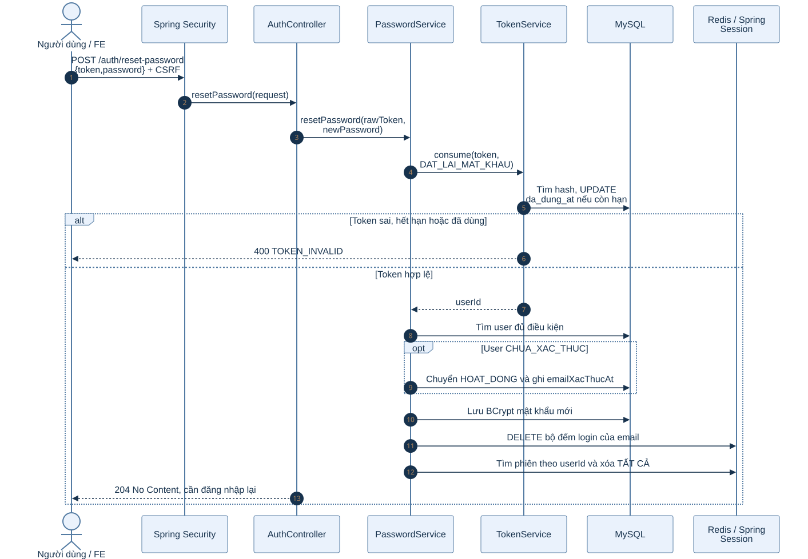
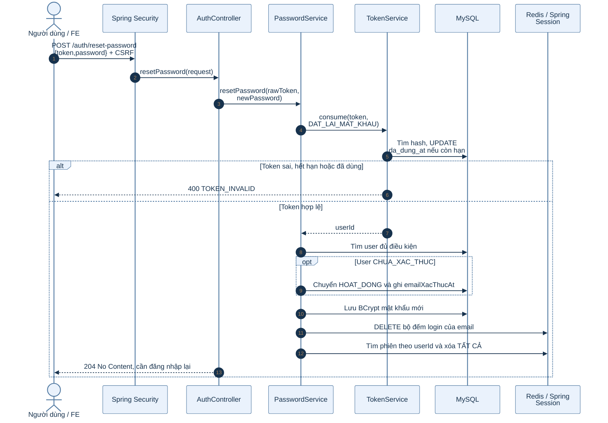
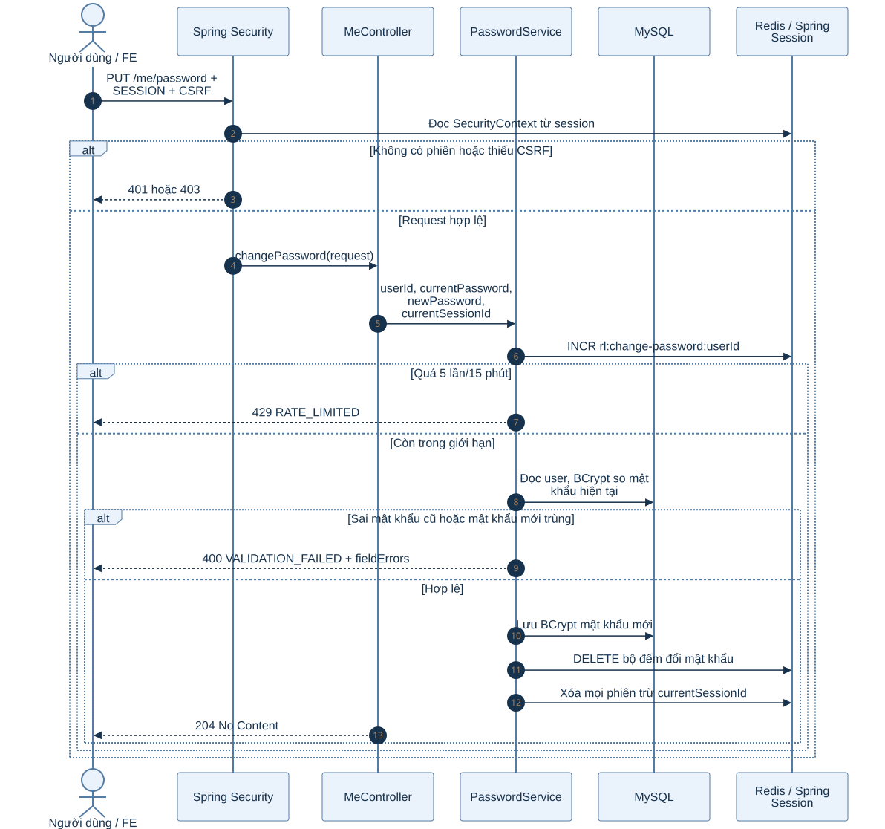
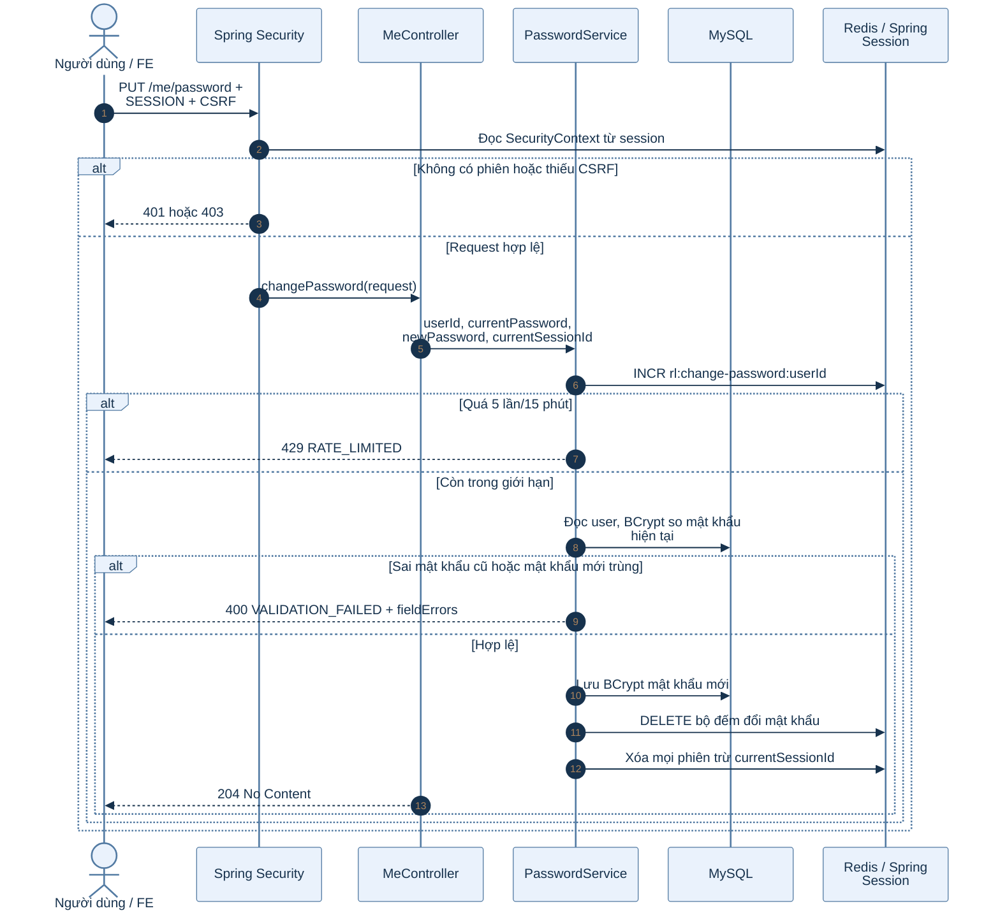

# B1.3 — Quên, đặt lại và đổi mật khẩu

Phạm vi: `POST /api/v1/auth/forgot-password`, `POST /api/v1/auth/reset-password`, `PUT /api/v1/me/password`.

## 1. Sơ đồ hoạt động

Hai nhánh có điều kiện khác nhau: **đặt lại** bằng token email sẽ hủy mọi phiên; **đổi** khi đang đăng nhập sẽ giữ phiên hiện tại.

Xem mã Mermaid của sơ đồ

## 2. Sơ đồ tuần tự: yêu cầu email đặt lại

Xem mã Mermaid của sơ đồ

### Giải thích từng bước quên mật khẩu

1. `POST /auth/forgot-password` nhận email và địa chỉ IP của client; Spring Security vẫn kiểm tra CSRF vì đây là POST.
2. `PasswordService` chuẩn hóa email và gọi `RateLimiter.FORGOT_PASSWORD` hai lần: khóa IP và khóa SHA-256(email), mỗi khóa tối đa 3 lần/15 phút. Vượt một khóa sẽ trả `429`.
3. MySQL chỉ cấp token cho user `HOAT_DONG` hoặc `CHUA_XAC_THUC`. Email không có hoặc user không đủ điều kiện vẫn nhận **`200` không body**; nhờ vậy response không cho biết tài khoản có tồn tại.
4. `TokenService.issue` vô hiệu token reset cũ cùng loại, tạo token ngẫu nhiên, lưu hash SHA-256 và hạn **30 phút** trong MySQL. Token gốc chỉ được đặt trong link email.
5. Sự kiện email được xử lý bất đồng bộ sau commit. Request trả `200` không đồng nghĩa thư đã được máy chủ email phát thành công. FE phải chấp nhận body rỗng, không cố đọc JSON.

## 3. Sơ đồ tuần tự: dùng token đặt lại

Xem mã Mermaid của sơ đồ

### Giải thích từng bước đặt lại

1. FE nhận token từ URL, kiểm tra mật khẩu mới với ô nhập lại ở phía giao diện, rồi gửi đúng hai trường `token` và `password` cùng CSRF. `ResetPasswordRequest` yêu cầu mật khẩu 8–72 ký tự, có chữ cái và chữ số.
2. `TokenService.consume` băm token, tìm đúng loại `DAT_LAI_MAT_KHAU` và đánh dấu đã dùng bằng điều kiện `da_dung_at IS NULL` và `het_han_at > now`. Token không hợp lệ dẫn đến `400 TOKEN_INVALID`.
3. `PasswordService` tìm user và kiểm tra `canResetPassword`. Nếu user còn `CHUA_XAC_THUC`, đặt lại mật khẩu đồng thời xác thực email: chuyển `HOAT_DONG` và lưu thời điểm xác thực.
4. Service ghi hash BCrypt của mật khẩu mới vào MySQL, xóa bộ đếm login trên Redis để không khóa người dùng đang khôi phục tài khoản.
5. `SessionRevoker.revokeAll(userId, null)` tìm phiên theo principal user ID trong Redis và xóa **tất cả**. Dù người dùng đang mở phiên ở thiết bị nào, phiên cũ đều không còn dùng được. Response `204`; cần đăng nhập lại.
6. Cần phân biệt `400 VALIDATION_FAILED` của mật khẩu mới với `400 TOKEN_INVALID` của liên kết. Hai lỗi có cùng HTTP status nhưng cách xử lý FE khác nhau.

## 4. Sơ đồ tuần tự: đổi mật khẩu khi đã đăng nhập

Xem mã Mermaid của sơ đồ

### Giải thích từng bước đổi mật khẩu

1. Đây là API bảo vệ: phải có cookie `SESSION` hợp lệ và CSRF. `MeController` lấy user ID từ `CurrentUser`, còn session ID hiện tại từ `HttpServletRequest`.
2. Redis giới hạn 5 lần/15 phút theo `user:<id>`. Bộ đếm tăng trước khi kiểm tra mật khẩu cũ. Sai nhiều lần dẫn đến `429`.
3. Backend đọc hash BCrypt hiện tại trong MySQL. Mật khẩu cũ sai trả `VALIDATION_FAILED` gắn trường `currentPassword`. Mật khẩu mới trùng mật khẩu cũ trả lỗi gắn `newPassword`.
4. Khi hợp lệ, BE lưu hash mới và xóa bộ đếm đổi mật khẩu. `SessionRevoker.revokeAll(userId, currentSessionId)` xóa **các phiên khác**, giữ phiên vừa thực hiện PUT.
5. `204` nghĩa là đổi thành công. Các thiết bị khác sẽ nhận `401` khi gọi API cần phiên; thiết bị hiện tại vẫn gọi `/me` được.

## 5. Phân tích khác biệt giữa hai cách thay mật khẩu

| Thuộc tính | Đặt lại bằng token email | Đổi khi đăng nhập |
| --- | --- | --- |
| Bằng chứng quyền thao tác | Token email dùng một lần, hạn 30 phút. | Session hợp lệ và mật khẩu hiện tại. |
| API | `POST /auth/reset-password` | `PUT /me/password` |
| User `CHUA_XAC_THUC` | Có thể chuyển `HOAT_DONG`. | Không có nhánh xác thực email. |
| Bộ đếm Redis | Xóa bộ đếm login sau reset. | Giới hạn và xóa bộ đếm change-password. |
| Thu hồi phiên | Tất cả phiên, kể cả phiên đang mở. | Mọi phiên khác, giữ phiên hiện tại. |
| Kết quả | `204`, đăng nhập lại. | `204`, tiếp tục phiên hiện tại. |

### Vai trò của các kho dữ liệu

| Nơi lưu | Dữ liệu liên quan |
| --- | --- |
| MySQL | Hash BCrypt của mật khẩu; hash, loại, hạn và trạng thái sử dụng của token reset. |
| Redis | Bộ đếm chống lạm dụng; các phiên bị truy tìm và thu hồi khi mật khẩu thay đổi. |
| Email | Liên kết đặt lại có token gốc; không phải nơi lưu trạng thái token. |

Nếu Redis lỗi khi cần giới hạn hoặc thu hồi phiên, `RateLimiter`/`SessionRevoker` trả `503 DEPENDENCY_DOWN`. Không nên diễn giải lỗi này thành mật khẩu đã thay đổi thành công chỉ vì giao diện đã chuyển màn hình.

**Mã nguồn chính:** `account/controller/AuthController.java`, `account/controller/MeController.java`, `account/service/PasswordService.java`, `account/service/TokenService.java`, `common/security/SessionRevoker.java` dưới `backend/k28/src/main/java/com/do_an_tot_nghiep/k28/`.
