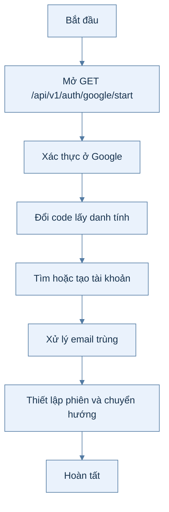
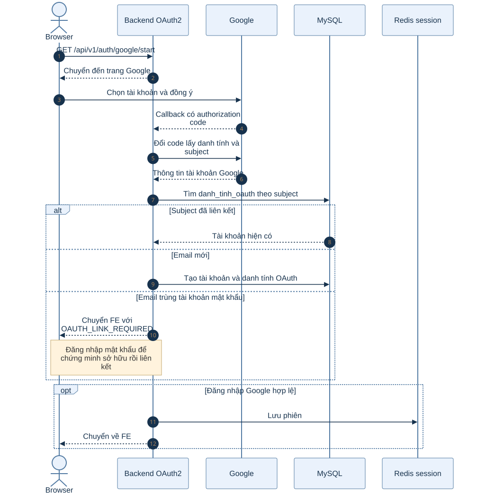
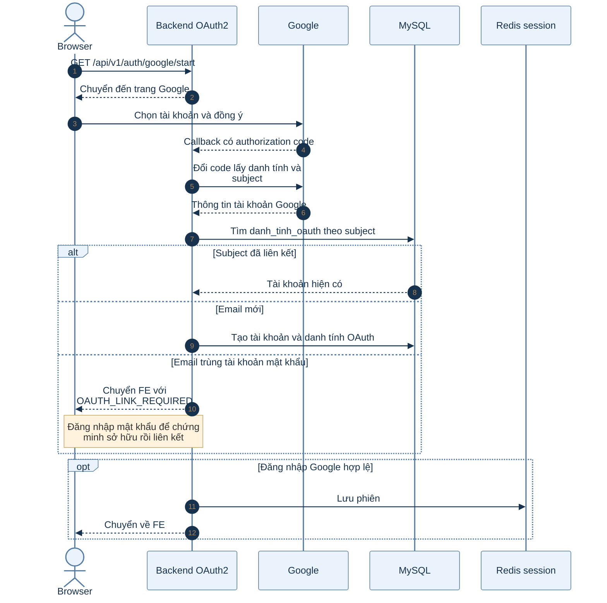

# B1.4 — Đăng nhập Google

> Phạm vi: backend hiện có theo roadmap và mã nguồn. Sơ đồ hoạt động mô tả các bước; sơ đồ tuần tự mô tả thành phần tham gia.

## Sơ đồ hoạt động

Xem mã Mermaid của sơ đồ

## Sơ đồ tuần tự

Xem mã Mermaid của sơ đồ

## Giải thích từng bước

| Bước | Việc diễn ra | Ý nghĩa và dữ liệu |
|---|---|---|
| 1 | Mở GET /api/v1/auth/google/start | Backend chuyển hướng sang luồng OAuth2 của Spring và lưu trạng thái cần cho callback. |
| 2 | Xác thực ở Google | Người dùng chọn tài khoản và đồng ý; Google trả authorization code về callback. |
| 3 | Đổi code lấy danh tính | Spring OAuth2 lấy thông tin Google, backend kiểm tra subject và email. |
| 4 | Tìm hoặc tạo tài khoản | Subject đã liên kết đi vào cùng tài khoản; email mới tạo tài khoản HOAT_DONG không mật khẩu. |
| 5 | Xử lý email trùng | Nếu email đã thuộc tài khoản khác, backend redirect 302 về `{frontend}/dang-nhap?loi=OAUTH_LINK_REQUIRED` (không trả JSON, không tạo phiên); người dùng đăng nhập mật khẩu trong 10 phút để liên kết. Lỗi khác (Hủy, `state` sai, hết hạn) về `?loi=GOOGLE_THAT_BAI`; điểm đến sau đăng nhập lấy từ tham số `next` đã kiểm tra. Chi tiết: SPRINT_1 §5.10. |
| 6 | Thiết lập phiên và chuyển hướng | Đăng nhập thành công ghi phiên rồi chuyển về FE theo trạng thái khởi đầu. |

## Nhánh lỗi và cách kiểm tra

Không tự nối hai tài khoản chỉ vì email giống nhau. Liên kết yêu cầu chứng minh quyền sở hữu bằng đăng nhập mật khẩu trong khoảng thời gian cho phép; tài khoản bị khóa bị từ chối.

## Vị trí mã nguồn liên quan

`account/service/GoogleLoginService.java`, `account/controller/GoogleLoginSuccessHandler.java`, `account/controller/AuthController.java`. Các đường dẫn Java ở trên nằm dưới `backend/k28/src/main/java/com/do_an_tot_nghiep/k28/`.
