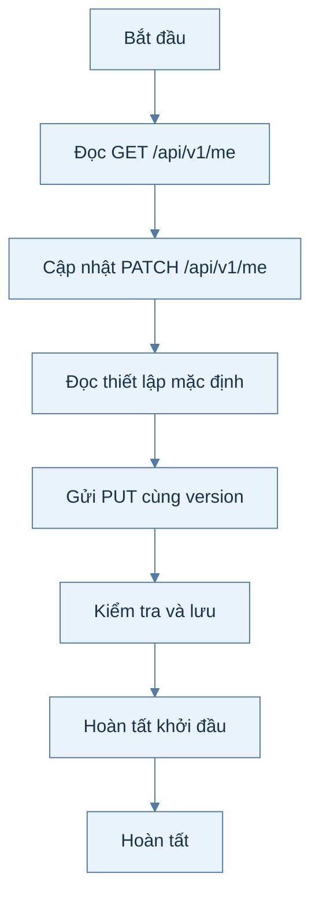
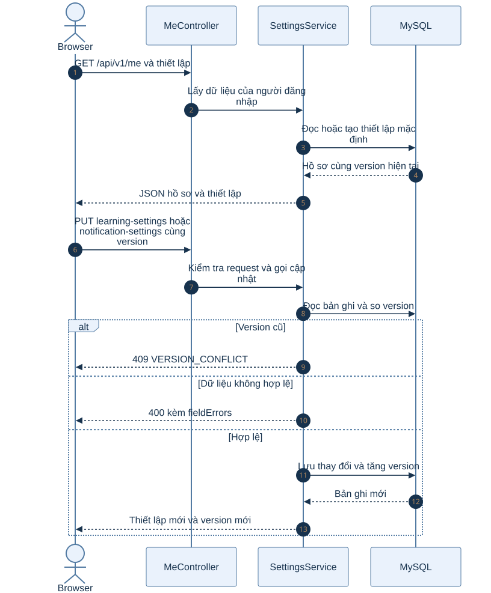
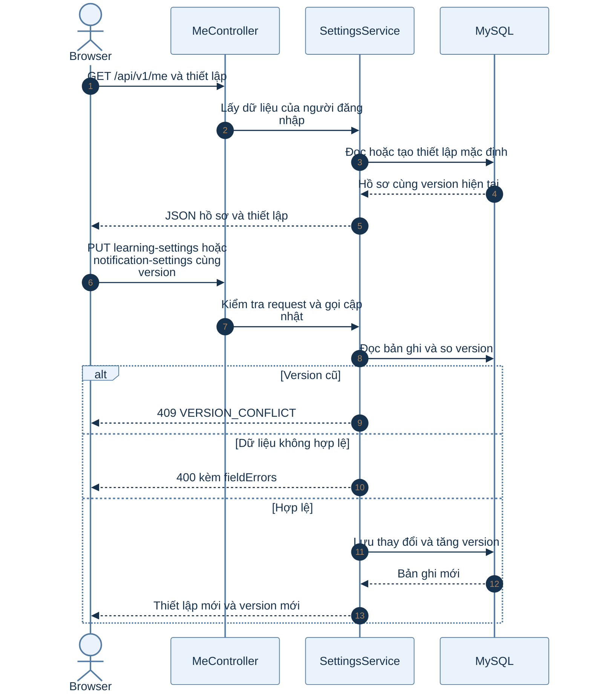

# B1.5 — Hồ sơ và thiết lập

> Phạm vi: backend hiện có theo roadmap và mã nguồn. Sơ đồ hoạt động mô tả các bước; sơ đồ tuần tự mô tả thành phần tham gia.

## Sơ đồ hoạt động

Xem mã Mermaid của sơ đồ

## Sơ đồ tuần tự

Xem mã Mermaid của sơ đồ

## Giải thích từng bước

| Bước | Việc diễn ra | Ý nghĩa và dữ liệu |
|---|---|---|
| 1 | Đọc GET /api/v1/me | Backend trả hồ sơ và cờ daHoanTatKhoiDau của người dùng từ phiên. |
| 2 | Cập nhật PATCH /api/v1/me | Controller kiểm tra DTO rồi cập nhật các trường hồ sơ được phép sửa. |
| 3 | Đọc thiết lập mặc định | GET learning-settings hoặc notification-settings trả giá trị mặc định khi chưa có bản ghi. |
| 4 | Gửi PUT cùng version | FE gửi toàn bộ thiết lập và version hiện tại để chống ghi đè dữ liệu cũ. |
| 5 | Kiểm tra và lưu | Service kiểm tra múi giờ IANA, giới hạn và giờ nhắc; version cũ trả 409 VERSION_CONFLICT. |
| 6 | Hoàn tất khởi đầu | Lần lưu learning-settings đầu tiên đặt daHoanTatKhoiDau thành true; GET /me phản ánh cờ mới. |

## Nhánh lỗi và cách kiểm tra

Thiếu giờ nhắc khi bật nhắc học, múi giờ dạng offset hoặc giá trị vượt giới hạn sẽ trả 400 kèm fieldErrors. Chủ đề yêu thích được chuyển sang B1.7.

## Vị trí mã nguồn liên quan

`account/controller/MeController.java`, `account/service/SettingsService.java`. Các đường dẫn Java ở trên nằm dưới `backend/k28/src/main/java/com/do_an_tot_nghiep/k28/`.
