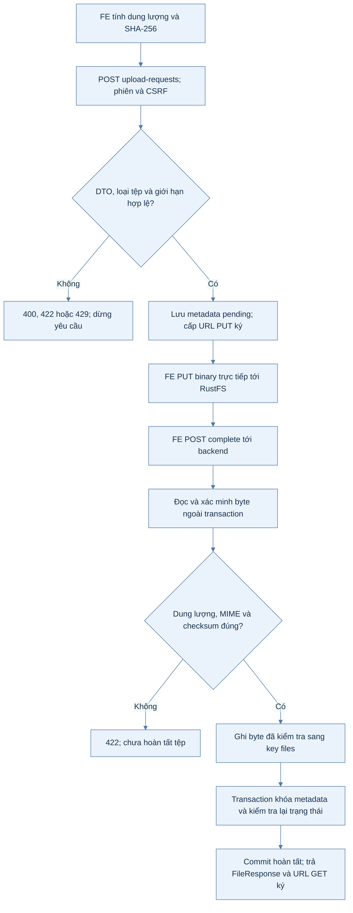
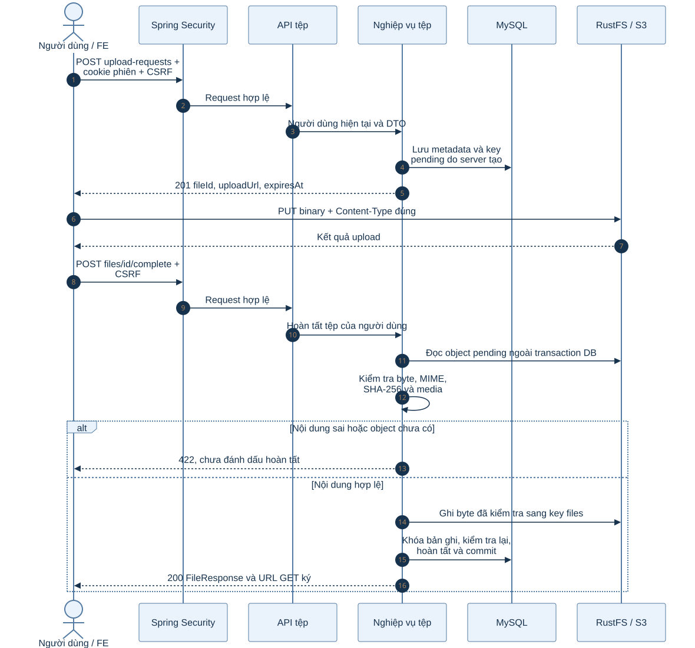
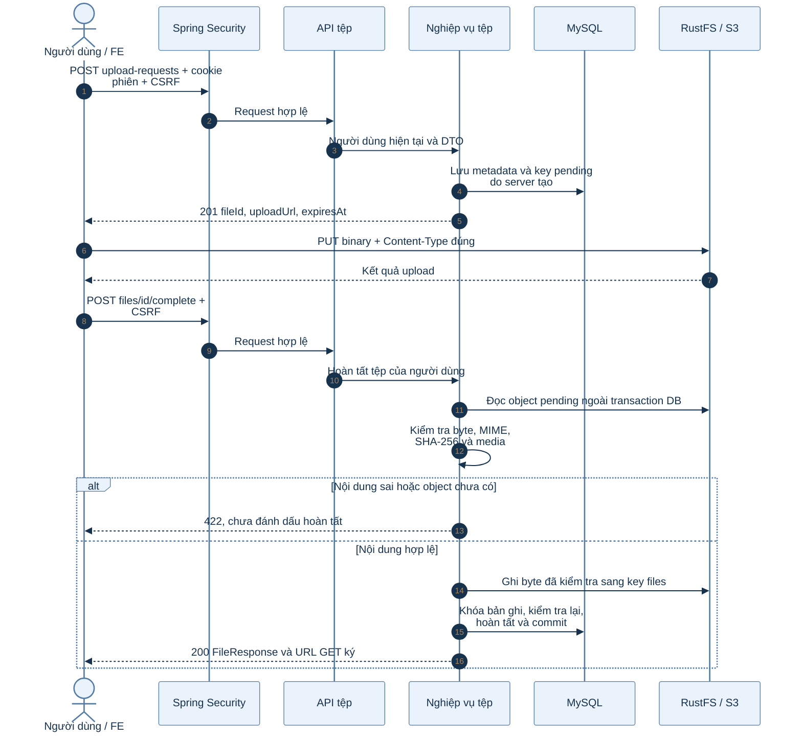

# B1.6 — Tệp tin và ảnh đại diện

Đã kiểm chứng ngày 02/10/2026. FR-03, TK §12.2, §13.2, §16.

## API

Mọi endpoint cần phiên đăng nhập; POST/PUT/DELETE cần cookie `XSRF-TOKEN` và header `X-XSRF-TOKEN`. ID response là chuỗi.

| Method | Endpoint | Request / response |
|---|---|---|
| POST | `/api/v1/files/upload-requests` | `{loai,mimeType,kichThuoc,checksum}` → 201 `{fileId,uploadUrl,expiresAt}` |
| POST | `/api/v1/files/{id}/complete` | Không cần body → 200 `FileResponse` |
| GET | `/api/v1/files/{id}` | Tệp hoàn tất của mình → 200 `FileResponse`, URL GET mới |
| DELETE | `/api/v1/files/{id}` | 204; có thể gọi lại để retry |
| PUT | `/api/v1/me/avatar` | `{anhDaiDienId:"12"}` → 200 `FileResponse` |
| GET | `/api/v1/me/avatar` | 200 `FileResponse`; chưa có ảnh → 204 |
| DELETE | `/api/v1/me/avatar` | 204; chỉ gỡ ảnh đại diện, giữ tệp |

`FileResponse`: `{id,loai,mimeType,kichThuoc,checksum,hoanTatAt,downloadUrl,expiresAt}`. `GET /me` bổ sung `anhDaiDienId`, nullable.

## Sơ đồ hoạt động: upload và hoàn tất tệp

Xem mã Mermaid của sơ đồ

## Sơ đồ tuần tự: upload và complete

Xem mã Mermaid của sơ đồ

### Giải thích từng bước trong hai sơ đồ

1. FE gửi metadata tới API của backend; danh tính lấy từ phiên, key lưu trữ do server tạo.
2. Backend kiểm tra DTO, giới hạn và tần suất trước khi cấp URL ký. Có URL upload chưa đồng nghĩa tệp đã hoàn tất.
3. FE gửi byte trực tiếp tới RustFS. Request này dùng quyền trong URL ký, không gửi cookie phiên hoặc CSRF tới storage.
4. Complete quay lại backend và phải qua bảo mật. Backend kiểm tra nội dung thật ngoài transaction để tránh giữ khóa DB trong thời gian đọc tệp.
5. Backend ghi byte đã xác minh sang key chính thức, sau đó khóa metadata để kiểm tra lại và commit. URL PUT cũ chỉ ghi được key tạm.
6. Response thành công có URL GET mới với thời hạn riêng. Gọi complete lặp lại nhận trạng thái hiện tại; lỗi storage/DB và object mồ côi được xử lý theo phần cleanup bên dưới.

## Upload

1. FE tính SHA-256 dạng 64 ký tự hex và kích thước byte của tệp.
2. Backend tự tạo key `pending/<userId>/<UUID>`, lưu bản ghi và cấp URL PUT ký.
3. FE PUT binary tới `uploadUrl`. Header `Content-Type` phải đúng giá trị `mimeType` trong request ban đầu. Không gửi cookie phiên/CSRF tới S3.
4. FE gọi complete. Backend đọc giới hạn, xác minh dung lượng/MIME/SHA-256 và nội dung media ngoài transaction.
5. Backend ghi đúng byte đã kiểm tra sang key `files/<userId>/<UUID>`; key này không được cấp URL PUT cho client.
6. Transaction khóa bản ghi, kiểm tra lại trạng thái/hạn và hoàn tất. Gọi lại complete trả kết quả hiện tại. URL PUT cũ chỉ ảnh hưởng object tạm.

Không nhận key, user ID, đường dẫn hoặc URL tùy ý từ client. Các trường JSON bổ sung không quyết định nơi lưu trữ. Tệp riêng của người khác và tệp đã xóa trả 404. Tệp chưa có object, chưa hoàn tất hoặc sai dữ liệu trả 422. DTO sai trả 400. Rate limit upload/complete dùng chung 30 lượt/phút/người.

Bucket dev được s3-init cấu hình CORS từ `backend/k28/docker/s3-cors.json`: chỉ localhost:3000 và 127.0.0.1:3000, cho GET/PUT/HEAD. Đổi origin FE cần cập nhật danh sách trong file và chạy `docker compose up -d s3-init` từ backend/k28. CORS không cấp quyền đọc bucket công khai. Compose config đã hợp lệ, init container đã chạy thành công và test preflight browser pass.

## Giới hạn

| Media | Giới hạn |
|---|---|
| JPEG, PNG, WebP | 2 × 1024 × 1024 byte; đọc được bằng ImageIO; tối đa 4096 pixel mỗi chiều mặc định |
| MP3, WAV, FLAC | 5 × 1024 × 1024 byte; metadata đọc được, sample rate hợp lệ, thời lượng > 0 và ≤ 300 giây mặc định |

Các MIME WAV/FLAC tương đương được chuẩn hóa. Chưa nhận MP4/WebM/Ogg qua endpoint này. Thời lượng dựa trên audio header do jaudiotagger đọc; bước phát âm sẽ thực hiện xử lý âm thanh của riêng nó.

`FILE_MAX_AUDIO_SECONDS` và `FILE_MAX_IMAGE_DIMENSION` điều chỉnh các giới hạn bổ sung. Request chưa hoàn tất hết hạn sau 24 giờ. URL ký mặc định 10 phút theo `S3_PRESIGN_TTL`. Không lưu URL ký vào DB, không coi ETag là SHA-256.

Dependency: Tika core 3.3.2 để nhận diện MIME; TwelveMonkeys imageio-webp 3.13.1 để giải mã WebP; jaudiotagger 3.0.1 để đọc metadata/thời lượng âm thanh. Tệp tạm kiểm tra âm thanh dùng tên máy chủ sinh và được dọn trong finally.

## Ảnh đại diện và xóa

Gắn ảnh chỉ nhận ảnh hoàn tất, còn hiệu lực và thuộc người đăng nhập. Gắn/xóa khóa tệp trước, người dùng sau; cập nhật tài khoản thông qua AccountService.

DELETE tệp: nếu tệp đang được thẻ từ vựng dùng → 409 `CONFLICT` ("Tệp đang được thẻ từ vựng sử dụng"), không đổi gì. Ngược lại gỡ tham chiếu avatar và đánh dấu DA_XOA trong cùng transaction. Sau commit, backend xóa S3 và ghi da_xoa_object_at. Nếu S3 lỗi: trả 503, giữ tombstone để retry; không cấp URL GET mới cho tệp đó. Các URL ký đã cấp có thời hạn và không phải cơ chế thu hồi tức thời khi storage đang lỗi.

## Cleanup và retry

Chưa cần bảng tác vụ AI của Đợt 3. FileCleanupWorker dùng tombstone bền vững của tep_tin để retry; chạy mỗi 60 giây mặc định, tối đa 100 bản ghi mỗi đợt. Không gọi S3 trong transaction DB.

Worker đánh dấu request pending quá 24 giờ đã xóa; retry xóa object chưa có da_xoa_object_at. Worker quét một trang 100 object mỗi prefix pending/files mỗi lượt, tiếp tục bằng continuation token. Chỉ xóa object cũ hơn 24 giờ cộng TTL URL ký và không còn bản ghi CON_HIEU_LUC tham chiếu. Đây là đường phục hồi cho upload bỏ dở, key tạm sau complete và object mồ côi khi DB commit lỗi. Object đang được xử lý và object còn tham chiếu được giữ.

Biến cấu hình: `FILE_CLEANUP_ENABLED`, `FILE_CLEANUP_INITIAL_DELAY_MS`, `FILE_CLEANUP_INTERVAL_MS`. Không xóa bản ghi tep_tin vật lý để giữ lịch sử và khả năng retry.

## Kiểm chứng

- FR03FilesTest: 12 test API/DB/RustFS, bao gồm concurrency, immutable promotion, outage/retry, pending hết hạn, quyền, CSRF, rate limit, avatar và browser preflight.
- FR03MediaTest: 7 test ảnh PNG/JPEG/WebP, kích thước ảnh, WAV ở biên thời lượng, MP3/FLAC hỏng.
- FR03CleanupTest: 3 test retry, giữ object còn tham chiếu/đang xử lý, dọn orphan và pagination.
- Hồi quy: FR02SettingsTest 7, StorageServiceTest 2, SecurityBaselineTest 4. Tổng 35 test pass, không skip.

Migrations: V2__file.sql hiện có được giữ nguyên; V3__file_cleanup.sql bổ sung timestamp/index cho retry. B1.7 bắt đầu V4__content.sql.
