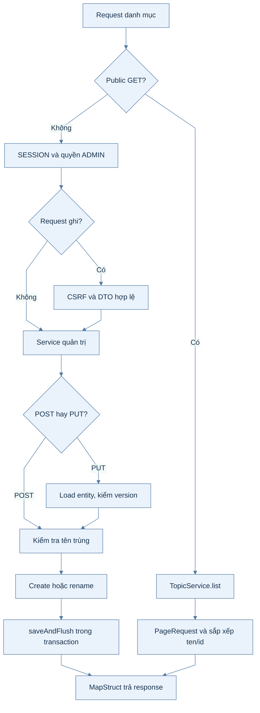
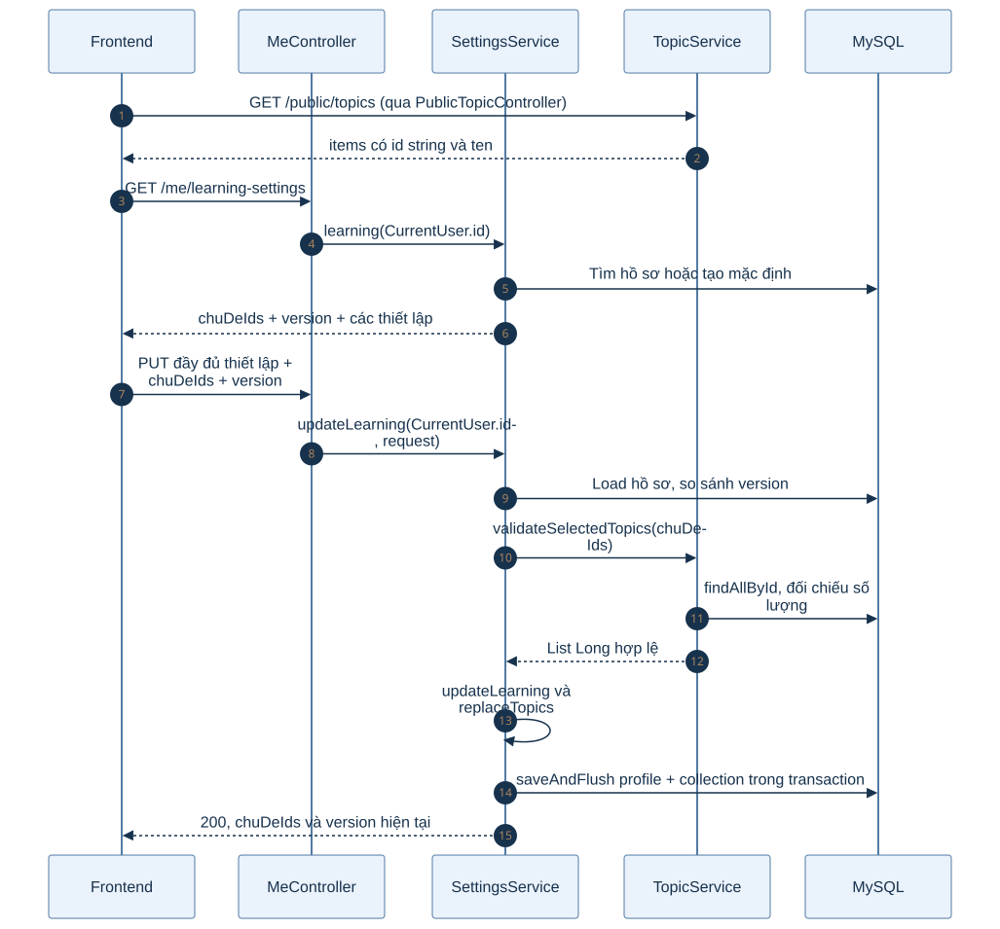
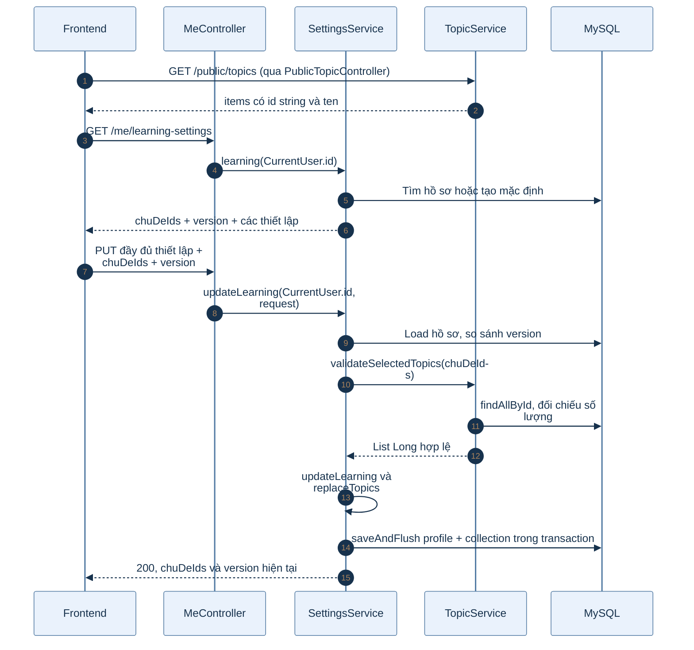
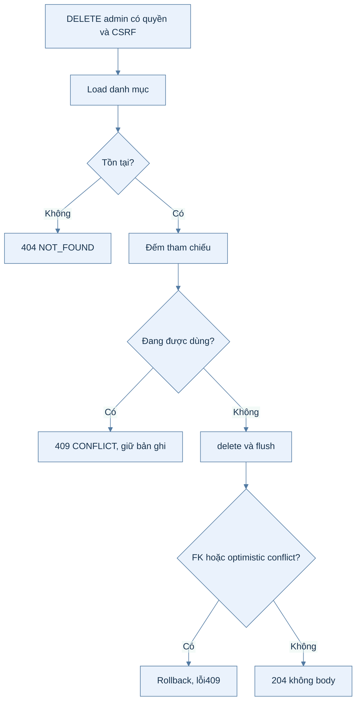

# B1.7 — Chủ đề, nhãn và chủ đề yêu thích

> Kiểm chứng mới 05/10/2026: toàn suite117/117; danh mục14/14 gồm race và FK; bộ thẻ11/11 gồm xóa mềm/bảo toàn tham chiếu/bộ ẩn/cập nhật đồng thời; guard tệp có liên kết được kiểm tra409 và không đổi avatar/trạng thái/S3. Newman smoke67/67 assertion. Bảng kiểm chứng cũ bên dưới là lịch sử, không phải phần còn thiếu hiện tại. Google E2E thật chưa chạy trong đợt này.

> Kiểm chứng05/10: FK chủ đề–bộ và nhãn–thẻ; concurrent duplicate/update-version/delete. Danh mục đang tham chiếu trả409, không cascade. Chủ đề100 ký tự, nhãn50, PUT có version, trình độ enum.

Ngày đối chiếu: 03/10/2026. FR-03, phần phân quyền FR-13 và phần chủ đề yêu thích chuyển từ B1.5.

## 1. Phạm vi và hợp đồng

| Nhóm | API | Quyền | Kết quả |
|---|---|---|---|
| Danh mục công khai | GET `/api/v1/public/topics` | Khách | PageResponse |
| Chủ đề quản trị | GET/POST `/api/v1/admin/topics`; GET/PUT/DELETE `/api/v1/admin/topics/{id}` | ADMIN | GET/PUT200, POST201+Location, DELETE204 |
| Nhãn quản trị | GET/POST `/api/v1/admin/tags`; GET/PUT/DELETE `/api/v1/admin/tags/{id}` | ADMIN | Tương tự chủ đề |
| Thiết lập học | GET/PUT `/api/v1/me/learning-settings` | Người đăng nhập | 200, thêm `chuDeIds` |

Request ghi dùng SESSION và CSRF. Backend lấy người dùng từ `CurrentUser`, không nhận userId trong body. Topic response `{id,ten,moTa,version}`, tag response `{id,ten,version}`; id string, version number. Danh sách `{items,page,size,totalElements,totalPages}`, mặc định page0/size20, page≥0, size1–100, sắp xếp ten rồi id.

Không có API CRUD trình độ: dùng enum `MOI_BAT_DAU`, `CO_BAN`, `TRUNG_CAP`, `NANG_CAO`. Không có `/public/tags`. Bộ/thẻ/thư viện/CSV vẫn thuộc B1.8–B1.12.

## 2. Đường đi trong mã nguồn

| Thành phần | Trách nhiệm |
|---|---|
| SecurityConfig và method security | `/admin/**` yêu cầu ADMIN; `/public/**` cho khách; request ghi kiểm CSRF |
| PublicTopicController | Đọc danh mục công khai |
| AdminTopicController / AdminTagController | Nhận path/query và DTO `@Valid`, gọi service, trả status/Location |
| TopicService / TagService | Phân trang, trùng tên, version, kiểm tra tham chiếu trước xóa |
| ChuDeRepository / NhanRepository | Spring Data JPA; countReferences bằng native query |
| ChuDe / Nhan | ID tự tăng, BaseEntity timestamps, @Version; thay đổi qua create/rename |
| CatalogMapper | MapStruct map entity thành response; Long id thành string |
| MeController → SettingsService | Lấy CurrentUser; đọc/lưu hồ sơ học và kiểm version |
| TopicService.validateSelectedTopics | Kiểm tối đa5, ID dương trong Long, không trùng và tồn tại |
| HoSoHocTap.replaceTopics | Thay tập ElementCollection, chỉ clear/add khi tập thực sự khác |
| GlobalExceptionHandler | ApiException, optimistic locking và constraint danh mục → lỗi chuẩn |

Mã nguồn nằm dưới `backend/k28/src/main/java/com/do_an_tot_nghiep/k28/`. Module account gọi content qua TopicService; không dùng trực tiếp repository của content.

## 3. Luồng đọc và sửa danh mục

Xem mã Mermaid của sơ đồ

1. Khách truy cập admin trả401; USER trả403. Request ghi không qua CSRF có thể trả403 trước khi xét quyền.
2. Topic ten bắt buộc, không trắng, tối đa100; moTa tùy chọn tối đa500. Tag ten tối đa50. Record constructor strip tên/mô tả trước Bean Validation.
3. POST kiểm existsByTen; trùng trả409 CONFLICT, field `ten`. Unique key ở DB bảo vệ cả trường hợp hai request tạo trùng đồng thời.
4. PUT tìm theo id; không có trả404. So sánh request.version với entity.version; cũ trả409 VERSION_CONFLICT trước khi ghi. Version danh mục bắt buộc ≥0.
5. Kiểm tra tên trùng với bản ghi khác, gọi rename, saveAndFlush. Hibernate @Version chống ghi đè khi hai transaction dùng cùng phiên bản.
6. PUT topic thay tên và mô tả; bỏ moTa đặt mô tả về null. Đổi dữ liệu tăng version; gửi lại cùng dữ liệu có thể giữ nguyên version.
7. POST201 có Location `/api/v1/admin/topics/{id}` hoặc `/api/v1/admin/tags/{id}`. GET/PUT200. Không gửi email/tạo job.

## 4. Luồng chọn chủ đề yêu thích

Xem mã Mermaid của sơ đồ

Body PUT gồm `trinhDo`, `mucTieu`, `phutMoiNgay`1–240, `tuMoiMoiNgay`0–100, `chuDeIds`, `version`. Mọi trường bắt buộc. `chuDeIds` là array string, 0–5 ID, mẫu `[1-9][0-9]{0,18}`, chuyển được sang Long, không trùng và tất cả phải tồn tại. Thiếu/null/trùng/quá5/sai ID trả400; ID hợp lệ nhưng không tồn tại trả422 BUSINESS_RULE, field `chuDeIds`.

`[]` bỏ toàn bộ lựa chọn. Không gửi `topicIds`. Không đảm bảo thứ tự các ID; đây là tập lựa chọn. Sửa các thiết lập khác vẫn phải gửi lại tập hiện tại.

HoSoHocTap sở hữu ElementCollection bảng `chu_de_yeu_thich`, join qua khóa chính hồ sơ bằng `nguoi_dung_id`. Không ghi bảng nối bằng JDBC ngoài Hibernate; thay collection làm version của hồ sơ thay đổi cả khi bốn thiết lập giữ nguyên. `created_at` của bảng nối dùng DEFAULT ở DB.

Lần lưu đầu đặt `daHoanTatKhoiDau=true`. Version thiết lập học bắt buộc khác null; DTO này không có PositiveOrZero. Version cũ trả409. Kiểm tra version và chủ đề trước khi sửa entity; lỗi làm transaction rollback. Không cam kết số version tăng khi gửi lại toàn bộ dữ liệu giống hệt.

## 5. Luồng xóa danh mục

Xem mã Mermaid của sơ đồ

| Danh mục | countReferences | Quy tắc |
|---|---|---|
| Chủ đề | bo_the.chu_de_id + chu_de_yeu_thich.chu_de_id | Chặn nếu có bất kỳ tham chiếu, kể cả bộ đã xóa mềm còn giữ FK |
| Nhãn | the_nhan.nhan_id | Chặn nếu có thẻ đang gắn nhãn |

Không ON DELETE CASCADE. Không tự gỡ nhãn khỏi thẻ hoặc xóa lựa chọn của người học. FK bảo vệ nếu có tham chiếu mới xuất hiện sau bước count; GlobalExceptionHandler nhận constraint đã biết và trả409. DELETE không nhận body/version; dùng version đã load trong transaction, không so sánh phiên bản từ client.

## 6. Schema V4

`V4__content.sql` thêm tám bảng: chu_de, nhan, bo_the, the_tu_vung, the_nhan, the_tep, bo_yeu_thich, chu_de_yeu_thich. Các bảng bộ/thẻ và liên kết mới là nền schema; chưa đồng nghĩa API B1.8/B1.9 đã được viết.

- Unique chu_de.ten và nhan.ten, CHECK tên không trắng.
- FK bộ/thẻ/người dùng/tệp; bảng nối dùng khóa chính ghép để chống trùng.
- Trình độ/access/moderation/role tệp/độ khó có CHECK; không có unique từ+từ loại.
- Index bộ theo owner hoặc public/topic, index thẻ theo bộ/xóa/id.
- ChuDe, Nhan và HoSoHocTap dùng optimistic version; thời gian do BaseEntity/DB quản lý.

## 7. Kiểm chứng và giới hạn

| Bằng chứng | Kết quả |
|---|---|
| FR03CatalogTest | 10/10 pass: hai loại danh mục, CRUD, tên trùng, stale version, validation và guest/USER |
| HTTP backend thật | 62 lượt đạt kỳ vọng, 03/10/2026; happy path đủ11 API danh mục + GET/PUT thiết lập học |
| Đổi riêng chủ đề | Thiết lập giữ nguyên, bỏ chọn chủ đề: version1→2 |
| Xóa đang dùng | Người học chọn chủ đề, admin DELETE→409; bỏ chọn rồi DELETE→204; GET sau đó404 |
| Validation chủ đề | Thiếu trường, quá5, trùng→400; không tồn tại→422; stale→409 |
| Chưa thử thực tế | Concurrent unique/update/delete; bo_the tham chiếu topic; the_nhan tham chiếu tag; toàn bộ suite |
| FR-13 còn thiếu | Chưa có audit log hoặc lý do thay đổi/xóa danh mục; không tuyên bố đã hoàn tất toàn bộ FR-13 |
| Mockup | Demo còn mảng/name/PATCH/topicIds và cascade nhãn; kết quả đối chiếu ở báo cáo FE mục10 |

Hợp đồng có phản hồi thật: [DOT1_BAO_CAO_FE.md](../../report/DOT1_BAO_CAO_FE.md) mục5.12 và5.21–5.31. Postman: [README](../../postman/README.md). Đây là tài liệu luồng B1.7, không triển khai thêm bước backend.
