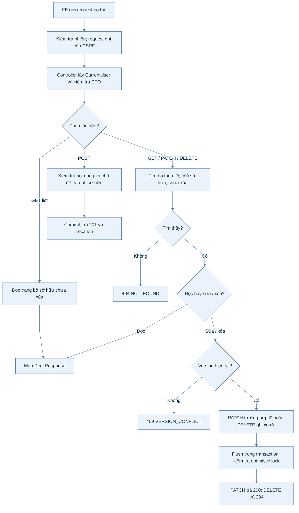
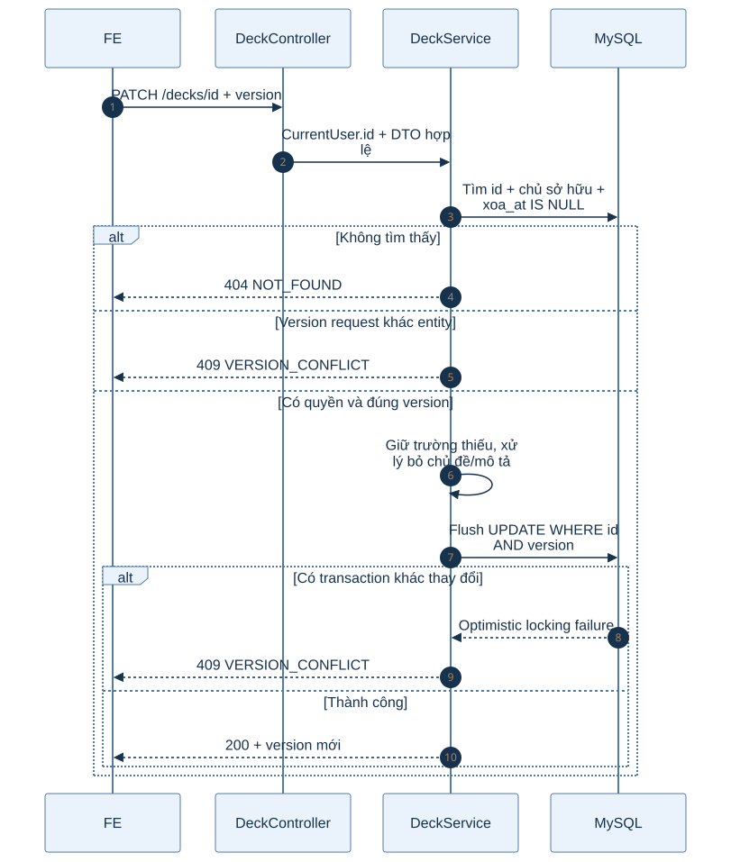
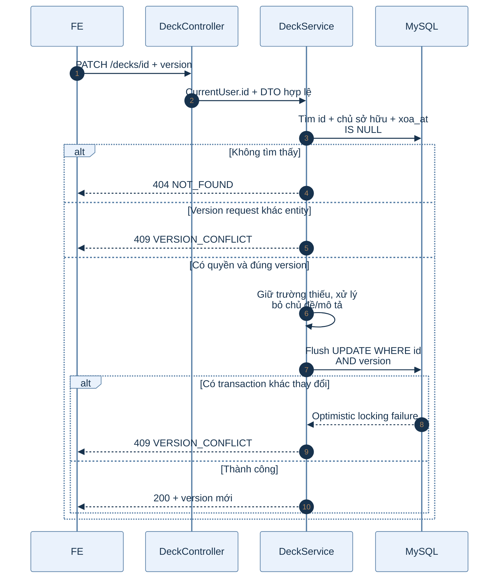

# B1.8 — Bộ thẻ cá nhân

> Kiểm chứng mới 05/10/2026: toàn suite117/117; danh mục14/14 gồm race và FK; bộ thẻ11/11 gồm xóa mềm/bảo toàn tham chiếu/bộ ẩn/cập nhật đồng thời; guard tệp có liên kết được kiểm tra409 và không đổi avatar/trạng thái/S3. Newman smoke67/67 assertion. Bảng kiểm chứng cũ bên dưới là lịch sử, không phải phần còn thiếu hiện tại. Google E2E thật chưa chạy trong đợt này.

> Bổ sung05/10: test và HTTP/Newman kiểm tra xóa mềm, đọc sau xóa, version, favorite và ownership. GET list chỉ bộ sở hữu; `mucTieu` đã có trong `DeckResponse`, `CreateDeckRequest`, `UpdateDeckRequest` (kèm `boMucTieu`, V5, từ B1.10); `cardCount` và danh sách yêu thích của người khác vẫn chưa có.

Cập nhật đối chiếu06/10/2026, FR-03/TC-02: B1.8 đã hoàn tất theo kiểm chứng05/10; không chạy lại build/test/HTTP trong lượt đối chiếu06/10. HTTP34/34 ngày04/10 là kết quả lịch sử.

## 1. Phạm vi và hợp đồng

Mọi API cần SESSION; POST/PATCH/PUT/DELETE cần CSRF. Người dùng lấy từ `CurrentUser.id()`, không nhận chủ sở hữu do client gửi.

| API | Quyền | Thành công theo code | HTTP đã kiểm chứng |
|---|---|---|---|
| GET `/api/v1/decks` | Đăng nhập, chỉ bộ của mình chưa xóa | 200 PageResponse | Có |
| POST `/api/v1/decks` | Đăng nhập | 201 + Location | Có |
| GET `/api/v1/decks/{id}` | Chủ sở hữu | 200 DeckResponse | Có |
| PATCH `/api/v1/decks/{id}` | Chủ sở hữu, version hiện tại | 200 DeckResponse | Có |
| DELETE `/api/v1/decks/{id}?version=…` | Chủ sở hữu, version hiện tại | 204 | DELETE204 và GET sau xóa404 qua Newman05/10; test bảo toàn tham chiếu11/11 |
| PUT `/api/v1/decks/{id}/favorite` | Chủ sở hữu hoặc công khai + bình thường | 204 | Có |
| DELETE `/api/v1/decks/{id}/favorite` | Gỡ liên kết của người hiện tại | 204 | Có |

GET danh sách: `page=0`, `size=20`, page≥0, size1–100; sắp xếp `createdAt DESC, id DESC`. Chưa hỗ trợ tìm kiếm `q`, `tab=favorites` hoặc liệt kê bộ yêu thích của người khác.

GET/PATCH/DELETE quản lý bộ người khác luôn 404, kể cả CONG_KHAI. GET công khai thuộc `/library/decks/{id}` B1.10, chưa triển khai.

## 2. Đường đi trong mã nguồn

| Thành phần | Trách nhiệm |
|---|---|
| DeckController | CurrentUser, path ID dương, DTO @Valid, query version khi xóa, status/Location |
| DeckService | Transaction, quyền sở hữu, version, chủ đề tồn tại, xóa mềm, quyền yêu thích |
| BoTheRepository | Danh sách theo chủ sở hữu; lookup bộ của mình; khóa PESSIMISTIC_READ khi thêm yêu thích |
| BoThe | BaseEntity auditing, create/updateDetails/markDeleted, @Version |
| DeckFavoriteRepository | JDBC composite PK; INSERT ON DUPLICATE KEY; DELETE theo user + deck; đọc theo lô |
| DeckMapper | MapStruct entity → DTO, ID Long → string |
| GlobalExceptionHandler | VALIDATION_FAILED, NOT_FOUND, VERSION_CONFLICT và optimistic locking |

## 3. Sơ đồ hoạt động: quản lý bộ thẻ

Xem mã Mermaid của sơ đồ

### Giải thích từng bước sơ đồ hoạt động

1. Lớp bảo mật kiểm tra phiên và CSRF cho thao tác ghi; controller không nhận chủ sở hữu do client tự khai.
2. GET danh sách chỉ lấy bộ của người hiện tại chưa xóa mềm. POST tạo bộ mới sau khi kiểm tra nội dung và chủ đề.
3. GET chi tiết, PATCH và DELETE kiểm tra đồng thời ID, quyền sở hữu và trạng thái chưa xóa; không đạt trả 404.
4. PATCH/DELETE đối chiếu version trước khi ghi. Flush vẫn có thể phát hiện transaction khác đã cập nhật và trả 409.
5. DELETE đánh dấu xóa mềm, giữ hàng bộ thẻ và các tham chiếu. Luồng yêu thích có quy tắc riêng ở mục 6.

## 4. Sơ đồ tuần tự: cập nhật bộ thẻ

Xem mã Mermaid của sơ đồ

POST: ten bắt buộc sau strip, tối đa150; moTa≤1000; trinhDo bắt buộc; quyenTruyCap thiếu/null mặc định RIENG_TU. chuDeId tùy chọn, string ID dương trong miền Long và phải tồn tại (422 BUSINESS_RULE nếu không).

PATCH: version bắt buộc, không âm. Các trường thiếu/null giữ nguyên; moTa chuỗi rỗng xóa mô tả; boChuDe=true bỏ chủ đề và không được gửi cùng chuDeId. Boolean boChuDe chuẩn hóa bằng Boolean.TRUE.equals để request thiếu trường vẫn deserialize được.

Không phải mọi PATCH đều làm version tăng: Hibernate chỉ tăng khi entity có thay đổi được ghi. FE luôn lấy version từ response, không tự cộng. Test HTTP đã xác nhận PATCH đổi tên tăng 0→1.

## 5. Quy tắc xóa mềm và tham chiếu

DELETE chỉ gọi markDeleted(clock.instant()) rồi flush; không gọi repository.delete, không xóa thẻ/yêu thích/tham chiếu. V4 có sẵn xoa_at, version và FK, không cần migration mới.

Theo code/schema, dòng bo_the giữ nguyên với xoa_at khác null và version tăng khi xóa; các dòng the_tu_vung, bo_yeu_thich và bo_the.bo_nguon_id còn nguyên. GET/list/PATCH/DELETE quản lý bỏ qua bộ đã xóa; thêm yêu thích bộ đã xóa trả404. Gỡ yêu thích vẫn204 và chỉ gỡ liên kết của người hiện tại.

Test05/10 đã xác nhận giữ thẻ/favorite/bộ nguồn; Newman đã xác nhận DELETE204/GET404. Không chạy lại HTTP6c ngày06/10. Lịch sử học thuộc bước sau, chưa có fixture để xác nhận bảo toàn lịch sử học.

## 6. Luồng yêu thích

1. PUT mở transaction, đọc bộ chưa xóa bằng PESSIMISTIC_READ.
2. Chủ sở hữu được yêu thích bộ của mình, kể cả DA_AN; người khác cần CONG_KHAI + BINH_THUONG.
3. Không đạt quyền →404; đạt quyền →INSERT composite PK (nguoi_dung_id, bo_the_id), lặp lại không tạo liên kết trùng theo schema/SQL.
4. GET/list bộ của mình tính yeuThich riêng cho người hiện tại; thay đổi yêu thích không tăng version của bộ.
5. DELETE favorite không cần đọc bộ: xóa theo người hiện tại + deckId; không tồn tại, bị riêng tư hoặc đã xóa vẫn204.

Khóa đọc giữ đến cuối transaction để thao tác chuyển riêng tư/xóa bộ không chen giữa lúc kiểm quyền và thêm liên kết. Race thêm favorite đồng thời với đổi quyền/xóa chưa được chạy riêng; race cập nhật cùng version đã qua kiểm thử hai transaction.

## 7. Bằng chứng và giới hạn

| Kiểm tra | Kết quả |
|---|---|
| 6a: tạo, đọc/list, sửa một phần, version cũ, thiếu version, đọc lại | 8/8 lượt HTTP đạt kỳ vọng |
| 6b: hai tài khoản, quản lý riêng tư/công khai, yêu thích lặp lại, riêng tư lại | 26/26 lượt HTTP đạt kỳ vọng |
| FR03DeckTest |11/11 đạt ở lần05/10; kế thừa kết quả, không chạy lại06/10 |
| HTTP6c ngày04/10 (lịch sử) |Bị429 và bỏ qua; sau đó Newman05/10 xác nhận xóa/GET404, test05/10 xác nhận giữ tham chiếu |
| DA_AN, validation mở rộng, hai transaction đồng thời |Đã kiểm chứng05/10; ca tên chỉ có NBSP/U+2007/U+202F chưa có, xem report mục10 |
| GET danh sách yêu thích ngoài bộ sở hữu, q/tab | Chưa có trong hợp đồng hiện tại |

HTTP sử dụng localhost:8080, cookie và CSRF thật. Các lần chuẩn bị phiên và các lần404 do image Docker cũ không nằm trong34 lượt đạt kỳ vọng. Không cộng34 lượt này với test tự động hoặc62 lượt B1.7 thành kết quả suite.

## 7. Bàn giao và bước tiếp

- Triển khai, bằng chứng kiểm chứng và bàn giao FE: [báo cáo Đợt1](../../report/DOT1_BAO_CAO_FE.md).
- FE F1.8, UI13/UI14: xem báo cáo Đợt1 mục5.32–5.38 và mục10 về lệch mockup.
- Postman: 7 request API + 5 ca lỗi; deckVersion/deckOldVersion/foreignDeckId có ở cả hai môi trường.
- B1.9 đã có4 API thẻ + public tags và HTTP06/10; còn kiểm thử ADMIN/JUnit/Postman. B1.10 thư viện, B1.11 sao chép và B1.12 CSV đã triển khai sau đó (xem luồng B1.10–B1.12).
- B1.8 được đánh dấu hoàn tất theo kiểm chứng mới05/10; giữ lịch sử những lần bị429.
