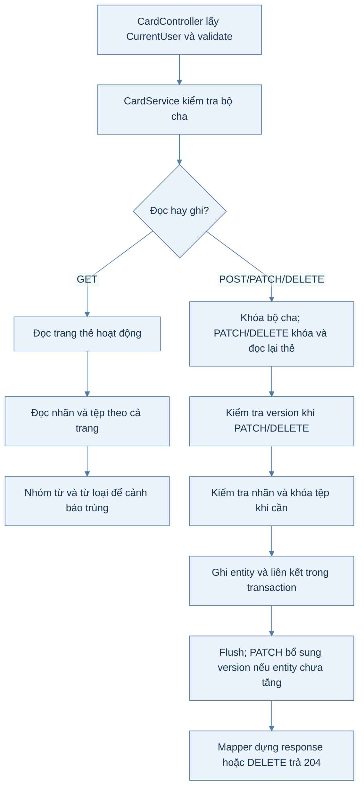
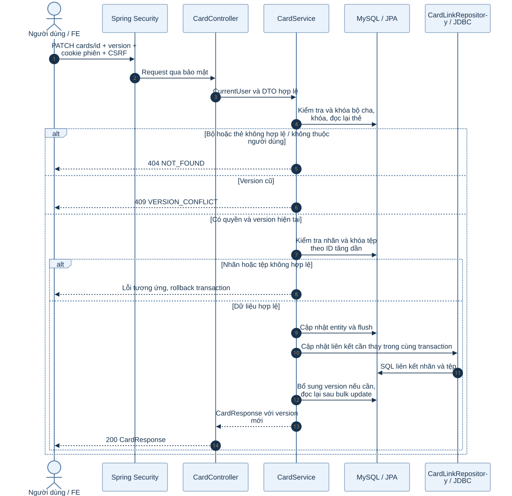
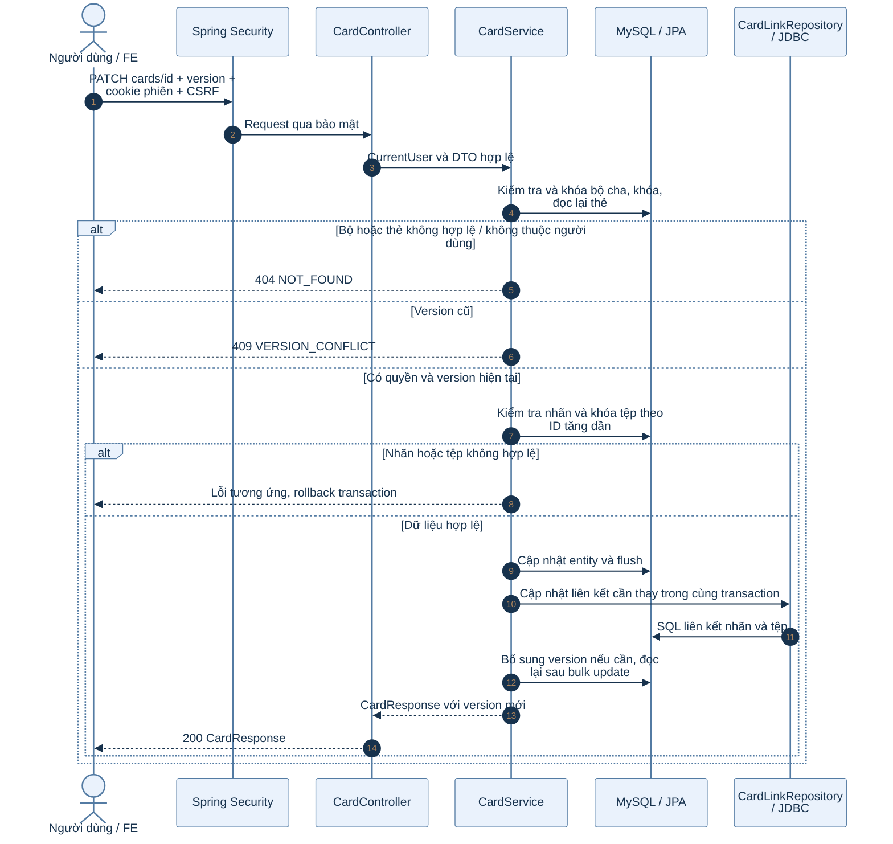

# B1.9 — Thẻ từ vựng

Ngày 06/10/2026: đã kiểm chứng HTTP phạm vi bên dưới; người dùng xác nhận build/test pass, chưa cung cấp log/số lượng. FR-03, TC-02. Không sửa migration V4 đã áp dụng; không chạy lại phần B1.8 người dùng đã bỏ qua.

## API và quyền

| API | Thành công | Quyền |
|---|---|---|
| GET /api/v1/decks/{id}/cards | 200 PageResponse | Chủ bộ, bộ chưa xóa mềm |
| POST /api/v1/decks/{id}/cards | 201 CardResponse, Location | Chủ bộ, bộ chưa xóa mềm |
| PATCH /api/v1/cards/{id} | 200 CardResponse | Chủ bộ cha, bộ/thẻ chưa xóa mềm |
| DELETE /api/v1/cards/{id}?version=... | 204 | Chủ bộ cha, bộ/thẻ chưa xóa mềm |
| GET /api/v1/public/tags | 200 PageResponse<TagResponse> | Khách và người đăng nhập |

API quản lý thẻ yêu cầu phiên đăng nhập; thao tác ghi dùng CSRF hiện tại. Bộ người khác, kể cả công khai, trả 404. ADMIN cũng phải là chủ bộ khi dùng các API này. API admin nhãn vẫn yêu cầu ADMIN.

## Sơ đồ hoạt động: quản lý thẻ từ vựng

Xem mã Mermaid của sơ đồ

Controller không nhận userId từ client. CardService dùng repository JPA cho bộ/thẻ/tệp/nhãn và CardLinkRepository JDBC cho liên kết; cùng transaction DB. Không gọi S3/RustFS trong transaction quản lý thẻ.

### Giải thích từng bước sơ đồ hoạt động

1. Request quản lý thẻ cần phiên; thao tác ghi cần CSRF. Controller lấy người dùng hiện tại và kiểm tra DTO.
2. Service kiểm tra bộ cha chưa xóa và thuộc người dùng. Bộ công khai của người khác cũng không được quản lý bằng API này.
3. GET đọc trang thẻ hoạt động, nạp nhãn/tệp theo cả trang và tính cảnh báo trùng trên phạm vi cả bộ.
4. Thao tác ghi khóa bộ cha; PATCH/DELETE còn khóa và đọc lại thẻ. Version cũ trả 409 trước khi ghi.
5. Nhãn và tệp cần đáp ứng quy tắc ở mục dưới. Các thay đổi entity và liên kết JPA/JDBC cùng transaction để rollback đồng bộ khi lỗi.
6. Flush và dựng response sau khi bảo đảm version. DELETE đánh dấu xóa mềm rồi trả 204, giữ các liên kết.

## Sơ đồ tuần tự: PATCH nội dung và liên kết thẻ

Xem mã Mermaid của sơ đồ

### Giải thích từng bước sơ đồ tuần tự

1. FE gửi version đã đọc gần nhất cùng các trường muốn sửa. Null/omitted giữ nguyên; các cờ bỏ liên kết phải tuân thủ DTO.
2. Security và validation chặn request không hợp lệ trước khi chạy nghiệp vụ. Service dùng danh tính từ phiên để kiểm tra quyền bộ cha.
3. Khóa và đọc lại dữ liệu giúp thao tác ghi dựa trên trạng thái hiện tại; version client khác trạng thái đó trả 409.
4. Nhãn phải tồn tại; tệp phải sở hữu, hoạt động, hoàn tất và đúng loại. Tệp cần kiểm tra được khóa theo thứ tự ID để nhất quán thứ tự lấy khóa.
5. JPA và JDBC cùng tham gia transaction MySQL. Sơ đồ diễn giải các nhóm thao tác; thứ tự flush chi tiết do service quyết định. Lỗi ở bất kỳ nhóm ghi nào phải rollback toàn bộ.
6. PATCH thành công tăng version đúng một lần, kể cả no-op. Sau bulk update, service clear persistence context và đọc lại để tránh trả version cũ.

## Nội dung, liên kết và version

- Trường: tu, tuLoai, nghiaVi, phienAm, viDuEn, dichVi, doKho, nguon. NFC và cắt khoảng trắng Unicode ở hai đầu; từ/từ loại gom khoảng trắng. So trùng bằng chữ thường Locale.ROOT; không bỏ dấu hoặc quy đổi tên từ loại. Chỉ cảnh báo thẻ hoạt động cùng bộ, loại chính thẻ khỏi theTrungIds.
- PATCH null/omitted giữ nguyên; chuỗi rỗng xóa trường tùy chọn. Tu và nghiaVi không được trắng. DoKho từ 1 đến 5; POST mặc định 1.
- NhanIds null giữ nguyên khi PATCH, [] bỏ tất cả; tối đa 100 nhãn và không lặp ID. Nhãn thiếu trả 422; xung đột FK nhãn trả 409.
- AnhId/amTuId/amCauId thay liên kết; boAnh/boAmTu/boAmCau bỏ liên kết. Gửi cả ID và cờ bỏ cùng vai trò trả 400. Các vai trò không thay giữ nguyên. Tệp phải sở hữu, hoạt động, hoàn tất và đúng loại; khóa tệp theo ID tăng dần.
- PATCH nhận version trong body, DELETE nhận query version. Version cũ trả 409. PATCH thành công tăng version một lần, kể cả không thay đổi nội dung; flush entity trước, chỉ touchVersion khi version chưa tăng. Sau bulk update clear persistence context, đọc lại thẻ để trả version mới.
- DELETE ghi xoaAt và flush; không xóa hàng thẻ hoặc liên kết nhãn/tệp. Gọi lại trả 404. Guard xóa tệp đếm cả liên kết từ thẻ đã xóa mềm và trả 409 trước khi thay avatar/trạng thái hoặc xóa object.
- GET page mặc định 0, size 20, tối đa 100; id giảm dần. Trùng được xét trên cả bộ, nên có thể nằm ngoài trang. Việc đọc ứng viên trùng toàn bộ bộ là giới hạn hiệu năng; cảnh báo không phải ràng buộc unique.

## Bàn giao và kiểm chứng

CardResponse trả ID dạng string; nhanIds/theTrungIds là danh sách; version là số; tệp chỉ trả ID, FE lấy URL ký qua B1.6. Public tags trả items/page/size/totalElements/totalPages, item gồm id/ten/version, sắp xếp ten rồi id.

Người dùng xác nhận build và test hiện có pass; chưa có log để xác nhận số lượng hoặc suite cụ thể. Agent không chạy lại build/JUnit.

HTTP ngày 06/10/2026 tại localhost:8080: 77/77 lượt có kiểm tra status/code và 19/19 assertion dữ liệu/kết quả, gồm một assertion đọc DB. [Bằng chứng đầy đủ](../../report/evidence/B1.9-http-603099a05ed3.json). Script: backend/k28/scripts/verify-b1-9-http.py; cần Python requests/Pillow và các dịch vụ dev đang chạy, chỉ dùng trên môi trường phát triển riêng vì tạo dữ liệu thử và sửa fixture DB.

Đã kiểm tra bốn API, USER/guest/foreign public-private, page/validation, NFC và phân biệt dấu, cảnh báo trùng, PATCH null/empty/no-op, nhãn, ba vai trò tệp, rollback, stale version, xóa mềm giữ hàng thẻ/nhãn/ba liên kết tệp, guard xóa tệp sau xóa thẻ. Hai PATCH đồng thời cùng version trả một200/một409; chưa suy rộng sang mọi race.

Bộ cha xóa mềm được chuẩn bị bằng SQL trên bộ thử vừa tạo, sau đó bốn API thẻ đều404. Không kiểm chứng lại DELETE bộ B1.8 hoặc bộ nguồn. Tài khoản thử có email b19-*@test.local; giữ các ID trong evidence để đối chiếu, không xóa cứng fixture/liên kết.

HTTP ADMIN ngày06/10/2026 tại localhost:8080 đạt9/9 kiểm tra: POST201, GET200, PATCH200, DELETE204 trong bộ của ADMIN; GET/POST/PATCH/DELETE trên bộ công khai người khác đều404 NOT_FOUND; GET /admin/tags200 xác nhận role. Quyền ADMIN fixture đã thu hồi và phiên đã logout (evidence xác nhận cả hai). [Bằng chứng ADMIN](../../report/evidence/B1.9-http-ec263badc3c9.json). Các lượt dừng [thiếu endpoint](../../report/evidence/B1.9-http-5cac40a79ecd.json) và đăng ký429 ([lượt trước](../../report/evidence/B1.9-http-a404862c3bda.json), [lượt thử lại](../../report/evidence/B1.9-http-04ac42a64033.json)) là lịch sử, không cộng vào9/9. Đã chờ TTL localhost hết tự nhiên; không xóa khóa Redis hay thay rate limit. Không chạy lại B1.8 đã bỏ qua. Đã đồng bộ Postman theo mục bàn giao bên dưới; không sửa FE/mockup.

## Suite CRUD bổ sung, pass theo xác nhận người dùng

Ngày06/10/2026 thêm `backend/k28/src/test/java/com/do_an_tot_nghiep/k28/content/FR03CardTest.java`, kế thừa AbstractIntegrationTest với MySQL/Redis/RustFS/Mailpit Testcontainers. Có16 phương thức và22 lượt dự kiến: 14 test thường, một test bốn tổ hợp USER/ADMIN × bộ riêng/công khai và một test bốn API với bộ cha xóa mềm. Đây là số lượng dự kiến từ source; Sau sửa baseline, người dùng xác nhận FR03CardTest đã pass toàn bộ; agent không chạy JUnit và chưa có log để xác nhận số lượt thực chạy. Source có16 phương thức/22 lượt dự kiến, không ghi thành22/22 quan sát được.

Suite kiểm tra CRUD/DTO/Location, page và trùng ngoài trang, NFC/phân biệt dấu/từ loại/bộ/thẻ hoạt động, quyền cả bộ cha, ADMIN quản lý bộ của mình, guest/CSRF, PATCH null/empty/no-op, nhãn, ba vai trò tệp, tệp người khác/đã xóa/chưa hoàn tất/sai loại, validation/version và hai PATCH cạnh tranh cùng version.

Fixture tệp ở test lựa chọn/validation được tạo trực tiếp bằng entity để tập trung vào metadata và quyền. Riêng test soft-delete dùng FileFixtures và upload/complete thật qua B1.6, sau đó xác nhận hàng thẻ/nhãn/ba liên kết, avatar, trạng thái tệp và byte object S3 được bảo toàn. Test rollback gồm lỗi validation và lỗi chủ động sau khi CardService ghi JPA/JDBC trong TransactionTemplate; đọc lại để kiểm tra cả entity, version và liên kết quay về trạng thái cũ.

Không kiểm tra tham chiếu tiến độ/lịch sử học chưa có trong các migration hiện tại. Không chạy build/JUnit/HTTP trong lượt bổ sung suite; kết quả build/test do người dùng xác nhận trước đó không áp dụng cho FR03CardTest mới. Chỉ chạy riêng `FR03CardTest` khi kiểm chứng, không chạy lại suite B1.8 đã bỏ qua.

## Đối chiếu bổ sung06/10/2026

DTO/entity khớp V4: tu100, tuLoai30, nghiaVi500, phienAm100, viDuEn/dichVi300, nguon500; doKho1–5, POST mặc định1; nhanIds tối đa100. POST tu/nghiaVi bắt buộc; PATCH null/omitted giữ và version bắt buộc. Không có GET /cards/{id}. Chi tiết lệch consumer và thứ tự ưu tiên: [báo cáo Đợt1 mục10](../../report/DOT1_BAO_CAO_FE.md#đối-chiếu-b18b19-ngày06102026).

Lịch sử trước đồng bộ Postman: lượt đối chiếu chỉ đọc nguồn/evidence và collection cloud, không chạy HTTP/JUnit thêm. Cloud có80 request, chưa có5 API B1.9; thư mục postman cục bộ hiện không có. Không sửa frontend/mockup/Postman; giữ B1.9 chưa hoàn tất. Quét ứng viên trùng cả bộ là giới hạn cần đo khi bộ lớn, chưa có benchmark.

### Sửa baseline sau kết quả IDE

Người dùng đã chạy suite và gửi ảnh IDE có lỗi ownership/validation/rollback; không có file Surefire FR03CardTest hoặc stack trace để xác nhận toàn bộ nguyên nhân/số lượng. Bốn test bảo toàn trạng thái được sửa lấy snapshot GET ngay sau tạo làm baseline, rồi so toàn bộ JSON trước/sau. Không so timestamp response POST trong persistence context với timestamp đọc lại DATETIME(3). Không bỏ kiểm tra timestamp, nội dung, version hoặc liên kết. Đây là sửa test dựa trên code. Sau sửa baseline, người dùng xác nhận FR03CardTest đã pass toàn bộ; agent không chạy JUnit và chưa có log để xác nhận số lượt thực chạy. Source có16 phương thức/22 lượt dự kiến, không ghi thành22/22 quan sát được. HTTP ADMIN9/9 đã kiểm chứng; Postman đã đồng bộ, B1.9 hoàn tất BE và bàn giao. Script Postman/Newman mới chưa chạy. Các ghi nhận chưa chạy lúc tạo suite phía trên là lịch sử.

## Bàn giao Postman và đóng B1.9

Postman B1.9 đã đồng bộ ngày06/10/2026: thêm28 request cho5 API vào 02 Nội dung / B1.9 Thẻ từ vựng; collection108 request, giữ nguyên80 request cũ và collection events. Cả hai environment thêm12 biến, bảo toàn mọi biến cũ. Đọc lại cloud xác nhận IDs/folder/scripts; [evidence đồng bộ](../../report/evidence/B1.9-postman-sync-20261006.json). Khôi phục registry/export collection và hai environment local đã loại credentials/token, kèm [hướng dẫn fixture](../../postman/README.md). HTTP ví dụ đạt5/5 ([evidence](../../report/evidence/B1.9-http-edc71d632f85.json)); chưa chạy script Postman/Newman28 request, không coi đồng bộ là28/28 pass. Không chạy lại B1.8 đã bỏ qua, không sửa FE. postman/ bị .gitignore bỏ qua; đã lưu trên máy, chưa commit/push.

B1.9 đã hoàn tất phạm vi BE với schema V4 hiện có; không thêm migration. FR03CardTest pass theo người dùng, không có log/số lượt thực chạy. HTTP77/77 + assertion19/19, ADMIN9/9 và mẫu5/5 là các lượt riêng, không cộng thành một suite. Tiếp theo B1.10 — Thư viện công khai.
