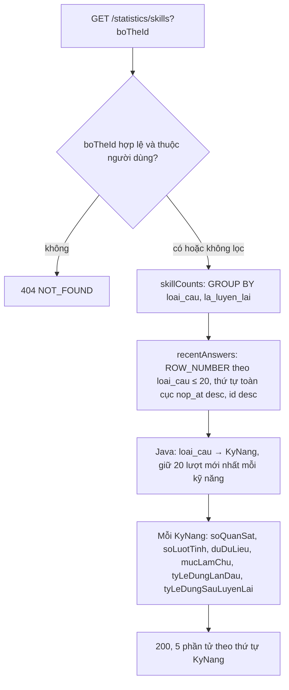

# B2.10 — Thống kê nền

FR-11, TC-09 (phần thống kê) · Sprint S6 · UI35 `/thong-ke` (F2.7) và khối "Hoạt động 7 ngày" của UI12 `/hom-nay` (F2.1 mở rộng, TK §9.1). API: `GET /api/v1/statistics/overview`, `GET /api/v1/statistics/skills`. Không migration. Tổng kết tuần, bản đồ làm chủ (B3.9), thưởng (B3.6) và lọc theo chủ đề nằm ngoài bước này.

## Phạm vi và quyền

| Mục | Giá trị |
|---|---|
| Endpoint | `GET /statistics/overview?tuNgay&denNgay&boTheId` (200), `GET /statistics/skills?boTheId` (200) |
| Quyền | Đăng nhập; mọi số liệu lọc theo `userId` của phiên. `boTheId` phải là bộ của chính người dùng, chưa xóa, nếu không thì 404 |
| Bảng đọc | `lich_su_on`, `tien_do_the`, `the_tu_vung`, `bo_the`, `lan_lam_bai`, `bai_luyen`, `tra_loi_bai_luyen`, `cau_hoi_bai_luyen`, `su_dung_hoc_ngay` (chuỗi ngày), `ho_so_hoc_tap` (mục tiêu phút) |
| Index dùng | `idx_lich_su_on_nguoi_ngay` (V8), `idx_lan_lam_bai_nguoi_nop`, unique `(lan_lam_id, cau_hoi_id)` (V11) |
| Transaction | `skills` chỉ đọc. `overview` là `@Transactional` thường vì `SettingsService.learning` tạo hồ sơ học tập mặc định khi chưa có (giống `/learning/today`) |
| Cấu hình | `app.statistics.so-luot-toi-da: 20`, `app.statistics.so-quan-sat-toi-thieu: 5` |

## Thành phần

| Thành phần | Vai trò |
|---|---|
| `stats/controller/StatisticsController` | Hai endpoint, `@Valid @ModelAttribute` query |
| `stats/service/StatisticsService` | Kiểm khoảng ngày và quyền bộ, ghép số liệu, gọi `StudyTimeService` và `LearningPlanService.streak` |
| `stats/service/MasteryCalculator` | Hàm thuần: tỷ lệ % làm tròn HALF_UP, mức làm chủ có trọng số tuyến tính |
| `stats/repository/StatisticsRepository` | Truy vấn chỉ đọc (JPQL + một native `ROW_NUMBER()`): `ownsDeck`, `reviews`, `attempts`, `skillCounts`, `recentAnswers` |
| `StudyTimeService.days(userId, tuNgay, denNgay, zone, boTheId)` | Hàm thời gian dùng chung với `/learning/today`; thêm lọc bộ (null = mọi bộ) |
| `LichSuOnRepository.studyTimes`, `LanLamBaiRepository.studyTimes` | Thêm tham số `boTheId` (lượt ôn lọc qua `the_tu_vung.bo_the_id`, bài luyện qua `bai_luyen.bo_the_id`) |
| `LearningPlanService.streak(userId, homNay)` | Chuỗi ngày hiện tại, cùng nguồn với `chuoiNgay` của `/learning/today` |
| DTO | `OverviewQuery`, `SkillsQuery`, `StatisticsOverviewResponse`, `BaiLuyenStatsResponse`, `TheoNgayResponse`, `SkillStatResponse` |

## Luồng overview

```mermaid
sequenceDiagram
    autonumber
    participant FE
    participant S as StatisticsService
    participant R as StatisticsRepository
    participant T as StudyTimeService
    participant L as LearningPlanService
    FE->>S: GET /statistics/overview?tuNgay&denNgay&boTheId
    S->>S: zone hiện tại, homNay; mặc định denNgay = homNay, tuNgay = denNgay − 6
    alt ngày sai / tuNgay > denNgay / > 90 ngày / denNgay sau hôm nay
        S-->>FE: 400 VALIDATION_FAILED (fieldErrors)
    end
    opt có boTheId
        S->>R: ownsDeck(userId, boTheId)
        alt không thuộc hoặc đã xóa
            S-->>FE: 404 NOT_FOUND
        end
    end
    S->>R: reviews, attempts trong [đầu tuNgay, đầu ngày sau denNgay)
    S->>T: days(userId, tuNgay, denNgay, zone, boTheId)
    S->>S: gom lượt/câu theo LocalDate bằng Java, điền đủ mọi ngày
    S->>L: streak(userId, homNay)
    S-->>FE: 200 StatisticsOverviewResponse
```

## Luồng skills



## Quy tắc

1. **Khoảng ngày:** `tuNgay`, `denNgay` dạng `YYYY-MM-DD`; mặc định 7 ngày đến hôm nay theo múi giờ hiện tại của người dùng; tối đa 90 ngày tính cả hai đầu; `denNgay` sau hôm nay → 400 (`denNgay`); `tuNgay > denNgay` → 400 (`denNgay`); quá 90 ngày → 400 (`tuNgay`); ngày không tồn tại → 400. `theoNgay` có đủ mọi ngày, ngày trống = 0.
2. **Thời gian:** `theoNgay[].thoiGian`/`soPhut` lấy từ `StudyTimeService.days` (TK §7.3): tổng `lich_su_on.thoi_gian` theo `created_at` + `lan_lam_bai.thoi_gian` theo `nop_at`, `soPhut = floor(thoiGian/60000)`. Không lọc bộ thì ngày hôm nay khớp `daHocHomNay.thoiGian`/`soPhut` của `/learning/today`. `tongPhut` = tổng `soPhut` các ngày (khớp tổng cột biểu đồ). `soNgayDatMucTieu` đếm ngày có `thoiGian ≥ phutMoiNgay × 60000`, `phutMoiNgay` là thiết lập hiện tại.
3. **Lượt ôn:** `soLuotOn` = số dòng `lich_su_on` trong khoảng; `soTuDaHoc` = số thẻ vật lý khác nhau (`tien_do_the.the_id`), một thẻ ôn hai chiều chỉ tính 1 (TC-09); `tyLeNho` = lượt khác `QUEN` / tổng lượt, % HALF_UP, `null` khi không có lượt.
4. **Bài luyện:** mọi lần nộp trong khoảng theo `nop_at`, gồm bài luyện lại. `baiLuyen.soBai` = số lần nộp, `soCauDung`/`tongSoCau` cộng từ `lan_lam_bai`, `tyLeDung` % hoặc `null`. `theoNgay[].soCauLuyen` = tổng `tong_so_cau` trong ngày. `soNgayCoHoc` = ngày có `soLuotOn > 0` hoặc `soCauLuyen > 0`.
5. **Lọc bộ:** lượt ôn theo `the_tu_vung.bo_the_id`; bài luyện theo `bai_luyen.bo_the_id`, nên bài `SO_TAY`/tất cả bộ (`bo_the_id = null`) không tính khi lọc. Không lọc bộ thì vẫn tính lượt của thẻ/bộ đã xóa sau khi học (lịch sử là sự kiện hợp lệ).
6. **Chuỗi ngày:** `chuoiNgay` là chuỗi hiện tại, đúng giá trị `/learning/today` (≥ 5 lượt hợp lệ/ngày theo `su_dung_hoc_ngay`), không phụ thuộc khoảng ngày.
7. **Kỹ năng:** chỉ từ bài luyện (`nguon = BAI_LUYEN`), không dùng lượt ôn SRS. 5 kỹ năng cố định theo `KyNang` (chưa có `PHAT_AM`). Một câu = một lượt quan sát, đúng = `tra_loi_bai_luyen.dung` (câu ghép đúng khi đúng hết cặp, câu bỏ trống là sai). Lọc bộ: theo bộ của thẻ trong câu; câu không có `the_id` (`GHEP_TU`) theo `bai_luyen.bo_the_id`. Không lọc ngày.
8. **Mức làm chủ:** lấy tối đa 20 lượt gần nhất mỗi kỹ năng (`nop_at desc, id desc`), lượt thứ i (0 = mới nhất) có trọng số `20 − i`; `mucLamChu = round(Σ trọng số đúng / Σ trọng số × 100)` HALF_UP. `duDuLieu = soLuotTinh ≥ 5`; chưa đủ thì `mucLamChu = null` (FE ghi "Chưa đủ dữ liệu"). `tyLeDungLanDau` (bài `la_luyen_lai = false`) và `tyLeDungSauLuyenLai` tính trên toàn bộ lượt, `null` khi không có lượt. Không quy đổi CEFR/TOEIC.
9. **Gom ngày bằng Java** như B2.12, không dùng `CONVERT_TZ`. Mỗi khoảng ≤ 90 ngày nên số dòng đọc có giới hạn; `recentAnswers` trả tối đa 7 loại câu × 20 dòng.

## Hợp đồng (contract từ code)

`GET /statistics/overview`:

| Field | Kiểu | Ghi chú |
|---|---|---|
| `muiGio` | chuỗi IANA | Múi giờ hiện tại |
| `tuNgay`, `denNgay` | `yyyy-MM-dd` | Sau khi áp mặc định |
| `boTheId` | chuỗi hoặc `null` | |
| `soTuDaHoc`, `soLuotOn` | số | |
| `tyLeNho` | số 0–100 hoặc `null` | |
| `baiLuyen` | `{soBai, soCauDung, tongSoCau, tyLeDung}` | `tyLeDung` có thể `null` |
| `tongPhut`, `phutMoiNgay`, `soNgayCoHoc`, `soNgayDatMucTieu`, `chuoiNgay` | số | |
| `theoNgay` | `[{ngay, soLuotOn, soCauLuyen, thoiGian, soPhut}]` | `thoiGian` ms |

`GET /statistics/skills`: mảng `[{kyNang, soQuanSat, soLuotTinh, duDuLieu, mucLamChu, tyLeDungLanDau, tyLeDungSauLuyenLai, soQuanSatToiThieu, nguon}]`, `kyNang` theo thứ tự `NHAN_NGHIA, VIET, NGHE, NGU_CANH, CAP_NHAM`, `nguon = "BAI_LUYEN"`.

Lỗi: 400 `VALIDATION_FAILED` (`fieldErrors[].field` = `tuNgay`/`denNgay`/`boTheId`), 401, 404 `NOT_FOUND`.

## Quyết định (chốt 03/11/2026, đề xuất)

| Chủ đề | Lựa chọn | Phương án bỏ |
|---|---|---|
| `denNgay` tương lai | 400 | Trả ngày 0 |
| `tongPhut` | Tổng `soPhut` từng ngày | `floor(tổng ms/60000)` |
| `tyLeNho` | Mọi lượt khác `QUEN` | Chỉ lượt `ON_TAP` |
| Tên mục tiêu | `phutMoiNgay` (trùng `TodayPlanResponse`) | `mucTieuPhutNgay` của demo |
| Kỹ năng | Chỉ bài luyện, câu = 1 lượt theo `dung` | Gộp lượt SRS; chấm theo `diem` từng cặp |
| Module | `stats/` mới, dùng lại `StudyTimeService` | Đặt trong `learning/` |
| Transaction `overview` | `@Transactional` (không chỉ đọc) | Chỉ đọc: lỗi khi hồ sơ học tập chưa có |
| Lọc chủ đề (TK §10 UI35) | Chưa làm | — |

## Kiểm chứng

- `FR11StatisticsTest` (5 tích hợp): ranh giới 16:59:59Z/17:00Z (HCM) chia đúng ngày, đủ 7 ngày, thẻ ôn hai chiều tính 1 từ, `tyLeNho` 75, bài luyện 4/5, `tongPhut` 14, ngày hôm nay khớp `daHocHomNay` và `chuoiNgay` khớp `/learning/today`, không lẫn dữ liệu người khác; đổi múi giờ sang UTC thì gom lại theo múi giờ mới; lọc bộ tách lượt ôn/bài luyện/thời gian, bài `SO_TAY` không tính khi lọc, thẻ đã xóa vẫn tính; mặc định 7 ngày qua HTTP, 90 ngày được, 91 ngày/ngày tương lai/`tuNgay > denNgay`/ngày không tồn tại/định dạng sai/`boTheId` sai → 400, bộ người khác/đã xóa → 404, chưa đăng nhập → 401; kỹ năng: trọng số 54, tách lần đầu 0/luyện lại 100, `GHEP_TU` lọc theo bộ của bài, < 5 lượt → `duDuLieu = false`, 25 lượt → `soLuotTinh = 20`.
- `MasteryCalculatorTest` (3 thuần): trọng số, cắt cửa sổ 20, làm tròn HALF_UP.
- Kết quả 03/11/2026: `mvnw -B test -Dtest=FR11StatisticsTest` 5/5 pass; cùng lượt chạy trước đó `MasteryCalculatorTest` 3, `FR06DashboardTest` 7, `FR06TodayPlanTest` 6, `FR07SubmissionTest` 4 pass. Bộ đầy đủ: xem roadmap B2.10.
- Chưa kiểm chứng: HTTP thật bằng `curl`, chạy request Postman.

## Giới hạn

- `theoNgay.soLuotOn` đếm `lich_su_on` theo múi giờ hiện tại; `daHocHomNay.soLuot` lấy `su_dung_hoc_ngay` theo `phien_hoc.mui_gio`: ngày vừa đổi múi giờ có thể lệch (như B2.12). Số phút luôn dùng chung một hàm.
- `recentAnswers` đánh số `ROW_NUMBER()` trên toàn bộ câu trả lời của người dùng trước khi cắt; đủ cho quy mô đồ án.
- Kỹ năng không lọc theo ngày; `PHAT_AM` thêm khi có bước phát âm.

Xem [roadmap](../../roadmap/TienDoDuKien_backend.md), [B2.8](B2.8-nop-bai-cham.md), [B2.12](B2.12-bang-dieu-khien.md), [báo cáo Đợt 2](../../ban-giao-cho%20fe/SPRINT_2_BAO_CAO_BE_BAN_GIAO_CHO_FE.md), [TK §5, §7.3, §8.2, §9.1, §13.2](../PHAN_TICH_THIET_KE_HE_THONG_HOC_TU_VUNG_K28.md).
