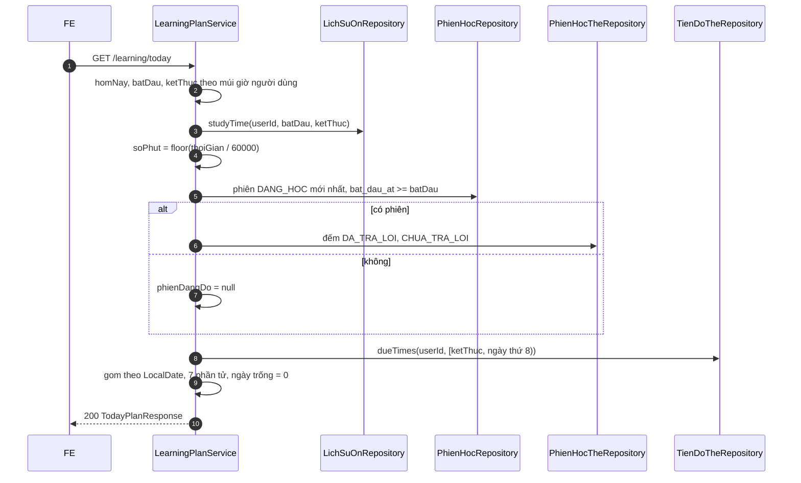

# B2.12 — Bảng điều khiển người học

FR-02, FR-06, FR-11, TC-09 · Sprint S6 · UI12 `/hom-nay` (TK §9.1) · FE F2.1 mở rộng. API: `GET /api/v1/learning/today` thêm `phienDangDo`, `duBaoOn`, `daHocHomNay.thoiGian`; đổi cách tính `daHocHomNay.soPhut`. Không thêm route, không migration, chỉ đọc.

## Phạm vi và quyền

| Mục | Giá trị |
|---|---|
| Endpoint | `GET /learning/today` (200), query như B2.6 |
| Quyền | Đăng nhập; mọi số liệu lọc theo `userId` của phiên đăng nhập |
| Bảng đọc | `phien_hoc`, `phien_hoc_the`, `tien_do_the`, `the_tu_vung`, `bo_the`, `lich_su_on` |
| Index dùng | `idx_phien_hoc_nguoi_bat_dau`, `idx_tien_do_the_hang_doi`, `idx_lich_su_on_nguoi_ngay` (V8) |
| Ngoài phạm vi | Khối "Hoạt động 7 ngày" (`GET /statistics/overview`, B2.10); thời gian bài luyện (B2.8); gợi ý (B3.5) |

## Thành phần

| Thành phần | Vai trò |
|---|---|
| `LearningPlanService.today` | Tính thêm `thoiGian`, gọi `openSession`, `forecast` |
| `LearningPlanService.openSession` | Phiên `DANG_HOC` mới nhất bắt đầu từ đầu ngày địa phương; đếm dòng `phien_hoc_the` theo trạng thái |
| `LearningPlanService.forecast` | Lấy `han_on_at` trong 7 ngày tới, gom theo ngày địa phương bằng Java, điền 0 cho ngày trống |
| `PhienHocRepository.findFirstByNguoiDungIdAndTrangThaiAndBatDauAtGreaterThanEqualOrderByBatDauAtDescIdDesc` | Phiên đang dở |
| `TienDoTheRepository.dueTimes` | `han_on_at` trong `[ngày mai, ngày thứ 8)`, cùng loại trừ như `dueByDeck` |
| `LichSuOnRepository.studyTime` | Tổng `lich_su_on.thoi_gian` trong `[đầu ngày, đầu ngày kế tiếp)` |
| `PhienDangDoResponse`, `DuBaoNgayResponse` | DTO mới |
| `DaHocHomNayResponse` | Thêm `thoiGian` (ms) |
| `TodayPlanResponse` | Thêm `phienDangDo`, `duBaoOn` sau `cuuLichOn` |
| `StudySessionService.TAT_CA_BO` | Đổi sang package-private để dùng chung tên "Tất cả bộ của tôi" |

## Luồng

## Quy tắc

1. **`phienDangDo`:** phiên `DANG_HOC` của chính người dùng, `bat_dau_at >= đầu ngày địa phương hôm nay` (múi giờ hiện tại), sắp `bat_dau_at desc, id desc`, lấy một. Phiên hôm qua, phiên `KET_THUC` và phiên người khác không hiện. B2.5 không tự đóng phiên quá hạn nên phiên cũ hơn hôm nay bị bỏ qua.
2. **Đếm phiên:** `soDaTraLoi`/`soChuaTraLoi` là số dòng `phien_hoc_the` theo trạng thái hiện tại; thẻ học lại trong phiên quay về `CHUA_TRA_LOI` (B2.4) nên được tính là chưa trả lời. `boTheTen` = tên bộ hoặc "Tất cả bộ của tôi" khi `boTheId = null` (như `StudySessionResponse`). `hetGioAt = batDauAt + quyThoiGian`.
3. **`duBaoOn`:** đúng 7 phần tử từ ngày mai; đếm hàng `DANG_HOC`/`ON_TAP`/`HOC_LAI` có `han_on_at` trong ngày địa phương đó (thẻ-chiều); loại thẻ/bộ đã xóa, `TAM_NGUNG`, bộ của người khác. Hôm nay không lặp lại (= `soQuaHan + soDenHan`).
4. **Gom ngày bằng Java:** không dùng `CONVERT_TZ` vì MySQL cần nạp bảng múi giờ; mỗi `han_on_at` đổi sang `LocalDate` theo múi giờ người dùng (đúng cả khi có giờ mùa hè).
5. **`daHocHomNay.thoiGian`:** tổng `lich_su_on.thoi_gian` (ms, mỗi lượt đã cắt ở 120000 khi ghi) của lượt có `created_at` trong ngày địa phương hôm nay; `soPhut = floor(thoiGian / 60000)`. `soLuot` giữ nguyên từ `su_dung_hoc_ngay.so_luot_hop_le`.
6. **Dùng chung với B2.10:** `/statistics/overview` phải tính phút mỗi ngày bằng cùng nguồn (`LichSuOnRepository.studyTime` hoặc truy vấn gom theo ngày có cùng điều kiện) và cùng quy tắc làm tròn xuống. B2.8 cộng thời gian bài luyện đã nộp vào cả hai.

## Hợp đồng (contract từ code)

| Field | Kiểu | Ghi chú |
|---|---|---|
| `daHocHomNay` | `{soLuot, thoiGian, soPhut}` | `thoiGian` là ms (số nguyên) |
| `phienDangDo` | `null` hoặc `{id, boTheId, boTheTen, chieuHoc, quyThoiGian, batDauAt, hetGioAt, soDaTraLoi, soChuaTraLoi}` | `id`, `boTheId` là chuỗi; `boTheId` null = mọi bộ |
| `duBaoOn` | `[{ngay, soCanOn}]` × 7 | `ngay` là `yyyy-MM-dd` |

## Quyết định

| Chủ đề | Lựa chọn | Ghi chú |
|---|---|---|
| Phụ thuộc B2.8, B2.10 | Làm trước; `thoiGian` chỉ từ `lich_su_on` | **Đề xuất** 31/10/2026; B2.8 cộng thời gian bài luyện, B2.10 dùng lại |
| Khớp `theoNgay` của `/statistics/overview` | Chuyển sang "Xong khi" của B2.10 | Endpoint chưa có |
| `soPhut` | Đổi từ ước tính `ceil(soLuot×20/60)` sang `floor(thoiGian/60000)` | TK §7.3; `FR06TodayPlanTest` sửa kỳ vọng 2 → 0 |
| `phienDangDo` không kèm `cheDo` | Giữ đúng hình dạng TK §13.2 | FE cần `cheDo` thì gọi `GET /sessions/{id}` |

## Kiểm chứng

- `FR06DashboardTest` (3 tích hợp): phiên đang dở `null` khi không có/phiên hôm qua (16:59:59Z)/phiên `KET_THUC`; chọn phiên mới nhất, đúng `boTheId`/`boTheTen`, `hetGioAt`, đếm 1 đã trả lời/2 còn lại; phiên của người khác không lộ; sang ngày mới thì `null`. Dự báo 7 ngày từ 20/10 với ranh giới 17:00Z (HCM), `[2,1,0,0,0,0,1]`, bỏ thẻ ngoài khoảng, tạm ngưng, thẻ xóa, thẻ người khác. Thời gian: 149999 ms (bỏ lượt 16:59:59Z hôm trước và 17:00Z hôm sau) → `soPhut` 2; người khác chỉ thấy lượt của mình; HTTP trả `duBaoOn` 7 phần tử, `thoiGian` là số.
- Kết quả: ngày 31/10/2026 chạy `mvnw -q test -Dtest='FR06*Test,RescuePlanTest,StreakCalculatorTest'` (JAVA_TOOL_OPTIONS=`-Djdk.net.unixdomain.tmpdir=C:\Users\Public`): exit 0, gồm `FR06DashboardTest` 3 test mới và `FR06TodayPlanTest`, `FR06RescuePlanTest` sau khi sửa constructor. Không đọc được báo cáo surefire nên không ghi tổng số test. Chưa chạy toàn bộ test dự án, chưa gọi HTTP thật bằng `curl`, chưa chạy Postman.

## Giới hạn

- `lich_su_on` lọc theo múi giờ hiện tại của người dùng, `su_dung_hoc_ngay` theo `phien_hoc.mui_gio`; vừa đổi múi giờ thì `soLuot` và `thoiGian` có thể lệch trong một ngày.
- Chưa có thời gian bài luyện (B2.8). Demo `studyMsOf` đã cộng bài luyện nên có thể lớn hơn BE khi có bài luyện mẫu.
- `duBaoOn` đọc mọi `han_on_at` của 7 ngày tới vào bộ nhớ (một cột); đủ cho quy mô đồ án.

Xem [roadmap](../../roadmap/TienDoDuKien_backend.md), [B2.2](B2.2-ke-hoach-hom-nay.md), [B2.6](B2.6-cuu-lich-on.md), [báo cáo Đợt 2](../../ban-giao-cho%20fe/SPRINT_2_BAO_CAO_BE_BAN_GIAO_CHO_FE.md), [TK §7.3, §9.1, §13.2](../PHAN_TICH_THIET_KE_HE_THONG_HOC_TU_VUNG_K28.md).
