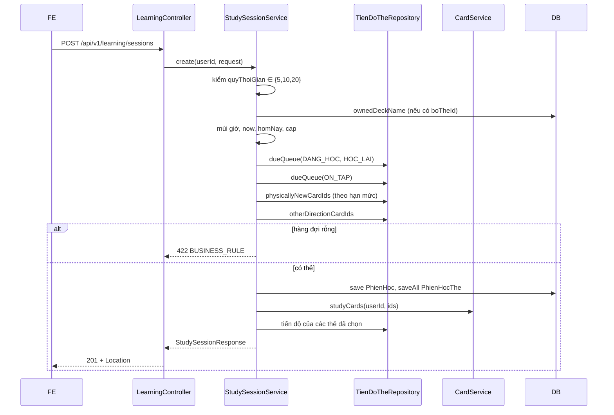

# B2.3 — Tạo phiên học

FR-06, TC-09 (phần hạn mức và nửa đêm) · Sprint S5 · UI18 `/hoc` · FE F2.2. API: `POST /api/v1/learning/sessions`, `GET /api/v1/learning/sessions/{id}`. Ghi `phien_hoc`, `phien_hoc_the`; không ghi tiến độ, không trừ hạn mức.

## Phạm vi và quyền

| Mục | Giá trị |
|---|---|
| Endpoint | `POST /learning/sessions` (201), `GET /learning/sessions/{id}` (200) |
| Quyền | Đăng nhập. `POST` cần CSRF như mọi POST; `GET` chỉ cho chủ phiên (người khác → 404) |
| Đầu vào | `{boTheId?, chieuHoc, quyThoiGian}`; `userId` lấy từ phiên đăng nhập |
| Migration | `V9__phien_hoc_bo_the.sql`: thêm `phien_hoc.bo_the_id` (null = tất cả bộ) + FK `bo_the` |
| Ngoài phạm vi | `cheDo` (B2.6), `duKien` (thêm khi F2.2 cần), ghi kết quả ôn (B2.4), kết thúc phiên (B2.5) |

## Thành phần

| Thành phần | Vai trò |
|---|---|
| `LearningController` | Thêm `POST /sessions` (201 + `Location`) và `GET /sessions/{id}` |
| `StudySessionService` | `create`: kiểm đầu vào, chọn hàng đợi, lưu phiên; `get`: đọc lại bản chụp |
| `CreateSessionRequest` | Kiểm `chieuHoc`, `quyThoiGian` không null, `boTheId` đúng dạng số |
| `StudySessionResponse`, `StudyQueueItemResponse`, `TienDoResponse` | Response; tên field trùng tên entity |
| `PhienHoc`, `PhienHocThe` | Entity phiên và bản chụp hàng đợi |
| `TienDoThe` | Map đủ cột (`buocHoc`, `ef`, `khoangOnNgay`, `chuoiThanhCong`, `soLanQuen`) và `@Version` |
| `TienDoTheRepository` | `dueQueue`, `physicallyNewCardIds`, `otherDirectionCardIds`, `findByNguoiDungIdAndChieuHocAndTheIdIn` |
| `PhienHocRepository` | `findByIdAndNguoiDungId`, `ownedDeckName`, `deckName` |
| `CardService.studyCards` + `StudyCardResponse` | Nội dung thẻ kèm ID media cho phiên (module `content`); `learning` không tự join bảng liên kết tệp |
| `TheTuVungRepository.findOwnedActive` | Thẻ chưa xóa, của bộ chưa xóa và thuộc người dùng |

## Luồng

## Quy tắc

1. **Quỹ thời gian:** chỉ nhận 5, 10, 20 phút (khớp `ck_phien_hoc_quy`); sai → 400 `fieldErrors[quyThoiGian]`.
2. **Giới hạn thẻ:** `cap = quyThoiGian×60 / 20` (hằng `GIAY_MOI_LUOT` của B2.2): 15/30/60 thẻ. Là ước tính (TK §7.3).
3. **Điều kiện hàng đợi** (`han_on_at <= now`, không phải nhãn thống kê của B2.2): thẻ chưa xóa, bộ chưa xóa, bộ của người dùng, đúng chiều của phiên; loại `MOI` và `TAM_NGUNG`.
4. **Thứ tự ưu tiên:** (1) `DANG_HOC`/`HOC_LAI` đến hạn → (2) `ON_TAP` đến hạn → (3) thẻ mới thật → (4) thẻ đã học chiều kia. Trong mỗi nhóm sắp theo `han_on_at` rồi `id` (nhóm 3, 4 theo `bo_the_id`, `id`). Gộp bằng `LinkedHashSet` rồi cắt còn `cap`.
5. **Thẻ mới thật:** không có hàng `tien_do_the` nào `<> MOI` ở cả hai chiều (cùng định nghĩa B2.2). Số lượng tối đa `max(0, tuMoiMoiNgay − so_the_moi hôm nay)`, tính theo ngày địa phương; hết hạn mức không chặn nhóm 1, 2, 4 (TK §7.3).
6. **Chiều còn lại (đề xuất):** thẻ đã học một chiều vào hàng đợi chiều kia sau thẻ mới thật và không tốn hạn mức (TC-09: không cộng hai chiều thành hai từ).
7. **Rỗng:** 422 `BUSINESS_RULE`, không lưu `phien_hoc`.
8. **Bản chụp:** `phien_hoc_the` lưu `the_id`, `chieu_hoc`, `thu_tu` 1..n, `CHUA_TRA_LOI`; `mui_gio` = múi giờ người dùng lúc tạo. `GET` đọc lại bản chụp, thẻ bị xóa sau đó trả `the = null`.
9. **Tiến độ trong response:** thẻ chưa có hàng `tien_do_the` có `MOI`, `ef` 2.50, `version` 0, `hanOnAt` null. B2.4 hiểu `expectedVersion = 0` là "chưa có hàng".
10. **Nhiều phiên:** cho phép nhiều phiên `DANG_HOC` cùng lúc (V8 không ràng buộc); B2.5 `finish` đóng phiên. B2.3 không trừ hạn mức nên hai phiên liên tiếp có thể chứa cùng thẻ mới; B2.4 kiểm lại hạn mức khi ghi.

## Hợp đồng response (contract từ code)

| Field | Kiểu | Ghi chú |
|---|---|---|
| `id`, `boTheId` | string | `boTheId` null khi học tất cả bộ |
| `boTheTen` | string | "Tất cả bộ của tôi" khi `boTheId` null; bộ đã xóa sau đó vẫn trả tên |
| `chieuHoc`, `quyThoiGian`, `muiGio` | enum, int, string | |
| `batDauAt`, `hetGioAt`, `ketThucAt` | ISO-8601 UTC | `hetGioAt` tính ra; `ketThucAt` null khi đang học |
| `trangThai` | `DANG_HOC` / `KET_THUC` | |
| `hangDoi[].theId` | string | |
| `hangDoi[].thuTu`, `.trangThai` | int, `CHUA_TRA_LOI`/`DA_TRA_LOI` | |
| `hangDoi[].tienDo` | `{trangThai, buocHoc, ef, khoangOnNgay, chuoiThanhCong, soLanQuen, hanOnAt, version}` | chiều của phiên |
| `hangDoi[].the` | `{id, boTheId, tu, tuLoai, phienAm, nghiaVi, viDuEn, dichVi, anhId, amTuId, amCauId, version}` | media là ID tệp; null khi thẻ đã bị xóa |

Không có `duKien`. Từ B2.6 response có thêm `cheDo` (`THUONG`/`CUU_LICH`) sau `quyThoiGian` và body nhận `cheDo` tùy chọn; xem [B2.6](B2.6-cuu-lich-on.md).

## Quyết định và đề xuất

| Chủ đề | Lựa chọn | Ghi chú |
|---|---|---|
| Cột bộ thẻ | Migration `V9` | `phien_hoc` ban đầu không có; TK §12.2 đã thêm |
| Media của thẻ | ID tệp, qua `CardService` | Cùng quy ước `CardResponse`; mockup sửa theo |
| Chiều còn lại | Vào hàng đợi, không tốn hạn mức | **Đề xuất** |
| 20 giây/lượt | Hằng chung với B2.2 | **Đề xuất**, ước tính |
| Nhiều phiên cùng lúc | Cho phép | **Đề xuất**; B2.5 xử lý `finish` |
| `duKien` | Chưa làm | Mockup `hoc-phien.html` còn đọc `duKien`; thêm khi F2.2 cần |
| Ngoại lệ module | JPQL của `learning` join `BoThe`, `TheTuVung` (chỉ đọc) | Đã ghi trong conventions |

## Kiểm chứng

- Test: `FR06StudySessionTest` (8 test tích hợp): thứ tự hàng đợi và hạn mức; cap 15/30 và giữ thẻ đến hạn sớm nhất; hết hạn mức không chặn ôn cũ, rỗng → 422 và không lưu; hạn mức đặt lại lúc nửa đêm giờ địa phương; chiều còn lại không tốn hạn mức; bỏ thẻ xóa, tạm ngưng, bộ xóa, của người khác, lọc theo bộ, bộ của người khác → 404; endpoint 201/401/404 và ID dạng chuỗi, thẻ xóa sau khi tạo → `the = null`; 400 `fieldErrors` và 422.
- Kết quả: ngày 26/10/2026 chạy `FR06StudySessionTest` 8/8 pass; chạy cùng `FR06TodayPlanTest` (6), `StreakCalculatorTest` (6), `FR06SrsCalculatorTest` (28): 40 test, BUILD SUCCESS. Chưa chạy toàn bộ test của dự án, chưa gọi HTTP thật bằng `curl`.
- Postman: xem [báo cáo Đợt 2](../../ban-giao-cho%20fe/SPRINT_2_BAO_CAO_BE_BAN_GIAO_CHO_FE.md) mục 10.

## Giới hạn

- Chưa ghi kết quả ôn, chưa kết thúc phiên (B2.4, B2.5): phiên tạo ra ở `DANG_HOC` mãi cho đến B2.5.
- Hạn mức mới chưa bị trừ khi tạo phiên.
- Chưa có `duKien`. Chế độ cứu lịch ôn đã thêm ở [B2.6](B2.6-cuu-lich-on.md).
- Cap theo 20 giây/lượt cố định, chưa dùng tốc độ trung bình của người học.

Xem [roadmap](../../roadmap/TienDoDuKien_backend.md), [B2.2](B2.2-ke-hoach-hom-nay.md), [TK §7.3](../PHAN_TICH_THIET_KE_HE_THONG_HOC_TU_VUNG_K28.md).
