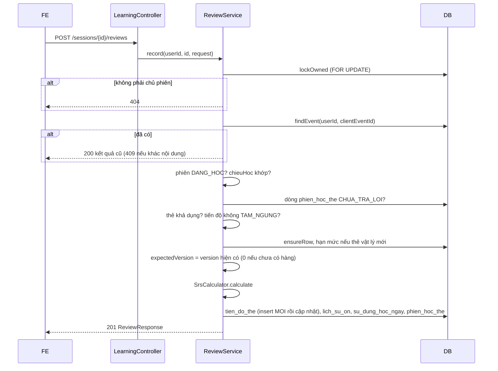

# B2.4 — Ghi kết quả ôn

FR-06, TC-05, TC-08, TC-09 · Sprint S5 · UI19 `/hoc/[sessionId]` · FE F2.2. API: `POST /api/v1/learning/sessions/{id}/reviews`. Ghi `lich_su_on`, `tien_do_the`, `su_dung_hoc_ngay`, `phien_hoc_the` trong một transaction.

## Phạm vi và quyền

| Mục | Giá trị |
|---|---|
| Endpoint | `POST /learning/sessions/{id}/reviews`: 201 khi ghi mới, 200 khi replay |
| Quyền | Đăng nhập, CSRF như mọi POST; chỉ chủ phiên (người khác → 404) |
| Đầu vào | `{clientEventId, theId, chieuHoc, danhGia, expectedVersion, thoiGianTraLoiMs}`; `userId` lấy từ phiên đăng nhập |
| Migration | Không. V8/V9 đủ bảng, unique và CHECK |
| Ngoài phạm vi | `duKien` (bước phụ sau), kết thúc phiên (B2.5), thưởng/điểm (B2.8, Đợt 3), cứu lịch (B2.6) |

## Thành phần

| Thành phần | Vai trò |
|---|---|
| `LearningController` | Thêm `POST /sessions/{id}/reviews`; chọn 201 hoặc 200 theo `Outcome.replayed()` |
| `ReviewService.record` | Toàn bộ quy tắc ghi, một `@Transactional` |
| `ReviewRequest`, `ReviewResponse` | DTO; tên field trùng tên entity, ID là chuỗi |
| `LichSuOn` | Entity chỉ đọc (`@Immutable`), không ánh xạ hai cột JSON |
| `LichSuOnRepository` | `findEvent` (native, join `tien_do_the`), `insertEvent` (native, `cast(... as json)`) |
| `ReviewEventRow` | Projection cho replay: phiên, thẻ, chiều, đánh giá, `truocJson`, `sauJson` |
| `PhienHocRepository.lockOwned` | `PESSIMISTIC_WRITE` trên dòng `phien_hoc` của chủ phiên |
| `PhienHocTheRepository` | `findByPhienIdAndTheIdAndChieuHoc`, `maxThuTu` |
| `TienDoTheRepository` | `findByNguoiDungIdAndTheIdAndChieuHoc`, `existsByNguoiDungIdAndTheIdAndTrangThaiNot` |
| `SuDungHocNgayRepository.ensureRow` | `insert ... on duplicate key update id = id` |
| `CardService.isStudyable` | Thẻ chưa xóa, bộ chưa xóa, thuộc người dùng (qua service của `content`) |
| `TienDoThe`, `PhienHocThe`, `SuDungHocNgay` | `create/toState/apply`, `markAnswered/requeue`, `record` |

## Luồng

## Quy tắc

1. **Thứ tự kiểm tra** (TK §7.4 đã sửa): chủ phiên 404 → replay 200 → phiên `DANG_HOC` (không thì 409 `CONFLICT`) → `chieuHoc` khớp phiên (400, field `chieuHoc`) → dòng hàng đợi tồn tại (422) và `CHUA_TRA_LOI` (422) → thẻ khả dụng (422) → tiến độ không `TAM_NGUNG` (422) → hạn mức (422) → version (409 `VERSION_CONFLICT`).
2. **Điểm tuần tự hóa:** khóa dòng `phien_hoc`. Hai request cùng phiên xếp hàng, nên lượt sau thấy `lich_su_on` của lượt trước. Giữa các phiên khác nhau, `@Version` của `tien_do_the` và `su_dung_hoc_ngay` làm việc đó; bên thua nhận `OptimisticLockingFailureException` → 409 `VERSION_CONFLICT` do `GlobalExceptionHandler`.
3. **Replay (TC-08):** cùng `(nguoi_dung_id, client_event_id)` trả lại `truoc`/`tienDo` đọc từ JSON đã lưu, `laiTrongPhien` tính lại từ trạng thái sau; không tính lại lịch, không cộng lượt. Cùng mã mà khác phiên/thẻ/chiều/đánh giá → 409 `CONFLICT`.
4. **Version:** `expectedVersion = 0` nghĩa là chưa có hàng. Hàng mới insert ở `MOI` (version 0) rồi áp kết quả trong cùng transaction (version 1), nên tab cũ gửi 0 sau đó nhận 409.
5. **Hạn mức từ mới (TC-09):** thẻ vật lý mới = chưa có hàng `tien_do_the` nào `<> MOI` ở cả hai chiều. Chỉ lượt đầu của thẻ đó tốn một suất; lượt chiều kia không tốn. Hết suất (`so_the_moi >= tuMoiMoiNgay`) → 422 cho thẻ mới; thẻ đến hạn, chiều còn lại không bị chặn.
6. **Ngày địa phương:** theo `phien_hoc.mui_gio` (múi giờ lúc tạo phiên), không theo múi giờ hiện tại của người dùng.
7. **Lượt hợp lệ (đề xuất):** mọi lượt mới ghi thành công cộng 1 vào `so_luot_hop_le`, kể cả `QUEN` và lượt học lại; replay không cộng.
8. **`thoiGianTraLoiMs`:** `>= 0`; lớn hơn 120000 thì lưu 120000, không từ chối. Không dùng để tính điểm hay hạn.
9. **Hàng đợi sau lượt:** nếu trạng thái sau là `DANG_HOC`/`HOC_LAI` và `hanOnAt <= hetGioAt` → `CHUA_TRA_LOI`, `thu_tu = max + 1` (`laiTrongPhien = true`); ngược lại `DA_TRA_LOI`.
10. **Sau `hetGioAt`:** vẫn nhận lượt; chỉ phiên `KET_THUC` mới chặn.
11. **Lịch sử:** `lich_su_on` lưu `truoc_json`, `sau_json` (cùng cấu trúc `TienDoResponse`, gồm `version`) và `phien_ban_thuat_toan = SM2-VN-1`.

## Hợp đồng

Request:

| Field | Kiểu | Quy tắc |
|---|---|---|
| `clientEventId` | string | Bắt buộc, ≤128, chỉ `A-Za-z0-9._:-` (cột `ascii_bin`) |
| `theId` | string | Bắt buộc, số dương |
| `chieuHoc` | enum | Bắt buộc, phải bằng chiều của phiên |
| `danhGia` | enum | `QUEN`/`KHO`/`NHO`/`DE` |
| `expectedVersion` | long | `>= 0`; `tienDo.version` của B2.3 hoặc của lượt trước |
| `thoiGianTraLoiMs` | long | `>= 0` |

Response (contract từ code): `{clientEventId, theId, chieuHoc, danhGia, truoc, tienDo, laiTrongPhien}`; `truoc` và `tienDo` có cùng cấu trúc `TienDoResponse` của B2.3 (`version` của `tienDo` dùng làm `expectedVersion` lượt sau). Không có `duKien`, `khoangHienThi`.

| HTTP | `code` | Khi nào |
|---|---|---|
| 201 / 200 | — | Ghi mới / replay |
| 400 | `VALIDATION_FAILED` | Thiếu/sai field, `chieuHoc` khác phiên |
| 401 | `UNAUTHENTICATED` | Chưa đăng nhập |
| 404 | `NOT_FOUND` | Phiên không tồn tại hoặc của người khác |
| 409 | `CONFLICT` | Phiên đã kết thúc; `clientEventId` đã dùng cho lượt khác |
| 409 | `VERSION_CONFLICT` | `expectedVersion` lệch, hoặc thua tranh chấp giữa các phiên |
| 422 | `BUSINESS_RULE` | Thẻ ngoài hàng đợi, đã trả lời, bị xóa, tạm ngưng; hết suất từ mới |

## Quyết định và đề xuất

| Chủ đề | Lựa chọn | Ghi chú |
|---|---|---|
| Tên field | Theo TK §13.3 | Không dùng `cardId/direction/rating/answerTimeMs` |
| Thứ tự replay | Trước kiểm tra phiên/hàng đợi | Đã sửa TK §7.4 |
| Phiên kết thúc | 409 `CONFLICT` | **Đề xuất** |
| Lượt hợp lệ, cắt 120000, nhận lượt sau `hetGioAt`, ngày theo `mui_gio` | Như trên | **Đề xuất** |
| `duKien` | Chưa làm | Bước phụ; 409 không kèm `tienDo` (FE gọi lại `GET /sessions/{id}`) |
| JSON `lich_su_on` | Native SQL | Chưa có ví dụ ánh xạ cột JSON với Hibernate 7 + Jackson 3 trong repo |

## Kiểm chứng

- Test: `FR06ReviewTest` (9 test tích hợp): TC-05 hai chiều độc lập và một suất mới; TC-08 replay (201 rồi 200, đổi nội dung → 409, một dòng lịch sử) và hai tab version cũ (409 rồi thành công với version 1); thẻ quên xuống cuối hàng đợi; TC-09 hạn mức khi ghi và ngày theo múi giờ phiên; người khác/sai chiều/ngoài hàng đợi; thẻ đã trả lời, thẻ xóa, tạm ngưng, phiên kết thúc; 400 `fieldErrors`, 401, cắt 120000.
- Kết quả: người dùng báo đã chạy xong ngày 26/10/2026, không đính kèm log hay số lượng test. Chưa chạy bộ test đầy đủ, chưa gọi HTTP thật bằng `curl`.
- Chưa có test song song thật sự (nhiều luồng); an toàn đồng thời dựa vào khóa dòng và `@Version`.
- Postman và mockup: xem [báo cáo Đợt 2](../../ban-giao-cho%20fe/SPRINT_2_BAO_CAO_BE_BAN_GIAO_CHO_FE.md) mục 10.

## Giới hạn

- Chưa kết thúc phiên (B2.5): dòng `CHUA_TRA_LOI` của thẻ đã xóa/tạm ngưng nằm lại cho đến `finish`.
- Chưa có thưởng/điểm; `diem` trong `su_dung_hoc_ngay` chưa được ghi.
- Chuỗi ngày vẫn tính theo ngày có `so_luot_hop_le >= 5` (chưa chốt theo phiên hay theo ngày, xem B2.8/Đợt 3).
- Lượt `QUEN` lặp lại vẫn tính hợp lệ, có thể dùng để "làm đầy" chuỗi ngày.

Xem [roadmap](../../roadmap/TienDoDuKien_backend.md), [B2.1](B2.1-srs-calculator.md), [B2.3](B2.3-tao-phien-hoc.md), [TK §7.4](../PHAN_TICH_THIET_KE_HE_THONG_HOC_TU_VUNG_K28.md).
