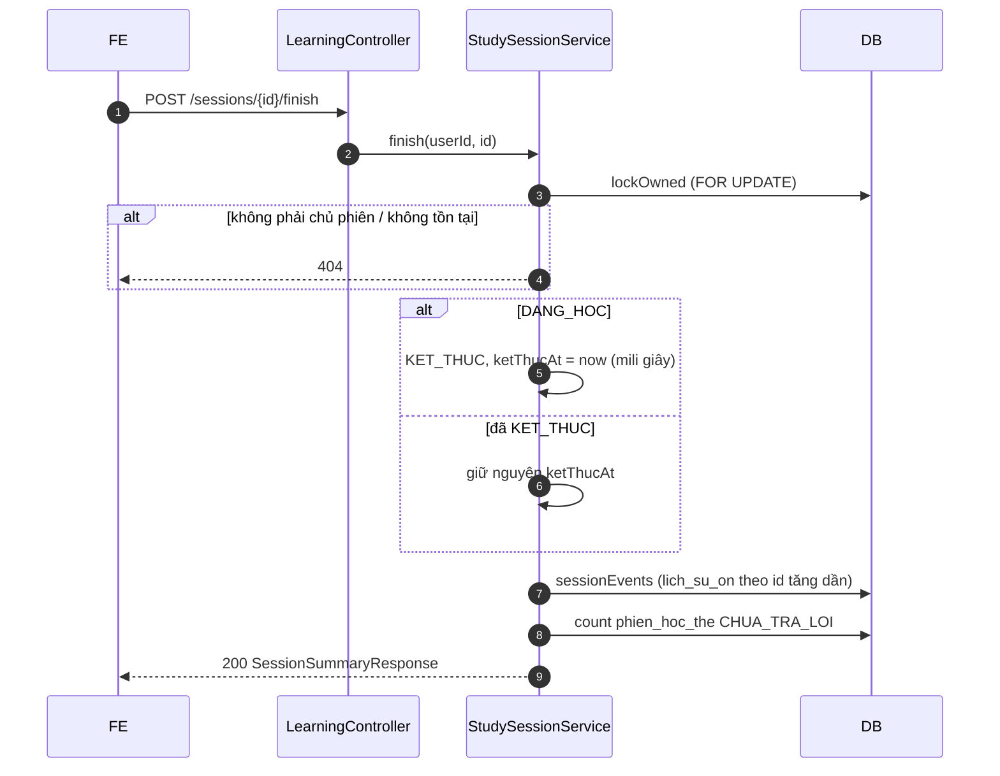
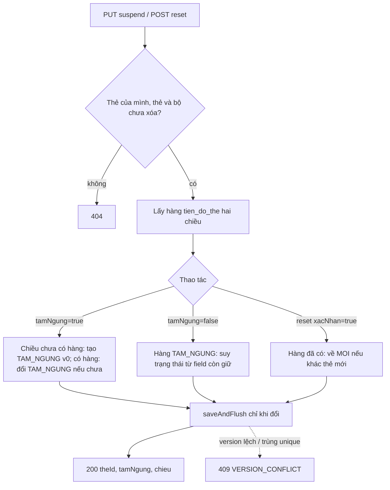

# B2.5 — Kết thúc phiên, lịch sử, tạm ngưng/đặt lại

FR-06 · Sprint S5 · UI20 `/hoc/[sessionId]/tong-ket`, UI21 `/bo-the/[id]/tien-do` · FE F2.3. Năm API: kết thúc phiên kèm tổng kết, lịch sử ôn, tiến độ theo bộ, tạm ngưng/khôi phục và đặt lại tiến độ một thẻ.

## Phạm vi và quyền

| Mục | Giá trị |
|---|---|
| Endpoint | `POST /learning/sessions/{id}/finish`, `GET /learning/history`, `GET /decks/{id}/progress`, `PUT /cards/{id}/progress/suspend`, `POST /cards/{id}/progress/reset` |
| Quyền | Đăng nhập; CSRF cho POST/PUT. Phiên, bộ, thẻ của người khác → 404; lịch sử chỉ lọc trong dữ liệu của chính người dùng (ID lạ → trang rỗng) |
| Migration | Không. V8/V9 đủ bảng, unique, CHECK |
| Ngoài phạm vi | `duKien` (bước phụ B2.4), cứu lịch (B2.6), thống kê (B2.10), tự đóng phiên quá hạn (không có job) |

## Thành phần

| Thành phần | Vai trò |
|---|---|
| `LearningController` | Thêm `POST /sessions/{id}/finish`, `GET /history` |
| `ProgressController` (mới) | `GET /decks/{id}/progress`, `PUT /cards/{id}/progress/suspend`, `POST /cards/{id}/progress/reset` dưới `/api/v1` |
| `StudySessionService.finish`, `summary` | Khóa phiên, đóng phiên, tính tổng kết từ `lich_su_on` |
| `HistoryService` (mới) | Đổi ngày địa phương sang khoảng `Instant`, phân trang lịch sử, đọc JSON trước/sau |
| `CardProgressService` (mới) | Tiến độ theo bộ (đếm theo thẻ-chiều), tạm ngưng/khôi phục, đặt lại |
| `PhienHoc` | `hetGioAt()`, `finish(now)` (idempotent, cắt về mili giây, không nhỏ hơn `batDauAt`) |
| `TienDoThe` | `suspend()`, `resume()`, `reset()` trả `boolean` có đổi hay không; `resumedStatus()` |
| `LichSuOn` | Ánh xạ thêm `truocJson`, `sauJson` (`columnDefinition = "json"`, chỉ đọc) |
| `LichSuOnRepository` | `history` (JPQL, lọc tùy chọn, `countQuery`), `sessionEvents` |
| `TienDoTheRepository` | `deckProgress` (left join hai chiều, lọc `q`/`nhom`), `deckProgressCount`, `activeCardCount`, `findByNguoiDungIdAndTheId`, `findByNguoiDungIdAndTheIdIn` |
| `PhienHocTheRepository` | `countByPhienIdAndTrangThai` |
| DTO | `SessionSummaryResponse`, `TuCanLuyenResponse`, `LichTiepTheoResponse`, `LichSuOnResponse`, `HistoryQuery`, `DeckProgressQuery`, `DeckProgressResponse`, `DeckProgressItemResponse`, `ChieuTienDoResponse`, `NhomTienDo`, `SuspendProgressRequest`, `ResetProgressRequest`, `CardProgressResponse`; `TienDoResponse.of(TienDoThe)` |
| `GlobalExceptionHandler` | `uk_tien_do_the_nguoi_the_chieu` → 409 `VERSION_CONFLICT` |

## Luồng kết thúc phiên

## Luồng tạm ngưng / đặt lại

## Quy tắc

1. **`finish` idempotent:** lần đầu `DANG_HOC` → `KET_THUC`; lần sau không đổi gì. Tổng kết chỉ tính từ `lich_su_on`, nên mọi lần gọi trả cùng nội dung (200). `ketThucAt` cắt về mili giây vì cột là `DATETIME(3)`; không cắt thì lần đầu trả nano giây còn lần sau trả giá trị đã lưu.
2. **Cho kết thúc bất kỳ lúc nào**, trước hoặc sau `hetGioAt`; không có job tự đóng phiên quá hạn. Sau `finish`, review mới vào phiên → 409 `CONFLICT` (B2.4), replay vẫn 200.
3. **Dòng `CHUA_TRA_LOI`** (kể cả thẻ đã xóa/tạm ngưng) giữ nguyên làm minh chứng, trả số lượng ở `soChuaTraLoi`.
4. **Tổng kết:** `soLuot` = số lượt; `soThe` = số thẻ khác nhau; `soTheMoi` = thẻ có lượt đầu với `truoc.trangThai = MOI`; `thoiGian` = tổng ms (đã cắt 120000/lượt khi ghi); `theoDanhGia` luôn đủ 4 mức; `tuCanLuyen` = thẻ có `QUEN` hoặc `KHO`, kèm mọi đánh giá theo thứ tự; `lichTiepTheo` = `sau` của lượt cuối mỗi thẻ, sắp theo `hanOnAt`. Không kèm chuỗi ngày (lấy ở `/learning/today`).
5. **Lịch sử:** lọc tùy chọn `phienId`, `theId`, `boTheId`, `chieuHoc`, `tuNgay`, `denNgay`. Ngày hiểu theo múi giờ **hiện tại** của người dùng, khoảng nửa mở `[tuNgay 00:00, denNgay+1 00:00)`. Sắp `createdAt desc, id desc`; `page` 0, `size` 20 (1–100). Gồm lượt của thẻ/bộ đã xóa (TK §12.4).
6. **Tiến độ theo bộ:** đếm theo thẻ-chiều nên tổng `tongHop` = 2 × `tongSoThe`. Nhóm mỗi chiều: không có hàng hoặc `MOI` → `MOI`; `TAM_NGUNG`; `hanOnAt` trước đầu hôm nay → `QUA_HAN`; trong hôm nay → `DEN_HAN`; sau hôm nay → `DANG_HOC` (có lịch, chưa đến hạn). Ngày theo múi giờ người dùng như B2.2. Bỏ thẻ đã xóa. `nhom` lọc thẻ có ít nhất một chiều thuộc nhóm; `q` tìm trong `tu`/`nghiaVi` (escape `! % _`). Thẻ sắp theo `id` tăng dần.
7. **Tạm ngưng cả thẻ:** áp hai chiều, tạo hàng `TAM_NGUNG` (version 0) cho chiều chưa có hàng. Lý do: query B2.2–B2.4 coi mọi hàng khác `MOI` là "đã học", nên chỉ ngưng một chiều sẽ làm chiều kia lọt vào nhóm "chiều còn lại".
8. **Khôi phục:** giữ nguyên bước, EF, khoảng, chuỗi, số lần quên và `hanOnAt` gốc; trạng thái suy ra: `hanOnAt` null → `MOI`; `khoangOnNgay > 0` → `ON_TAP`; `soLanQuen > 0` → `HOC_LAI`; còn lại `DANG_HOC`. Thẻ quá hạn khi khôi phục sẽ vào hàng đợi ngay.
9. **Đặt lại:** chỉ khi `xacNhan = true`. Hàng đã có về `MOI` tại chỗ (không xóa vì FK `lich_su_on.tien_do_id`), lịch sử giữ nguyên, không ghi lượt, không hoàn suất `su_dung_hoc_ngay`. `version` tăng nên tab đang mở phiên nhận 409 `VERSION_CONFLICT`.
10. **Gửi lại cùng giá trị** (tạm ngưng lần 2, khôi phục lần 2, đặt lại thẻ đã mới) không đổi dữ liệu, không tăng `version`.
11. **Tranh chấp:** sửa hàng song song với review → `@Version` → 409 `VERSION_CONFLICT`; hai request cùng tạo hàng tiến độ → trùng `uk_tien_do_the_nguoi_the_chieu` → 409 `VERSION_CONFLICT` (trước đây 500).

## Hợp đồng

Response (contract từ code):

| API | Body |
|---|---|
| `finish` | `{phienId, boTheId, boTheTen, chieuHoc, quyThoiGian, batDauAt, hetGioAt, ketThucAt, trangThai, soLuot, soThe, soTheMoi, soChuaTraLoi, thoiGian, theoDanhGia{QUEN,KHO,NHO,DE}, tuCanLuyen[{theId,tu,tuLoai,nghiaVi,danhGia[]}], lichTiepTheo[{theId,tu,trangThai,hanOnAt}]}` |
| `history` | `PageResponse{items[{id,phienId,theId,boTheId,tu,tuLoai,nghiaVi,chieuHoc,danhGia,thoiGian,truoc,sau,phienBanThuatToan,createdAt}],page,size,totalElements,totalPages}`; `truoc`/`sau` cùng cấu trúc `TienDoResponse` |
| `decks/{id}/progress` | `{boTheId, ten, muiGio, tongSoThe, tongHop{MOI,DANG_HOC,DEN_HAN,QUA_HAN,TAM_NGUNG}, items[{theId,tu,tuLoai,phienAm,nghiaVi,tamNgung,chieu{EN_VI,VI_EN}}], page, size, totalElements, totalPages}`; mỗi chiều = `TienDoResponse` + `nhom` |
| `suspend`, `reset` | `{theId, tamNgung, chieu{EN_VI,VI_EN}}`; `tamNgung` chỉ `true` khi cả hai chiều `TAM_NGUNG` |

| HTTP | `code` | Khi nào |
|---|---|---|
| 200 | — | Mọi thao tác thành công (kể cả gọi lại) |
| 400 | `VALIDATION_FAILED` | ID không phải số; `chieuHoc`/`nhom` sai; ngày sai định dạng hoặc không tồn tại; `tuNgay > denNgay` (field `denNgay`); `size` ngoài 1–100; thiếu `tamNgung`; `xacNhan` thiếu/`false` |
| 401 | `UNAUTHENTICATED` | Chưa đăng nhập |
| 404 | `NOT_FOUND` | Phiên/bộ/thẻ không tồn tại, của người khác, hoặc bộ/thẻ đã xóa |
| 409 | `VERSION_CONFLICT` | Tranh chấp version hoặc trùng unique tiến độ |

## Quyết định (đề xuất)

| Chủ đề | Lựa chọn |
|---|---|
| Trạng thái phiên đóng | `KET_THUC` (CHECK V8) |
| `finish` gọi lại | 200, cùng tổng kết, không đổi `ketThucAt` |
| Phiên quá hạn | Không tự đóng; dòng chưa trả lời giữ nguyên |
| Phạm vi tạm ngưng/đặt lại | Cả thẻ, hai chiều |
| Khôi phục | Suy trạng thái từ field còn giữ, giữ `hanOnAt` gốc |
| Đặt lại | Không xóa hàng, không xóa lịch sử, không hoàn suất |
| Ngày lọc lịch sử | Múi giờ hiện tại của người dùng (khác B2.4 dùng `phien_hoc.mui_gio`) |

## Kiểm chứng

- Test: `FR06FinishHistoryTest` (4 test) và `FR06ProgressTest` (6 test), tích hợp qua MockMvc + Testcontainers.
- Kết quả ngày 28/10/2026: người dùng chạy `./mvnw test` (315 test), **3 fail**:
  - `FR06FinishHistoryTest.fr06_finishClosesSessionAndRepeatReturnsSameSummary`: `ketThucAt` lần đầu có nano giây, lần sau mili giây. Đã sửa `PhienHoc.finish` (cắt về mili giây).
  - `IntegrationSetupTest.xsrfHelperPassesCsrfFilter` (404 thành 405) và `FR05CsvTest.tc04_missingFileMalformedUtf8AndInvalidHeaders` (400 thành 415): ngoài phạm vi B2.5, không sửa.
- Chạy lại sau khi sửa (28/10/2026): `mvnw test -Dtest='FR06*Test,StreakCalculatorTest,FR05CsvTest,IntegrationSetupTest'` 88 test, chỉ còn 2 fail ngoài B2.5 nói trên; toàn bộ 71 test learning pass, gồm `FR06FinishHistoryTest` (4) và `FR06ProgressTest` (6). Chưa chạy lại bộ test đầy đủ.
- Chưa gọi HTTP thật bằng `curl`, chưa chạy request Postman, chưa mở mockup B2.5 trên trình duyệt.

## Giới hạn

- Chưa có test song song nhiều luồng; an toàn đồng thời dựa vào khóa dòng `phien_hoc`, `@Version` và unique.
- Mỗi lần gọi `finish` đọc lại toàn bộ lịch sử phiên (tối đa vài chục lượt với quỹ 20 phút); chưa lưu sẵn tổng kết.
- `uk_lich_su_on_nguoi_event` (hai request cùng `clientEventId` song song ở hai phiên) vẫn chưa được map, vẫn có thể ra 500.

Xem [roadmap](../../roadmap/TienDoDuKien_backend.md), [B2.2](B2.2-ke-hoach-hom-nay.md), [B2.3](B2.3-tao-phien-hoc.md), [B2.4](B2.4-ghi-ket-qua-on.md), [báo cáo Đợt 2](../../ban-giao-cho%20fe/SPRINT_2_BAO_CAO_BE_BAN_GIAO_CHO_FE.md).
