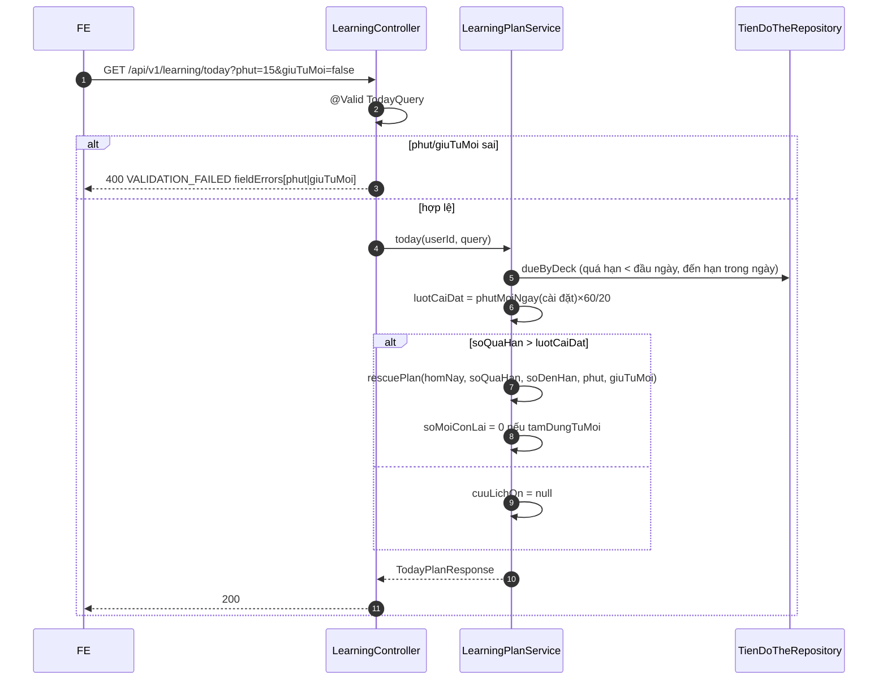
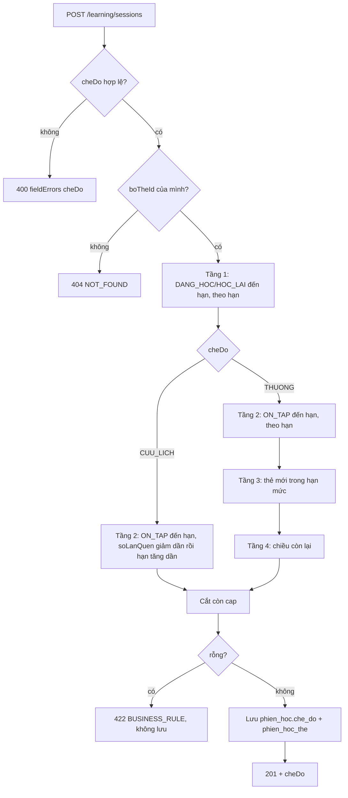

# B2.6 — Cứu lịch ôn

FR-06, TC-10 · Sprint S5 · UI22 (khối "Cứu lịch ôn" trên UI12 `/hom-nay`) · FE F2.4. API: `GET /api/v1/learning/today?phut&giuTuMoi` (thêm `cuuLichOn`), `POST /api/v1/learning/sessions` (thêm `cheDo`), `GET /api/v1/learning/sessions/{id}` (trả `cheDo`). Chỉ đọc `tien_do_the`; không đổi `han_on_at`, không xóa nợ ôn.

## Phạm vi và quyền

| Mục | Giá trị |
|---|---|
| Endpoint | `GET /learning/today` (200), `POST /learning/sessions` (201), `GET /learning/sessions/{id}` (200) |
| Quyền | Đăng nhập. `POST` cần CSRF; `GET /sessions/{id}` chỉ cho chủ phiên (người khác → 404); `boTheId` của người khác → 404 |
| Đầu vào | Query `phut` (1–240, mặc định `phutMoiNgay`), `giuTuMoi` (`true`/`false`, mặc định `false`); body thêm `cheDo` (`THUONG`/`CUU_LICH`, mặc định `THUONG`). `userId` lấy từ phiên đăng nhập |
| Migration | `V10__phien_hoc_che_do.sql`: `phien_hoc.che_do VARCHAR(20) NOT NULL DEFAULT 'THUONG'` + `ck_phien_hoc_che_do` |
| Ngoài phạm vi | `duKien`, bảng điều khiển B2.12 (`phienDangDo`, `duBaoOn`, `daHocHomNay.thoiGian`), tốc độ cá nhân thay cho 20 giây/lượt |

## Thành phần

| Thành phần | Vai trò |
|---|---|
| `LearningController.today` | Nhận `@Valid @ModelAttribute TodayQuery` |
| `TodayQuery` | Kiểm `phut` 1–240 và `giuTuMoi` bằng `@Pattern` (sai → 400 đúng field); chuỗi rỗng = mặc định |
| `LearningPlanService.today` | Quyết định bật cứu lịch, đặt `soMoiConLai = 0` khi tạm dừng từ mới |
| `LearningPlanService.rescuePlan` | Hàm thuần chia `soTheCanOn` theo `luotMoiNgay`, tối đa 14 dòng `keHoach` |
| `CuuLichOnResponse`, `KeHoachNgayResponse` | Response khối cứu lịch |
| `TodayPlanResponse` | Thêm `cuuLichOn` (null khi không cần cứu) ở cuối record |
| `CreateSessionRequest` | Thêm `cheDo` (`@Pattern THUONG\|CUU_LICH`), `mode()` trả enum |
| `StudySessionService.create`/`pickCardIds` | Rẽ nhánh theo `cheDo`; message 422 riêng cho `CUU_LICH` |
| `StudySessionResponse` | Thêm `cheDo` sau `quyThoiGian` |
| `PhienHoc` + `CheDoPhien` | Lưu chế độ, gán một lần trong `start(...)` |
| `TienDoTheRepository.rescueQueue` | Như `dueQueue`, sắp `soLanQuen desc, hanOnAt, id` |

## Luồng kế hoạch

## Luồng tạo phiên

## Quy tắc

1. **Ngưỡng:** bật khi `soQuaHan > phutMoiNgay(cài đặt)×60/20`. Chỉ đếm quá hạn (hạn trước đầu ngày địa phương); thẻ đến hạn trong ngày không tính. Query `phut` không đổi việc bật/tắt (TK §6.5 bước 1, "ngưỡng cấu hình" = cài đặt của người học).
2. **Chia ngày:** `soTheCanOn = soQuaHan + soDenHan` (thẻ-chiều, như `soQuaHan`); `luotMoiNgay = phut×60/20`; `soNgay = ceil(soTheCanOn / luotMoiNgay)`; `keHoach[i] = {ngay: homNay+i, soThe: min(luotMoiNgay, phần còn lại), phut: ceil(soThe×20/60)}`, tối đa 14 dòng; `soNgay` vẫn là số thật.
3. **Từ mới:** `tamDungTuMoi = !giuTuMoi`. Khi có `cuuLichOn` và `tamDungTuMoi`, `/today` trả `soMoiConLai = 0` (kéo theo `uocTinhPhut`). Chỉ là số hiển thị, không ghi `su_dung_hoc_ngay`.
4. **Chế độ phiên:** `CUU_LICH` lấy bước học/học lại đến hạn, rồi `ON_TAP` đến hạn theo `so_lan_quen` giảm dần, `han_on_at` tăng dần, `id`; không có thẻ mới và chiều còn lại. `THUONG` giữ nguyên B2.3, kể cả khi đang có `cuuLichOn` (phiên không biết `giuTuMoi`).
5. **Không cần `cuuLichOn` để chọn `CUU_LICH`:** người học được chủ động chọn học lại (TK §6.5 bước 1). Hàng đợi rỗng → 422 `BUSINESS_RULE`.
6. **Giữ lịch gốc (TC-10):** cả hai luồng không ghi `tien_do_the`; `han_on_at`, `version`, `so_lan_quen` không đổi, số quá hạn giữ nguyên. Lộ trình là ước tính, tính lại mỗi lần gọi (TK §6.5 bước 4–5).
7. **Lưu `cheDo`:** `phien_hoc.che_do`, gán một lần lúc tạo; phiên cũ nhận `THUONG` qua `DEFAULT`.

## Hợp đồng `cuuLichOn` (contract từ code)

| Field | Kiểu | Ghi chú |
|---|---|---|
| `soTheCanOn` | int | `soQuaHan + soDenHan`, thẻ-chiều |
| `soQuaHan` | int | Bằng `soQuaHan` ở gốc |
| `phutMoiNgay` | int | Phút dùng để chia (query `phut` hoặc cài đặt), có thể khác `phutMoiNgay` ở gốc |
| `luotMoiNgay` | int | `phutMoiNgay×60/20` |
| `soNgay` | int | Số ngày thật, có thể > 14 |
| `keHoach[]` | `{ngay, soThe, phut}` | Từ hôm nay, tối đa 14 phần tử |
| `tamDungTuMoi` | boolean | `!giuTuMoi` |

Ước tính dùng `giayMoiLuot` ở gốc (20); không có `laUocTinh`, `uuTien`, `giayMoiLuot` trong khối.

## Quyết định và đề xuất

| Chủ đề | Lựa chọn | Ghi chú |
|---|---|---|
| Ngưỡng | `soQuaHan > luot` theo cài đặt, không đưa vào `application.yaml` | **Đề xuất** đã chốt 30/10/2026 |
| Query `phut` | 1–240 như `LearningSettingsRequest` | Demo chỉ nhận 5/10/15/20/30; BE rộng hơn để mặc định luôn hợp lệ |
| Kiểu `phut`, `giuTuMoi`, `cheDo` | `String` + `@Pattern` | Để lỗi có `fieldErrors[].field`; enum trong body sai sẽ ra 400 không có field |
| Phiên THUONG khi đang cứu lịch | Không đổi | Demo cũ bỏ thẻ mới cả THUONG; đã sửa demo |
| Chiều còn lại trong CUU_LICH | Bỏ | Ở chiều này thẻ vẫn là `MOI` |
| `cheDo=CUU_LICH` không có `cuuLichOn` | Cho tạo | TK §6.5 |
| Thứ tự với B2.12 | B2.6 trước; B2.12 nối field sau `cuuLichOn` | |
| Số migration | V10 cho `che_do`; practice B2.7 dời sang V11 | Roadmap đã dời số |

## Kiểm chứng

- Test: `FR06RescuePlanTest` (5 tích hợp): chia ngày theo phút cài đặt và query `phut`, `giuTuMoi`; ngưỡng theo cài đặt và chỉ đếm quá hạn, tạm ngưng không tính; thứ tự `CUU_LICH`, không thẻ mới/chiều còn lại/chưa tới giờ, `che_do` lưu DB, phiên THUONG giữ B2.3, ảnh chụp `tien_do_the` không đổi; `CUU_LICH` rỗng → 422 không lưu; HTTP 400 `phut`/`giuTuMoi`/`cheDo`, `cheDo` trả ở POST/GET, người khác → 404. `RescuePlanTest` (3 JUnit thuần): trần 14 dòng giữ `soNgay` thật, ngày cuối nhận phần dư, chia chẵn không có ngày rỗng.
- Kết quả: ngày 31/10/2026 chạy `mvnw -q test -Dtest='FR06*Test,RescuePlanTest,StreakCalculatorTest'`: 79 test, 0 lỗi, exit 0 (`FR06RescuePlanTest` 5/5, `RescuePlanTest` 3/3, `FR06TodayPlanTest` 6/6, `FR06StudySessionTest` 8/8 sau khi sửa chữ ký). Chưa chạy toàn bộ test của dự án, chưa gọi HTTP thật bằng `curl`, chưa chạy request Postman.

## Giới hạn

- 20 giây/lượt cố định, lộ trình không tính lượt ôn/học lại phát sinh trong những ngày tới.
- `quyThoiGian` của phiên chỉ nhận 5/10/20; khi `phut` khác (ví dụ 15) FE chọn giá trị gần nhất.
- `giuTuMoi` không được lưu; FE ánh xạ `giuTuMoi=false` → `cheDo: CUU_LICH`, `true` → `THUONG`.

Xem [roadmap](../../roadmap/TienDoDuKien_backend.md), [B2.2](B2.2-ke-hoach-hom-nay.md), [B2.3](B2.3-tao-phien-hoc.md), [báo cáo Đợt 2](../../ban-giao-cho%20fe/SPRINT_2_BAO_CAO_BE_BAN_GIAO_CHO_FE.md), [TK §6.5, §9.3](../PHAN_TICH_THIET_KE_HE_THONG_HOC_TU_VUNG_K28.md).
