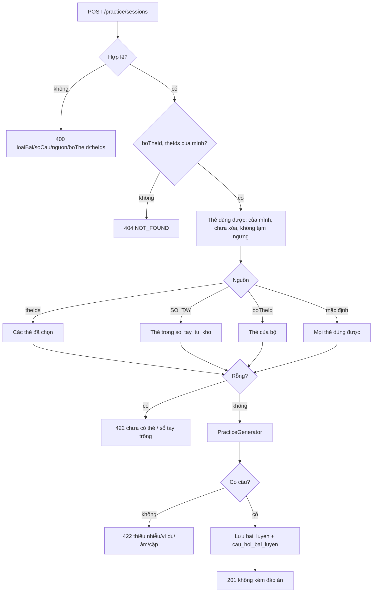

# B2.7 — Tạo bài luyện

FR-07, TC-11 · Sprint S6 · UI23 `/luyen-tap`, UI24 `/luyen-tap-lam-bai` · FE F2.5. API: `POST /api/v1/practice/sessions`, `GET /api/v1/practice/sessions/{id}`. Module mới `practice`; migration `V11__practice.sql`.

## Phạm vi và quyền

| Mục | Giá trị |
|---|---|
| Endpoint | `POST /practice/sessions` (201 + `Location`), `GET /practice/sessions/{id}` (200) |
| Quyền | Đăng nhập; `POST` cần CSRF. Bài, bộ, thẻ của người khác → 404 |
| Bảng ghi | `bai_luyen`, `cau_hoi_bai_luyen` |
| Bảng đọc | `the_tu_vung`, `bo_the`, `the_tep` (qua `CardService.studyCards`), `tien_do_the` (bỏ thẻ tạm ngưng), `so_tay_tu_kho`, `cap_tu_de_nham` |
| Bảng tạo sẵn cho bước sau | `lan_lam_bai`, `tra_loi_bai_luyen` (B2.8), `loi_hoc_tap` (B2.8), `so_tay_tu_kho` (B2.9), `cap_tu_de_nham` (B2.8/B2.9) |
| Ngoài phạm vi | Nộp/chấm, lịch sử, luyện lại (B2.8); `daNop`, `lanLamId`, `ketQua`, `laLuyenLai` trong response |

## Thành phần

| Thành phần | Vai trò |
|---|---|
| `PracticeController` | `/api/v1/practice/sessions` |
| `CreatePracticeRequest` | `loaiBai`, `nguon`, `boTheId`, `theIds` là chuỗi + `@Pattern` (400 đúng field); `soCau` kiểm 5/10/20 ở service |
| `PracticeService.create` | Kiểm tổ hợp đầu vào, quyền, chọn nguồn thẻ, gọi `PracticeGenerator`, lưu đề + bản chụp |
| `PracticeService.get` | Đọc bản chụp, chỉ chủ bài |
| `PracticeGenerator` | Sinh câu hỏi 7 loại; trộn bằng `Random` truyền vào |
| `BaiLuyenRepository` | `usableCardIds`, `ownedDeckName`, `deckName`, `notebookCardIds`, `confusingPairs` |
| `BaiLuyen`, `CauHoiBaiLuyen` | Entity; JSON lưu dạng chuỗi trong cột `JSON` |
| `TimeConfig.auditingDateTimeProvider` | Cắt `createdAt`/`updatedAt` về mili giây (khớp `DATETIME(3)`) |

## Luồng tạo bài

## Quy tắc sinh câu

| Loại | Đề (`deBai`) | Phương án | Đáp án lưu (`dap_an_json`) | Bỏ thẻ khi |
|---|---|---|---|---|
| `CHON_NGHIA` | `{tu, phienAm, tuLoai}` | 4 nghĩa, `o1…o4` | `{luaChonId, noiDung, luaChon[{id, theId}]}` | Không đủ 3 nhiễu khác từ và khác nghĩa |
| `CHON_TU` | `{nghiaVi, tuLoai}` | 4 từ | như trên | như trên |
| `DIEN_CHO_TRONG` | `{cau, goiY, tuLoai}` | — | `{chapNhan[chữ khớp], noiDung}` | `viDuEn` không chứa từ (khớp đầu từ, không phân biệt hoa thường, cho phép đuôi chữ cái) |
| `NHAP_TU_THEO_NGHIA` | `{nghiaVi, tuLoai, viDuVi}` | — | `{chapNhan[tu], noiDung}` | — |
| `NGHE_VIET` | `{amTuId, tuLoai}` | — | `{chapNhan[tu], noiDung}` | Thẻ không có âm từ |
| `GHEP_TU` | `{cotTrai[{id t1…, noiDung tu}], cotPhai[{id n1…, noiDung nghiaVi}]}` | — | `{cap[{traiId, phaiId, theId}]}` | Trùng từ/nghĩa trong nhóm; nhóm cuối < 3 thẻ thì bù từ thẻ khác |
| `PHAN_BIET_CAP` | `{cau, goiY}` (câu trống hoặc nghĩa) | 2 từ | `{luaChonId, noiDung, chapNhan, capId, luaChon}` | Cặp không nằm trọn trong nguồn |

- `soCau` là số câu yêu cầu; `GHEP_TU` tính theo số thẻ (5 thẻ/câu). Không đủ thẻ thì `soCau` (thực tế) < `soCauYeuCau`.
- `TONG_HOP` xoay vòng `CHON_NGHIA → DIEN_CHO_TRONG → NGHE_VIET → CHON_TU → NHAP_TU_THEO_NGHIA`; thẻ không hợp loại này thì thử loại kế; còn chỗ thì thêm 1 câu cặp nhầm nếu có.
- `PHAN_BIET_CAP` mỗi cặp sinh 2 câu (mỗi từ làm đáp án một lần). `cap_tu_de_nham` chỉ có dữ liệu từ B2.8, nên trước đó luôn 422.
- `giai_thich_json`: bản chụp `{theId, tu, phienAm, tuLoai, nghiaVi, viDuEn, dichVi}` (mảng với `GHEP_TU`, `{the, theKhac}` với cặp).
- Nhiễu lấy từ mọi thẻ dùng được của người dùng, không lấy thẻ thư viện công khai.

## Hợp đồng (contract từ code)

Request: `{loaiBai, soCau, boTheId?, nguon?, theIds?}`. `nguon=SO_TAY` không đi cùng `boTheId` (400 `boTheId`); `theIds` không đi cùng `boTheId` hoặc `SO_TAY` (400 `theIds`); `theIds` tối đa 20.

Response: `{id, loaiBai, boTheId, boTheTen, nguon, soCau, soCauYeuCau, createdAt, cauHoi[{id, thuTu, loaiCau, deBai, phuongAn}]}`. `boTheTen` = tên bộ, "Sổ tay từ khó" hoặc "Tất cả bộ của tôi". Không có `dapAn`, `giaiThich`, `luaChon`, `theId`. Thứ tự khóa trong `deBai` có thể khác vì MySQL chuẩn hóa JSON.

| HTTP | `code` | Khi nào |
|---|---|---|
| 400 | `VALIDATION_FAILED` | `loaiBai` thiếu/sai, `soCau` khác 5/10/20, `nguon` sai, ID sai, tổ hợp nguồn sai, `theIds` > 20 |
| 404 | `NOT_FOUND` | `boTheId`/`theIds` không thuộc mình hoặc đã xóa; bài của người khác |
| 422 | `BUSINESS_RULE` | Không có thẻ; sổ tay trống; < 4 thẻ cho dạng chọn; < 3 thẻ khác nhau cho ghép; không thẻ có ví dụ/âm; chưa có cặp nhầm. Không lưu bài |

## Quyết định (chốt 31/10/2026, đề xuất)

a. V11 tạo đủ 7 bảng; B2.7 chỉ ghi 2 bảng. b. Body như trên. c. Thẻ tạm ngưng (có hàng `TAM_NGUNG`) bị bỏ. d. Thiếu dữ liệu → 422. e. Nghe viết cần `amTuId`, không dùng giọng đọc trình duyệt (lộ đáp án). f. Điền chỗ trống khớp đầu từ. g. Ghép từ theo nhóm 3–5. h. Cặp nhầm 422 đến B2.8. i. Bản chụp đề/đáp án/giải thích. j. Response chưa có field của B2.8. Thêm: dùng `createdAt` thay `taoAt` của demo (tên DTO = tên entity).

**Sửa nền:** `auditingDateTimeProvider` cắt về mili giây để `createdAt` trả ngay sau khi lưu bằng giá trị đọc lại từ DB (cùng lỗi `ketThucAt` ở B2.5). Ảnh hưởng mọi entity có `BaseEntity`; 220 test liên quan pass.

## Kiểm chứng

- `FR07PracticeSessionTest` (4): TC-11 sửa/xóa thẻ sau khi tạo → `GET` trả đúng JSON lúc tạo, response không có đáp án, đáp án lưu khớp nghĩa thẻ; điền chỗ trống (`budgets` khớp `budget`, thẻ không ví dụ bị bỏ), nhập từ, ghép 5 thẻ, nghe viết 422 khi không có âm rồi 201 sau khi gắn âm, tổng hợp nhiều loại; sổ tay trống/có, cặp nhầm 422 rồi 201 (2 câu), lọc bộ, thẻ tạm ngưng bị bỏ, thiếu nhiễu 422; 400 từng field, 404 bộ/thẻ/bài người khác, 401.
- 31/10/2026: `mvnw test -Dtest='FR07*Test,FR06*Test,RescuePlanTest,StreakCalculatorTest,FR03*Test,FR04*Test'` → 220 test, 0 lỗi, BUILD SUCCESS. Chưa chạy bộ đầy đủ, chưa gọi HTTP thật, chưa chạy Postman.

## Giới hạn

- Nạp mọi thẻ dùng được của người dùng mỗi lần tạo bài (đủ cho quy mô đồ án).
- Ngẫu nhiên nên test chỉ kiểm bất biến, không kiểm thứ tự.
- Chấp nhận biến thể chỉ là chữ khớp/từ gốc; quy tắc chuẩn hóa khi chấm thuộc B2.8.

Xem [roadmap](../../roadmap/TienDoDuKien_backend.md), [báo cáo Đợt 2](../../ban-giao-cho%20fe/SPRINT_2_BAO_CAO_BE_BAN_GIAO_CHO_FE.md), [TK §6.6, §8.1, §12.2, §13.2](../PHAN_TICH_THIET_KE_HE_THONG_HOC_TU_VUNG_K28.md).
