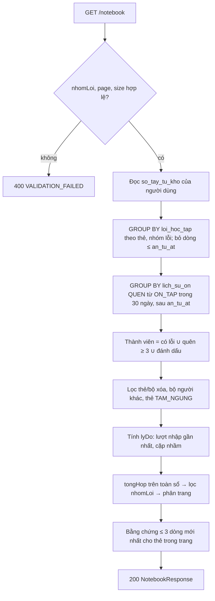
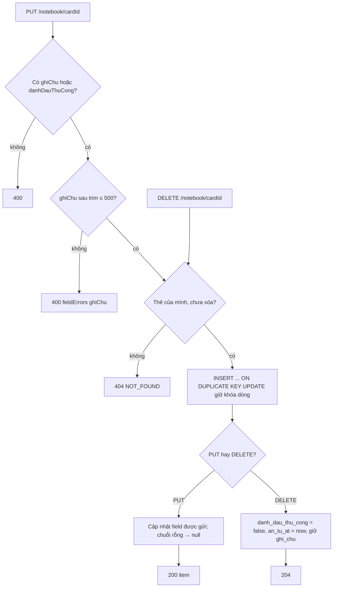

# B2.9 — Sổ tay từ khó & cặp dễ nhầm

FR-08 · Sprint S6 · UI27 `/so-tay` · FE F2.6. API: `GET /api/v1/notebook`, `PUT /api/v1/notebook/{cardId}`, `DELETE /api/v1/notebook/{cardId}`, `GET /api/v1/learning/confusing-pairs`; đổi nguồn `nguon = SO_TAY` của `POST /api/v1/practice/sessions` (B2.7).

## Phạm vi và quyền

| Mục | Giá trị |
|---|---|
| Endpoint | `GET /notebook` (200), `PUT /notebook/{cardId}` (200), `DELETE /notebook/{cardId}` (204), `GET /learning/confusing-pairs` (200) |
| Quyền | Đăng nhập; `PUT`/`DELETE` cần CSRF. Thẻ của người khác, thẻ đã xóa hoặc thẻ thuộc bộ đã xóa → 404 |
| Bảng ghi | `so_tay_tu_kho` (upsert: ghi chú, đánh dấu, mốc ẩn `an_tu_at`) |
| Bảng đọc | `loi_hoc_tap`, `lich_su_on` + `tien_do_the` (lần quên), `tra_loi_bai_luyen` + `lan_lam_bai` + `cau_hoi_bai_luyen` (lượt nhập), `cap_tu_de_nham`, `the_tu_vung` + `bo_the` |
| Migration | `V13__so_tay_an_tu.sql`: thêm `so_tay_tu_kho.an_tu_at DATETIME(3) NULL` |
| Không làm | Không đổi lịch SRS; không gợi ý `GET /learning/recommendations` (B3.5); không thống kê (B2.10); không thưởng |

## Thành phần

| Thành phần | Vai trò |
|---|---|
| `NotebookController` (module `practice`) | 4 endpoint; path cặp nhầm nằm dưới `/learning` theo TK §13.2 |
| `NotebookService` | Định nghĩa sổ tay dùng chung cho UI27 và `nguon = SO_TAY`; ghi chú/đánh dấu/ẩn; danh sách cặp nhầm |
| `SoTayTuKho` + `SoTayTuKhoRepository` | Entity có `@Version`; truy vấn tổng hợp (JPQL `GROUP BY`, native `ROW_NUMBER()` cho lượt nhập và bằng chứng) |
| `MaLyDo` | `QUEN_NHIEU`, `SAI_CHINH_TA`, `CAP_DE_NHAM`, `DANH_DAU_THU_CONG` (TK §8.3; B3.5 dùng lại) |
| `PracticeService.create` | `nguon = SO_TAY` lấy `NotebookService.cardIds` thay cho đọc thẳng `so_tay_tu_kho` |
| `app.notebook.*` | Ngưỡng cấu hình: `quen-nhieu` 3, `quen-nhieu-ngay` 30, `chinh-ta-luot` 5, `chinh-ta-sai` 2, `cap-nham` 2 |

## Định nghĩa sổ tay

Sổ tay là kết quả suy ra, không có hàng nào được ghi khi nộp bài hoặc ôn. Một thẻ thuộc sổ tay khi có ít nhất một điều kiện:

1. Có dòng `loi_hoc_tap` tạo sau `an_tu_at` (gồm câu bỏ trống, theo B2.8).
2. QUEN_NHIEU: ≥ 3 lượt `lich_su_on` có `danh_gia = QUEN` và `truoc_json.trangThai = ON_TAP`, cộng cả hai chiều, trong 30 ngày gần nhất và sau `an_tu_at`. Đây chính là các lượt làm `so_lan_quen` tăng; cột tích lũy `so_lan_quen` không dùng vì không có thời điểm.
3. `so_tay_tu_kho.danh_dau_thu_cong = true`.

Ghi chú đứng một mình không đưa thẻ vào sổ. Sau đó loại thẻ hoặc bộ đã xóa, bộ của người khác và thẻ có bất kỳ chiều nào `TAM_NGUNG` (cùng bộ lọc với `usableCardIds` của B2.7).

| `lyDo` | Điều kiện |
|---|---|
| `QUEN_NHIEU` | Điều kiện 2; `soLanQuen` trả về là số lượt đếm được (có thể < 3 khi thẻ vào sổ vì lý do khác) |
| `SAI_CHINH_TA` | ≥ 2 câu `nhomLoi = CHINH_TA` trong 5 lượt nhập gần nhất của thẻ (`NHAP_TU_THEO_NGHIA`, `NGHE_VIET`, `DIEN_CHO_TRONG`), sau `an_tu_at`; câu bỏ trống không tính là lượt nhập |
| `CAP_DE_NHAM` | Thẻ thuộc một cặp `cap_tu_de_nham` có `so_lan_nham ≥ 2` và `lan_cuoi_at` sau `an_tu_at` của thẻ |
| `DANH_DAU_THU_CONG` | Điều kiện 3 |

`lanGanNhatAt` = mốc muộn nhất của lỗi, lần quên đã đếm và `updated_at` của hàng đánh dấu. Sắp `lanGanNhatAt desc, theId desc`.



## Ghi chú, đánh dấu và bỏ khỏi sổ



- `null` hoặc không gửi = giữ nguyên. Gửi `ghiChu: ""` để xóa ghi chú. Độ dài đếm theo ký tự Unicode (code point), khớp `VARCHAR(500)`.
- PUT không xóa `an_tu_at`: sửa ghi chú không làm bằng chứng cũ hiện lại. Đánh dấu lại sau khi xóa vẫn đưa thẻ vào sổ, chỉ với bằng chứng mới.
- DELETE idempotent: thẻ chưa có trong sổ vẫn 204. Lỗi hoặc lần quên mới sau mốc làm thẻ hiện lại.
- Không có `version` trong body (lần ghi sau thắng). `@Version` của entity chỉ chặn hai transaction đồng thời: lệch → 409 `VERSION_CONFLICT`.
- Response PUT có cùng dạng với một item của danh sách. Thẻ chưa thuộc sổ (chỉ có ghi chú) hoặc đang tạm ngưng vẫn trả item với `lyDo` rỗng và không có bằng chứng.

## Cặp dễ nhầm

`GET /learning/confusing-pairs` đọc `cap_tu_de_nham` của người dùng có `so_lan_nham > 0`, bỏ cặp có thẻ đã xóa, thuộc bộ đã xóa hoặc tạm ngưng, sắp `soLanNham desc, lanCuoiAt desc, id` và lấy tối đa 20. Không phân trang, không kèm bằng chứng, không có `loaiNham` (V11 không có cột, B2.8 chỉ ghi một loại).

## Hợp đồng (contract từ code)

`GET /api/v1/notebook?nhomLoi=&page=0&size=20`: `nhomLoi` ∈ `NGHIA|CHINH_TA|NGHE|NGU_CANH|CAP_NHAM|QUEN_NHIEU|DANH_DAU`, `page ≥ 0`, `1 ≤ size ≤ 100`.

```json
{
  "tongHop": { "TAT_CA": 3, "NGHIA": 1, "CHINH_TA": 0, "NGHE": 0, "NGU_CANH": 0, "CAP_NHAM": 1, "QUEN_NHIEU": 1, "DANH_DAU": 1 },
  "items": [{
    "theId": "21", "tu": "receipt", "tuLoai": "noun", "phienAm": "/rɪˈsiːt/", "nghiaVi": "biên lai",
    "boTheId": "2", "boTheTen": "Văn phòng",
    "nhomLoi": [{ "nhomLoi": "NGHIA", "soLan": 3 }, { "nhomLoi": "CAP_NHAM", "soLan": 1 }],
    "lyDo": ["CAP_DE_NHAM"],
    "bangChung": [{ "nhomLoi": "CAP_NHAM", "nguonSuKien": "BAI_LUYEN", "suKienId": "41", "baiLuyenId": "38", "cauHoiId": "390", "loaiCau": "PHAN_BIET_CAP", "traLoi": "recipe", "dapAn": "receipt", "createdAt": "2026-11-03T07:30:00.000Z" }],
    "soLanQuen": 0, "ghiChu": null, "danhDauThuCong": false, "lanGanNhatAt": "2026-11-03T07:30:00.000Z"
  }],
  "page": 0, "size": 20, "totalElements": 3, "totalPages": 1
}
```

- `tongHop` đếm theo **thẻ** trên toàn sổ, không phụ thuộc `nhomLoi`/trang; `nhomLoi[].soLan` đếm theo lượt lỗi sau mốc ẩn. Nhóm `PHAT_AM` chưa có trong `tongHop`/bộ lọc (chưa có nguồn ghi).
- `bangChung` tối đa 3 dòng mới nhất; `suKienId` = `loi_hoc_tap.su_kien_id` (id lần làm bài), `traLoi` = `null` khi bỏ trống.

`PUT /api/v1/notebook/{cardId}` body `{ "ghiChu"?: string, "danhDauThuCong"?: boolean }` → 200 một item như trên. `DELETE /api/v1/notebook/{cardId}` → 204.

`GET /api/v1/learning/confusing-pairs`:

```json
[{ "id": "5", "the1": { "id": "21", "tu": "receipt", "tuLoai": "noun", "phienAm": "/rɪˈsiːt/", "nghiaVi": "biên lai", "viDuEn": "Keep the receipt." },
   "the2": { "id": "22", "tu": "recipe", "tuLoai": "noun", "phienAm": null, "nghiaVi": "công thức", "viDuEn": null },
   "soLanNham": 3, "lanCuoiAt": "2026-11-03T07:30:00.000Z" }]
```

| Mã | Khi nào |
|---|---|
| 400 `VALIDATION_FAILED` | `nhomLoi` lạ, `size` > 100, `page` âm; PUT body rỗng; `ghiChu` > 500 ký tự sau trim (`fieldErrors[].field = ghiChu`); `cardId` không phải số |
| 401 | Chưa đăng nhập |
| 403 `CSRF_INVALID` | PUT/DELETE thiếu CSRF |
| 404 `NOT_FOUND` | Thẻ không thuộc mình, đã xóa hoặc thuộc bộ đã xóa |
| 409 `VERSION_CONFLICT` | Hai PUT/DELETE cùng thẻ chạy đồng thời |

`POST /practice/sessions {nguon: SO_TAY}` dùng đúng tập thẻ của sổ tay, theo thứ tự `lanGanNhatAt desc`; sổ trống → 422 như cũ. `{loaiBai: PHAN_BIET_CAP, theIds: [the1, the2]}` dùng cho nút "Luyện phân biệt" giữ nguyên B2.7.

## Quyết định (chốt 03/11/2026, đề xuất)

a. Sổ tay suy ra từ `loi_hoc_tap` + lần quên + hàng đánh dấu; một hàm dùng chung cho UI27 và `SO_TAY`. b. DELETE ẩn theo mốc `an_tu_at`, lỗi mới làm thẻ hiện lại, 204 cả khi chưa có trong sổ; PUT không xóa mốc. c. PUT không có `version`, `null`/không gửi = giữ nguyên, trim, rỗng → `null`, ≤ 500, luôn 200. d. `lyDo` tính ở B2.9 theo TK §8.3 (QUEN_NHIEU từ `lich_su_on` 30 ngày; SAI_CHINH_TA 2/5 lượt nhập; CAP_DE_NHAM `so_lan_nham ≥ 2`); câu bỏ trống vào sổ nhưng không là lượt nhập; ngưỡng trong `app.notebook.*`. e. Ẩn thẻ/bộ xóa, bộ người khác, thẻ tạm ngưng. f. `tongHop` theo thẻ, bằng chứng 3, sắp `lanGanNhatAt desc, theId desc`, mặc định 20, tối đa 100, chỉ lọc `nhomLoi`. g. Tổng hợp bằng SQL, ghép trong Java. h. `notebookCardIds` dùng định nghĩa (a). i. Controller trong `practice`, field theo entity (`soLanNham`, `lanCuoiAt`), bỏ `loaiNham`, `so_lan_nham ≥ 1`, tối đa 20. j. V13 `so_tay_an_tu`; admin → V14, jobs_ai → V15, engagement → V16. k. Demo sửa theo DTO. l. Test `FR08NotebookTest`.

## Kiểm chứng

- `FR08NotebookTest` (4): sổ tay suy từ lỗi/lần quên/đánh dấu, lần quên từ `DANG_HOC` và lần quên cũ hơn 30 ngày không tính, ghi chú đứng một mình không vào sổ, `tongHop`, thứ tự, bằng chứng 3 dòng, lọc và phân trang, `SO_TAY` lấy đúng 3 thẻ, DELETE ẩn rồi lỗi mới làm hiện lại; SAI_CHINH_TA từ hai lần nộp thật (câu bỏ trống không tính lượt nhập); 400/401/404, thẻ xóa và tạm ngưng bị ẩn; cặp nhầm sắp theo số lần, bỏ cặp có thẻ tạm ngưng, không lộ cho người khác.
- `FR07PracticeSessionTest` sửa dữ liệu: hàng `so_tay_tu_kho` phải `danh_dau_thu_cong = TRUE` mới vào sổ.
- 03/11/2026: `mvnw -q test -Dtest="FR08NotebookTest,FR07PracticeSessionTest"` exit 0.
- 03/11/2026: bộ đầy đủ `./mvnw -B test` → 386 test, 0 lỗi, BUILD SUCCESS.
- Mockup: `demo.js` (khóa `vl-demo-v7`) và `dot2/so-tay.html` khớp DTO; mở `so-tay.html?as=an` ở 1280 px và 390 px (không cuộn ngang), gọi thử GET/PUT/DELETE/cặp nhầm trên demo.
- Postman: 5 request trong "03 Học tập" (4 happy path + PUT body rỗng → 400), chưa chạy.
- Chưa gọi HTTP thật bằng `curl`, chưa chạy request Postman.

## Giới hạn

- Sổ tay tính lại mỗi lần đọc (không bộ nhớ đệm); số dòng đọc bị chặn bởi số thẻ có lỗi/lần quên của người dùng nhờ `GROUP BY`.
- QUEN_NHIEU dựa vào `truoc_json.trangThai` của `lich_su_on`; dữ liệu ôn nhập tay không có field này sẽ không được đếm.
- Lỗi phát âm (`PHAT_AM`) chưa có nguồn ghi nên chưa có tab.

Xem [roadmap](../../roadmap/TienDoDuKien_backend.md), [báo cáo Đợt 2](../../ban-giao-cho%20fe/SPRINT_2_BAO_CAO_BE_BAN_GIAO_CHO_FE.md), [flow B2.7](B2.7-tao-bai-luyen.md), [flow B2.8](B2.8-nop-bai-cham.md), [TK §8.2, §8.3, §12.2, §13.2](../PHAN_TICH_THIET_KE_HE_THONG_HOC_TU_VUNG_K28.md).
