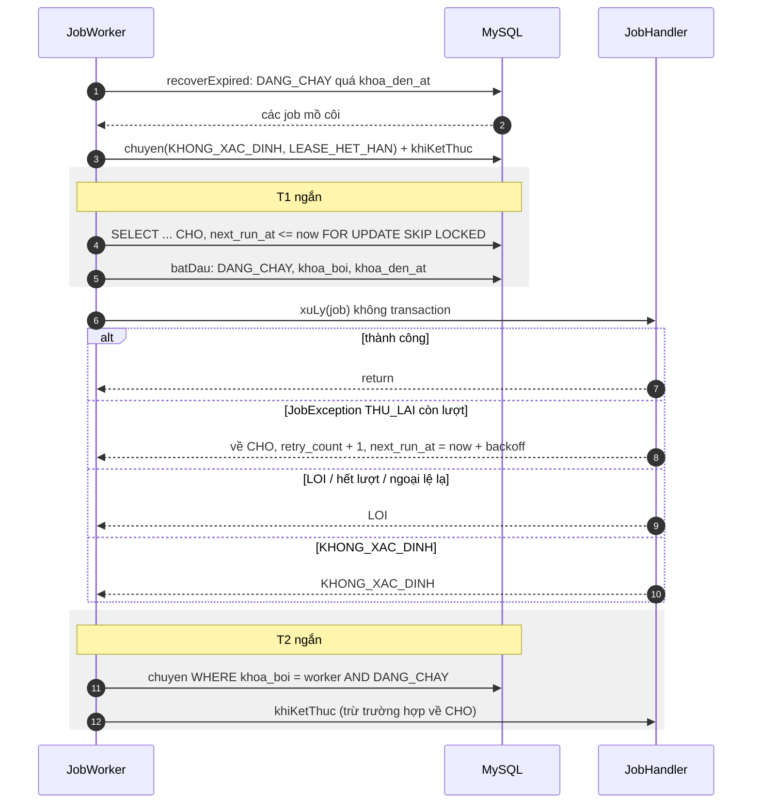
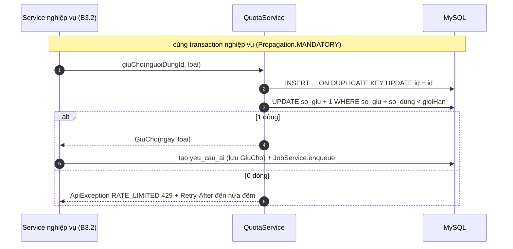

# B3.1 — Tác vụ nền và hạn mức dịch vụ

FR-09, TC-12 · Sprint S7 · Không có endpoint, không có màn hình riêng (`GET /me/service-quota` thuộc B3.3, `/admin/service-quotas` thuộc B3.11). Migration `V15__jobs_ai.sql`. Ngoài phạm vi: logic AI, `AiClient`, `yeu_cau_ai`/`ban_nhap_the_ai` (chỉ tạo bảng, entity thuộc B3.2), `EntitlementService` và `goi_dich_vu` (B3.12a).

## Thành phần

| Thành phần | Vai trò |
|---|---|
| `common/job`: `JobService`, `JobWorker`, `JobHandler`, `JobException`, `TacVuNen` | Hàng đợi bền trong MySQL; handler theo `loai` do module nghiệp vụ đăng ký |
| `common/quota`: `QuotaService`, `GoiDichVuResolver`, `HanMucDichVu`, `SuDungDichVu` | Giữ chỗ hạn mức nguyên tử theo người/ngày/loại |
| Cấu hình | `app.jobs.*` (enabled, interval-ms, batch-size, max-retry, lease, backoff-base, backoff-max), `app.quota.zone`; `JobConfig` bật `@EnableScheduling` độc lập với `FileCleanupConfig` |

## Quyết định (chốt 11/11/2026)

| # | Quyết định |
|---|---|
| a | `han_muc_dich_vu(goi_ma, loai, so_luot_ngay)` là nguồn hạn mức duy nhất; hai nhóm `AI` và `ANH`. Seed theo TK §6.9: `PRO` AI 20, ảnh 10; `PREMIUM` AI 100, ảnh 30. Không có gói miễn phí (chốt 10/11/2026). Chưa có B3.12a nên `ProGoiResolver` luôn trả `PRO`; B3.12a thay bằng bản đọc `EntitlementService` |
| b | "Ngày" hạn mức = ngày của `Clock` (UTC) quy sang `app.quota.zone` (`Asia/Ho_Chi_Minh`), lưu `DATE`; không theo `nguoi_dung.mui_gio` để tránh đổi múi giờ lấy thêm lượt. Sang ngày mới là dòng đếm mới, không cần job reset |
| c | `su_dung_dich_vu` là bộ đếm một dòng cho mỗi (người, ngày, loại); còn lại = `giới hạn − so_giu − so_dung`. Lượt đang chạy tính vào `so_giu` |
| d | `LOI` (lỗi xác định) hoàn lượt; `KHONG_XAC_DINH` (đã gửi, không biết kết quả) tính là đã dùng, không tự thử lại; lỗi tạm thời chưa gửi (`THU_LAI`) thử lại tối đa `max-retry` lần, chờ `backoff-base × 2^(k−1)` trần `backoff-max` |
| e | Worker chết khi `DANG_CHAY`: quá `khoa_den_at` thì chuyển `KHONG_XAC_DINH` (`LEASE_HET_HAN`), không về `CHO`, vì không biết đã gọi API chưa. Đánh đổi: worker chết trước khi gọi API thì người dùng mất một lượt |
| f | Ngoại lệ bất ngờ trong handler → `LOI` (`NOI_BO`); `loai` chưa có handler → `LOI` (`CHUA_DANG_KY`); cả hai không retry |
| g | Chưa chốt (B3.2): đầu ra nhà cung cấp sai schema có hoàn lượt hay không (nhà cung cấp đã xử lý nên có thể đã tính phí) |

## Lấy việc và chạy việc

- `chuyen` trả 0 dòng (đã mất lease) thì bỏ kết quả và không gọi `khiKetThuc`.
- `khiKetThuc` chạy cùng transaction T2 với việc đổi trạng thái; nó ném lỗi thì T2 rollback, job còn `DANG_CHAY` và sẽ được thu hồi sau lease.
- Lease phải lớn hơn `batch-size × timeout API`: việc đứng cuối lô bắt đầu muộn nhưng đồng hồ lease chạy từ lúc nhận (mặc định 3 × 60 giây so với 10 phút).

## Giữ chỗ hạn mức

| Sự kiện | Hàm | `so_giu` | `so_dung` |
|---|---|---|---|
| Job `XONG` hoặc `KHONG_XAC_DINH` | `xacNhan` | −1 | +1 |
| Job `LOI` | `hoanTra` | −1 | |

- Một câu UPDATE vừa kiểm tra vừa ghi nên hai request đồng thời không vượt hạn mức (khóa dòng đếm).
- `GiuCho.ngay` được lưu cùng yêu cầu; xác nhận/hoàn trả dùng đúng ngày đó, kể cả khi job kết thúc sau nửa đêm.
- `xacNhan`/`hoanTra` trả 0 dòng chỉ ghi log, không ném lỗi (tránh rollback `finish`); bảo đảm gọi đúng một lần là việc của người gọi (`yeu_cau_ai.han_muc_trang_thai`, B3.2).
- Thiếu dòng cấu hình cho (gói, loại) → giới hạn 0 và log cảnh báo.

## Kiểm chứng

| Test | Nội dung |
|---|---|
| `FR09JobWorkerTest` (5) | hai worker không lấy trùng 20 job; retry/backoff 5s·10s·20s rồi `LOI` sau 4 lần chạy; `LOI`/`KHONG_XAC_DINH`/lỗi lạ/loại chưa đăng ký không retry; lease hết hạn → `KHONG_XAC_DINH`; `enqueue` ngoài transaction bị từ chối |
| `FR09QuotaTest` (5) | 10 request đồng thời giới hạn 5 chỉ được 5; 429 kèm `Retry-After` và sang ngày mới theo giờ Việt Nam; hạn mức ảnh tách khỏi AI; hoàn trả mở lại một lượt, xác nhận tính đã dùng; job `LOI` hoàn lượt, `KHONG_XAC_DINH` giữ lượt |

Trạng thái (11/11/2026): compile, khởi động ứng dụng và chạy `FR09JobWorkerTest`, `FR09QuotaTest` không lỗi (người dùng báo, không có tổng số test). Chưa chạy bộ test đầy đủ.
