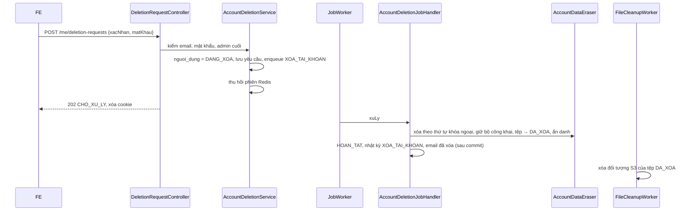

# B3.10 — Xóa tài khoản và dữ liệu cá nhân

FR-14, TC-16 · Sprint S9 · Màn hình UI44 `/ca-nhan/du-lieu`. Migration `V24__privacy.sql`: bảng `yeu_cau_xoa_du_lieu` (một yêu cầu đang mở mỗi người bằng cột sinh + unique) và hành động nhật ký `XOA_TAI_KHOAN`. Module `privacy`. **Cắt:** `GET /admin/deletion-requests` (Admin xem qua `GET /admin/audit-logs?hanhDong=XOA_TAI_KHOAN`).

## Chính sách (chốt 16/11/2026)

| Dữ liệu | Xử lý |
|---|---|
| Tài khoản `nguoi_dung` | Giữ dòng (khóa ngoại của giao dịch, nhật ký, bộ chia sẻ) nhưng ẩn danh: email `deleted-{id}@deleted.invalid`, tên "Người dùng đã xóa", xóa mật khẩu, ảnh đại diện, thời điểm xác thực/đăng nhập; trạng thái `DANG_XOA` (không đăng nhập được). Email cũ được giải phóng để đăng ký lại |
| Vai trò, OAuth, token, hồ sơ học, cài đặt thông báo | Xóa |
| Tiến độ SRS, phiên học, lịch sử ôn, lượt học ngày, bài luyện và lượt làm, lỗi học tập, sổ tay, cặp từ dễ nhầm, điểm, huy hiệu, thử thách, thông báo, lượt dùng dịch vụ, yêu thích, yêu cầu AI và thẻ nháp, kết quả phát âm, khóa idempotency sao chép/CSV/lưu thẻ AI | Xóa cứng |
| Bộ thẻ riêng tư hoặc đã xóa mềm + thẻ, nhãn thẻ, liên kết tệp | Xóa cứng; bản sao của người khác giữ nguyên, `bo_nguon_id` trỏ tới bộ bị xóa → `NULL`; yêu thích và khóa sao chép của người khác trên bộ đó bị xóa |
| Bộ đang công khai (`CONG_KHAI`, chưa xóa) | **Giữ** cùng thẻ và tệp của thẻ; tác giả hiện "Người dùng đã xóa" |
| Tệp của User không thuộc bộ công khai được giữ | Đánh dấu `DA_XOA` → mất quyền truy cập ngay; `FileCleanupWorker` (B1.x) xóa đối tượng S3. Thẻ của người khác còn trỏ tới tệp (bản sao trước RS-059) → **gỡ media** (xóa `the_tep`) |
| Gói, giao dịch | Gói `HIEU_LUC` → `HET_HAN` (không hoàn tiền); đơn chờ → `HET_HAN`; giao dịch giữ để đối soát, chỉ còn gắn với dòng đã ẩn danh |
| Nhật ký quản trị | Giữ; thêm dòng `XOA_TAI_KHOAN` (người thực hiện = chính User đã ẩn danh) với số lượng đã xóa |

## Quyết định khác

| Mục | Chốt |
|---|---|
| Xác nhận | `xacNhan` = email tài khoản (không phân biệt hoa thường) + `matKhau` nếu tài khoản có mật khẩu (tài khoản chỉ OAuth chỉ cần email). FE làm xác nhận hai bước |
| Quản trị viên cuối cùng | Không cho xóa (422) |
| Thời điểm | Không có thời gian chờ: ngay khi gửi thì khóa đăng nhập, thu hồi mọi phiên Redis (`SessionRevoker`), xóa cookie phiên hiện tại; job `XOA_TAI_KHOAN` trên `tac_vu_nen` xử lý trong một transaction |
| Trạng thái | `CHO_XU_LY` → `DANG_XU_LY` → `HOAN_TAT` (hoặc `LOI` khi job thất bại hẳn; lỗi CSDL thì thử lại). Sau khi gửi, User không đăng nhập được nên trạng thái chỉ thấy trong phản hồi 202 và email "đã xóa" gửi tới địa chỉ cũ khi xong |
| Gửi lặp | Đã có yêu cầu đang mở → trả lại yêu cầu đó, không tạo job mới |

## API

| Method / path | Request | Response |
|---|---|---|
| `POST /api/v1/me/deletion-requests` | `{xacNhan, matKhau?}` | 202 `{id, phamVi: TAI_KHOAN, trangThai: CHO_XU_LY, yeuCauAt}` và xóa cookie `SESSION`; 400 `fieldErrors[].field = xacNhan|matKhau`; 401 chưa đăng nhập; 422 quản trị viên cuối cùng |

Không phụ thuộc gói (nằm trong `/me/**`, `SubscriptionGuard` bỏ qua).

## Luồng

## Kiểm chứng

- `FR14AccountDeletionTest` 2/2 (16/11/2026): email sai/mật khẩu sai 400 và không đổi trạng thái; gửi đúng → 202, phiên cũ 401, đăng nhập 403; sau job: yêu cầu `HOAN_TAT`, tài khoản ẩn danh, bộ riêng và thẻ bị xóa, thông báo và vai trò bị xóa, 2 tệp `DA_XOA`, thẻ bản sao của người khác bị gỡ media, bản sao trỏ bộ riêng có `bo_nguon_id = NULL`, bản sao bộ công khai còn thẻ, gói `HET_HAN`, giao dịch giữ, 1 dòng nhật ký, email cũ không còn; thư viện hiện tác giả "Người dùng đã xóa". Tài khoản chỉ OAuth xác nhận bằng email, một job.
- Toàn bộ `mvnw test` 536/536 pass (16/11/2026).
- HTTP thật trên dev 16/11/2026 (tài khoản thử): 400 email/mật khẩu sai, 202, `/me` 401, đăng nhập 403 `ACCOUNT_LOCKED`, job `HOAN_TAT`, dòng ẩn danh `DANG_XOA`, gói `HET_HAN`, email Mailpit "Tài khoản VocabLearning đã được xóa".
- Mockup UI44 `dot3/ca-nhan-du-lieu.html` đọc route demo đúng DTO (16/11/2026); Postman đồng bộ (16/11/2026).
- Chưa: test nhánh quản trị viên cuối cùng (phụ thuộc số admin trong DB test), test với dữ liệu học thật (phiên học, bài luyện) ngoài đường xóa SQL.
