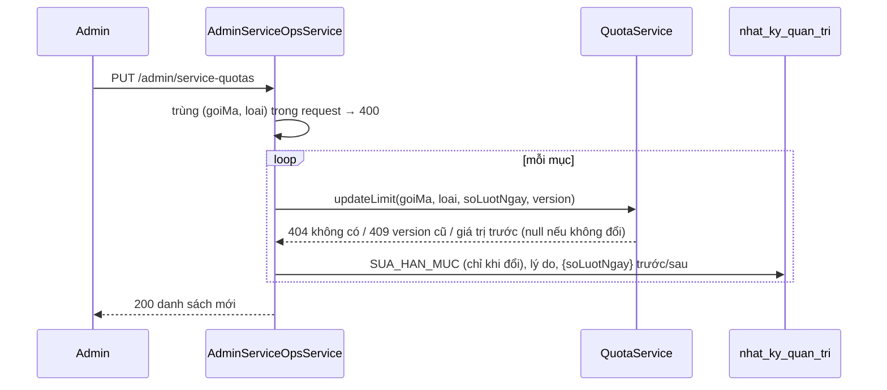

# B3.11 — Quản trị vận hành (FR-13, gọn mạnh)

Trạng thái 16/11/2026: code xong, `FR13ServiceOpsTest` 2/2 pass, toàn bộ `mvnw test` 544/544 pass; đã gọi HTTP thật trên dev (16/11/2026), chưa Postman; mockup UI51 đã đọc route demo đúng DTO. Đã cắt: `GET /admin/statistics`, `GET /admin/jobs`, thời gian phản hồi, chi phí.

## 1. API (chỉ ADMIN)

| Method / path | Request | Response |
|---|---|---|
| `GET /api/v1/admin/service-quotas` | — | `[{id, goiMa, loai, soLuotNgay, version}]` (8 dòng: `PRO`/`PREMIUM` × `AI`/`ANH`/`PHAT_AM`/`TTS`, sắp theo gói, loại) |
| `PUT /api/v1/admin/service-quotas` | `{hanMuc: [{goiMa, loai, soLuotNgay (0–10000), version}] (1–20 mục), lyDo (10–500)}` | 200 danh sách đầy đủ sau khi lưu |
| `GET /api/v1/admin/service-usage` | `?tuNgay=&denNgay=` (ngày theo `app.quota.zone`; mặc định 7 ngày đến hôm nay; tối đa 90 ngày) | `{muiGio, tuNgay, denNgay, dichVu: [{loai, soLuotDung, soDangGiu, soNguoiDung, soLoi, soKhongXacDinh}]}` (đủ 4 loại) |

## 2. Sửa hạn mức

- Một transaction: một mục lỗi (404/409) thì không mục nào được lưu.
- Có hiệu lực ngay: `QuotaService.giuCho` đọc `han_muc_dich_vu` ở mỗi lượt (không cache) và `GET /me/service-quota` trả giới hạn mới. Lượt đã dùng hôm nay giữ nguyên; hạ hạn mức xuống dưới số đã dùng thì người dùng hết lượt tới ngày mai.
- Nhật ký: `loai_doi_tuong = HAN_MUC_DICH_VU`, `doi_tuong_id` = `han_muc_dich_vu.id`, tên "PRO · AI".
- Không trùng `PUT /admin/plans` (B3.12c): API gói sửa giá, giới hạn thẻ, quyền lợi; hạn mức lượt/ngày chỉ sửa ở đây. `GET /billing/plans` đọc hạn mức từ cùng bảng.

## 3. Lượt dùng và lỗi

- `soLuotDung`, `soDangGiu`, `soNguoiDung`: cộng `su_dung_dich_vu` (`so_dung`, `so_giu`, số người khác nhau) theo `ngay` trong khoảng.
- `soLoi`, `soKhongXacDinh`: đếm `yeu_cau_ai` có `han_muc_loai` = loại, `han_muc_ngay` trong khoảng, `trang_thai = LOI` / `KHONG_XAC_DINH`. Chỉ có cho `AI` và `ANH`. `TTS`, `PHAT_AM` trả `null` vì lỗi nhà cung cấp trả 503 và hoàn lượt ngay, BE không lưu lượt lỗi.
- Lượt `LOI` đã hoàn nên không nằm trong `soLuotDung`; lượt `KHONG_XAC_DINH` giữ lượt nên có trong `soLuotDung`.
- `V26__service_ops.sql`: thêm `SUA_HAN_MUC`, `HAN_MUC_DICH_VU` vào CHECK nhật ký; index `yeu_cau_ai (han_muc_ngay, han_muc_loai, trang_thai)`.

## 4. Thành phần

`admin/controller/AdminServiceOpsController`, `admin/service/AdminServiceOpsService`, `admin/dto/UpdateServiceQuotasRequest`, `ServiceUsageResponse`; `common/quota/QuotaService` (`allLimits`, `updateLimit`, `usageTotals`), `ServiceQuotaItem`, `HanMucDichVu.doiSoLuot`, `SuDungDichVuRepository.totals`; `ai/service/AiTaskService.failures`, `YeuCauAiRepository.failures`, `AiFailureCount`.

## 5. Kiểm chứng

`FR13ServiceOpsTest` (16/11/2026, Testcontainers): learner 403; danh sách 8 dòng; một mục version cũ → 409 và mục còn lại không lưu; sửa `PRO · AI` → nhật ký đúng trước/sau, mục không đổi không ghi nhật ký; `/me/service-quota` thấy giới hạn mới ngay; 409 version cũ, 400 trùng mục, 404 gói không có, 400 vượt 10000, 400 lý do ngắn. Lượt dùng: cộng đúng 2 người, giữ chỗ, bỏ dòng ngoài khoảng; lỗi AI 2, không xác định 1, ảnh 1, TTS `soLoi = null`; 400 khoảng > 90 ngày, đảo ngày, ngày không tồn tại. Cùng `FR09QuotaTest`, `FR13AdminTest`: 16/16 pass.
