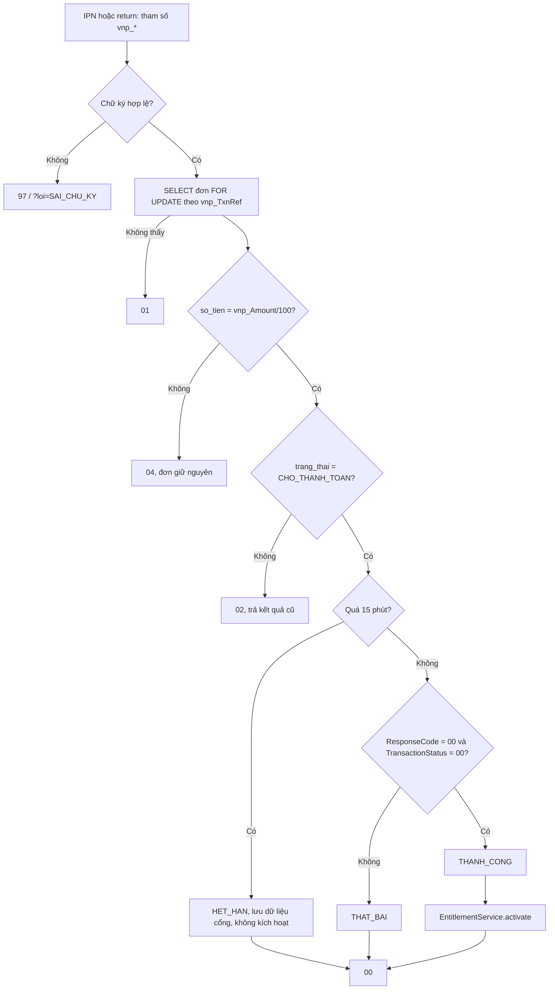

# B3.12a — Gói dịch vụ và thanh toán VNPay

FR-15, TC-21, TC-22 (phần chưa có gói/hết hạn) · Sprint S8 · Màn hình UI55 `/thanh-toan-goi`, UI57 `/thanh-toan-ket-qua` · Migration `V21__billing.sql`. Ngoài phạm vi (B3.12b): danh sách giao dịch, biên nhận HTML, `SubscriptionExpiryJob` nhắc/hết hạn, áp giới hạn thẻ, cờ `phat_am`, bộ mẫu cao cấp. Admin (B3.12c): quản lý thanh toán, doanh thu.

## Quyết định (16/11/2026)

| Mục | Chốt |
|---|---|
| Cổng | `PaymentGateway` có hai bản: `VnpayGateway` (`PAYMENT_PROVIDER=vnpay`, cần `VNPAY_TMN_CODE`, `VNPAY_HASH_SECRET`, `VNPAY_PAY_URL`, `VNPAY_RETURN_URL`, thiếu thì không khởi động) và `FakePaymentGateway` (mặc định). Ký/kiểm HMAC-SHA512 theo mẫu Java của VNPay 2.1.0: sắp xếp khóa, mã hóa URL US-ASCII, bỏ `vnp_SecureHash`/`vnp_SecureHashType`, so sánh hằng thời gian |
| Mô phỏng | `FakePaymentGateway` trả `paymentUrl` là chính `GET /billing/vnpay/return` kèm bộ tham số kiểu VNPay đã ký bằng khóa ngẫu nhiên mỗi lần khởi động (đặt `PAYMENT_FAKE_SECRET` để test tự ký). Mở URL = cổng báo thành công (hoặc thất bại khi `PAYMENT_FAKE_RESULT=THAT_BAI`), đi đúng hàm xác nhận như VNPay thật. Đơn ghi `cong = MO_PHONG`, response có `moPhong = true` để FE gắn nhãn "Mô phỏng" |
| Tên trường | Body tạo đơn là `{goiMa, chuKy}` (DTO = tên cột `goi_ma`), không phải `{goi, chuKy}` như TK cũ; đã sửa TK §6.9. `GET /me/subscription` trả `goiMa` |
| Bắt buộc gói | `SubscriptionGuard` (interceptor MVC) chặn `/api/v1/**` trừ: `/auth/**`, `/public/**`, `/library/**`, `/admin/**`, `/me`, `/me/**`, `/billing/**`, `/notifications/**`, `/files/**` (đổi ảnh đại diện ở hồ sơ), `/decks/*/export`, `/ping`. Admin bỏ qua. Đọc thẳng `het_han_at`, không chờ tác vụ nền |
| Tắt kiểm tra | `app.billing.enforce` (`BILLING_ENFORCE`, mặc định `true`). Hồ sơ test đặt `false` để các test B1–B3 tạo người dùng mới không bị 402; khi tắt, hạn mức AI/ảnh coi như `PRO`. `FR15BillingTest` bật lại `true` |
| Một gói hiệu lực | Cột sinh `nguoi_dung_hieu_luc` + unique bảo đảm tối đa một dòng `HIEU_LUC`/người. Hai IPN cùng lúc tạo gói đầu tiên: bên thua gặp lỗi unique → trả `99`, VNPay gọi lại IPN và lần sau cộng dồn đúng |
| Đổi gói | Đang gói A còn hạn → tạo đơn gói B: 422 `BUSINESS_RULE`. Đang có đơn gói khác `CHO_THANH_TOAN` chưa quá 15 phút → 409 `CONFLICT` (chặn trả hai gói khác nhau song song). Cùng gói thì được (gia hạn) |
| Đơn quá 15 phút | URL VNPay có `vnp_ExpireDate` = tạo + 15 phút. Kết quả cổng về sau hạn: đơn → `HET_HAN`, lưu dữ liệu cổng để đối soát, không kích hoạt gói, IPN vẫn trả `00` để VNPay ngừng gọi lại. `GET /billing/transactions/{maDon}` cũng chuyển đơn chờ quá hạn sang `HET_HAN` (UPDATE có điều kiện); quét hàng loạt ở B3.12b |
| `soNgayConLai` | Tính sẵn ở B3.12a theo múi giờ của người dùng (TK §6.9) vì UI55/UI56 đã dùng; `null` khi không hiệu lực |

## Bảng (V21)

| Bảng | Cột chính |
|---|---|
| `goi_dich_vu` | `ma` (unique), `ten`, `gia_thang`, `gia_nam` (VND, BIGINT), `gioi_han_the` (null = không giới hạn), `phat_am`, `bo_mau_cao_cap`, `hoat_dong`, `version`. Seed `PRO` 299.000/2.990.000, 5.000 thẻ; `PREMIUM` 999.000/9.990.000, không giới hạn, có bộ mẫu cao cấp. Hạn mức ngày vẫn ở `han_muc_dich_vu` |
| `dang_ky_goi` | `nguoi_dung_id`, `goi_ma`, `bat_dau_at`, `het_han_at`, `trang_thai` (`HIEU_LUC`/`HET_HAN`), cột sinh `nguoi_dung_hieu_luc` (unique), chỉ mục `(trang_thai, het_han_at)` |
| `giao_dich_thanh_toan` | `ma_don` (unique, `DH` + yyyyMMdd + 8 ký tự ngẫu nhiên, chỉ chữ số/chữ hoa vì `vnp_TxnRef` là alphanumeric), `goi_ma`, `chu_ky`, `so_tien`, `cong` (`VNPAY`/`MO_PHONG`), `trang_thai`, `ma_giao_dich_cong`, `ma_phan_hoi`, `du_lieu_cong_json`, `tao_at`, `hoan_tat_at`. Không có cột thẻ |

## API

| Method / path | Quyền | Request | Response |
|---|---|---|---|
| `GET /api/v1/billing/plans` | Công khai | – | 200 `[{ma, ten, giaThang, giaNam, gioiHanThe, phatAm, boMauCaoCap, hanMucAi, hanMucAnh, hanMucPhatAm}]`, gói `hoat_dong`, giá tăng dần |
| `GET /api/v1/me/subscription` | Đăng nhập | – | 200 `{goiMa, tenGoi, trangThai, batDauAt, hetHanAt, soNgayConLai}`; `trangThai` = `HIEU_LUC`/`HET_HAN`/`CHUA_CO_GOI` (khi chưa từng mua, các trường khác `null`) |
| `POST /api/v1/billing/checkouts` | Đăng nhập + CSRF | `{goiMa, chuKy: THANG\|NAM}` | 201 `{maDon, paymentUrl, soTien, hanThanhToanAt, moPhong}`; 422 gói không bán/đang gói khác; 409 có đơn gói khác đang chờ |
| `GET /api/v1/billing/transactions/{maDon}` | Chủ đơn (đơn người khác 404) | – | 200 `{maDon, goiMa, tenGoi, chuKy, soTien, cong, trangThai, maPhanHoi, taoAt, hoanTatAt}` |
| `GET /api/v1/billing/vnpay/ipn` | Công khai, chỉ tin chữ ký | tham số `vnp_*` | 200 `{RspCode, Message}`: `00` đã ghi nhận, `01` không thấy đơn, `02` đã xác nhận trước, `04` sai số tiền, `97` sai chữ ký, `99` lỗi khác |
| `GET /api/v1/billing/vnpay/return` | Công khai, chỉ tin chữ ký | tham số `vnp_*` | 302 tới `{APP_FRONTEND_URL}/thanh-toan-ket-qua?maDon=…` (hoặc `?loi=SAI_CHU_KY\|KHONG_THAY_DON\|LOI_KHAC`) |

402 `SUBSCRIPTION_REQUIRED`: `{code, message, fieldErrors: [], requestId, details: {lyDo: CHUA_CO_GOI|HET_HAN, goiGanNhat, hetHanAt}}`. `details` chỉ có ở lỗi này (trường mới của `ErrorResponse`, ẩn khi `null`).

## Luồng xác nhận

`activate`: khóa dòng `HIEU_LUC` của người dùng; còn hạn cùng gói → `het_han_at` cộng 1 tháng/1 năm dương lịch theo `Asia/Ho_Chi_Minh`; dòng `HIEU_LUC` đã quá hạn → chuyển `HET_HAN` (flush trước) rồi tạo dòng mới bắt đầu từ lúc xác nhận; chưa có → tạo mới. Đang gói khác còn hạn (chỉ xảy ra khi lách quy tắc 409) → lỗi, IPN trả `99`, cần đối soát tay.

## Hạn mức theo gói

`EntitlementGoiResolver` thay `ProGoiResolver`: `QuotaService` lấy `goi_ma` từ gói hiệu lực; không có gói → `null` (hạn mức 0) khi bật kiểm tra, `PRO` khi tắt.

## Kiểm chứng

- `FR15BillingTest` 7/7 (Testcontainers, `app.billing.enforce=true`): chưa có gói → 402 và các đường được phép vẫn chạy; thanh toán mô phỏng kích hoạt đúng một lần, return/IPN lặp không cộng thêm (`02`), gia hạn cùng gói cộng đúng 1 tháng; sai chữ ký `97`, sai số tiền `04`, không thấy đơn `01`; thanh toán thất bại; đơn người khác 404; đơn quá 15 phút `HET_HAN`; gói hết hạn → 402 `HET_HAN`, mua lại tạo dòng mới; đổi gói giữa kỳ 422; đơn gói khác đang chờ 409; Admin không bị chặn.
- Chưa gọi VNPay sandbox thật (chưa có `VNPAY_TMN_CODE`/`VNPAY_HASH_SECRET`).
