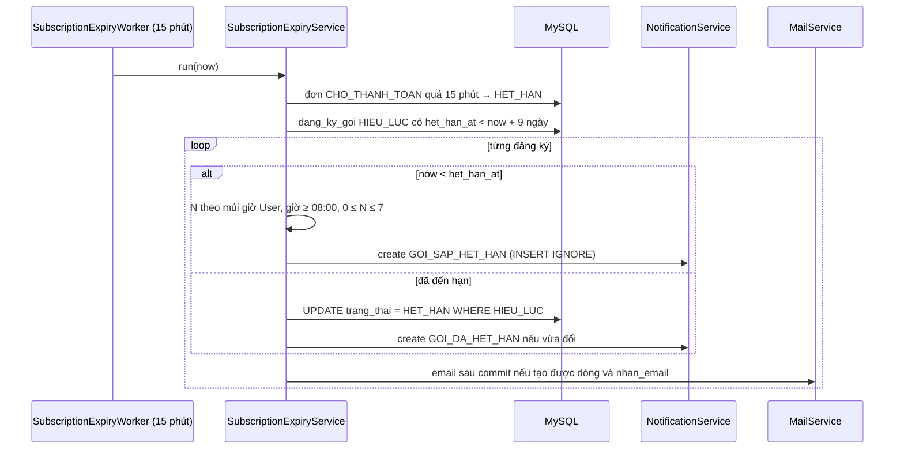

# B3.12b — Lịch sử giao dịch, biên nhận, nhắc và hết hạn gói, áp quyền lợi

FR-15, TC-22, TC-23 · Sprint S9 · Màn hình UI56 (lịch sử, biên nhận), banner `AppShell`, UI44 (thông báo), UI49 (bật bộ mẫu cao cấp). Migration `V22__entitlements.sql`: cột `bo_the.cao_cap` (chỉ bật được cho bộ mẫu).

## Quyết định (16/11/2026)

| Mục | Chốt |
|---|---|
| `GET /admin/payments` | Roadmap ghi ở cả B3.12b và B3.12c → làm một lần ở B3.12c (đủ bộ lọc gói, email) |
| Lịch sử | `GET /billing/transactions?trangThai=&page=&size=` (mặc định 0/20, tối đa 100), mới nhất trước, chỉ của mình; đơn chờ quá 15 phút của chính người gọi được chuyển `HET_HAN` trước khi đọc |
| Biên nhận | `GET /billing/transactions/{maDon}/receipt` trả `text/html` in được (CSP chặn script, `no-store`); chỉ đơn `THANH_CONG`, khác → 422; đơn người khác → 404. Ghi rõ "không phải hóa đơn VAT", đơn Fake có nhãn mô phỏng. Cần cookie phiên nên FE mở bằng `fetch` rồi hiện trong tab mới (blob) hoặc iframe `srcdoc` |
| Job hết hạn | `SubscriptionExpiryService.run(now)` + `SubscriptionExpiryWorker` cùng lịch B3.7 (`app.reminders.interval-ms`, tắt bằng `app.billing.expiry-job.enabled=false`). B3.12c gọi lại `run` cho nút "chạy ngay" |
| Nhắc | `0 ≤ N ≤ 7` (ngày địa phương theo `muiGio` của User), `now < het_han_at`, giờ địa phương ≥ 08:00 → `GOI_SAP_HET_HAN`, liên kết `/thanh-toan-goi`; mỗi ngày một lần nhờ unique `(nguoi_dung_id, loai, ngay_dia_phuong)` |
| Hết hạn | `now ≥ het_han_at` → `UPDATE ... WHERE trang_thai = 'HIEU_LUC'`; chỉ lần đổi thành công mới tạo `GOI_DA_HET_HAN` (liên kết `/thanh-toan-goi?lyDo=HET_HAN`) |
| Kênh | Trong ứng dụng luôn hiện (`hien_thi = true`); email theo `cai_dat_thong_bao.nhan_email` (chưa có dòng cài đặt → gửi). Chỉ User `HOAT_DONG` nhận thông báo; gói của tài khoản khóa vẫn chuyển hết hạn |
| Đơn chờ | Job chuyển mọi `CHO_THANH_TOAN` quá 15 phút sang `HET_HAN` |
| Quyền lợi | `EntitlementService.plan(userId)` = gói hiệu lực (hồ sơ test tắt guard thì coi như `PRO`). Vượt → 422 `BUSINESS_RULE` + `details {quyenLoi, goiCanNangCap, …}`; `goiCanNangCap` = gói đang bán rẻ nhất đáp ứng, `null` nếu không có |
| Giới hạn thẻ | Đếm thẻ chưa xóa trong bộ chưa xóa của User; kiểm khi tạo thẻ (bỏ qua bộ mẫu của Admin), commit CSV, sao chép bộ, commit thẻ AI. `details` thêm `gioiHanThe`, `soTheHienCo`. Thẻ đã có vẫn học được |
| Phát âm | `POST /pronunciation/assessments` kiểm cờ `phat_am` trước khi giữ lượt |
| Bộ mẫu cao cấp | Admin gửi `caoCap` ở `POST/PATCH /admin/decks`; `GET /library/decks*` và `/admin/decks*` trả `caoCap`. Sao chép bộ `cao_cap` cần cờ `bo_mau_cao_cap` (hiện chỉ `PREMIUM`); bản sao luôn `caoCap = false` |
| Không đổi | `soNgayConLai` đã có từ B3.12a; xuất CSV, xóa dữ liệu không phụ thuộc gói |

## API

| Method / path | Request | Response |
|---|---|---|
| `GET /api/v1/billing/transactions` | `trangThai?` (`CHO_THANH_TOAN`/`THANH_CONG`/`THAT_BAI`/`HET_HAN`), `page`, `size` | 200 `PageResponse<TransactionResponse>` (`items`, như `GET /billing/transactions/{maDon}`) |
| `GET /api/v1/billing/transactions/{maDon}/receipt` | – | 200 `text/html;charset=UTF-8`; 404 không phải của mình; 422 chưa thành công |
| `POST /api/v1/admin/decks`, `PATCH /api/v1/admin/decks/{id}` | thêm `caoCap?: boolean` | `SampleDeckResponse` thêm `caoCap` |

Lỗi quyền lợi (ví dụ):

```json
{"code":"BUSINESS_RULE","message":"Gói Pro cho phép tối đa 5.000 thẻ, bạn đang có 5.000 thẻ nên không thêm được 1 thẻ. Xóa bớt thẻ hoặc mua gói Premium sau khi gói hiện tại hết hạn.","fieldErrors":[],"traceId":"…","details":{"quyenLoi":"GIOI_HAN_THE","goiCanNangCap":"PREMIUM","gioiHanThe":5000,"soTheHienCo":5000}}
```

`quyenLoi`: `GIOI_HAN_THE`, `PHAT_AM`, `BO_MAU_CAO_CAP`.

## Luồng job



## Kiểm chứng

- `FR15SubscriptionExpiryTest` 3/3 (16/11/2026, thời điểm truyền vào `run`): D−8 và D−7 07:59 không nhắc; D−7 08:00 nhắc "còn 7 ngày", chạy lại 20:00 không thêm; D−3, D 09:00 ("hết hạn hôm nay lúc 12:00"), D 11:59 → tổng 3; D 12:00 chuyển `HET_HAN` + 1 `GOI_DA_HET_HAN`, chạy lại không đổi; gia hạn trong tuần cuối thì hết nhắc và không hết hạn; đơn chờ 16 phút → `HET_HAN`, 5 phút giữ nguyên.
- `FR15EntitlementTest` 2/2: gói giới hạn 2 thẻ → thẻ thứ 3 bị 422 `GIOI_HAN_THE` gợi ý `PRO`; gói không có phát âm → 422 `PHAT_AM`, không giữ lượt; `PRO` tạo thẻ bình thường; bộ mẫu `caoCap` → `PRO` sao chép 422 `BO_MAU_CAO_CAP` gợi ý `PREMIUM`, `PREMIUM` sao chép được (bản sao không cao cấp), Admin tắt `caoCap` thì `PRO` sao chép được.
- `FR15BillingTest` thêm `tc22_transactionHistoryAndReceiptAreOwnOnly`: lịch sử mới nhất trước, lọc trạng thái, `size` 101 → 400, biên nhận HTML (số tiền "299.000 ₫", nhãn mô phỏng, câu không phải VAT), đơn chờ 422, người khác 404/0 dòng, đơn quá 15 phút hiện `HET_HAN`.
- Toàn bộ `mvnw test` 530/530 pass (16/11/2026).
- HTTP thật trên dev 16/11/2026: lịch sử, biên nhận (header HTML/CSP), 404 biên nhận người khác, 400 `size`. Chưa chạy job hết hạn trên dev; chưa xem email nhắc trên Mailpit; giới hạn thẻ không khóa đồng thời giữa nhiều bộ (hai request song song ở hai bộ khác nhau có thể vượt vài thẻ).
- Mockup 16/11/2026: UI56 `mockups/dot3/thanh-toan-lich-su.html` đọc `GET /me/subscription` và `GET /billing/transactions` (lọc `trangThai`, phân trang 20), nút "Biên nhận" chỉ ở `THANH_CONG` mở HTML từ `GET /billing/transactions/{maDon}/receipt` bằng Blob; đơn `CHO_THANH_TOAN` có lối sang UI57. Preview: lọc, trống sau lọc, biên nhận 200, 422 đơn thất bại, 404 đơn lạ, 400 `size=500`; 390 px không cuộn ngang.
