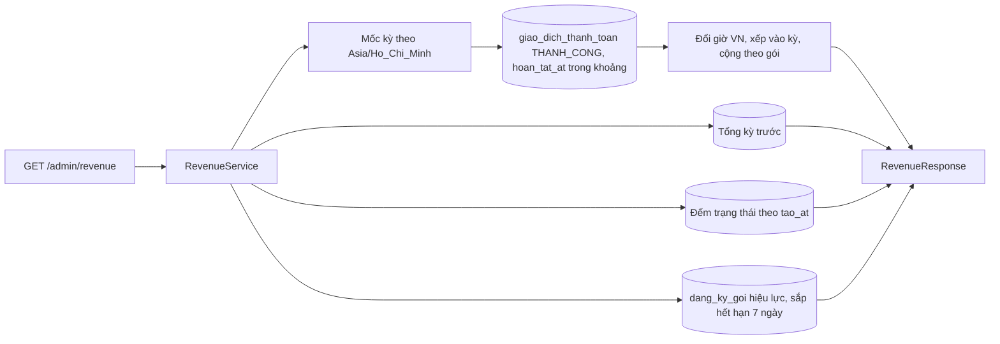

# B3.12c — Quản lý thanh toán và thống kê doanh thu (Admin)

FR-15, TC-23, TC-24 · Sprint S9 · Màn hình UI58 `/quan-tri/doanh-thu`, UI59 `/quan-tri/thanh-toan`. Migration `V23__billing_admin.sql`: nới ràng buộc `nhat_ky_quan_tri` (hành động `SUA_GOI_DICH_VU`, `SUA_HAN_GOI`, `CHAY_KIEM_TRA_HET_HAN`; đối tượng `GOI_DICH_VU`, `DANG_KY_GOI`) và 2 chỉ mục giao dịch. Seed demo `db/demo/R__seed_demo_billing.sql` chỉ nạp ở profile `demo`.

## Quyết định (16/11/2026)

| Mục | Chốt |
|---|---|
| Vị trí | `AdminBillingController` trong module `billing`, `@PreAuthorize("hasRole('ADMIN')")`; `/admin/**` vốn không qua `SubscriptionGuard` |
| Lọc giao dịch | `tuNgay`, `denNgay` (ngày theo `Asia/Ho_Chi_Minh`, gồm cả hai đầu) lọc theo `tao_at`; `email` khớp một phần, không phân biệt hoa thường; mới nhất trước |
| Chi tiết giao dịch | `duLieuCong` = tham số cổng trả về, bỏ `vnp_SecureHash`, `vnp_SecureHashType`; cổng không gửi số thẻ nên không có trường thẻ |
| Gói của người dùng | `sapHetHan=N` (1–365) → chỉ `HIEU_LUC` có `now < het_han_at ≤ now + N ngày`, sắp xếp hết hạn sớm trước; `soNgayConLai` theo múi giờ User |
| Cấu hình gói | `GET /admin/plans` gồm cả gói ngừng bán + `soDangKyHieuLuc`; `PUT /admin/plans/{ma}` thay toàn bộ (`gioiHanThe` bỏ trống = không giới hạn), `version` cũ → 409, phải còn ít nhất một gói đang bán, `lyDo` tùy chọn; ghi `SUA_GOI_DICH_VU` chỉ các trường đổi. Hạn mức ngày AI/ảnh/TTS/phát âm sửa ở B3.11 (`/admin/service-quotas`) |
| Doanh thu | Chỉ `THANH_CONG`, gom theo `hoan_tat_at` đổi sang múi giờ kinh doanh; tính bằng Java trên các dòng trong khoảng (đúng ranh giới múi giờ); kỳ trống = 0; `theoGoi` có đủ mã gói theo giá tăng dần |
| So với kỳ trước | `THANG`/`QUY`: cả năm trước; `NAM`: khoảng năm cùng độ dài liền trước; phần trăm làm tròn 1 chữ số, `null` khi kỳ trước = 0 |
| Tỷ lệ thành công | Phần trăm (0–100, 1 chữ số) = `THANH_CONG / (THANH_CONG + THAT_BAI + HET_HAN)` theo `tao_at` trong khoảng; đơn đang chờ không tính; `null` khi không có đơn kết thúc |
| Kỳ `NAM` | Mặc định 5 năm gần nhất kết thúc ở năm nay; tối đa 20 năm |
| Công cụ demo | Bật bằng `app.billing.demo-tools` (mặc định `false`; dev và test `true`, biến `BILLING_DEMO_TOOLS`); tắt → 404. Sửa hạn chỉ cho gói `HIEU_LUC`, hạn mới phải sau `bat_dau_at`, có `version`; chạy ngay gọi `SubscriptionExpiryService.run(now)` của B3.12b. Lý do 10–500 ký tự bắt buộc, ghi nhật ký |
| Seed demo | 160 đơn `DEMO-0000…0159` (Fake, cho `an`/`binh`/`chi`) trải 01/2025–09/2026: 138 thành công, 13 thất bại, 9 hết hạn. Chạy: `SPRING_PROFILES_ACTIVE=dev,demo` |

## API

| Method / path | Request | Response |
|---|---|---|
| `GET /api/v1/admin/payments` | `trangThai?`, `goiMa?`, `tuNgay?`, `denNgay?` (yyyy-MM-dd), `email?`, `page`, `size` (20, ≤ 100) | `PageResponse<{maDon, nguoiDungId, email, goiMa, tenGoi, chuKy, soTien, cong, trangThai, maGiaoDichCong, maPhanHoi, taoAt, hoanTatAt}>` |
| `GET /api/v1/admin/payments/{maDon}` | – | `{giaoDich: {…như trên}, duLieuCong: {vnp_…}}`; 404 |
| `GET /api/v1/admin/subscriptions` | `trangThai?`, `goiMa?`, `email?`, `sapHetHan?`, `page`, `size` | `PageResponse<{id, nguoiDungId, email, tenHienThi, goiMa, tenGoi, batDauAt, hetHanAt, trangThai, soNgayConLai, version}>` |
| `GET /api/v1/admin/plans` | – | `[{ma, ten, giaThang, giaNam, gioiHanThe, phatAm, boMauCaoCap, hoatDong, soDangKyHieuLuc, version}]` |
| `PUT /api/v1/admin/plans/{ma}` | `{ten, giaThang, giaNam, gioiHanThe?, phatAm, boMauCaoCap, hoatDong, lyDo?, version}` | như phần tử trên; 400, 404, 409, 422 |
| `GET /api/v1/admin/revenue` | `ky=THANG\|QUY\|NAM`, `nam?` hoặc `tuNam?`, `denNam?` | `{ky, nam, tuNam, denNam, tongDoanhThu, soGiaoDich, soVoiKyTruocPhanTram, cacKy: [{nhan, tuNgay, denNgay, doanhThu, soGiaoDich, theoGoi}], tongQuan: {soGoiHieuLuc, soSapHetHan7Ngay, tyLeThanhCong}}` |
| `PATCH /api/v1/admin/subscriptions/{id}/expiry` | `{hetHanAt, lyDo, version}` | đăng ký sau khi sửa; 400, 404 (cả khi tắt công cụ), 409, 422 |
| `POST /api/v1/admin/subscriptions/expiry-check` | `{lyDo}` | `{soNhacSapHetHan, soChuyenHetHan, soDonHetHan}` |

## Luồng doanh thu

## Kiểm chứng

- `FR15AdminBillingTest` 4/4 (16/11/2026): TC-24 đơn 31/03/2031 23:30 giờ VN vào tháng 3/quý 1, 01/04 00:30 vào tháng 4/quý 2, 31/12 23:59:59 vào năm 2031, 01/01/2032 00:00 sang năm sau; tổng 12 tháng = 4 quý = năm 2031 = 10.588.000; so với 2030 = 959,9%; tỷ lệ thành công 75,0% (đơn chờ không tính); năm không có dữ liệu → 0 và `null`; khoảng năm ngược → 400; User → 403. TC-23 lọc `sapHetHan=7`, sửa hạn (thiếu lý do 400, sai `version` 409), rút hạn về quá khứ rồi chạy ngay → `HET_HAN` + 1 `GOI_DA_HET_HAN`, 3 dòng nhật ký, sửa gói đã hết hạn → 422. Giao dịch lọc email/trạng thái/gói/ngày, chi tiết ẩn chữ ký. Sửa gói: `version` cũ 409, giá 0 → 400, nhật ký chỉ trường đổi, mã lạ 404.
- Toàn bộ `mvnw test` 534/534 pass (16/11/2026).
- Seed demo chạy thử trên DB dev trong transaction rồi rollback (16/11/2026): 160 dòng đúng phân bố trạng thái.
- HTTP thật trên dev 16/11/2026: 6 API đọc/sửa gói đúng (200, 400, 409, 403); nhánh `demo-tools=false` trả 404 "Công cụ demo đang tắt" cho `PATCH .../expiry` và `expiry-check`.
- Mockup 16/11/2026: UI58 `mockups/dot3/quan-ly-thong-ke.html` đọc `GET /admin/revenue` (tháng/quý/năm, khoảng năm ngược → 400 `yearRangeValid`, `soVoiKyTruocPhanTram`/`tyLeThanhCong` `null` → "Chưa có cơ sở"/"—"); UI59 `mockups/dot3/quan-ly-thanh-toan.html` đọc `GET /admin/payments` (lọc email/trạng thái/gói/ngày, khoảng ngày ngược → 400 `rangeValid`), chi tiết kèm `duLieuCong`, `GET /admin/subscriptions` (`sapHetHan=7`), `GET/PUT /admin/plans` (400, 409 tải lại), `PATCH .../expiry` và `expiry-check` (404 "Công cụ demo đang tắt" → ẩn khối). Route demo cùng quy tắc trong `mockups/shared/demo.js`; preview 1280 và 390 px không cuộn ngang, console sạch.
- Chưa: nhánh `demo-tools=true` qua HTTP, chạy thật profile `demo`. Postman đã đồng bộ 16/11/2026.
