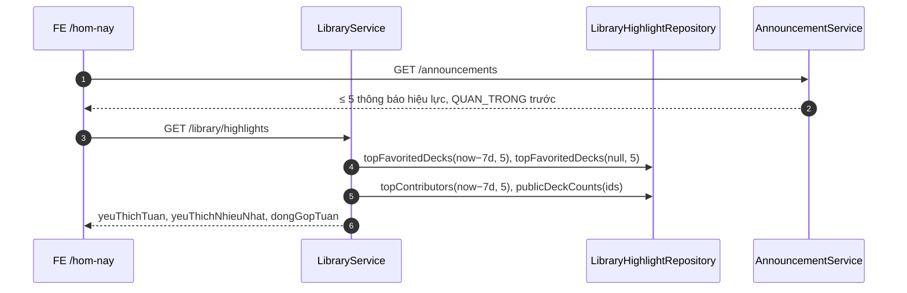

# B3.13 — Điểm nổi bật bảng điều khiển và thông báo hệ thống

FR-04, FR-12, FR-13 · yêu cầu 20/11/2026 · UI12 `/hom-nay`, UI52 `/quan-tri/thong-bao` (khôi phục gọn). Migration `V27__dashboard_highlights.sql`.

## Thành phần

| Thành phần | Vai trò |
|---|---|
| `LibraryHighlightController` | `GET /api/v1/library/highlights`, cho guest (nằm dưới `/library/**`) |
| `LibraryService.highlights` | Cửa sổ `[now − 7 ngày, now]` theo `Clock`; ghép bộ, tên tác giả, số thẻ bằng `responder` dùng chung với danh sách thư viện |
| `LibraryHighlightRepository` | 3 truy vấn SQL gốc: top bộ theo lượt thích (có/không cửa sổ), top người đóng góp, số bộ công khai của từng người |
| `AnnouncementController` | `GET /api/v1/announcements` (đăng nhập) |
| `AdminAnnouncementController` | CRUD `/api/v1/admin/announcements` (ADMIN) |
| `AnnouncementService` | Kiểm khoảng hiệu lực, `version`, ghi `AuditService` |
| `ThongBaoHeThong` | Bảng `thong_bao_he_thong` |

## Luồng

## Quy tắc

1. **Bộ hiển thị:** `xoa_at IS NULL`, `CONG_KHAI`, `BINH_THUONG` (như `LibraryDeckSpecifications.publiclyVisible`).
2. **Lượt yêu thích:** đếm `bo_yeu_thich`, bỏ dòng chủ bộ tự thích. Tuần = `created_at >= now − 7 ngày`; mọi lúc = không lọc ngày. Sắp `soYeuThich desc, id desc`, lấy 5.
3. **Đóng góp tuần:** cộng lượt thích mới (quy tắc 2) và lượt sao chép mới (`bo_the.bo_nguon_id`, người sao chép khác chủ bộ) trên bộ công khai không phải bộ mẫu; chủ bộ phải `HOAT_DONG`. Sắp theo tổng, rồi lượt thích, rồi id; lấy 5. `soBoCongKhai` = số bộ hiển thị không phải bộ mẫu của người đó.
4. **Thông báo hiệu lực:** `hienThi = true`, `batDauAt <= now`, `ketThucAt` null hoặc `> now`; lấy 5 mới nhất theo `batDauAt`, sau đó xếp `QUAN_TRONG` lên trước. Không gửi email, không ghi `thong_bao`.
5. **Ghi Admin:** `ketThucAt <= batDauAt` → 400 `ketThucAt`; `lienKet` phải bắt đầu bằng `/` và không phải `//` → 400 `lienKet`; `PUT` thiếu `version` → 400, lệch → 409; không có → 404. Tạo/sửa (khi có thay đổi)/xóa ghi `nhat_ky_quan_tri` (`TAO_THONG_BAO`, `SUA_THONG_BAO`, `XOA_THONG_BAO`, đối tượng `THONG_BAO_HE_THONG`). Xóa là xóa cứng; muốn tạm ẩn dùng `hienThi = false`.

## Quyết định

| Chủ đề | Lựa chọn | Ghi chú |
|---|---|---|
| "Tuần" | 7 ngày lăn, không theo tuần lịch | Không phụ thuộc múi giờ người xem |
| Bộ mẫu trong "Đóng góp" | Loại | Bộ mẫu do Admin tạo, sẽ luôn đứng đầu |
| Ẩn thông báo phía người học | `localStorage` trên FE | Không thêm bảng trạng thái đọc |
