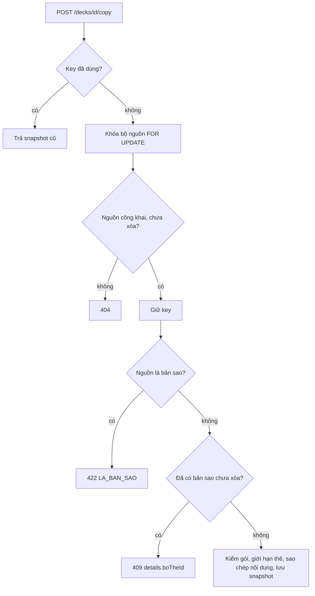
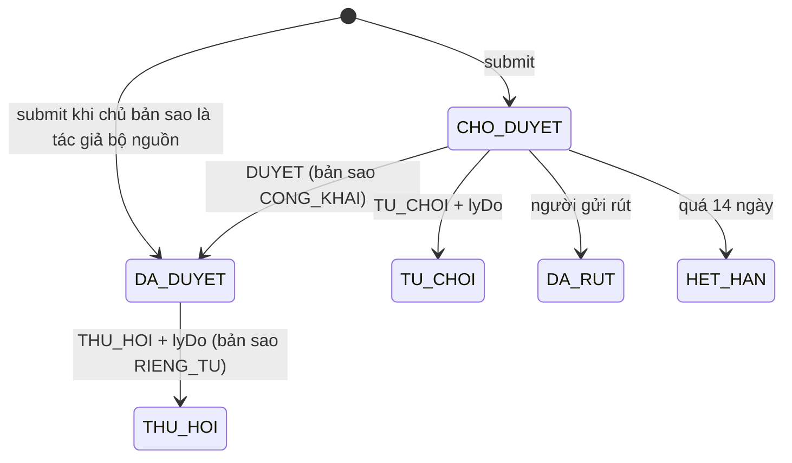

# B3.14 — Giới hạn sao chép và duyệt công khai bản sao

Phạm vi: FR-04, TC-25, TK §6.2a (chốt 21/11/2026). Migration `V29__publish_requests.sql`. Module `content`.

## API

| Method / path | Quyền | Request | Response |
|---|---|---|---|
| `POST /api/v1/decks/{id}/copy` | Đăng nhập | không body, `Idempotency-Key` | 201 `DeckResponse` (thêm `banSao`, `yeuCauCongKhai = null`); 409 `details.boTheId` khi đã có bản sao chưa xóa; 422 `details {lyDo: LA_BAN_SAO, boGocId}` khi nguồn là bản sao |
| `PATCH /api/v1/decks/{id}` | Chủ bộ | như cũ | 422 `details.lyDo = CAN_DUYET_CONG_KHAI` khi đổi bản sao từ riêng tư sang `CONG_KHAI` |
| `POST /api/v1/decks/{id}/publish-requests` | Chủ bản sao | `{loiNhan?}` ≤ 500, có thể bỏ body | 201 `DeckPublishStatusResponse` |
| `DELETE /api/v1/publish-requests/{id}` | Người gửi | — | 200 `DeckPublishStatusResponse` (`DA_RUT`); 409 khi đã xử lý; người khác 404 |
| `GET /api/v1/me/publish-requests` | Tác giả bộ nguồn | `?trangThai&page&size` (mặc định 0/20, tối đa 100) | `PageResponse<PublishRequestResponse>` |
| `POST /api/v1/publish-requests/{id}/decision` | Tác giả bộ nguồn (khi người duyệt hiện tại là `TAC_GIA`) | `{quyetDinh: DUYET|TU_CHOI|THU_HOI, lyDo?, version}` | 200 `PublishRequestResponse` |
| `GET /api/v1/publish-requests/{id}/cards`, `GET /api/v1/admin/publish-requests/{id}/cards` | Người duyệt hiện tại (như `decision`) | `?page&size` (mặc định 0/20, tối đa 100) | `PageResponse<LibraryCardResponse>` của bản sao (thẻ chưa xóa, cũ trước); bản sao còn riêng tư nên FE chỉ hiện chữ, không tải media. Bổ sung 21/11/2026 khi làm FE: người duyệt cần xem nội dung trước khi quyết định |
| `GET /api/v1/admin/publish-requests` | ADMIN | như `/me/publish-requests` | `PageResponse<PublishRequestResponse>` |
| `POST /api/v1/admin/publish-requests/{id}/decision` | ADMIN (khi người duyệt hiện tại là `ADMIN`) | như trên | 200, ghi `nhat_ky_quan_tri` |

DTO:

- `banSao` (trong `DeckResponse`, `LibraryDeckResponse`): `null` hoặc `{boGocId, boGocTen, tacGiaGoc, boGocXemDuoc}`. Khi bộ gốc đã xóa, riêng tư hoặc bị ẩn: `boGocXemDuoc = false`, tên và tác giả là `null`.
- `DeckPublishStatusResponse` (`DeckResponse.yeuCauCongKhai`, yêu cầu gần nhất): `{id, nguoiDuyet, trangThai, loiNhan, lyDo, hetHanAt, xuLyAt, guiLaiSauAt, createdAt, version}`. `guiLaiSauAt` = `xuLyAt + 24h` khi `TU_CHOI`/`THU_HOI`, ngược lại `null`.
- `PublishRequestResponse`: `{id, boTheId, tenBoThe, boNguonId, tenBoNguon, nguoiGuiId, tenNguoiGui, nguoiDuyet, trangThai, loiNhan, lyDo, hetHanAt, xuLyAt, createdAt, version}`.

## Luồng sao chép

Khóa ghi bộ nguồn ngay từ đầu (trước là khóa đọc) để hai yêu cầu song song khác key không cùng tạo bản sao và không deadlock khi nâng khóa. Không thêm unique DB vì dữ liệu cũ có thể đã trùng.

## Luồng yêu cầu công khai

- `submit`: khóa bản sao của người gọi. Từ chối khi bộ không phải bản sao (`KHONG_PHAI_BAN_SAO`), đã công khai (`DA_CONG_KHAI`), bị ẩn (`DA_AN`), bộ nguồn `cao_cap` (`BO_CAO_CAP`); 409 khi đang có yêu cầu chờ (cột sinh `cho_duyet_bo_id` + unique chặn race); 422 `CHO_GUI_LAI` kèm `guiLaiSauAt` trong 24 giờ sau từ chối/thu hồi.
- Người duyệt hiện tại: `TAC_GIA` khi bộ nguồn không phải bộ mẫu, chưa xóa, `CONG_KHAI` + `BINH_THUONG` và tác giả `HOAT_DONG`; còn lại `ADMIN`. Xét lại mỗi lần đọc hàng đợi và ra quyết định; cột `nguoi_duyet` chỉ lưu giá trị lúc tạo. Gọi sai đường (tác giả gọi khi đã chuyển Admin, Admin gọi khi thuộc tác giả, người khác) → 404.
- `decision`: khóa yêu cầu và bản sao; `version` lệch → 409 `VERSION_CONFLICT`; `DUYET`/`TU_CHOI` chỉ khi `CHO_DUYET` (khác → 409); `THU_HOI` chỉ với yêu cầu `DA_DUYET` gần nhất của bản sao; bản sao đã xóa hoặc bị ẩn không duyệt được.
- Hết hạn: `PublishRequestExpiryWorker` mỗi giờ (`app.publish-requests.expiry-job.*`, tắt ở hồ sơ test), cộng chuyển khi đọc hàng đợi, khi gửi, rút và ra quyết định.
- Thông báo trong ứng dụng, không email: `YEU_CAU_CONG_KHAI` cho tác giả (Admin không nhận, xem hàng đợi), `KET_QUA_CONG_KHAI` cho người gửi khi duyệt, từ chối, thu hồi, hết hạn. Hai loại này lưu `ngay_dia_phuong = NULL` nên không vướng unique một thông báo/ngày của nhắc học.

## Dữ liệu

- `yeu_cau_cong_khai` (V29): FK tới `bo_the` (bản sao, bộ nguồn) và `nguoi_dung` (người gửi, người xử lý). Index `(bo_the_id, id)`, `(bo_nguon_id, trang_thai, created_at)`, `(trang_thai, het_han_at)`.
- V29 tạo yêu cầu `DA_DUYET` cho mỗi bản sao đang công khai, `ly_do = 'Dữ liệu trước 21/11/2026'`.
- `thong_bao.ngay_dia_phuong` nullable; CHECK loại thêm 2 giá trị. CHECK `nhat_ky_quan_tri.hanh_dong` thêm `DUYET_CONG_KHAI`, `TU_CHOI_CONG_KHAI`, `THU_HOI_CONG_KHAI` (đối tượng `BO_THE` = bản sao).
- Xóa tài khoản (B3.10): `AccountDataEraser` xóa yêu cầu gắn với bộ bị xóa cứng (bản sao hoặc bộ nguồn) trước khi xóa bộ.

## Kiểm chứng (21/11/2026)

- `FR04PublishRequestTest` 8/8 pass (TC-25): một bản sao, xóa rồi sao chép lại; hai yêu cầu song song khác key; bản sao của bản sao; PATCH công khai; duyệt → thu hồi → chờ 24 giờ; rút và từ chối; bộ mẫu do Admin duyệt (nhật ký), bộ mẫu cao cấp 422; tác giả bị khóa → Admin; hết hạn và thông báo.
- Hồi quy pass: `FR04DeckCopyTest` 22 (sửa ca khóa phân biệt hoa thường: lần thứ hai 409), `FR03DeckTest`, `FR04Library*`, `FR13AdminTest`, `FR15EntitlementTest`, `FR12NotificationTest`, `FR14AccountDeletionTest` (fixture dùng người dùng thứ ba cho bản sao thứ hai).
- Toàn bộ `mvnw test` 566/566 pass (21/11/2026, trước khi thêm API xem thẻ); sau khi thêm, `FR04PublishRequestTest` (thêm kiểm tra tác giả xem thẻ 200, người lạ 404) + `FR04LibraryTest` 27/27 pass.
- Trình duyệt 21/11/2026 (BE 8080 profile `dev`, FE 3000): `an@vocab.local` sao chép bộ 84 → 201; tải lại và sao chép lần nữa → thông báo 409 "Bạn đã có bản sao" + nút mở bản sao; bộ 199 có huy hiệu và link gốc; form sửa bộ khóa ô "Công khai"; gửi yêu cầu → "Chờ duyệt". Bản sao bộ mẫu 194: `admin@vocab.local` thấy ở `/quan-tri/duyet-cong-khai`, xem thẻ, từ chối thiếu lý do báo lỗi dưới ô, duyệt → bản sao hiện trong thư viện (375 px không cuộn ngang, nút "Xem bộ gốc"), rồi thu hồi kèm lý do. Console chỉ có 409/401 đúng kịch bản. Chưa thử UI60 với tác giả thật (tác giả bộ 84 là tài khoản cá nhân); UI60 dùng chung component với UI61.
- Chưa: Postman, mockup.
