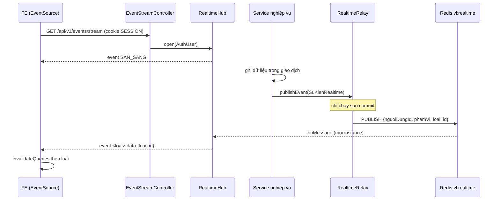

# B3.19 — Cập nhật thời gian thực bằng SSE (giai đoạn 1)

Yêu cầu ngày 22/11/2026. Mục tiêu: các mục người dùng đang chờ (thông báo, khóa tài khoản, gói, thanh toán, yêu cầu AI, hàng chờ quản trị) cập nhật ngay, thay cho việc hỏi lại máy chủ dày đặc. Polling vẫn giữ làm dự phòng nhưng giãn ra.

## Quyết định

| Vấn đề | Chọn | Lý do |
|---|---|---|
| Công nghệ | SSE (`SseEmitter`), không dùng WebSocket | Dữ liệu chỉ đi một chiều từ máy chủ xuống; chạy trên HTTP thường; ít mã hơn |
| Xác thực | Cookie phiên `SESSION` như mọi API | FE gọi qua proxy Next cùng origin nên `EventSource` gửi được cookie; không cần vé ngắn hạn |
| Nhiều instance | Redis pub/sub kênh `vl:realtime` | Instance nào phát sự kiện cũng tới được kết nối đang mở ở instance khác |
| Thời điểm phát | `@TransactionalEventListener(AFTER_COMMIT, fallbackExecution = true)` + `@Async` | Không gửi sự kiện cho dữ liệu bị rollback; không gọi mạng trong giao dịch |
| Nội dung | `{loai, id}` | FE chỉ dùng để biết cần tải lại dữ liệu nào; không đẩy dữ liệu nhạy cảm qua luồng |
| Gói dịch vụ | `/api/v1/events/**` nằm ngoài `SubscriptionGuard` | Người chưa có gói vẫn phải nhận kết quả thanh toán và đổi gói |

## API

- `GET /api/v1/events/stream` (cần đăng nhập; chưa đăng nhập → 401). Trả `text/event-stream`, header `Cache-Control: no-cache, no-transform`, `X-Accel-Buffering: no`. Sự kiện đầu `SAN_SANG` với `retry: 5000`. Mỗi 25 giây gửi comment `ping`. Kết nối tự đóng sau 15 phút, trình duyệt tự nối lại.
- `GET /api/v1/admin/dashboard/queue` (ADMIN; người học → 403). Trả khối `canXuLy` của sổ trực ban: `congKhaiChoDuyet`, `congKhaiCuNhatAt`, `baoCaoChoXuLy`, `thueBaoSapHetHan`, `giaoDichTreo`, `chuaXacThucQua48h`, `tacVuLoi24h`. Dùng cho số đếm ở menu quản trị.

## Loại sự kiện

| `loai` | Gửi tới | Phát khi | `id` |
|---|---|---|---|
| `THONG_BAO_MOI` | Người nhận | `NotificationService.create` chèn được thông báo hiển thị | rỗng |
| `THONG_BAO_HE_THONG` | Mọi kết nối | Admin tạo, sửa (có thay đổi) hoặc xóa thông báo hệ thống | rỗng |
| `TAI_KHOAN_BI_KHOA` | Người bị khóa | `AdminUserService.changeStatus` sang `BI_KHOA`, sau khi thu hồi phiên; máy chủ đóng luồng ngay sau khi gửi | rỗng |
| `GOI_THAY_DOI` | Chủ gói | `EntitlementService.activate`, hủy gói, Admin sửa hạn, tác vụ chuyển gói sang `HET_HAN` | rỗng |
| `THANH_TOAN` | Chủ đơn | `PaymentConfirmationService.confirm` ghi `THANH_CONG`, `THAT_BAI` hoặc `HET_HAN` | `maDon` |
| `YEU_CAU_AI` | Người gửi | `AiRequestFinisher.finish` (sinh thẻ, giải thích, chấm câu, ảnh thẻ) | `yeuCauId` |
| `HANG_CHO_QUAN_TRI` | Kết nối có vai trò ADMIN | Gửi, rút, quyết định, hết hạn yêu cầu công khai; tạo báo cáo; xử lý báo cáo | rỗng |

Chấm phát âm chạy đồng bộ (trả kết quả ngay trong `POST`) nên không cần sự kiện.

## Luồng

## Nhánh lỗi

- Redis lỗi khi phát: ghi `warn`, nghiệp vụ không bị ảnh hưởng; FE vẫn nhận dữ liệu qua polling dự phòng.
- Gửi tới kết nối đã đóng (`IOException`, `IllegalStateException`): bỏ kết nối khỏi danh sách.
- Phiên hết hạn hoặc bị thu hồi: lần nối lại nhận 401, `EventSource` dừng. Kết nối đang mở tự hết sau tối đa 15 phút. Sự kiện chỉ chứa `{loai, id}` nên không lộ dữ liệu.
- Async dispatch của SSE được `permitAll` theo `DispatcherType.ASYNC`; quyền đã kiểm ở request gốc.

## FE

- `src/lib/realtime.mjs`: bảng `loai` → query key cần `invalidateQueries`.
- `src/hooks/useEventStream.js`: mở `EventSource` khi đã đăng nhập, gắn ở `AppShell` và `AdminShell`. `THONG_BAO_MOI` bật toast; `TAI_KHOAN_BI_KHOA` xóa cache và chuyển về `/dang-nhap`.
- `AdminShell`: số đếm menu lấy từ `GET /admin/dashboard/queue` (key `admin-queue`), thêm số giao dịch treo ở mục "Thanh toán và gói".
- Polling dự phòng: chuông 60 giây → 5 phút, sổ trực ban 60 giây → 5 phút, yêu cầu AI 1,5 giây → 5 giây, kết quả thanh toán 3 giây → 10 giây, lịch sử AI 15/30 giây → 2 phút.

## Kiểm chứng

- `FR12RealtimeTest` 4/4 (TC-26): rollback không phát sự kiện; 401 khi chưa đăng nhập, `SAN_SANG`; sự kiện chỉ tới đúng người, Admin và mọi người; khóa tài khoản qua API đẩy `TAI_KHOAN_BI_KHOA`; `/admin/dashboard/queue` 403/200.
- `FR15BillingTest.tc22_noPlanBlocksLearningButKeepsAllowedRoutes`: người chưa có gói vẫn mở được luồng.
- HTTP thật qua proxy Next (`next start` 3002 → BE 8081): sự kiện tới ngay, proxy không giữ đệm; trình duyệt thật cập nhật banner thông báo không cần tải lại trang. Lưu ý khi chạy FE khác cổng 3000: BE phải đặt `APP_FRONTENDURL` đúng origin, nếu không CORS chặn đăng nhập (403).
- Postman: "Luồng sự kiện realtime SSE" (engagement), "Số việc chờ cho menu quản trị" (admin).

## Giai đoạn 2 (B3.20)

Yêu cầu ngày 22/11/2026. Cùng luồng và cùng định dạng `{loai, id}`; không có API mới.

| `loai` | Gửi tới | Phát khi | `id` |
|---|---|---|---|
| `MUC_DA_XU_LY` | ADMIN, trừ người xử lý | `PublishRequestService.decide` khi Admin quyết định; `AdminReportService.resolve` cho mọi báo cáo được đóng | `CONG_KHAI:<id>`, `BAO_CAO:<id>` |
| `SU_CO_HE_THONG` | ADMIN | `SystemHealthMonitor` thấy CSDL hoặc Redis đổi trạng thái; `JobWorker` chuyển tác vụ sang `LOI`/`KHONG_XAC_DINH` | `CSDL:DOWN`, `REDIS:UP`, `TAC_VU:<id>` |
| `PHIEN_HOC_MOI` | Chủ phiên | `StudySessionService.create` | id phiên |

- Loại người xử lý: `RealtimeService.toOtherAdmins(nguoiXuLyId, …)` đặt `nguoiDungId` của sự kiện phạm vi `QUAN_TRI` là người xử lý; `RealtimeHub` bỏ qua kết nối của người đó.
- `SystemHealthMonitor` chạy mỗi 30 giây (`app.realtime.health-interval-ms`) ở từng instance. Lần kiểm đầu nếu UP thì không báo. Sự kiện CSDL/Redis gửi thẳng tới kết nối của instance (`RealtimeHub.dispatch`), không qua Redis, vì Redis có thể đang là thành phần lỗi. Sự kiện tác vụ lỗi đi qua Redis như các sự kiện khác.
- Bảng xếp hạng không đẩy realtime: hạng tính theo tuần, tính lại sau mỗi lượt ôn quá tốn. Tải lại khi quay lại tab đã có (mặc định `refetchOnWindowFocus`).

FE: `useEventStream` phát `CustomEvent('vl:realtime')`; trang dùng `useRealtimeEvent(loai, handler)`. Trang báo cáo và duyệt công khai đóng mục đang mở khi Admin khác xử lý; `/hoc-phien` báo khi một phiên khác vừa mở; toast sự cố cho Admin (tác vụ lỗi tối đa 1 lần mỗi phút).

Kiểm chứng: `FR12RealtimeTest` 6/6, gồm `tc26_handledItemReachesOtherAdminsButNotTheActor` và `tc26_healthChangesAlertAdminsOnlyOnTransition`. FE `tests/realtime.test.mjs` 5/5. **Trình duyệt thật 22/11/2026:** BE dev 8081 + FE `next start` 3003 (proxy Next), tài khoản thử `rt*@test.local`. Admin 1 mở báo cáo #5, Admin 2 xử lý qua API → ngăn kéo của Admin 1 tự đóng, hiện báo vàng, danh sách tự tải lại. Đang học phiên 29, mở phiên 31 từ thiết bị khác → báo phiên học khác. Chèn tác vụ nền loại lạ → worker đánh `LOI`/`CHUA_DANG_KY`, Admin thấy toast "Có tác vụ nền vừa lỗi", sổ trực ban tự tải lại. Không thử dừng Redis/CSDL thật (sẽ làm gián đoạn BE dev khác); nhánh này có trong `FR12RealtimeTest`. Đã xóa tác vụ thử và gỡ quyền ADMIN tạm.
