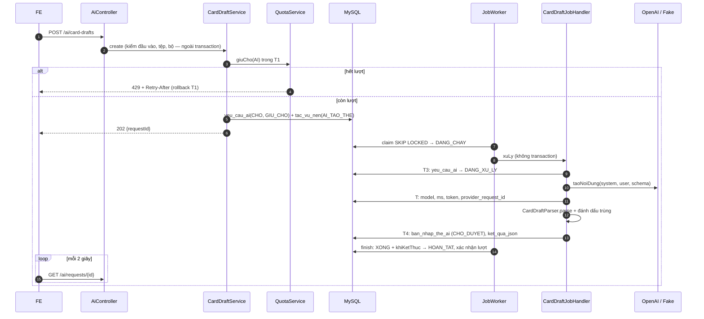
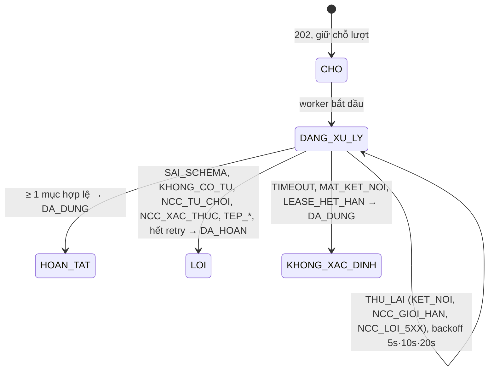
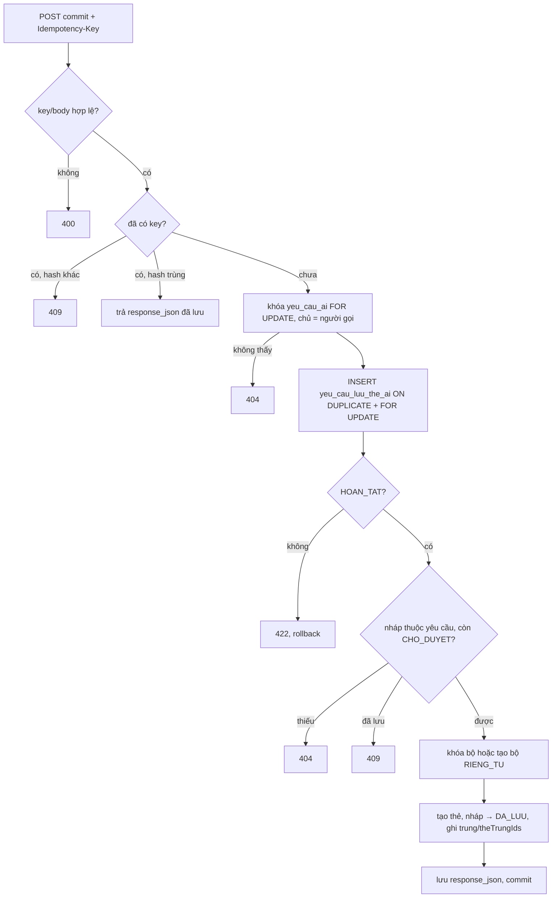

# B3.2 — Adapter AI và tạo thẻ từ đoạn văn

FR-09, TC-12, TC-13 · Sprint S7 · Màn hình UI29 `/ai/xuong-the` (F3.1) · Migration `V18__ai_card_drafts.sql` · Bổ sung X-01 (tệp `.docx`), X-02 (lưu vào bộ mới). Ngoài phạm vi: `POST /ai/context-explanations` (X-03), `POST /ai/card-images` (X-04), `GET /ai/history`, `GET /me/service-quota` (B3.3).

## API

| Method / path | Quyền | Request | Response |
|---|---|---|---|
| `POST /api/v1/ai/card-drafts` | Đăng nhập + CSRF | `{doanVan?, tepId?, boTheId?}`: đúng một trong `doanVan` (≤ `app.ai.card-draft.max-ky-tu` = 5.000 ký tự) và `tepId` (tệp `TAI_LIEU` của chính mình, đã hoàn tất, ≤ 1 MB); `boTheId` tùy chọn (bộ của mình) để đánh dấu trùng | **202** `{requestId, trangThai:"CHO"}` + header `Location: /api/v1/ai/requests/{id}` |
| `GET /api/v1/ai/requests/{id}` | Đăng nhập, chủ yêu cầu | – | 200 `{id, loai, trangThai, maLoi, moPhong, nhaCungCap, model, phienBanPrompt, createdAt, banNhap[]}`; `banNhap` rỗng cho tới khi `HOAN_TAT` |
| `POST /api/v1/ai/card-drafts/{id}/commit` | Đăng nhập + CSRF, chủ yêu cầu | header `Idempotency-Key` (1–128 ký tự `[A-Za-z0-9._:-]`); `{banNhapIds[1..50], boTheId?, tenBoMoi?, sua?}` đúng một trong hai đích; `sua?: [{banNhapId, tu, tuLoai, nghiaVi, viDuEn, dichVi}]` (tùy chọn, chỉ cho thẻ đang chọn, cùng quy tắc an toàn với parser, tính vào hash idempotency) | 200 `{yeuCauId, boTheId, boMoi, soTheDaLuu, ketQua[{banNhapId, theId, trung, theTrungIds}]}` |

`banNhap[i]` = `{id, thuTu, tu, tuLoai, nghiaVi, viDuEn, dichVi, trung, theTrungId, trangThaiDuyet, theDaLuuId}`. `requestId` của body 202 là id `yeu_cau_ai`, khác `requestId` trong body lỗi (mã truy vết).

| Lỗi | Khi nào |
|---|---|
| 400 `VALIDATION_FAILED` | Thiếu hoặc gửi cả `doanVan` và `tepId`; đoạn văn quá dài; ID sai định dạng; thiếu/sai `Idempotency-Key`; `banNhapIds` rỗng, > 50 hoặc trùng; không chọn hoặc chọn cả `boTheId` và `tenBoMoi`; `sua` sai nội dung hoặc sửa thẻ không được chọn |
| 401 / 403 | Chưa đăng nhập / thiếu CSRF |
| 404 `NOT_FOUND` | Yêu cầu, bộ, tệp hoặc thẻ nháp không thuộc người gọi (kể cả bộ công khai của người khác) |
| 409 `CONFLICT` | Cùng `Idempotency-Key` khác body; thẻ nháp đã lưu bằng key khác |
| 422 `BUSINESS_RULE` | Tệp không phải `TAI_LIEU` hoặc chưa tải xong; commit khi yêu cầu chưa `HOAN_TAT` |
| 429 `RATE_LIMITED` + `Retry-After` | Hết lượt `AI` trong ngày (B3.1) |

## Thành phần

| Thành phần | Vai trò |
|---|---|
| `ai/client`: `AiClient`, `OpenAiClient`, `FakeAiClient`, `AiRequest`, `AiResponse` | Cổng gọi mô hình. Chọn bằng `app.ai.provider` (`openai`/`fake`, mặc định `fake`) |
| `ai/config`: `AiProperties`, `AiConfig` | Mọi ngưỡng `app.ai.*`; `RestClient` OpenAI (JDK HttpClient, connect 5 s, read 60 s); thiếu `OPENAI_API_KEY` khi `provider=openai` → không khởi động |
| `ai/service/CardDraftPrompt` | Prompt `card-draft-v1` + JSON schema strict; phiên bản trong yaml khác phiên bản code → không khởi động |
| `ai/service/CardDraftParser` | Kiểm lại đầu ra, bỏ mục sai, loại trùng trong nhóm |
| `ai/service/CardDraftJobHandler` | `JobHandler` loại `AI_TAO_THE`: `xuLy` ngoài transaction, `khiKetThuc` chốt trạng thái + hạn mức |
| `ai/service/CardDraftService`, `CardDraftCommitService`, `ai/controller/AiController` | 3 API |
| `ai/entity`: `YeuCauAi`, `BanNhapTheAi`; `ai/repository`: JPA + `CardDraftCommitRepository` (JDBC, giống CSV) | Dữ liệu |
| `content/service/CardDraftTargetService` | Module `ai` đi qua service này để kiểm bộ, tạo bộ `RIENG_TU`, tạo thẻ, lấy chỉ mục từ trùng |
| `content/service/FileService.requireDocument/readDocument`, `common/document/DocxTextReader`, `FileVerifier` | X-01: tải `.docx` qua luồng tệp B1.6, kiểm bằng POI khi `complete`, đọc chữ trong job |

## Luồng tạo và xử lý

| `ma_loi` | Kiểu | Lượt |
|---|---|---|
| `KET_NOI` (connect timeout, từ chối kết nối, không phân giải tên), `NCC_GIOI_HAN` (HTTP 429/408/409), `NCC_LOI_5XX`, `LUU_TRU` | `THU_LAI` → hết 3 lần thành `LOI` | hoàn khi `LOI` |
| `TIMEOUT` (đã gửi, hết read timeout), `MAT_KET_NOI` (đứt giữa chừng) | `KHONG_XAC_DINH` | giữ |
| `SAI_SCHEMA`, `KHONG_CO_TU`, `NCC_TU_CHOI_ND` (refusal), `NCC_TU_CHOI` (4xx khác), `NCC_XAC_THUC` (401/403) | `LOI` | hoàn |
| `TEP_KHONG_HOP_LE`, `TEP_RONG`, `TEP_QUA_DAI` (> 5.000 ký tự sau khi đọc `.docx`) | `LOI` | hoàn |
| `MO_PHONG_LOI`, `MO_PHONG_TAM_THOI` (Fake) | `LOI` / `THU_LAI` | như trên |

`han_muc_trang_thai` chỉ chuyển từ `GIU_CHO` một lần (`YeuCauAi.chotHanMuc`), nên xác nhận/hoàn trả không lặp kể cả khi `khiKetThuc` chạy lại.

## Chống prompt injection (TC-12)

1. System prompt là hằng số có phiên bản, không chứa dữ liệu User; đoạn văn nằm trong `<doan_van>…</doan_van>` ở message `user`; thẻ `doan_van` trong đoạn văn bị xóa trước khi bọc.
2. Không gửi `tools`; mô hình chỉ trả JSON nháp, không có quyền ghi.
3. `response_format: json_schema` strict, và `CardDraftParser` vẫn kiểm lại: `tu` 1–100 ký tự, ≤ 6 từ, chỉ chữ/khoảng trắng/`'`/`-`; `nghiaVi` 1–500, không chứa `< > { }` hay ký tự điều khiển; `tuLoai` thuộc danh sách; `viDuEn`/`dichVi` ≤ 300 (sai → `null`); khóa lạ bị bỏ qua; tối đa 50 mục.
4. Không có gì được lưu tự động; commit chỉ lưu `banNhapIds` của chính yêu cầu.

## Commit (TC-13)

- Thứ tự khóa luôn là `yeu_cau_ai` → `yeu_cau_luu_the_ai`, nên hai request cùng key bị tuần tự hóa và request sau replay; hai key khác nhau cùng nháp thì request sau gặp `DA_LUU` → 409.
- Nháp không chọn giữ `CHO_DUYET`, commit tiếp được bằng key mới.
- Thẻ trùng bộ đích vẫn được lưu nếu người dùng chọn; response trả `trung` + `theTrungIds`, không ghi đè thẻ cũ (X-02). Khóa so trùng = `tu` chuẩn hóa (NFC, gộp khoảng trắng, chữ thường).
- Bộ mới: `tenBoMoi` (≤ 150 ký tự), `trinhDo = CO_BAN`, `quyenTruyCap = RIENG_TU`, qua `DeckService.create` trong cùng transaction; lỗi sau đó làm rollback cả bộ mới.
- Thẻ tạo từ nháp: `doKho = 1`, `phienAm`, `nguon` null.
- `sua` (X-06): mỗi phần tử phải thuộc `banNhapIds`, không lặp; kiểm bằng `CardDraftParser.kiemTraSua` (cùng regex `tu`, ≤ 6 từ, cấm `< > { }`) + Bean Validation độ dài; nội dung sửa ghi vào thẻ mới và cập nhật `noi_dung_json` của nháp; các mục sửa (sắp theo id) nằm trong `request_hash`, nên cùng key khác nội dung sửa → 409.

## Cấu hình

| Khóa | Mặc định | Ghi chú |
|---|---|---|
| `app.ai.provider` | `${AI_PROVIDER:fake}` | `openai` cần `OPENAI_API_KEY` (biến môi trường hoặc `.env` máy, không ghi vào yaml/`.env.example`) |
| `app.ai.openai.*` | `base-url` OpenAI, `model` `${OPENAI_MODEL:gpt-4o-mini}`, `connect-timeout` 5s, `read-timeout` 60s, `max-output-tokens` 6000, `temperature` 0.2 | `read-timeout × app.jobs.batch-size` (60 s × 3) < `app.jobs.lease` (10 phút) |
| `app.ai.fake.*` | `che-do` `${AI_FAKE_MODE:THANH_CONG}`, `do-tre` 1s (test 0s) | Chế độ `THANH_CONG`, `LOI`, `TIMEOUT`, `THU_LAI`, `SAI_SCHEMA`, `INJECTION`; demo đổi từng yêu cầu bằng chuỗi `#mo-phong:<CHE_DO>` trong đoạn văn |
| `app.ai.card-draft.*` | `phien-ban-prompt` card-draft-v1, `max-ky-tu` 5000, `max-the` 50, `max-tep-bytes` 1048576, `max-tu-moi-the` 6 | Trần tải lên 1 MB của `TAI_LIEU` nằm trong enum `LoaiTep` như các loại tệp khác |

## X-01 tệp `.docx`

`.txt`/`.csv`: FE đọc ở trình duyệt rồi gửi như `doanVan`. `.docx`: `POST /files/upload-requests {loai:"TAI_LIEU", mimeType:"application/vnd.openxmlformats-officedocument.wordprocessingml.document", …}` → PUT lên URL ký → `POST /files/{id}/complete` (Tika nhận `x-tika-ooxml`/`zip`, coi là `.docx` rồi mở bằng POI; ZIP không phải Word → 422) → `POST /ai/card-drafts {tepId}`. Job đọc tệp (≤ 1 MB, POI có giới hạn chống zip bomb), quá 5.000 ký tự → `LOI` `TEP_QUA_DAI`, hoàn lượt.

## Kiểm chứng

Xem báo cáo [Sprint 3](../../ban-giao-cho%20fe/SPRINT_3_BAO_CAO_BE_BAN_GIAO_CHO_FE.md) mục 10. Test: `CardDraftParserTest` (14), `FakeAiClientTest` (8), `FR09CardDraftTest` (18). Chưa gọi OpenAI thật (chưa có khóa), chưa gọi HTTP thật trên dev.
