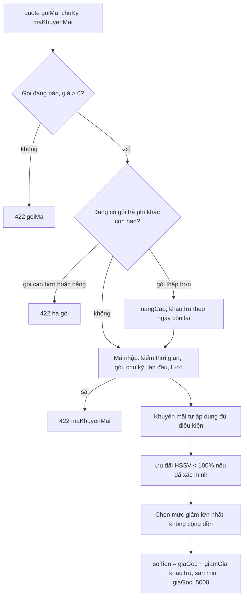

# B3.21 — Gói Free, dùng thử, khuyến mãi, ưu đãi HSSV, nâng cấp giữa kỳ

FR-15, TC-21, TC-22, TC-27. Quyết định người dùng 22/11/2026: thêm gói `FREE`, làm lại giá `PRO`/`PREMIUM`, có gói năm, khuyến mãi, ưu đãi học sinh, sinh viên (mặc định Pro miễn phí, Admin chỉnh được). Quy tắc nghiệp vụ: TK §6.9.

## Thay đổi so với B3.12a–c

| Trước | Sau |
|---|---|
| Không có gói hiệu lực → `SubscriptionGuard` trả 402 `SUBSCRIPTION_REQUIRED` | Bỏ guard và mã lỗi; `planCode` trả `FREE`, giới hạn bằng hạn mức (422/429) |
| PRO 299.000/2.990.000, PREMIUM 999.000/9.990.000 | PRO 79.000/599.000, PREMIUM 129.000/999.000, FREE 0 |
| Đổi gói giữa kỳ luôn 422 | Nâng lên gói cao hơn được, trừ phần còn lại; hạ gói vẫn 422 |
| Giá đơn = giá gói | Giá đơn = giá gói − giảm giá − khấu trừ, sàn `min(giá gốc, 5.000)` |

## Dữ liệu (V34__billing_offers.sql)

- `goi_dich_vu`: thêm `FREE` (300 thẻ, phát âm bật, không bộ mẫu cao cấp); CHECK giá: `FREE` = 0, gói khác > 0.
- `han_muc_dich_vu`: FREE AI 3, ANH 0, TTS 20, PHAT_AM 3; PRO 20/3/150/30; PREMIUM 60/10/500/100.
- `dang_ky_goi.nguon`: `MUA` | `DUNG_THU` | `HSSV`; gia hạn bằng đơn trả phí đặt lại `MUA`.
- `giao_dich_thanh_toan`: `gia_goc` (mặc định `so_tien` cho dòng cũ và INSERT thô), `giam_gia`, `khau_tru`, `khuyen_mai_id`, `ma_khuyen_mai`, `uu_dai_hssv`, `nang_cap`.
- Bảng mới `khuyen_mai`, `chuong_trinh_uu_dai` (seed `DUNG_THU` PREMIUM 7 ngày, `HSSV` PRO 100% 180 ngày, tên miền `edu.vn`), `xac_minh_hssv`.
- `nhat_ky_quan_tri`: thêm hành động `TAO_KHUYEN_MAI`, `SUA_KHUYEN_MAI`, `SUA_UU_DAI`, `DUYET_HSSV`, `TU_CHOI_HSSV` và đối tượng `KHUYEN_MAI`, `CHUONG_TRINH_UU_DAI`, `XAC_MINH_HSSV`.

## API

| Method | Path | Quyền | Ghi chú |
|---|---|---|---|
| GET | `/api/v1/billing/plans` | Công khai | Thêm `FREE` đầu danh sách, thêm `hanMucTts` |
| GET | `/api/v1/me/plan` | User | Thêm `nguon` |
| GET | `/api/v1/me/subscription` | User | Thêm `nguon` |
| POST | `/api/v1/me/subscription/trial` | User | 201 `SubscriptionResponse`; 422 khi đã từng có gói hoặc tắt dùng thử |
| POST | `/api/v1/billing/quotes` | User | Body `{goiMa, chuKy, maKhuyenMai?}` → `{goiMa, tenGoi, chuKy, giaGoc, giamGia, khauTru, soTien, maKhuyenMai, tenKhuyenMai, uuDaiHssv, nangCap}` |
| POST | `/api/v1/billing/checkouts` | User | Body thêm `maKhuyenMai?`; response thêm `giaGoc, giamGia, khauTru, maKhuyenMai` |
| GET | `/api/v1/me/student-offer` | User | `{hoatDong, goiMa, tenGoi, phanTramGiam, soNgay, tenMien[], xacMinh, coTheNhan}` |
| POST | `/api/v1/me/student-verifications` | User | Body `{tepTheId?, tenTruong?}`; 201; 409 khi đang chờ duyệt hoặc đã xác minh |
| POST | `/api/v1/me/student-offer/claim` | User | Nhận gói miễn phí khi `phanTramGiam = 100` |
| GET/POST | `/api/v1/admin/promotions` | ADMIN | Phân trang `hoatDong?`; tạo 201, trùng mã 409 |
| PUT | `/api/v1/admin/promotions/{id}` | ADMIN | Cần `version`; `lyDo` tùy chọn |
| GET | `/api/v1/admin/offers` | ADMIN | `DUNG_THU`, `HSSV` kèm `soSuatDaDung` |
| PUT | `/api/v1/admin/offers/{ma}` | ADMIN | `{goiMa, phanTramGiam, soNgay, soSuatToiDa?, tenMien[], hoatDong, lyDo, version}`; `DUNG_THU` luôn 100% |
| GET | `/api/v1/admin/student-verifications` | ADMIN | Lọc `trangThai`; có `anhTheUrl` ký sẵn |
| POST | `/api/v1/admin/student-verifications/{id}/decision` | ADMIN | `{duyet, lyDo, version}` |
| PUT | `/api/v1/admin/plans/FREE` | ADMIN | Giá phải 0, không ngừng được (422) |

## Luồng tính giá (PricingService)

Lượt khuyến mãi chỉ đếm giao dịch `THANH_CONG`; nhiều đơn chờ song song có thể vượt nhẹ tổng lượt.

## Kích hoạt (EntitlementService)

- `activate(..., thayThe = don.nangCap)`: cùng gói còn hạn → cộng dồn; gói khác còn hạn mà nguồn không phải `MUA` (dùng thử, HSSV) hoặc đơn nâng cấp → đăng ký cũ `HET_HAN` tại thời điểm thanh toán, tạo đăng ký mới từ bây giờ; gói trả phí khác còn hạn mà không phải nâng cấp → lỗi nội bộ (đã chặn ở checkout).
- `grant(..., nguon, soNgay)`: dùng cho dùng thử và HSSV; từ chối 422 nếu đang có gói trả phí còn hạn.
- Dùng thử khóa hàng `chuong_trinh_uu_dai` để chống bấm hai lần; điều kiện "chưa từng có `dang_ky_goi`".

## Ưu đãi HSSV (StudentOfferService)

- `FileService` có `Propagation.NEVER`, nên kiểm ảnh thẻ và ký URL ảnh nằm ngoài transaction; phần ghi DB chạy trong `TransactionTemplate`.
- Email: tài khoản đã xác thực, tên miền bằng hoặc là tên miền con của mục trong danh sách → `DA_DUYET` ngay, hiệu lực 365 ngày.
- Ảnh thẻ: tệp `ANH` của chính người gửi, đã tải xong → `CHO_DUYET`, phát `HANG_CHO_QUAN_TRI` cho Admin. Quyết định của Admin ghi nhật ký, phát `GOI_THAY_DOI` cho người học và `MUC_DA_XU_LY` cho Admin khác.
- Nhận ưu đãi: khóa hàng `HSSV`, kiểm còn suất, chưa nhận lần nào, không có gói trả phí còn hạn.

## Kiểm chứng

Xem phần B3.21 trong `roadmap/TienDoDuKien_backend.md` và mục 5.21 báo cáo Đợt 3.
