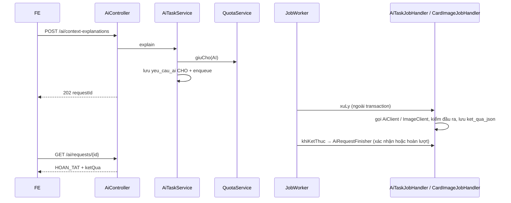

# B3.3 — Giải thích ngữ cảnh, sửa câu, ảnh AI, hạn mức dịch vụ

FR-09, TC-12 · Sprint S8 · Màn hình UI30 (giải thích), UI31 (sửa câu), UI32 (lịch sử), UI16 (R-02 tự điền thẻ), UI29 (X-03 hoàn thiện thẻ nháp, X-04 ảnh). Không có migration mới: V15 đã có loại `NGU_CANH`, `SUA_CAU`, `ANH_THE` và hạn mức `ANH`. Hoãn: `POST /ai/exercise-drafts`. Chưa làm: bộ nối Imagen thật (chỉ có `FakeImageClient`), gắn ảnh vào thẻ nháp lúc commit (FE gửi `anhId` khi tạo/sửa thẻ).

## Quyết định (16/11/2026)

| Mục | Chốt |
|---|---|
| Bất đồng bộ | Cả ba tác vụ trả 202 `{requestId, trangThai}` + header `Location`, chạy qua `tac_vu_nen` như B3.2 (loại job `AI_TAC_VU` cho giải thích/sửa câu, `AI_ANH_THE` cho ảnh). FE hỏi `GET /ai/requests/{id}` |
| Kết quả | `GET /ai/requests/{id}` thêm trường `ketQua` (JSON, `null` khi chưa `HOAN_TAT`): `NGU_CANH` → `{tu, tuLoai, phienAm, nghiaVi, giaiThich, viDuEn, dichVi, meoNho, doanLienQuan}` (tên trùng trường thẻ để tự điền); `SUA_CAU` → `{cauGoc, cauSua, dungTuMucTieu, loi: [{loai, doanGoc, doanSua, giaiThich}], nhanXet, cachDungTu}`; `ANH_THE` → `{tepId}`; `TAO_THE` → `{soThe, soBoQua, soTrung}` (tóm tắt đã có từ B3.2, nay mới hiện ra) |
| Lỗi và gợi ý | `loi[].loai` là `NGU_PHAP`/`CHINH_TA`/`TU_VUNG` (lỗi) hoặc `PHONG_CACH` (chỉ là gợi ý, TK §14.1). Mục lỗi sai cấu trúc bị bỏ; tối đa 10 |
| Kiểm đầu ra | Trường bắt buộc thiếu/rỗng/quá dài → `LOI` `SAI_SCHEMA`, hoàn lượt. `phienAm` không có dạng `/.../` → `null`; `tuLoai` ngoài danh sách → `null`. Khóa lạ (ví dụ `role`, `xp`) bị bỏ vì chỉ đọc các khóa đã biết |
| Chống chèn lệnh | Dữ liệu người học bọc trong `<tu>`, `<ngu_canh>`, `<cau>`; xóa các thẻ này khỏi dữ liệu trước khi bọc; prompt cố định có phiên bản `context-v1`, `sentence-v1`, `card-image-v1` |
| Hạn mức | Giải thích, sửa câu dùng nhóm `AI`; ảnh dùng nhóm `ANH`. Giữ lượt khi tạo yêu cầu (429 + `Retry-After` khi hết); `HOAN_TAT`/`KHONG_XAC_DINH` tính đã dùng, `LOI` hoàn lượt (chung `AiRequestFinisher` với B3.2) |
| Ảnh | `ImageClient` + `FakeImageClient` (mặc định, `IMAGE_PROVIDER=fake`): PNG 256×256 hình học theo từ, không chữ. Kiểm chữ ký PNG và ≤ 2 MB, lưu S3 `files/ai-images/{userId}/…`, tạo `tep_tin` loại `ANH` của người dùng, đã hoàn tất, nên dùng ngay được làm `anhId` khi tạo/sửa thẻ. Lỗi lưu trữ → thử lại; DB lỗi sau khi lưu → xóa đối tượng S3 |
| Lịch sử | `GET /ai/history?loai=&page=&size=` (mặc định 0/20, tối đa 100), mới nhất trước, chỉ của mình. `inputRef` = từ đã gửi (giải thích, sửa câu, ảnh) hoặc `TEXT:<hash>`/`FILE:<id>` (tạo thẻ) — không lưu nguyên văn đoạn văn/câu |
| Hạn mức hôm nay | `GET /me/service-quota` (nằm trong `/me/**`, không cần gói) trả `{goiMa, ngay, datLaiAt, hanMuc: [{loai, gioiHan, soDung, soGiu, conLai}]}` cho `AI`, `ANH`, `TTS`, `PHAT_AM`; chưa có gói → `goiMa = null`, `gioiHan = 0` |

## API

| Method / path | Request | Response |
|---|---|---|
| `POST /api/v1/ai/context-explanations` | `{tu ≤ 100, nguCanh? ≤ 1000}` | 202 `{requestId, trangThai: CHO}` |
| `POST /api/v1/ai/sentence-feedback` | `{tu ≤ 100, cau ≤ 500}` | 202 |
| `POST /api/v1/ai/card-images` | `{tu ≤ 100, nghia? ≤ 300}` | 202 |
| `GET /api/v1/ai/requests/{id}` | – | 200 `{id, loai, trangThai, maLoi, moPhong, nhaCungCap, model, phienBanPrompt, createdAt, banNhap, ketQua}`; của người khác 404 |
| `GET /api/v1/ai/history` | `loai?`, `page`, `size` | 200 `PageResponse<{id, loai, trangThai, maLoi, inputRef, moPhong, nhaCungCap, createdAt}>` |
| `GET /api/v1/me/service-quota` | – | 200 như trên |

Lỗi: 400 dữ liệu sai (không tốn lượt), 402 chưa có gói (trừ `/me/service-quota`), 429 hết lượt ngày.

## Luồng

## Kiểm chứng

- `FR09AiTaskTest` 6/6 (Testcontainers, 16/11/2026): giải thích hoàn tất và `doanLienQuan` đúng câu trong ngữ cảnh; sửa câu tách gợi ý `PHONG_CACH`; chèn lệnh không lọt khóa lạ; sai schema `LOI` hoàn lượt; timeout `KHONG_XAC_DINH` giữ lượt; ảnh lưu PNG của người dùng, dùng nhóm `ANH`, gắn được làm `anhId` khi tạo thẻ, ảnh lỗi hoàn lượt; hết hạn mức ảnh 429 nhưng AI văn bản vẫn chạy; lịch sử lọc theo loại, không lộ của người khác; `service-quota` đúng số đã dùng; dữ liệu sai 400 không tốn lượt. `FakeAiClientTest` 8/8 vẫn pass; toàn bộ `mvnw test` 524/524 pass.
- HTTP thật trên dev với Fake (16/11/2026): giải thích, sửa câu, ảnh đều `HOAN_TAT`; ảnh PNG 5.235 byte tải được qua URL ký; `GET /ai/history` có 3 mục; `GET /me/service-quota` AI 2/20, ảnh 1/10.
- Chưa gọi OpenAI thật cho hai prompt mới (chờ `OPENAI_API_KEY`); chưa có nhà cung cấp ảnh thật.
- Mockup 16/11/2026: UI30 `mockups/dot3/ai-giai-thich.html` (ngăn bên gửi `{tu, nguCanh}`, hiện `ketQua` NGU_CANH), UI31 `ai-viet-cau.html` (`{tu, cau}`, lỗi tách khỏi gợi ý `PHONG_CACH`), UI32 `ai-lich-su.html` (`GET /me/service-quota` 4 nhóm, `GET /ai/history` lọc `loai`, chi tiết qua `GET /ai/requests/{id}`). Route demo trong `mockups/shared/demo.js` giữ/xác nhận/hoàn lượt theo gói (`han_muc_dich_vu`), 400, 429 + `Retry-After`, `LOI` hoàn lượt, `KHONG_XAC_DINH` tính lượt; preview 1280 và 390 px không cuộn ngang, console sạch. Ảnh AI (UI16) chưa có route demo.
