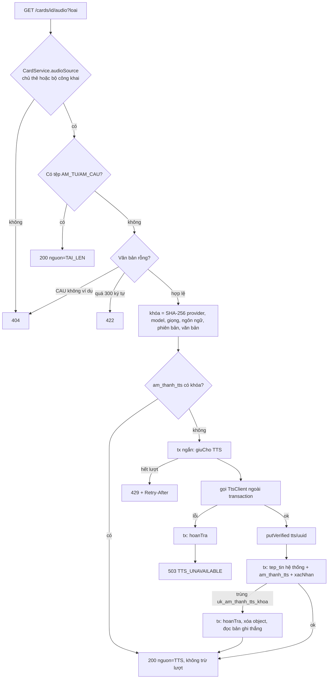

# B3.4a — Âm thanh TTS

FR-10, TC-14 (phần nghe mẫu) · Sprint S7 · Màn hình UI19 (nút loa thẻ), UI24 (bài nghe viết), X-05 (loa thẻ nháp đã lưu) · Migration `V19__tts_cache.sql`. Ngoài phạm vi: đánh giá phát âm (B3.4b), chọn giọng US/UK (chốt 14/11/2026: một giọng cố định).

## Quyết định (14/11/2026)

| Mục | Chốt |
|---|---|
| Nhà cung cấp | OpenAI `POST /audio/speech`, model `gpt-4o-mini-tts`, giọng `alloy`, `mp3`; dùng chung `OPENAI_API_KEY`, base URL và connect timeout của B3.2, read timeout riêng `app.tts.read-timeout` = 20 s |
| Giọng | Một giọng cố định, không có tham số chọn giọng |
| Hạn mức | Loại `TTS` mới: PRO 100, PREMIUM 300 lượt/ngày, chỉ tính khi cache miss. Người dùng đề xuất thêm "Miễn phí 30" nhưng TK §12 không có gói miễn phí (sửa 10/11/2026) và `ProGoiResolver` coi mọi người là PRO, nên không seed dòng miễn phí |
| Lỗi | Mọi lỗi nhà cung cấp (timeout, 5xx, 429 của nhà cung cấp, sai định dạng) → 503 `TTS_UNAVAILABLE`, hoàn lượt; ngoại lệ có chủ đích so với quy tắc `KHONG_XAC_DINH` của tác vụ nền (TK §14.2) |
| Tệp hệ thống | `tep_tin.chu_so_huu_id = NULL`; object key `tts/<uuid>` nằm ngoài các prefix `pending/`, `files/` mà job dọn tệp quét |

## API

| Method / path | Quyền | Request | Response |
|---|---|---|---|
| `GET /api/v1/cards/{id}/audio` | Đăng nhập; chủ thẻ hoặc thẻ thuộc bộ `CONG_KHAI` + `BINH_THUONG` chưa xóa | query `loai` = `TU` (mặc định) hoặc `CAU` | 200 `{id, loai, mimeType, kichThuoc, checksum, hoanTatAt, downloadUrl, expiresAt, nguon, moPhong}` |
| `GET /api/v1/practice/sessions/{id}/questions/{qid}/audio` | Chủ bài luyện | – | 200 `FileResponse` (không đổi hợp đồng) |

`nguon`: `TAI_LEN` (tệp `AM_TU`/`AM_CAU` của thẻ) hoặc `TTS`. `moPhong = true` khi sinh bằng `FakeTtsClient` → FE gắn nhãn "Mô phỏng". `downloadUrl` là URL ký, hết hạn ở `expiresAt`.

| Lỗi | Khi nào |
|---|---|
| 400 `VALIDATION_FAILED` | `loai` không phải `TU`/`CAU`; id sai định dạng |
| 401 | Chưa đăng nhập (kể cả thẻ công khai) |
| 404 `NOT_FOUND` | Thẻ không tồn tại, của người khác trong bộ riêng tư, bộ bị ẩn `DA_AN`, thẻ/bộ đã xóa mềm; `loai=CAU` khi thẻ không có `viDuEn` |
| 422 `BUSINESS_RULE` | Văn bản sau chuẩn hóa dài hơn `app.tts.max-ky-tu` (300) |
| 429 `RATE_LIMITED` + `Retry-After` | Cache miss và hết lượt `TTS` trong ngày |
| 503 `TTS_UNAVAILABLE` | Nhà cung cấp lỗi/timeout/sai định dạng; lượt đã hoàn. FE chuyển sang Web Speech |
| 503 `DEPENDENCY_DOWN` | Kho tệp lỗi khi lưu tệp TTS; lượt đã hoàn |

## Thành phần

| Thành phần | Vai trò |
|---|---|
| `speaking/client`: `TtsClient`, `OpenAiTtsClient`, `FakeTtsClient`, `TtsResult`, `TtsException` | Chọn bằng `app.tts.provider` (`openai`/`fake`, mặc định `fake`). Fake sinh WAV 0,3 s hợp lệ, `moPhong = true`; chế độ `app.tts.fake.che-do` hoặc marker `#mo-phong:LOI|TIMEOUT|SAI_DINH_DANG|CHAM` trong văn bản |
| `speaking/config`: `TtsProperties`, `TtsConfig` | `app.tts.*` (provider, model, giọng, ngôn ngữ, phiên bản `tts-v1`, `max-ky-tu`, `max-bytes`, `read-timeout`, fake); `RestClient` `openAiTtsRestClient`; thiếu khóa khi `provider=openai` → không khởi động |
| `speaking/service/TtsService` | Luồng chính, `Propagation.NEVER` để không bao giờ gọi mạng trong transaction |
| `speaking/entity/AmThanhTts` + `AmThanhTtsRepository` | Bảng cache `am_thanh_tts` |
| `speaking/controller/CardAudioController`, `CardAudioMapper`, `CardAudioResponse` | Endpoint thẻ |
| `content/service/CardService.audioSource` | Kiểm quyền thẻ, trả `{tu, viDuEn, amTuId, amCauId}` |
| `content/service/FileService.createSystemAudio` / `linkedFile` | Ghi tệp hệ thống (transaction bắt buộc) / ký URL tệp đã được kiểm quyền qua thẻ |
| `practice/service/PracticeGenerator`, `PracticeService.audio` | `NGHE_VIET` không loại thẻ thiếu âm thanh; audio câu hỏi rơi về TTS |

## Luồng

## Quy tắc

- Chuẩn hóa: `CardText.term` (NFC, gộp khoảng trắng). `tu = "  receipt "` và `"receipt"` dùng chung một cache; đổi `tu`/`viDuEn` đổi khóa nên sinh tệp mới, tệp cũ vẫn ở cache cho thẻ khác cùng nội dung.
- Cache không chứa người dùng hay thẻ: hai người học cùng từ dùng chung một tệp, người thứ hai không mất lượt.
- Song song: hai request cùng khóa đều có thể gọi nhà cung cấp, nhưng unique `uk_am_thanh_tts_khoa` chỉ cho một bản ghi; bên thua rollback, hoàn lượt, xóa object vừa tải và trả tệp bên thắng. Kết quả: một `tep_tin`, một lượt `so_dung`.
- Metadata: nhà cung cấp, model, giọng, ngôn ngữ, phiên bản, độ dài văn bản, thời gian gọi (ms) lưu ở `am_thanh_tts` và log `TTS generated`; không log văn bản, URL ký hay khóa API.
- Tệp hệ thống: `GET/DELETE /files/{id}` → 404 (lọc theo chủ sở hữu); `CardService` không cho gắn tệp có chủ khác người gọi nên không gắn được tệp TTS vào thẻ.
- `NGHE_VIET`: thẻ không có `AM_TU` cho `deBai = {amThanhTts: true, tuLoai}`; thẻ có `AM_TU` giữ `{amTuId, tuLoai}`. Audio câu hỏi đọc lại quyền thẻ lúc gọi, nên thẻ đã xóa → 404. Hết lượt/lỗi TTS trả 429/503 như endpoint thẻ; nộp bài và SRS không phụ thuộc TTS.
- Thư viện mẫu R-01: thẻ trong bộ công khai đọc được bởi mọi người dùng đăng nhập; lượt đầu tiên của mỗi nội dung tốn một lượt của người gọi.

## Kiểm chứng

`FR10TtsTest` (7 test, Testcontainers MySQL/Redis/RustFS) + `FR07PracticeSessionTest` cập nhật cho `NGHE_VIET`:

| Test | Nội dung |
|---|---|
| `tc14_cacheMissGeneratesOnceAndIsSharedAcrossCards` | Miss tốn 1 lượt, hit không tốn; thẻ người khác cùng nội dung dùng chung tệp; `CAU` là khóa khác; tệp hệ thống `chu_so_huu_id NULL`, `/files/{id}` GET/DELETE → 404 |
| `tc14_changedContentGeneratesNewAudio` | Đổi `tu` → tệp mới, lượt thứ hai |
| `tc14_uploadedAudioIsPreferred` | `AM_TU` tải lên được trả, không tốn lượt; `CAU` chưa có tệp → TTS |
| `tc14_accessRulesHideForeignPrivateAndDeletedCards` | 404 thẻ riêng tư người khác, `CAU` không ví dụ, bộ `DA_AN`, thẻ xóa mềm; 400 `loai` sai; 401 chưa đăng nhập; thẻ công khai đọc được |
| `tc14_quotaExhaustedReturns429AndFailuresRefund` | `LOI`/`TIMEOUT` → 503 `TTS_UNAVAILABLE`, `so_giu = so_dung = 0`; hết lượt → 429 + `Retry-After` |
| `tc14_parallelRequestsCreateOneFile` | Hai luồng cùng khóa (Fake `CHAM` 400 ms) → một tệp, một lượt, `so_giu = 0` |
| `tc14_listeningPracticeUsesTtsForCardsWithoutAudio` | 5 thẻ không âm thanh → 5 câu `amThanhTts`, audio câu hỏi trả WAV, không lộ từ |

Chưa kiểm chứng: một lượt gọi OpenAI TTS thật (cần `TTS_PROVIDER=openai` + `OPENAI_API_KEY`).
