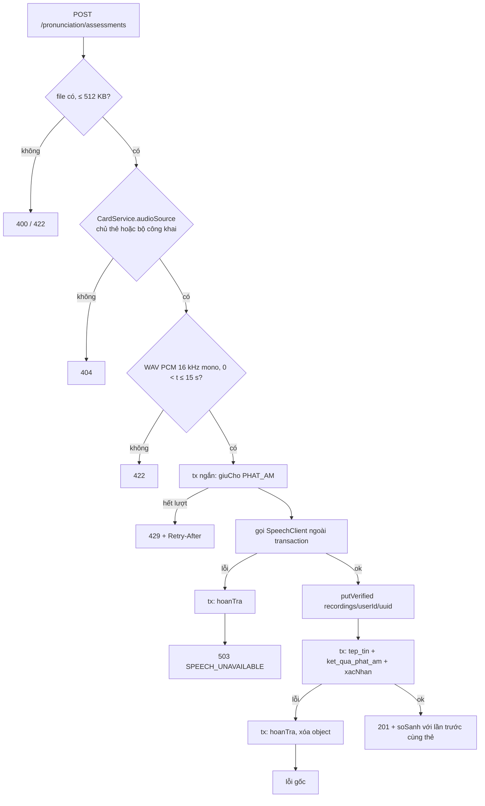

# B3.4b — Đánh giá phát âm

FR-10, TC-14 (phần ghi âm và đánh giá) · Sprint S9 · Màn hình UI33 (góc phát âm), UI34 (lịch sử/so sánh) · Migration `V20__speaking.sql`. Phần nghe mẫu thuộc [B3.4a](B3.4a-am-thanh-tts.md). Ngoài phạm vi: biểu đồ tiến bộ (bản gọn S9 chỉ so sánh 2 lần gần nhất), ghi `loi_hoc_tap` nhóm `PHAT_AM`, bật `PHAT_AM_THAP` của B3.5, tự xóa bản ghi theo thời hạn, đánh giá câu ví dụ.

## Quyết định (14/11/2026)

| Mục | Chốt |
|---|---|
| Nhà cung cấp | Azure Speech REST short audio (`/speech/recognition/conversation/cognitiveservices/v1`, header `Pronunciation-Assessment`, thang `HundredMark`, độ chi tiết `Word`, `EnableMiscue`), không thêm SDK; `FakeSpeechClient` mặc định, bật Azure bằng `SPEECH_PROVIDER=azure` + `AZURE_SPEECH_KEY` + `AZURE_SPEECH_REGION` (mặc định `southeastasia`). Khóa chỉ đọc từ biến môi trường |
| Hạn mức | Loại `PHAT_AM` mới: PRO 30, PREMIUM 100 lượt/ngày; chỉ tính khi đã gọi nhà cung cấp và lưu được kết quả |
| Định dạng | Chỉ nhận WAV PCM 16 kHz, 16 bit, một kênh (định dạng Azure REST nhận trực tiếp), > 0 và ≤ 15 giây, ≤ 512 KB. BE tự đọc header RIFF, không tin MIME trình duyệt gửi. FE ghi bằng Web Audio rồi đóng gói WAV (MediaRecorder mặc định ra WebM/Opus, BE không nhận) |
| Đồng bộ | Gọi trong request như TTS, không qua `tac_vu_nen`; mọi lỗi nhà cung cấp (kể cả timeout) → 503 `SPEECH_UNAVAILABLE`, hoàn lượt, không lưu bản ghi hay kết quả |
| Văn bản mẫu | Chỉ `tu` của thẻ qua `CardText.term`, ≤ 100 ký tự; không nhận văn bản tự do từ client |
| Cờ gói `phat_am` | TK §6.9 yêu cầu kiểm cờ `goi_dich_vu.phat_am`, nhưng bảng gói chưa có (B3.12a). Hiện mọi người dùng là PRO qua `ProGoiResolver`; B3.12a thêm kiểm cờ trước `giuCho` |

## API

| Method / path | Quyền | Request | Response |
|---|---|---|---|
| `POST /api/v1/pronunciation/assessments` | Đăng nhập + CSRF; chủ thẻ hoặc thẻ thuộc bộ `CONG_KHAI` + `BINH_THUONG` chưa xóa | multipart: `theId` (form field), `file` (WAV) | 201 `PronunciationResponse` |
| `GET /api/v1/pronunciation/assessments/{id}` | Chủ kết quả | – | 200 `PronunciationResponse` |
| `GET /api/v1/pronunciation/history` | Đăng nhập | query `theId?`, `page` (0), `size` (20, ≤ 100) | 200 `PageResponse<PronunciationHistoryItem>`, mới nhất trước |
| `DELETE /api/v1/pronunciation/recordings/{id}` | Chủ bản ghi; `id` = `ghiAm.id` | – | 204; kết quả và chỉ số giữ nguyên, `ghiAm` thành `null` |

`PronunciationResponse`: `{id, theId, vanBanMau, ngonNgu, nhaCungCap, moPhong, trangThai, chiSo, thoiLuongGhiMs, ghiAm, soSanh, createdAt}`.

- `chiSo`: `{tongDiem, doChinhXac, doTroiChay, doDayDu, vanBanNhanDien, tu: [{tu, doChinhXac, loi}]}`; mỗi chỉ số là số 0–100 hoặc `null` khi dịch vụ không trả (không bao giờ sinh điểm giả). `loi`: `KHONG`/`SAI`/`BO_SOT`/`THUA`/`KHAC`.
- `trangThai`: `DAY_DU` (đủ 4 chỉ số), `THIEU_CHI_SO` (thiếu ít nhất một), `KHONG_NHAN_DIEN` (không nghe được tiếng nói, cả 4 là `null`; vẫn tốn lượt vì đã gọi dịch vụ).
- `ghiAm`: `FileResponse` của bản ghi (URL ký để nghe lại) hoặc `null` khi đã xóa.
- `soSanh`: `null` ở lần đầu của thẻ; sau đó `{lanTruocId, lanTruocAt, cungThangDo, tongDiem, doChinhXac, doTroiChay, doDayDu}` là chênh lệch so với lần ngay trước cùng thẻ. `cungThangDo = false` khi khác nhà cung cấp hoặc khác `moPhong` → mọi chênh lệch `null`; chỉ số thiếu ở một trong hai lần → chênh lệch đó `null`.
- `moPhong = true` khi chấm bằng `FakeSpeechClient` → FE gắn nhãn "Mô phỏng".

`PronunciationHistoryItem`: `{id, theId, vanBanMau, nhaCungCap, moPhong, trangThai, tongDiem, doChinhXac, doTroiChay, doDayDu, tepGhiAmId, createdAt}`; gồm cả kết quả của thẻ đã xóa (minh chứng). `theId` của người khác → trang rỗng.

| Lỗi | Khi nào |
|---|---|
| 400 `VALIDATION_FAILED` | Thiếu `file`/`theId`, `theId` sai định dạng, query lịch sử sai |
| 401 / 403 `CSRF_INVALID` | Chưa đăng nhập / thiếu CSRF ở POST, DELETE |
| 404 `NOT_FOUND` | Thẻ người khác trong bộ riêng tư, bộ ẩn, thẻ/bộ đã xóa; kết quả của người khác; bản ghi đã xóa hoặc không phải của mình |
| 422 `BUSINESS_RULE` | Không phải WAV PCM 16 kHz/16 bit/mono, rỗng, > 15 giây, > 512 KB; `tu` > 100 ký tự |
| 429 `RATE_LIMITED` + `Retry-After` | Hết lượt `PHAT_AM` trong ngày |
| 503 `SPEECH_UNAVAILABLE` | Nhà cung cấp lỗi/timeout/trả sai định dạng; lượt đã hoàn, không lưu gì |
| 503 `DEPENDENCY_DOWN` | Kho tệp lỗi khi lưu bản ghi; lượt đã hoàn |

## Thành phần

| Thành phần | Vai trò |
|---|---|
| `speaking/client`: `SpeechClient`, `AzureSpeechClient`, `FakeSpeechClient`, `SpeechResult`, `SpeechException` | Chọn bằng `app.speech.provider` (`azure`/`fake`, mặc định `fake`). Azure: 5xx → `NCC_LOI_5XX`, 429 → `NCC_GIOI_HAN`, 4xx khác → `NCC_TU_CHOI`, mất kết nối/timeout → `TIMEOUT`, JSON hỏng/`RecognitionStatus` lỗi → `SAI_DINH_DANG`/`NCC_TRANG_THAI_LOI`; `NoMatch`, `InitialSilenceTimeout`, `BabbleTimeout` → không có chỉ số. Đọc điểm ở `NBest[0].PronunciationAssessment.*` hoặc `NBest[0].*`, bỏ giá trị không phải số hoặc ngoài 0–100, tối đa 50 từ. Fake: điểm 60–95 theo nội dung tệp, chế độ `app.speech.fake.che-do` hoặc marker `#mo-phong:THIEU_CHI_SO|KHONG_NHAN_DIEN|LOI|TIMEOUT` trong `tu` |
| `speaking/config`: `SpeechProperties`, `SpeechConfig` | `app.speech.*`; `RestClient` `azureSpeechRestClient` (base `https://<region>.stt.speech.microsoft.com`, header `Ocp-Apim-Subscription-Key`); thiếu khóa hoặc region sai khi `provider=azure` → không khởi động |
| `speaking/service/PronunciationService` | Luồng chính, `Propagation.NEVER` |
| `speaking/service/WavAudio` | Đọc chunk RIFF `fmt `/`data`, kiểm PCM 16 kHz/16 bit/mono, tính thời lượng |
| `speaking/entity/KetQuaPhatAm` + `KetQuaPhatAmRepository` | Bảng `ket_qua_phat_am` |
| `speaking/controller/PronunciationController` + DTO `PronunciationResponse`, `PronunciationHistoryItem`, `PronunciationHistoryQuery`, `ChiSoPhatAm`, `ChiSoTu`, `SoSanhPhatAm` | Bốn endpoint |
| `content/service/FileService.createRecording` / `ownedFile`, `TepTin.recording` | Ghi tệp bản ghi thuộc người dùng (transaction bắt buộc) / ký URL khi tệp còn hiệu lực |

## Luồng

Xóa bản ghi: transaction khóa dòng `ket_qua_phat_am` theo (người dùng, `tep_ghi_am_id`), đặt `tep_ghi_am_id = NULL`, rồi `FileService.delete` đánh dấu `DA_XOA` và xóa object. Tệp bị xóa trước qua `DELETE /files/{id}` thì `ghiAm` tự thành `null`.

## Quy tắc

- Không lưu điểm khi lỗi: lỗi nhà cung cấp không tạo `ket_qua_phat_am`, không tải bản ghi lên kho, hoàn lượt.
- Bản ghi là tệp của người dùng (`chu_so_huu_id` = người học, `loai = AM_THANH`, object key `recordings/<userId>/<uuid>` ngoài prefix job dọn tệp quét). Người dùng xóa được bằng endpoint riêng hoặc `DELETE /files/{id}`.
- Dữ liệu gửi Azure: tệp WAV và `tu` của thẻ; không gửi email, tên hay ID người dùng. Log chỉ ghi nhà cung cấp, trạng thái, thời lượng; không log văn bản, URL ký hay khóa.
- Metadata lưu: nhà cung cấp, `mo_phong`, ngôn ngữ `en-US`, thời lượng bản ghi, thời gian gọi dịch vụ (ms).
- So sánh trước–sau chỉ giữa hai lần gần nhất cùng người dùng, cùng thẻ; không tính chênh lệch khi khác thang đo hoặc thiếu chỉ số (TK §9.6, §14.1).

## Kiểm chứng

`FR10PronunciationTest` (5 test, Testcontainers MySQL/Redis/RustFS) + `AzureSpeechClientTest` (3 test thuần, parse JSON Azure):

| Test | Nội dung |
|---|---|
| `tc14_assessmentStoresScoresRecordingAndComparesWithPreviousAttempt` | 201 `DAY_DU`, `moPhong`, `ghiAm` có URL, lần 2 có `soSanh` đúng chênh lệch, tệp thuộc người học, GET người khác 404, lịch sử lọc `theId`, người khác trang rỗng |
| `tc14_missingMetricsAreNotInventedOrCompared` | `THIEU_CHI_SO` giữ `null`, so sánh chỉ số thiếu → `null`; `KHONG_NHAN_DIEN` cả 4 `null` |
| `tc14_invalidRecordingsAndForeignCardsAreRejectedWithoutQuota` | Thiếu tệp 400; không phải WAV, 8 kHz, stereo, 15,1 s → 422; thẻ riêng tư người khác 404; 401; không tốn lượt; thẻ công khai 15 s được chấm |
| `tc14_serviceFailuresRefundAndQuotaExhaustionReturns429` | `LOI`/`TIMEOUT` → 503, `so_dung = so_giu = 0`, không có dòng/tệp; hết lượt → 429 + `Retry-After` |
| `tc14_deletingRecordingKeepsScores` | Người khác 404; chủ 204; `ghiAm` null, chỉ số giữ, tệp `DA_XOA`; xóa lại 404 |
| `AzureSpeechClientTest` (3) | Điểm lồng `PronunciationAssessment`, giá trị sai/ngoài thang → `null`, `NoMatch` không điểm, `Error`/JSON không phải object bị từ chối |

Toàn bộ `mvnw verify` 507/507 pass (14/11/2026, trước khi đổi tên `coGhiAm` → `tepGhiAmId`; sau đổi chạy lại hai lớp test trên pass).

Chưa kiểm chứng: một lượt gọi Azure Speech thật (cần `SPEECH_PROVIDER=azure`, `AZURE_SPEECH_KEY`, `AZURE_SPEECH_REGION`), gọi HTTP thật.
