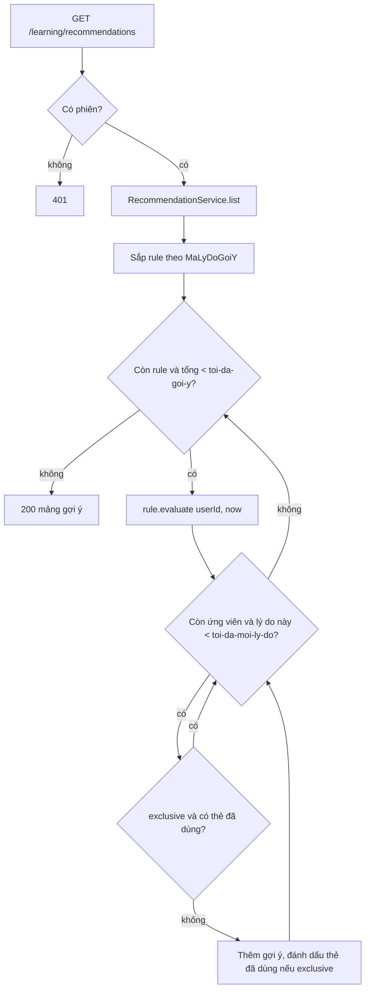

# B3.5 — Gợi ý có lý do

FR-08 · Sprint S8 · UI28 (khối gợi ý trên `/hom-nay` và `/so-tay`) · FE F3.4. API: `GET /api/v1/learning/recommendations`. Không migration.

## Phạm vi và quyền

| Mục | Giá trị |
|---|---|
| Endpoint | `GET /api/v1/learning/recommendations` → 200, mảng `[{reasonCode, message, cardIds, evidence}]`; chưa có dữ liệu → `[]` |
| Quyền | Cần đăng nhập (401 khi không có phiên). Chỉ đọc dữ liệu của người gọi: thẻ phải thuộc bộ của chính họ, chưa xóa, không `TAM_NGUNG` |
| Ghi dữ liệu | Không ghi gì. Có thể tạo `ho_so_hoc_tap` mặc định qua `SettingsService.learning` (giống `/learning/today`), nên transaction không đặt `readOnly` |
| Module | `practice` (cùng nơi với `/learning/confusing-pairs` và sổ tay B2.9); `QUA_HAN_NHIEU` gọi `LearningPlanService.overdue` của module `learning` |
| Không làm | `PHAT_AM_THAP` chưa có rule (chờ B3.4b dùng dịch vụ thật); không đổi lịch SRS (TC-10) |

## Thành phần

| Thành phần | Vai trò |
|---|---|
| `RecommendationController` | `GET /api/v1/learning/recommendations` |
| `RecommendationService` | Duyệt rule theo thứ tự `MaLyDoGoiY`, giới hạn mỗi lý do và tổng, loại trùng thẻ |
| `RecommendationRule` | Giao diện chung: `code()`, `evaluate(userId, now)` |
| `ForgettingRule` | `QUEN_NHIEU` từ `SoTayTuKhoRepository.lapseStats` |
| `SpellingRule` | `SAI_CHINH_TA` từ `spellingStats` (mới) |
| `ConfusingPairRule` | `CAP_DE_NHAM` từ `pairStats`, bỏ cặp bị ẩn khỏi sổ tay |
| `OverdueRule` | `QUA_HAN_NHIEU` từ `LearningPlanService.overdue` (mới) |
| `ProgressRule` + `ProgressPolicy` | `TIEN_BO` (R-04) từ `progressStats` (mới); ngưỡng trong lớp thuần để B3.9 dùng lại |
| `RecommendationCards` | Lọc thẻ dùng được và lấy `tu` cho message |
| `RecommendationProperties`, `NotebookProperties`, `RecommendationConfig` | Ngưỡng `app.recommendations.*` và `app.notebook.*` |
| `RecommendationResponse`, `RecommendationEvidenceResponse` | DTO; `evidence` bỏ trường `null` |

## Quy tắc từng mã lý do

| Mã | Điều kiện | Nguồn | `evidence` | Message mẫu |
|---|---|---|---|---|
| `QUEN_NHIEU` | ≥ `app.notebook.quen-nhieu` (3) lượt Quên từ `ON_TAP` trong `quen-nhieu-ngay` (30) ngày, sau mốc ẩn sổ tay | `lich_su_on` ⋈ `tien_do_the` | `soLanQuen`, `soNgay`, `lanCuoiAt` | Ôn lại ‘receipt’ và thêm mẹo nhớ: bạn quên 3 lần trong 30 ngày qua |
| `SAI_CHINH_TA` | ≥ `chinh-ta-sai` (2) lỗi `CHINH_TA` trong `chinh-ta-luot` (5) lượt nhập gần nhất, câu bỏ trống không tính | `tra_loi_bai_luyen` ⋈ `lan_lam_bai` ⋈ `cau_hoi_bai_luyen` | `soSai`, `soLuot`, `lanCuoiAt` | Luyện viết ‘receipt’ vì bạn viết sai 3 trong 5 lượt gần đây |
| `CAP_DE_NHAM` | `so_lan_nham ≥ cap-nham` (2), cả hai thẻ dùng được và không bị ẩn sau lần nhầm cuối | `cap_tu_de_nham` | `capId`, `soLanNham`, `lanCuoiAt` | Phân biệt ‘affect’ và ‘effect’: bạn chọn nhầm 3 lần |
| `QUA_HAN_NHIEU` | `soQuaHan > phutMoiNgay×60/20`, đúng điều kiện bật `cuuLichOn` của `/learning/today` | `tien_do_the`, `ho_so_hoc_tap` | `soQuaHan`, `soDenHan`, `luotMoiNgay`, `phutMoiNgay`, `soNgayKeHoach` | Bạn có 120 lượt ôn quá hạn, nhiều hơn 30 lượt mỗi ngày với 10 phút học. Chia kế hoạch cứu lịch trong 5 ngày |
| `TIEN_BO` | Cửa sổ cũ `[now−30d, now−7d)`: ≥ 5 lượt, ≥ 3 sai, tỷ lệ sai ≥ 0.5; cửa sổ mới `[now−7d, now)`: ≥ 5 lượt, ≤ 0 sai | `lich_su_on` (Quên = sai) ∪ `tra_loi_bai_luyen` (`dung = false` = sai) | `soLuotCu`, `soSaiCu`, `soNgayCu`, `soLuotMoi`, `soDungMoi`, `soNgayMoi`, `lanCuoiAt` | ‘reimbursement’: sai 3/5 lượt trước đó, đúng 5/5 lượt trong 7 ngày gần đây |
| `PHAT_AM_THAP` | Chưa bật (`app.recommendations.phat-am-thap.enabled: false`) | B3.4b | `diem`, `diemToiThieu`, `lanCuoiAt` (dành sẵn) | — |

Một gợi ý ứng với một thẻ; `CAP_DE_NHAM` ứng với một cặp (2 `cardIds`); `QUA_HAN_NHIEU` tối đa một gợi ý, `cardIds` là tối đa `toi-da-the-qua-han` (20) thẻ quá hạn lâu nhất.

## Luồng

Thứ tự ưu tiên: `QUEN_NHIEU` → `SAI_CHINH_TA` → `CAP_DE_NHAM` → `PHAT_AM_THAP` → `QUA_HAN_NHIEU` → `TIEN_BO`. Mặc định `toi-da-moi-ly-do = 2`, `toi-da-goi-y = 10`, nên tối đa 2+2+2+1+2 = 9 gợi ý và `TIEN_BO` không bị cắt. `QUA_HAN_NHIEU` có `exclusive = false`: không chiếm thẻ và không bị loại trùng.

## Quyết định (chốt 12/11/2026, đề xuất)

1. TK §8.3 `QUA_HAN_NHIEU` sửa thành "vượt số lượt ôn mỗi ngày theo cài đặt", dùng chung điều kiện với `cuuLichOn` (B2.6) để UI12 không mâu thuẫn.
2. `reasonCode`, `cardIds`, `evidence` giữ tên tiếng Anh vì đã ghi trong roadmap, SPRINT_PLAN và báo cáo bàn giao; trường bên trong `evidence` dùng tiếng Việt.
3. "Sai" của `TIEN_BO`: lượt ôn `QUEN`, câu luyện `dung = false` (câu bỏ trống tính sai, như B2.8). Ngưỡng `TIEN_BO` cấu hình ở `app.recommendations.tien-bo.*`; `so-ngay-cu` phải lớn hơn `so-ngay-moi`, sai thì ứng dụng không khởi động.
4. Ba mã đầu dùng chung ngưỡng `app.notebook.*` với sổ tay (đọc qua `NotebookProperties`), nên sổ tay UI27 và gợi ý không lệch nhau.
5. Loại trùng theo thứ tự ưu tiên: một thẻ vừa `QUEN_NHIEU` vừa `TIEN_BO` chỉ hiện `QUEN_NHIEU`. B3.9 dùng `ProgressPolicy` trực tiếp, không qua bước loại trùng.

## Kiểm chứng

| Test | Nội dung |
|---|---|
| `ProgressPolicyTest` (8) | Biên đủ ngưỡng, thiếu lượt cũ, thiếu lỗi cũ, tỷ lệ 3/6 đạt và 3/7 không đạt, thiếu lượt mới, có 1 lỗi mới, cửa sổ thời gian, cấu hình chồng cửa sổ |
| `RecommendationServiceTest` (5) | Rỗng, thứ tự + trần mỗi lý do, loại trùng, `QUA_HAN_NHIEU` không loại trùng, trần tổng |
| `RecommendationRulesTest` (5) | Từng rule với repository giả: ngưỡng, lọc thẻ, message, evidence |
| `FR08RecommendationTest` (3) | User rỗng → `[]`, 401; QUEN_NHIEU + CAP_DE_NHAM + TIEN_BO với dữ liệu thật, bỏ thẻ đã xóa và thẻ chỉ có 4 lượt mới, user khác → `[]` (TC-02); `QUA_HAN_NHIEU` khớp `cuuLichOn` và không đổi `han_on_at` (TC-10) |

Kết quả 12/11/2026: 21 test mới và `FR08NotebookTest` (4) pass; toàn bộ `mvnw test` 452/452 pass. Chưa gọi HTTP thật trên dev. `SAI_CHINH_TA` chỉ có unit test với repository giả; câu SQL `spellingStats` dùng lại điều kiện của `spellingCardIds` (B2.9) nhưng chưa có test tích hợp riêng.
