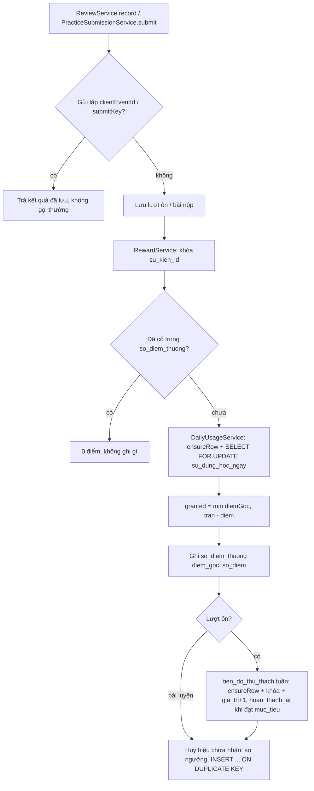

# B3.6 — Điểm thưởng, chuỗi ngày, huy hiệu, thử thách

FR-12, TC-15 · Sprint S8 · UI38 `/thanh-tich`, chuỗi ngày + ngày đóng băng trên UI12 (R-03) · FE F3.6. API: `GET /api/v1/rewards/history`, `GET /api/v1/badges`, `GET /api/v1/challenges`; mở rộng `GET /api/v1/learning/today`. Migration `V16__engagement.sql`.

## Phạm vi và quyền

| Mục | Giá trị |
|---|---|
| Endpoint | 3 `GET` mới, đều 200; cần đăng nhập, chỉ đọc dữ liệu của chính người gọi (không có ID trên đường dẫn) |
| Bảng ghi | `so_diem_thuong`, `nguoi_dung_huy_hieu`, `tien_do_thu_thach`, `su_dung_hoc_ngay.diem` |
| Bảng đọc | `huy_hieu`, `thu_thach` (seed cố định), `su_dung_hoc_ngay` (chuỗi ngày) |
| Cấu hình | `app.rewards.diem-toi-da-ngay` (`REWARD_DAILY_CAP`, mặc định 100), `diem-moi-luot-on` 1, `diem-moi-cau-dung` 1 |
| Không làm (Cắt) | CRUD `/admin/badges`, `/admin/challenges`, UI54; huy hiệu/thử thách không cộng điểm |

## Thành phần

| Thành phần | Vai trò |
|---|---|
| `RewardService` (`engagement`) | Ghi sổ điểm, áp trần, cộng tiến độ thử thách, trao huy hiệu; `Propagation.MANDATORY` |
| `DailyUsageService` (`learning`) | Khóa dòng `su_dung_hoc_ngay` của ngày rồi cộng điểm trong trần |
| `StreakCalculator` | Logic thuần: chuỗi ngày + ngày đóng băng theo tuần thứ Hai–Chủ nhật |
| `StreakService` | Đọc ngày đủ ≥ 5 lượt rồi gọi `StreakCalculator`; dùng chung cho `/learning/today`, `/statistics/overview`, huy hiệu `CHUOI_NGAY` |
| `EngagementService`, `EngagementController`, `EngagementMapper` | 3 API đọc |
| `ReviewService` (B2.4), `PracticeSubmissionService` (B2.8) | Gọi `RewardService` trong cùng transaction sau khi đã lưu |

## Luồng ghi thưởng (trong transaction của lượt ôn / nộp bài)

| Sự kiện | `loai_su_kien` | `su_kien_id` | `diem_goc` |
|---|---|---|---|
| Lượt ôn | `ON_THE` | `tienDoId:ngàyĐịaPhương` (ngày theo múi giờ của phiên) | 1; các lượt sau của cùng thẻ/chiều trong ngày không ghi |
| Nộp bài | `BAI_LUYEN` | `lanLamBaiId` | số câu đúng × 1; bài luyện lại = 0 (ngày theo múi giờ người dùng lúc nộp) |

Vì sao chung transaction, không sau commit: chỉ là ghi DB, không gọi mạng; lượt ôn rollback thì điểm rollback; không cần outbox/job bù. Replay trả về trước khi gọi thưởng; unique `uk_sdt_su_kien` là lớp chặn thứ hai. Trần không bị vượt khi ghi đồng thời vì mọi lần cộng điểm đều khóa dòng ngày.

## Chuỗi ngày và ngày đóng băng (R-03)

- Ngày hợp lệ: `su_dung_hoc_ngay.so_luot_hop_le ≥ 5` (giữ cách B2.2).
- Đi lùi từ hôm nay (hoặc hôm qua nếu hôm nay chưa đủ). Ngày thiếu đầu tiên trong một tuần được đóng băng; ngày thiếu thứ hai trong cùng tuần đứt chuỗi. Ngày đóng băng không cộng vào số chuỗi.
- `daDungNgayNghiTuanNay`/`ngayNghiDaDung` chỉ báo ngày đóng băng nằm trong tuần hiện tại và đã được nối bởi một ngày hợp lệ phía trước.
- Đổi múi giờ: ngày đã lưu muộn hơn hôm nay theo múi giờ mới được coi là hôm nay (sửa lỗi B2.2 làm mất một ngày).

| Ví dụ (hôm nay) | Ngày hợp lệ | Kết quả |
|---|---|---|
| T4 21/10 | 21, 19 | chuỗi 2, nghỉ 20/10 |
| T5 22/10 | 22, 19 | chuỗi 1 (nghỉ 20 và 21 cùng tuần) |
| T3 20/10 | 20, 17 | chuỗi 2 (nghỉ CN 18 tuần trước + T2 19 tuần này) |

## API

| API | Response 200 |
|---|---|
| `GET /rewards/history?page=0&size=20` | `{tongDiem, diemHomNay, diemToiDaNgay, lichSu: {items: [{id, loaiSuKien, diemGoc, soDiem, ngayDiaPhuong, createdAt}], page, size, totalElements, totalPages}}`; mới nhất trước |
| `GET /badges` | `[{id, ma, ten, moTa, loaiDieuKien, nguong, daNhan, nhanAt}]` theo `thu_tu` |
| `GET /challenges` | `[{id, ma, ten, moTa, loaiDieuKien, chuKy, mucTieu, giaTri, tuanBatDau, tuanKetThuc, hoanThanhAt}]` tuần hiện tại theo múi giờ người dùng; chưa có tiến độ → `giaTri = 0`, `hoanThanhAt = null` |
| `GET /learning/today` (thêm) | `daDungNgayNghiTuanNay` (boolean), `ngayNghiDaDung` (ngày hoặc `null`) |

Lỗi: 401 chưa đăng nhập; 400 `VALIDATION_FAILED` khi `page < 0`, `size` ngoài 1–100.

## Kiểm chứng

- `StreakCalculatorTest` (13), `FR12RewardTest` (6): lượt ôn gửi lặp và bước học lại chỉ thưởng 1 lần; trần 100 điểm (sự kiện bị cắt ghi `so_diem = 0`); nộp bài gọi lặp và luyện lại không cộng; huy hiệu `BUOC_DAU`, `CHUOI_3` và thử thách tuần sau 5 lượt; ngày đóng băng đọc từ DB; 401/400.
- Hồi quy B2.x: xem báo cáo [Sprint 3](../../ban-giao-cho%20fe/SPRINT_3_BAO_CAO_BE_BAN_GIAO_CHO_FE.md) mục 10.
- Chưa: HTTP thật trên môi trường dev; "qua nửa đêm" chỉ kiểm qua cách gán ngày của B2.2 (TC-09) và test thuần, chưa có test tích hợp với đồng hồ cố định cho lượt ôn lúc 23:59/00:01.
