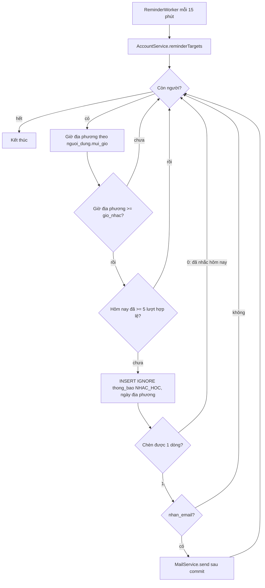

# B3.7 — Thông báo và nhắc học

FR-12, TC-15 · Sprint S8 · UI39 chuông + `/thong-bao` · FE F3.7. API: `GET /api/v1/notifications`, `PATCH /api/v1/notifications/{id}`. Migration `V17__notification.sql`.

## Phạm vi và quyền

| Mục | Giá trị |
|---|---|
| Endpoint | `GET` danh sách (200), `PATCH` đánh dấu đọc/chưa đọc (200); cần đăng nhập; chỉ thông báo của chính người gọi, ID của người khác → 404 |
| Bảng ghi | `thong_bao` |
| Bảng đọc | `nguoi_dung` (trạng thái, múi giờ), `cai_dat_thong_bao` (kênh, `nhac_hoc`, `gio_nhac`), `su_dung_hoc_ngay` (lượt hợp lệ hôm nay) |
| Cấu hình | `app.reminders.enabled` (`REMINDERS_ENABLED`, test = `false`), `interval-ms` 900000 (15 phút), `initial-delay-ms` 60000 |
| Không làm | `POST /admin/announcements` (Cắt), web push + PWA (Hoãn), link ngừng nhận 1 chạm có token |
| Để B3.12b dùng | Loại `GOI_SAP_HET_HAN`, `GOI_DA_HET_HAN`; `NotificationService.create(...)` (`Propagation.MANDATORY`) |

## Thành phần

| Thành phần | Vai trò |
|---|---|
| `ReminderWorker` | `@Scheduled` mỗi 15 phút, tắt bằng `app.reminders.enabled=false` |
| `ReminderService.run(now)` | Lấy danh sách người cần xét, gọi `remind` từng người; lỗi một người chỉ ghi log, lần chạy sau thử lại |
| `AccountService.reminderTargets()` | User `HOAT_DONG`, `nhac_hoc = true`, có `gio_nhac`, còn ít nhất một kênh |
| `NotificationService.remind` | Một transaction/người: kiểm giờ, kiểm lượt, `INSERT IGNORE`, gửi email nếu chèn được |
| `DailyUsageService.validReviews` | Số lượt hợp lệ của ngày địa phương (B2.2) |
| `MailService` → `MailDispatcher` | Email gửi sau commit (`AFTER_COMMIT`, `@Async`) |
| `NotificationController`, `NotificationMapper` | 2 API |

## Luồng nhắc học



## Quy tắc

| Quy tắc | Cách làm | Nguồn |
|---|---|---|
| Nhắc theo giờ và múi giờ | Đổi `now` sang `mui_gio` của User; gửi ở lần chạy đầu tiên khi giờ địa phương ≥ `gio_nhac` (trễ tối đa ~15 phút) | TK §15.2 |
| Chống trùng | Unique `(nguoi_dung_id, loai, ngay_dia_phuong)` + `INSERT IGNORE`; email chỉ gửi khi chèn được dòng, nên chạy lại hay chạy song song không gửi lại | TK §15.2, TC-15 |
| Đã hoàn thành thì không nhắc | Hôm nay đã ≥ 5 lượt hợp lệ (cùng ngưỡng chuỗi ngày B3.6) | TK §15.1, §15.2 |
| Tôn trọng kênh | `nhan_trong_ung_dung = false` → vẫn ghi dòng chống trùng với `hien_thi = false`, API không trả; `nhan_email = false` → không gửi email; `nhac_hoc = false` hoặc tắt cả hai kênh → không xét | TK §15.2 |
| Tài khoản đang xóa/bị khóa | Chỉ xét `HOAT_DONG` | TK §15.2 |
| Ngừng nhận email | Email có link tới `/ca-nhan/thong-bao` để tắt | TK §15.2 |
| Đổi múi giờ | Ngày địa phương lấy theo múi giờ lúc chạy; đổi múi giờ trong ngày có thể nhận thêm một nhắc cho ngày địa phương mới | — |

## API

`GET /api/v1/notifications?chuaDoc=false&page=0&size=20`

```json
{
  "soChuaDoc": 1,
  "thongBao": {
    "items": [{
      "id": "12", "loai": "NHAC_HOC", "tieuDe": "Đến giờ ôn từ vựng",
      "noiDung": "Hôm nay bạn đã ôn 2/5 lượt. Ôn thêm vài thẻ để giữ chuỗi ngày học.",
      "lienKet": "/hom-nay", "ngayDiaPhuong": "2026-11-11", "daDocAt": null,
      "createdAt": "2026-11-11T13:00:04.120Z"
    }],
    "page": 0, "size": 20, "totalElements": 1, "totalPages": 1
  }
}
```

`PATCH /api/v1/notifications/{id}` body `{"daDoc": true}` → `NotificationResponse`. `daDoc: false` đặt lại chưa đọc. Đánh dấu đọc lần hai giữ nguyên `daDocAt` cũ.

| Lỗi | Khi nào |
|---|---|
| 401 `UNAUTHENTICATED` | Chưa đăng nhập |
| 400 `VALIDATION_FAILED` | `daDoc` thiếu; `size` ngoài 1–100; `page` âm |
| 404 `NOT_FOUND` | ID không tồn tại, của người khác hoặc `hien_thi = false` |
| 403 `CSRF_INVALID` | `PATCH` thiếu XSRF |

## Kiểm thử

`FR12NotificationTest` (4, Testcontainers, `MailService` giả lập để đếm email):

| Test | Kiểm |
|---|---|
| `tc15_rerunningReminderJobCreatesOneNotificationAndOneEmail` | Chạy 3 lần trong ngày → 1 thông báo, 1 email; ngày sau → thêm 1 |
| `tc15_skipsBeforeReminderTimeAfterGoalOrWhenDisabled` | Chưa tới giờ, đã đủ 5 lượt, tắt nhắc, tài khoản `DANG_XOA` → không gì |
| `tc15_respectsChannelsAndLocalTimezone` | Chỉ email → có email, API không trả; chỉ trong ứng dụng → không email; New York lấy đúng ngày địa phương |
| `fr12_markReadOwnNotificationOnly` | 401, 404 người khác, 400 thiếu `daDoc`, đọc/chưa đọc, lọc `chuaDoc` |

Lưu ý khi viết test: ghi `gio_nhac` qua `SettingsService` hoặc API, không qua JDBC thô — `hibernate.jdbc.time_zone=UTC` làm giá trị `TIME` ghi thô bị đọc lệch giờ.
