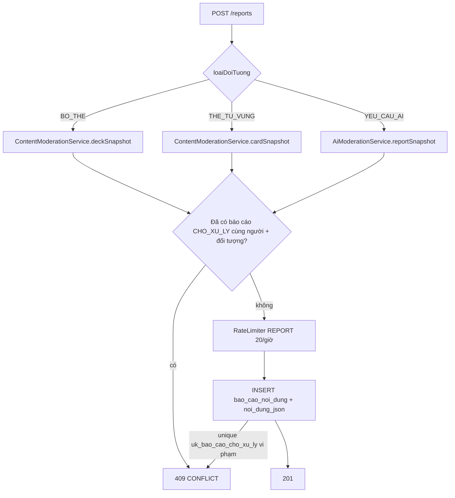
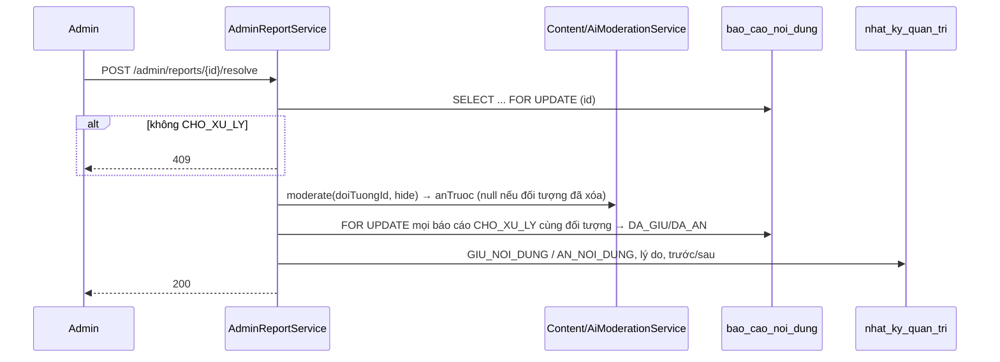

# B3.8 — Báo cáo nội dung và kiểm duyệt (FR-13, gọn)

Trạng thái 16/11/2026: code xong, `FR13ModerationTest` 4/4 pass, toàn bộ `mvnw test` 540/540 pass; đã gọi HTTP thật trên dev (16/11/2026), chưa Postman. Phạm vi gọn S9: chỉ **giữ** hoặc **ẩn**; trạng thái "yêu cầu sửa", "từ chối" và thông báo cho người liên quan là hướng phát triển (TK §6.8).

## 1. API và quyền

| Method / path | Quyền | Request | Response |
|---|---|---|---|
| `POST /api/v1/reports` | Đăng nhập, **không cần gói** (bỏ khỏi `SubscriptionGuard`) | `{loaiDoiTuong: BO_THE\|THE_TU_VUNG\|YEU_CAU_AI, doiTuongId, lyDo: SAI_NOI_DUNG\|KHONG_PHU_HOP\|KHAC, moTa (10–500)}` | 201 `{id, loaiDoiTuong, doiTuongId, lyDo, moTa, trangThai: CHO_XU_LY, createdAt}` |
| `GET /api/v1/admin/reports` | ADMIN | `?trangThai=&loaiDoiTuong=&page=0&size=20` (size 1–100) | `PageResponse<AdminReportResponse>`: `id, loaiDoiTuong, doiTuongId, lyDo, moTa, noiDung (bản chụp JSON), trangThai, nguoiBaoCao{id,tenHienThi}, nguoiXuLy{id,tenHienThi}\|null, lyDoXuLy, xuLyAt, createdAt` |
| `POST /api/v1/admin/reports/{id}/resolve` | ADMIN | `{quyetDinh: GIU\|AN, lyDo (10–500)}` | 200 `AdminReportResponse` sau xử lý |

Thứ tự hàng đợi: `trangThai=CHO_XU_LY` cũ trước (FIFO); lọc khác hoặc không lọc thì mới trước.

## 2. Gửi báo cáo

Điều kiện đối tượng:

| Loại | Báo cáo được khi | Lỗi |
|---|---|---|
| `BO_THE` | Bộ chưa xóa, `CONG_KHAI` + `BINH_THUONG`, không phải của người báo cáo | Của mình → 422; riêng tư/đã ẩn/không có → 404 |
| `THE_TU_VUNG` | Thẻ chưa xóa, chưa bị ẩn, thuộc bộ như trên | Như trên |
| `YEU_CAU_AI` | Yêu cầu AI của chính người báo cáo, `HOAN_TAT`, chưa bị ẩn | Người khác/không có → 404; chưa hoàn tất → 422 |

Bản chụp `noi_dung_json` (TK §6.8 bước 2 "lưu nội dung tham chiếu") giữ nội dung lúc báo cáo để Admin xem dù chủ sở hữu sửa sau: bộ (`ten, moTa, boMau, chuSoHuuId`), thẻ (`ten, tu, tuLoai, nghiaVi, phienAm, viDuEn, dichVi, boTheId, chuSoHuuId`), AI (`ten, loai, inputRef, nhaCungCap, model, phienBanPrompt, ketQua, banNhap`). Admin chỉ xem nội dung gắn báo cáo, không đọc được dữ liệu riêng khác (TC-17).

Chống trùng: cột sinh `khoa_cho_xu_ly = 1` khi `CHO_XU_LY`, NULL khi đã xử lý; unique `(nguoi_bao_cao_id, loai_doi_tuong, doi_tuong_id, khoa_cho_xu_ly)`. Sau khi báo cáo đã xử lý `DA_GIU`, người dùng được báo cáo lại (ví dụ chủ bộ sửa nội dung sau đó); chặn spam bằng giới hạn 20 báo cáo/giờ/người.

## 3. Xử lý

- Một quyết định áp cho **mọi** báo cáo đang chờ của cùng đối tượng (người xử lý, lý do, `xu_ly_at` giống nhau); nhật ký ghi `sau.baoCaoIds`.
- Nhật ký: `loai_doi_tuong` = loại nội dung (`YEU_CAU_AI` mới thêm), `doi_tuong_id` = ID nội dung, `ten_doi_tuong` = `noiDung.ten`; `truoc = {trangThai: CHO_XU_LY, anKiemDuyet}`, `sau = {trangThai, anKiemDuyet, baoCaoIds}`. `anKiemDuyet = null` khi đối tượng đã bị xóa (vẫn cho xử lý báo cáo).
- `GIU` không đổi nội dung, kể cả khi nội dung đã bị ẩn trước đó (không tự hiện lại).

Tác dụng của `AN`:

| Loại | Thay đổi | Ảnh hưởng |
|---|---|---|
| `BO_THE` | `bo_the.trang_thai_kiem_duyet = DA_AN` | Rời thư viện, chi tiết thư viện 404, không sao chép/yêu thích được (đã có từ B2.11). Chủ vẫn thấy và học bộ. Bộ mẫu hiện lại qua `PATCH /admin/decks/{id}`; bộ người học chưa có đường hiện lại (cắt) |
| `THE_TU_VUNG` | `the_tu_vung.an_kiem_duyet = true` | Không còn trong chi tiết thư viện, `soThe` thư viện, tệp thư viện (404), âm thanh của người khác, bản sao mới. Chủ vẫn thấy, sửa, học thẻ; bản sao đã tạo trước đó không đổi |
| `YEU_CAU_AI` | `yeu_cau_ai.an_kiem_duyet = true` | `GET /ai/requests/{id}` trả `ketQua = null`, `banNhap = []`, `anKiemDuyet = true`; commit thẻ nháp → 422; `GET /ai/history` có `anKiemDuyet` |

Bằng chứng gốc vẫn còn ở `noi_dung_json` của báo cáo.

## 4. Schema `V25__moderation.sql`

- Bảng `bao_cao_noi_dung` (CHECK loại, lý do, trạng thái, `mo_ta` 10–500; CHECK nhất quán: `CHO_XU_LY` thì chưa có người/lý do/thời điểm xử lý, đã xử lý thì đủ cả ba). Index `(trang_thai, created_at)` (TK §12.4) và `(loai_doi_tuong, doi_tuong_id, trang_thai)`.
- `the_tu_vung.an_kiem_duyet`, `yeu_cau_ai.an_kiem_duyet` (BOOLEAN, mặc định FALSE).
- CHECK `nhat_ky_quan_tri`: thêm hành động `GIU_NOI_DUNG`, `AN_NOI_DUNG` và loại `YEU_CAU_AI`.

## 5. Thành phần

| Lớp | File |
|---|---|
| Controller | `moderation/controller/ReportController`, `AdminReportController` |
| Service | `moderation/service/ReportService`, `AdminReportService`; `content/service/ContentModerationService`; `ai/service/AiModerationService` |
| Entity/Repo | `moderation/entity/BaoCaoNoiDung` (+ enum `LoaiDoiTuongBaoCao`, `LyDoBaoCao`, `TrangThaiBaoCao`, `QuyetDinhBaoCao`), `BaoCaoNoiDungRepository` |
| Sửa | `TheTuVung`, `TheTuVungRepository` (lọc thẻ ẩn), `LibraryService`, `LibraryMediaService`, `CardService.audioSource`, `YeuCauAi`, `AiRequestResponse`, `AiHistoryItem`, `CardDraftService`, `CardDraftCommitService`, `RateLimiter.Policy.REPORT`, `BillingConfig`, enum nhật ký |

## 6. Kiểm chứng

`FR13ModerationTest` (16/11/2026, Testcontainers): báo cáo bộ của mình 422, bộ riêng tư/không có 404, gửi trùng 409, người khác báo cáo cùng bộ 201; learner gọi Admin 403; lý do xử lý ngắn 400; ẩn → cả 2 báo cáo `DA_AN`, thư viện 404, chủ thấy `DA_AN`, nhật ký `AN_NOI_DUNG` đủ trước/sau + `baoCaoIds`, xử lý lại 409; thẻ: giữ một thẻ, ẩn một thẻ → thư viện còn 2/3 thẻ và `soThe = 2`, chủ còn 3; AI: của người khác 404, chưa hoàn tất 422, ẩn → `ketQua = null`; validation `moTa`, loại sai 400, chưa đăng nhập 401.

Mockup UI45/UI50 đọc route demo đúng DTO (16/11/2026). HTTP thật trên dev 16/11/2026: 201, 409, 400, 403, `GIU` 200, xử lý lại 409. Chưa: Postman.

## 7. Giới hạn đã biết

- Người dùng không xem được lịch sử báo cáo của mình và không nhận thông báo kết quả (cắt cùng thông báo; mockup UI45 đang có khối "Báo cáo đã gửi của bạn").
- Chưa có gợi ý phân loại bằng AI (TK §6.8 bước 4 [Thiết kế]).
- Báo cáo của tài khoản đã xóa (B3.10) được giữ (người dùng đã ẩn danh); `mo_ta` là văn bản người dùng tự nhập.
